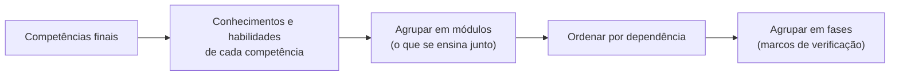

# Desenho pedagógico: como montar o sumário

Leia este arquivo antes de propor o sumário (etapa 2 da skill).

## Sumário

1. Comece pelo fim: as competências
2. Das competências aos módulos
3. Quantos módulos? (não há número fixo)
4. Sequência e fases
5. Trilhas contínuas e projeto final
6. Carga horária realista
7. Formato do sumário para aprovação
8. Erros comuns de desenho

---

## 1. Comece pelo fim: as competências

Um bom curso não começa pela lista de assuntos, e sim pela pergunta: **"ao final, o que a pessoa consegue fazer que hoje não consegue?"** (é o chamado desenho reverso, ou *backward design*).

Escreva de 3 a 6 **competências finais**, cada uma com um verbo de ação observável:

| Fraco (não dá para verificar) | Forte (dá para verificar) |
|---|---|
| "Entender finanças" | "Montar o fluxo de caixa de 12 meses de uma empresa real e apontar os 3 maiores riscos" |
| "Saber marketing digital" | "Planejar, publicar e analisar um mês de conteúdo com metas de alcance e mensagens" |
| "Conhecer Python" | "Escrever um script que lê uma planilha, calcula indicadores e envia um relatório por e-mail" |

Cada competência vira, no fim, **uma prova no portfólio** (um entregável real). Se não dá para imaginar a prova, a competência ainda está vaga.

## 2. Das competências aos módulos

Para cada competência, liste:
- **Conhecimentos** necessários (conceitos, vocabulário, princípios).
- **Habilidades** práticas (o que a pessoa precisa saber fazer com as mãos).
- **Pré-requisitos** (o que precisa vir antes).

Depois agrupe conhecimentos e habilidades que **se ensinam juntos** em módulos. Um módulo é uma unidade com começo, meio e fim: termina com um entregável que prova uma parte da competência.

Faça a pergunta de dependência para cada par de módulos: "dá para fazer o módulo B sem ter feito o A?". Isso define a ordem.



## 3. Quantos módulos? (não há número fixo)

O número de módulos é **consequência** do conteúdo necessário, nunca uma meta. Um curso de "Excel para o financeiro" pode ter 5 módulos; um de "tornar-se especialista em engenharia de dados" pode ter 20.

Use estas referências para dimensionar cada módulo:
- **1 a 3 semanas** de estudo por módulo, com 8 a 10 horas por semana (ajuste ao tempo que a pessoa informou).
- **5 a 10 aulas** de conteúdo por módulo, mais exercícios, tarefa, entregável e autoavaliação.
- Um módulo que passaria de 3 semanas deve ser dividido. Dois módulos de 1 semana muito ligados podem ser unidos.

Se a pessoa informou pouco tempo disponível, **não corte módulos essenciais**: alongue o calendário e diga isso no sumário. A prioridade é o aprendizado real, não caber em um prazo artificial.

## 4. Sequência e fases

Agrupe os módulos em **fases**, e termine cada fase com um **marco de verificação** ("ao fim desta fase você deve conseguir...").

Princípios de sequência:
- **Do concreto ao abstrato, do simples ao complexo.** Primeiro a pessoa faz algo útil com o básico; depois aprofunda.
- **Vitória cedo.** Algo útil e aplicável já no primeiro ou segundo módulo, para manter a motivação.
- **Prática espaçada.** Conceitos importantes reaparecem em módulos posteriores, aplicados a situações novas.
- **Um módulo pode ser dividido em partes** estudadas em momentos diferentes, quando metade do assunto só faz sentido depois de outros módulos (no arquivo, use `# PARTE A:` e `# PARTE B:`).

## 5. Trilhas contínuas e projeto final

**Trilha contínua:** uma competência que se desenvolve ao longo de toda a formação, e não em um bloco (ex.: comunicar, publicar conteúdo, praticar um idioma, montar portfólio). Vira um arquivo próprio, estudado em paralelo, com marcos em cada fase.

**Projeto final integrador:** quase sempre presente. É a aplicação de todas as competências juntas em um caso novo, com critérios de aprovação claros. É o que transforma "estudei" em "sei fazer".

**Glossário:** sempre que houver vocabulário técnico (quase sempre). Cada termo aponta para a aula onde é explicado.

**Modelos prontos (templates):** quando os entregáveis se beneficiam de um formato padrão (relatório, planilha, roteiro, checklist). Crie só os que os entregáveis realmente pedem.

## 6. Carga horária realista

Estime por módulo: horas de leitura + horas de exercícios + horas de tarefa prática + horas do entregável. Some e compare com o tempo semanal informado para chegar ao número de semanas.

Regra prática para formações práticas: **cerca de 30% do tempo em leitura e 70% em prática**. Se o seu sumário dá mais tempo à leitura que à prática, revise.

## 7. Formato do sumário para aprovação

Apresente o sumário **na conversa**, em Markdown, neste formato:

```markdown
# [Título da formação]

**Para quem:** [perfil, em uma frase]
**Ao final, você será capaz de:**
1. [competência com verbo de ação]
2. ...

**Duração:** [N] semanas · [X] a [Y] horas por semana · cerca de [Z] horas no total

## Fase 1 · [nome] (semanas 1 a N)
**Marco:** ao fim desta fase você consegue [...]

### M1 · [Título do módulo] (semanas 1 e 2)
- Aula 1.1: [título]
- Aula 1.2: [título]
- ...
- **Entregável:** [o que a pessoa produz]

### M2 · ...

## Fase 2 · ...

## Trilha contínua: [nome] (se houver)
## Projeto final: [descrição em 2 linhas]
## Apoio: guia de estudo, glossário, [N] modelos prontos ([lista])
```

Depois do sumário, pergunte de forma direta se a pessoa aprova, quer acrescentar, retirar ou reordenar algo. Só comece a escrever as aulas depois da aprovação.

## 8. Erros comuns de desenho

| Erro | Sintoma | Correção |
|---|---|---|
| Lista de assuntos sem competências | Módulos que "cobrem" temas mas não levam a nenhuma capacidade | Volte ao passo 1 |
| Número de módulos escolhido antes do conteúdo | Módulos inchados ou com enchimento | Dimensione pelo conteúdo |
| Teoria demais no início | Primeiras semanas sem nada aplicável | Traga uma vitória prática para o M1 ou M2 |
| Entregáveis vagos ("estudar o capítulo") | Nada no portfólio no fim | Cada módulo termina com um produto concreto |
| Ignorar o tempo da pessoa | Calendário impossível | Ajuste o número de semanas, não o conteúdo essencial |
| Avançado demais para o nível informado | Abandono | Acrescente um módulo de fundamentos |
