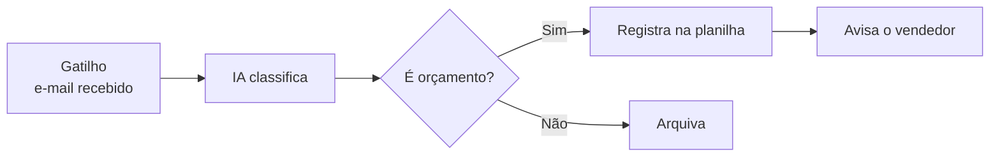

# Esquemas visuais (Mermaid)

Leia este arquivo antes de escrever o primeiro esquema. O site desenha cada bloco ` ```mermaid ` como um esquema com as cores do tema (claro e escuro). O GitHub também desenha esses blocos.

## Quando um esquema vale a pena

Desenhe quando o esquema mostra algo que o texto sozinho obriga a pessoa a montar na cabeça:
- um **fluxo ou processo** (passos, decisões, laços);
- uma **comparação** (antes × depois, opção A × opção B);
- uma **hierarquia ou composição** (camadas, partes de um todo);
- uma **sequência no tempo** (cronograma, etapas de um projeto);
- uma **conversa entre partes** (cliente, sistema, pessoa);
- uma **priorização** (matriz de 4 quadrantes).

Não desenhe o que uma frase diz mais rápido, nem esquemas decorativos com caixas soltas sem relação.

Depois de cada esquema, escreva uma legenda em itálico que diz **o que o esquema mostra** (não "Figura 1"):
```markdown
*Figura: o laço de geração. O modelo constrói a resposta um pedaço por vez.*
```

## Tipos que funcionam bem (testados)

| Tipo | Uso | Primeira linha |
|---|---|---|
| Fluxograma | Processos, decisões, arquiteturas | `flowchart LR` (horizontal) ou `flowchart TB` (vertical) |
| Sequência | Conversas entre partes | `sequenceDiagram` |
| Matriz de quadrantes | Priorização (impacto × esforço, risco) | `quadrantChart` |
| Linha do tempo | Cronogramas, roadmaps | `timeline` |
| Mapa mental | Panorama de um tema | `mindmap` |
| Pizza | Proporções simples | `pie showData` |
| Barras | Comparar poucos valores | `xychart-beta` |

## Regras de sintaxe (evitam esquemas quebrados)

1. **Textos com acento, espaço, parênteses ou pontuação vão entre aspas duplas.** Em fluxogramas: `A["Cálculo do preço (R$)"]`. Isso é obrigatório no `quadrantChart`: títulos, eixos, quadrantes e pontos precisam de aspas, senão o esquema não desenha:
   ```
   quadrantChart
       title "Matriz Impacto x Esforço"
       x-axis "Esforço baixo" --> "Esforço alto"
       y-axis "Impacto baixo" --> "Impacto alto"
       quadrant-1 "Projetos estratégicos"
       quadrant-2 "Quick wins"
       quadrant-3 "Complementares"
       quadrant-4 "Evite por ora"
       "Follow-up automático": [0.22, 0.72]
   ```
2. **Quebra de linha dentro de caixa:** use `<br/>`.
3. **Rótulos nas setas** dizem o que a seta significa: `A -->|"envia o pedido"| B`.
4. **Evite `;` dentro de textos de `sequenceDiagram`**: o ponto e vírgula encerra a instrução.
5. **IDs de nós sem acento e sem espaço** (`CL`, `orc1`); o texto com acento fica entre aspas no rótulo.
6. **Vários nós de uma vez:** `A & B & C --> D` funciona.
7. **Agrupamentos:** `subgraph ID["Título com acento"]` ... `end`.
8. Mantenha cada esquema com até cerca de 12 caixas. Se precisar de mais, divida em dois esquemas.
9. **Não defina cores** nos esquemas (`style`, `classDef`): o site aplica as cores do tema e elas funcionam no modo claro e no escuro.

## Exemplo de fluxograma bem feito

````markdown


*Figura: a anatomia de uma automação. O gatilho inicia, a IA classifica e o filtro decide o caminho.*
````

## Verificação

Depois de gerar o site, rode `scripts/check_site.py`: ele abre cada aula e informa qualquer esquema que não desenhou, com as primeiras linhas do esquema para você localizar e corrigir.
