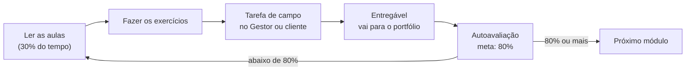

# Guia da formação

**Do Zero ao Sistema em Produção com Claude** · 38 semanas · cerca de 420 horas

## Para que serve esta formação

Você já usa IA para escrever código, mas hoje é ela quem decide: "vamos hospedar aqui", "agora instale isso". Esta formação inverte essa relação. Ao final, **quem decide é você**, e o Claude vira o seu time de programadores: rápido, incansável e sob a sua supervisão.

Você vai aprender a:

1. **Transformar** a necessidade de um cliente (ou da sua operação) em uma especificação com escopo, modelo de dados e arquitetura antes de escrever qualquer código.
2. **Conduzir** o Claude com o método de um programador sênior: especificação, plano, passos pequenos, testes, revisão e Git.
3. **Construir** sistemas web completos com banco de dados, login, permissões, várias empresas no mesmo sistema (multi-tenant) e cobrança recorrente automática.
4. **Colocar no ar e operar** o sistema com domínio, HTTPS, deploy automático, backups testados e monitoramento.
5. **Proteger** o sistema contra os ataques mais comuns, cuidar das chaves e senhas, cumprir a LGPD e ter um plano para incidentes.
6. **Explicar ao cliente por que o sistema é confiável**, oferecer manutenção com SLA e **cobrar o preço certo**.

> 🎯 **Os três medos que esta formação resolve**
> 1. **"E se o sistema cair?"** → Módulos 12 e 15: deploy seguro, monitoramento, backup testado, plano de recuperação.
> 2. **"E se vazar os dados?"** → Módulos 9, 13 e 14 + a trilha "Segurança desde o 1º dia", que atravessa a formação inteira.
> 3. **"E se o cliente perguntar sobre manutenção?"** → Módulo 16 (planos de manutenção e SLA) e Módulo 17 (o Dossiê de Confiança e as perguntas difíceis do cliente).

## O projeto-guia: o Gestor

Em vez de exercícios soltos, você constrói **um sistema real, um pedaço por módulo**: o **Gestor**, um SaaS de CRM com financeiro simples e atendimento por WhatsApp.

- Várias empresas usam o mesmo sistema, cada uma vendo só os próprios dados (**multi-tenant**).
- Cada empresa tem equipe com papéis: dono, gerente e atendente.
- Cada empresa paga uma assinatura mensal, cobrada sozinha (cartão, Pix ou boleto), e o acesso é liberado ou bloqueado automaticamente.
- O sistema tem cadastro de clientes, funil de vendas, contas a receber e a pagar, e conversa pelo WhatsApp.

O Gestor é o **molde** de quase tudo que você vai vender: um ERP é um Gestor com estoque e notas fiscais; um sistema de atendimento é um Gestor com mais foco em conversas; um financeiro é o módulo financeiro do Gestor ampliado. Quem constrói o Gestor de ponta a ponta sabe construir todos eles.

## Como a formação funciona

Cada módulo segue o mesmo ciclo:

*Figura: o ciclo de cada módulo. Você só avança quando a autoavaliação mostra que aprendeu.*

**Em cada aula:** explicação em partes, exemplo concreto (geralmente o Gestor ou um cliente fictício realista), esquemas quando há um mecanismo para mostrar, quadro "Em resumo" e links oficiais para ir além.

**Em cada módulo:** exercícios com passo a passo, uma tarefa de campo, um entregável com checklist de qualidade, uma autoavaliação com gabarito e um **checklist de segurança do módulo** (parte da trilha de segurança).

## O que você precisa antes de começar

- Um computador com Windows, macOS ou Linux, com pelo menos 8 GB de memória.
- Uma conta no GitHub (gratuita).
- Uma assinatura do Claude que inclua o Claude Code (consulte os planos em claude.com; eles mudam com frequência).
- Um cartão de crédito para serviços de hospedagem (a maioria tem plano gratuito ou de poucos dólares; você só paga quando decidir).
- Disposição para **ler o que o Claude escreve**. Você não precisa saber programar no começo, mas vai aprender a ler código. Esse é o ponto de virada.

## A stack desta formação

Você vai aprender a **escolher** a stack (Módulo 6). Para não se perder no começo, a formação usa uma **stack padrão**, escolhida por ser popular, bem documentada e muito bem conhecida pelo Claude:

| Camada | Escolha padrão | Alternativas que você vai conhecer |
|---|---|---|
| Linguagem | TypeScript | Python, PHP |
| Aplicação web | Next.js (React) | Remix, Laravel, Django |
| Banco de dados | PostgreSQL | MySQL, SQLite |
| Acesso ao banco | Prisma | Drizzle |
| Validação | Zod | Valibot |
| Login | Better Auth | Supabase Auth, Clerk |
| Pagamentos | Asaas, Mercado Pago e Stripe (os três) | Pagar.me, Iugu |
| Testes | Vitest e Playwright | Jest, Cypress |
| Hospedagem | PaaS (Vercel, Railway, Render) **e** VPS com Docker | Coolify, AWS |

## Mapa da formação

| Fase | Semanas | Módulos | Marco ao final |
|---|---|---|---|
| **1 · Fundamentos e método** | 1–6 | M1 Como um sistema funciona · M2 Ambiente profissional · M3 Programar com o Claude como sênior | Você entende o que roda onde e já publicou um app feito com o Claude, versionado no GitHub |
| **2 · Da ideia ao projeto** | 7–12 | M4 Da ideia à especificação · M5 Banco de dados · M6 Arquitetura e stack | Você transforma uma ideia em um documento técnico que o Claude consegue seguir |
| **3 · Construindo o sistema** | 13–22 | M7 Backend e APIs · M8 Frontend · M9 Login, permissões e multi-tenant · M10 Pagamentos · M11 Integrações | O Gestor funciona com login, várias empresas isoladas, cobrança automática e WhatsApp |
| **4 · Produção blindada** | 23–32 | M12 Hospedagem e deploy · M13 Proteger a aplicação · M14 Proteger dados, servidor e LGPD · M15 Confiabilidade | O Gestor está no ar, seguro, com backup testado e monitoramento |
| **5 · O negócio de sistemas** | 33–36 | M16 Manutenção e suporte · M17 Precificar, vender e explicar a confiança | Você sabe quanto custa, quanto cobrar e como provar que o sistema é confiável |
| **Projeto final** | 37–38 | Sistema real do zero à produção | Um sistema entregue a um cliente real ou à sua operação |

**Trilhas contínuas** (estude em paralelo, do início ao fim):
- [Segurança desde o 1º dia](trilha-seguranca-desde-o-dia-1.md): o hábito de segurança aplicado em cada módulo.
- [Portfólio e diário de decisões](trilha-portfolio-e-decisoes.md): o registro que vira o seu material de vendas.

## Modelos prontos

| Modelo | Para quê | Usado no módulo |
|---|---|---|
| [CLAUDE.md](templates/claude-md.md) | Regras do projeto que o Claude sempre segue | M2, M3 |
| [Especificação](templates/especificacao.md) | O documento que descreve o que será construído | M4 |
| [ADR](templates/adr.md) | Registro de decisão de arquitetura | M6 |
| [Checklist de segurança](templates/checklist-seguranca.md) | Conferência antes de todo deploy importante | M13, M14 |
| [Checklist de deploy](templates/checklist-deploy.md) | Colocar no ar sem susto | M12 |
| [Checklist de entrega ao cliente](templates/checklist-entrega.md) | Nada esquecido na entrega | M16, Final |
| [Dossiê de Confiança](templates/dossie-de-confianca.md) | Explicar ao cliente por que o sistema é confiável | M17 |
| [Perguntas difíceis do cliente](templates/perguntas-dificeis-do-cliente.md) | Respostas honestas e seguras | M17 |
| [Plano de resposta a incidente](templates/plano-de-incidente.md) | "Vazou ou caiu: e agora?" | M14, M15 |
| [Runbook de operação](templates/runbook.md) | Procedimentos passo a passo para problemas comuns | M15 |
| [Planos de manutenção](templates/planos-de-manutencao.md) | Básico, padrão e premium | M16 |
| [SLA](templates/sla.md) | O que você garante e em quanto tempo | M16 |
| [Calculadora de preço](templates/calculadora-de-preco.md) | Quanto custa e quanto cobrar | M17 |
| [Proposta comercial](templates/proposta-comercial.md) | O documento que fecha o negócio | M17 |
| [Contrato](templates/contrato.md) | Base de contrato de desenvolvimento e manutenção | M17 |

## Cronograma semana a semana

Marque cada semana ao concluir. O progresso fica salvo no navegador que você usa.

### Fase 1 · Fundamentos e método
- [ ] Semana 1 · M1: aulas 1.1 a 1.3 + exercícios 1 e 2
- [ ] Semana 2 · M1: aulas 1.4 e 1.5 + primeiro app no ar + entregável e autoavaliação
- [ ] Semana 3 · M2: aulas 2.1 a 2.3 + instalação completa do ambiente
- [ ] Semana 4 · M2: aulas 2.4 a 2.6 + repositório do Gestor criado + autoavaliação
- [ ] Semana 5 · M3: aulas 3.1 a 3.3 + exercícios de prompt e contexto
- [ ] Semana 6 · M3: aulas 3.4 a 3.6 + primeira funcionalidade com testes + autoavaliação · **Marco da Fase 1**

### Fase 2 · Da ideia ao projeto
- [ ] Semana 7 · M4: aulas 4.1 a 4.3 + entrevista de descoberta
- [ ] Semana 8 · M4: aulas 4.4 e 4.5 + especificação do Gestor + autoavaliação
- [ ] Semana 9 · M5: aulas 5.1 a 5.3 + exercícios de SQL
- [ ] Semana 10 · M5: aulas 5.4 a 5.6 + modelo de dados do Gestor + autoavaliação
- [ ] Semana 11 · M6: aulas 6.1 a 6.3 + matriz de decisão
- [ ] Semana 12 · M6: aulas 6.4 a 6.6 + documento de arquitetura + autoavaliação · **Marco da Fase 2**

### Fase 3 · Construindo o sistema
- [ ] Semana 13 · M7: aulas 7.1 a 7.3
- [ ] Semana 14 · M7: aulas 7.4 a 7.6 + módulo de clientes e financeiro com testes
- [ ] Semana 15 · M8: aulas 8.1 a 8.3
- [ ] Semana 16 · M8: aulas 8.4 a 8.6 + interface do Gestor
- [ ] Semana 17 · M9: aulas 9.1 a 9.3
- [ ] Semana 18 · M9: aulas 9.4 a 9.6 + Gestor multi-empresa com papéis
- [ ] Semana 19 · M10: aulas 10.1 a 10.3
- [ ] Semana 20 · M10: aulas 10.4 a 10.7 + cobrança automática funcionando
- [ ] Semana 21 · M11: aulas 11.1 a 11.3
- [ ] Semana 22 · M11: aulas 11.4 a 11.6 + WhatsApp integrado · **Marco da Fase 3**

### Fase 4 · Produção blindada
- [ ] Semana 23 · M12: aulas 12.1 a 12.3 + Gestor em uma PaaS
- [ ] Semana 24 · M12: aulas 12.4 a 12.7 + VPS do zero + deploy automático
- [ ] Semana 25 · M13: aulas 13.1 a 13.3
- [ ] Semana 26 · M13: aulas 13.4 a 13.6 + auditoria da aplicação
- [ ] Semana 27 · M14: aulas 14.1 a 14.3
- [ ] Semana 28 · M14: aulas 14.4 a 14.6 + plano de incidente + inventário LGPD
- [ ] Semana 29 · M15: aulas 15.1 a 15.3
- [ ] Semana 30 · M15: aulas 15.4 a 15.6 + monitoramento e alertas
- [ ] Semana 31 · M15: simulação de desastre (restaurar backup do zero)
- [ ] Semana 32 · Revisão geral da Fase 4 + runbook completo · **Marco da Fase 4**

### Fase 5 · O negócio de sistemas
- [ ] Semana 33 · M16: aulas 16.1 a 16.3
- [ ] Semana 34 · M16: aulas 16.4 a 16.6 + planos de manutenção e SLA
- [ ] Semana 35 · M17: aulas 17.1 a 17.3 + calculadora de preço
- [ ] Semana 36 · M17: aulas 17.4 a 17.6 + Dossiê de Confiança e proposta · **Marco da Fase 5**

### Projeto final
- [ ] Semana 37 · Descoberta, especificação, arquitetura e construção
- [ ] Semana 38 · Deploy, auditoria, dossiê, proposta e apresentação

## Marcos de verificação

Antes de mudar de fase, confira se consegue fazer cada item **sem ajuda**:

**Fase 1**
- [ ] Explicar, com um desenho, o que acontece entre digitar um endereço no navegador e a página aparecer.
- [ ] Criar um repositório, fazer commits, abrir e mesclar um pull request.
- [ ] Pedir uma funcionalidade ao Claude usando o ciclo especificação → plano → passos → testes → revisão.

**Fase 2**
- [ ] Conduzir uma entrevista de descoberta e escrever uma especificação com critérios de aceite.
- [ ] Desenhar o modelo de dados de um CRM ou ERP simples.
- [ ] Justificar por escrito a escolha de stack e hospedagem de um projeto.

**Fase 3**
- [ ] Mostrar que um usuário da Empresa A não consegue, de jeito nenhum, ver dados da Empresa B.
- [ ] Mostrar uma assinatura sendo cobrada, o pagamento confirmado por webhook e o acesso liberado sozinho.

**Fase 4**
- [ ] Fazer um deploy sem derrubar o sistema e voltar à versão anterior em poucos minutos.
- [ ] Restaurar o banco de dados a partir do backup em um servidor novo.
- [ ] Passar no seu próprio checklist de segurança.

**Fase 5**
- [ ] Calcular o custo e o preço de um sistema a partir de uma conversa com o cliente.
- [ ] Responder, sem gaguejar, "e se cair?", "e se vazar?" e "e se você sumir?".

## Rotina de atualização

Tecnologia muda rápido. Preços de hospedagem, planos do Claude, versões de bibliotecas e regras dos provedores de pagamento mudam várias vezes por ano. Por isso:

- A formação ensina **critérios** e manda consultar a página oficial, em vez de fixar preços e versões.
- Antes de começar um projeto novo, peça ao Claude: *"confira na documentação oficial a versão atual de [biblioteca] e me avise se algo mudou em relação ao que está no CLAUDE.md"*.
- A cada 6 meses, revise o seu [checklist de segurança](templates/checklist-seguranca.md) com a lista atual do OWASP Top 10.
