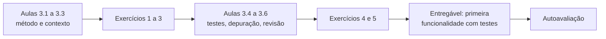
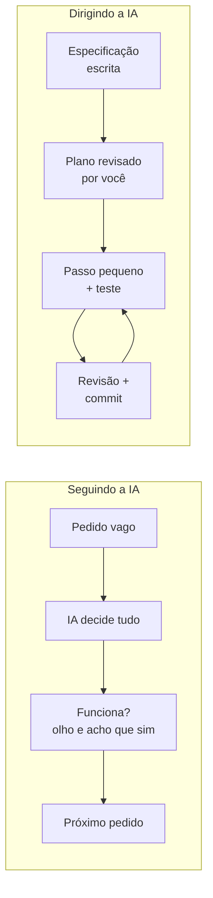
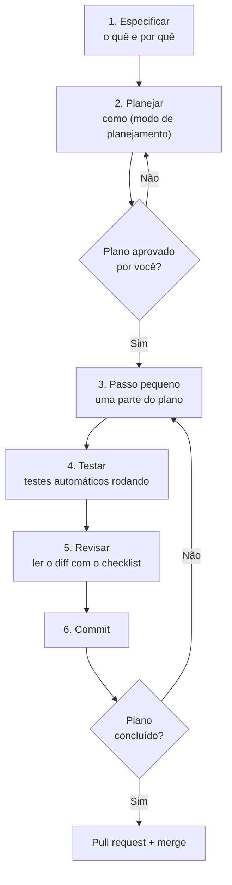
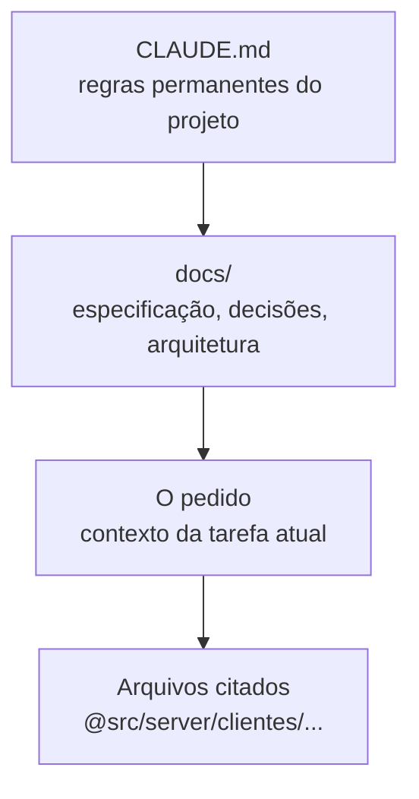
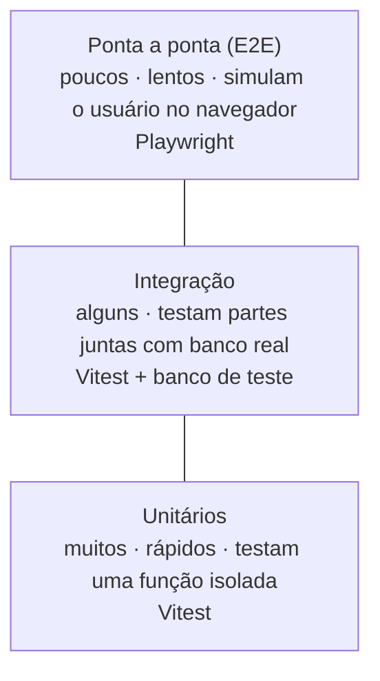
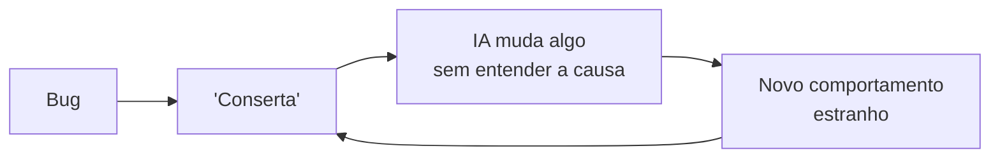
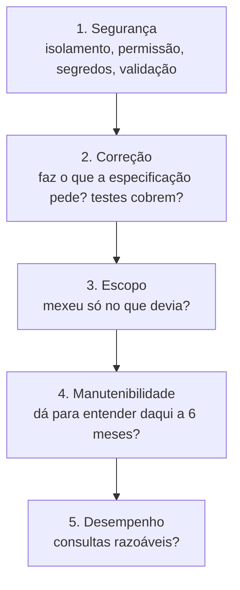

# Módulo 3: Programar com o Claude como um sênior

**Semanas 5 e 6 · cerca de 22 horas**

## Objetivos de aprendizagem

Este é o módulo que muda a sua relação com a IA. Até hoje, o Claude decidia e você seguia. A partir daqui, **você decide e o Claude executa**, dentro de um método que programadores seniores usam há décadas: especificar, planejar, fazer em passos pequenos, testar, revisar e registrar. O método é o que separa um sistema que "funcionou na demonstração" de um sistema que aguenta anos de uso real.

Ao final deste módulo você será capaz de:
1. Explicar por que "ir seguindo a IA" produz sistemas frágeis, e reconhecer os sinais disso.
2. Aplicar o ciclo especificação → plano → passos pequenos → teste → revisão → commit em qualquer funcionalidade.
3. Dar ao Claude o contexto certo (e só o necessário) para cada tarefa.
4. Exigir e ler testes automatizados como prova de que algo funciona.
5. Depurar problemas de forma sistemática, sem tentativa e erro.
6. Revisar o código entregue pelo Claude com um checklist objetivo.

### Como estudar este módulo

*Figura: o módulo em duas metades. Primeiro o método de trabalho, depois as ferramentas que garantem a qualidade.*

| Semana | O que fazer | Horas |
|---|---|---|
| 5 | Aulas 3.1 a 3.3, exercícios 1 a 3 | 10 |
| 6 | Aulas 3.4 a 3.6, exercícios 4 e 5, tarefa, entregável, autoavaliação | 12 |

---

## Aula 3.1: Por que "ir seguindo a IA" quebra sistemas

Você já viveu isto: pediu uma funcionalidade, o Claude escreveu, funcionou. Pediu outra, ele mudou coisas que já funcionavam. Algo quebrou, você pediu para corrigir, ele corrigiu e quebrou outra coisa. Três dias depois, o projeto é um emaranhado que ninguém entende. Isso não é falha da IA. É falta de método.

### Como o Claude "pensa"

O Claude é extremamente bom em escrever código, mas tem limites que você precisa conhecer para dirigi-lo:

| Característica | Consequência | Como você compensa |
|---|---|---|
| Ele **completa o que falta** com suposições razoáveis | Se você não disse "filtre por empresa", ele pode não filtrar | Escreva requisitos e regras explícitas (CLAUDE.md, especificação) |
| Ele quer **concluir a tarefa** | Pode declarar "pronto" sem ter testado de verdade | Exija testes rodando e a saída deles como prova |
| A **janela de contexto** é grande, mas finita | Em sessões muito longas, detalhes do começo perdem força | Sessões curtas e focadas; registre decisões em arquivos |
| Ele **não sabe** o que você não contou | Não conhece o cliente, o orçamento, a regra de negócio específica | Você é a fonte da verdade sobre o negócio |
| Ele pode estar **desatualizado** sobre uma biblioteca | Usa uma forma antiga de fazer algo | Peça para consultar a documentação atual |

### Os cinco sintomas de um projeto "ao sabor da IA"

1. **Ninguém sabe explicar a estrutura.** Se você não consegue desenhar a arquitetura em um papel, ela não existe: é acidental.
2. **Correções quebram outras coisas.** Sinal de que não há testes e de que o código está acoplado (tudo depende de tudo).
3. **Bibliotecas demais.** Cada problema resolvido com um pacote novo. Cada pacote é uma dependência que pode ter falhas de segurança.
4. **Segurança "depois".** Login funciona, mas ninguém verificou se a Empresa A vê dados da Empresa B.
5. **Medo de mexer.** Você evita mudar algo porque "está funcionando e eu não sei por quê".

### O que muda quando você assume o comando


*Figura: dois jeitos de trabalhar com IA. À esquerda, decisões implícitas e verificação no olho. À direita, decisões escritas e verificação por testes, em passos pequenos.*

### Exemplo completo: a mesma tarefa, dois jeitos

**Pedido da Imobiliária Lar Novo:** "quero que o corretor receba um aviso quando um interessado ficar 3 dias sem contato".

**Jeito "seguindo a IA":**
> "Faça um sistema de avisos para interessados sem contato há 3 dias."

O Claude cria uma tabela nova, instala uma biblioteca de agendamento, envia e-mail para **todos os corretores** (ele não sabia que cada interessado tem um corretor responsável), conta os dias incluindo fins de semana (a imobiliária não queria) e não registra quando o aviso foi enviado, então o corretor recebe o mesmo aviso todos os dias.

**Jeito sênior:**

```text
Contexto: CRM da imobiliária. Cada interessado (Lead) tem um corretorId
responsável e um campo ultimoContatoEm.

Objetivo: avisar o corretor responsável quando um lead dele ficar 3 dias
úteis sem contato.

Regras:
- Dias úteis: segunda a sexta, sem feriados por enquanto.
- Um aviso por lead por período sem contato (não repetir todo dia).
- Leads com status "fechado" ou "perdido" não geram aviso.
- Aviso por e-mail, usando o serviço de e-mail que já existe em src/server/email.

Restrições: não instale bibliotecas novas. Use a estrutura de tarefas agendadas
que já existe.

Critério de pronto: testes cobrindo (a) lead de sexta sem contato avisa na
quarta, não na segunda; (b) aviso não se repete; (c) lead fechado não avisa.

Primeiro, me mostre o plano em modo de planejamento.
```

A diferença não é o tamanho do texto. É que **as decisões de negócio foram tomadas por quem conhece o negócio (você)**, e o Claude ficou com o que faz melhor: escrever o código.

> 📌 **Em resumo**
> - O Claude preenche lacunas com suposições; suposições erradas viram defeitos.
> - Os sintomas de projeto sem método: estrutura inexplicável, correções que quebram coisas, bibliotecas demais, segurança "depois", medo de mexer.
> - Você é a fonte da verdade sobre o negócio; o Claude é o executor.
> - Um bom pedido tem contexto, objetivo, regras, restrições e critério de pronto.

### Para ir além
- [Boas práticas do Claude Code (Anthropic, em inglês)](https://www.anthropic.com/engineering/claude-code-best-practices)

---

## Aula 3.2: O ciclo de trabalho do sênior

Esta aula é o coração da formação. O ciclo abaixo vai se repetir em **toda** funcionalidade que você construir, do cadastro de clientes à cobrança automática. Decore-o, cole na parede, transforme em reflexo.

### O ciclo completo


*Figura: o ciclo de trabalho. A especificação e o plano acontecem uma vez; o laço de passo pequeno, teste, revisão e commit se repete até o plano acabar.*

### Passo 1: especificar (o quê e por quê)

Antes de qualquer código, escreva em um parágrafo ou lista:
- **Contexto:** onde isso entra no sistema.
- **Objetivo:** o que o usuário vai conseguir fazer.
- **Regras de negócio:** os detalhes que só você sabe.
- **Fora do escopo:** o que **não** é para fazer agora.
- **Critério de pronto:** como saberemos que funcionou (de preferência, como testes).

Para funcionalidades grandes, a especificação vira um arquivo em `docs/` (Módulo 4). Para pequenas, cabe no pedido.

### Passo 2: planejar (como)

No **modo de planejamento** (Shift + Tab), peça:

```text
Leia a especificação acima e os arquivos relevantes do projeto. Proponha um plano
em passos numerados, cada passo pequeno o suficiente para ser testado sozinho.
Para cada passo diga: arquivos que vai criar ou alterar, e o teste que prova
que funciona. Aponte riscos de segurança e dúvidas sobre as regras de negócio.
```

Ao ler o plano, pergunte:
- Ele mexe em arquivos que não deveria (autenticação, configuração)?
- Ele instala bibliotecas? Por quê? Dá para evitar?
- Os passos são pequenos de verdade, ou o passo 2 é "implementar tudo"?
- Ele levantou dúvidas? **Responda-as.** Dúvidas não respondidas viram suposições.

### Passo 3: passo pequeno

Execute **um passo do plano por vez**. "Pequeno" quer dizer: dá para revisar o diff em 5 minutos e, se der errado, desfazer sem dor.

```text
Execute apenas o passo 1 do plano. Pare depois e me mostre o resultado dos testes.
```

> 💡 **Por que pequeno?** Um diff de 30 linhas você lê com atenção. Um diff de 800 linhas você "passa o olho" e aprova, e é aí que entra a consulta sem `empresaId`.

### Passo 4: testar

"Funcionou" significa: **os testes automatizados rodaram e passaram, e você viu a saída**. Não "o Claude disse que funcionou". A Aula 3.4 aprofunda.

```text
Rode npm test e me mostre a saída completa. Se algum teste falhar, não altere
o teste para ele passar: corrija o código.
```

> ⚠️ **Armadilha comum:** quando um teste falha, a IA às vezes "conserta" o teste em vez do código, ou marca o teste para ser pulado. Isso é proibido no seu CLAUDE.md: *"nunca altere, desative ou pule um teste para fazê-lo passar sem minha aprovação explícita"*.

### Passo 5: revisar

Leia as mudanças (`git diff` ou a tela do pull request) com o checklist da Aula 3.6. Você não precisa entender cada linha; precisa encontrar os sinais de problema.

### Passo 6: commit

Uma mensagem clara, no padrão da Aula 2.2. Agora este passo é um ponto de restauração.

### Exemplo completo: "exportar clientes para CSV" no Gestor

1. **Especificação:** "O dono e o gerente podem exportar a lista de clientes da sua empresa para CSV (planilha). Campos: nome, e-mail, telefone, cidade, data de cadastro. Atendente não pode exportar. Fora do escopo: filtros, outros formatos. Pronto quando: teste prova que dono exporta, atendente recebe 403 e o arquivo só tem clientes da própria empresa."
2. **Plano** (Claude propõe, você ajusta): passo 1, função de serviço que monta o CSV; passo 2, rota protegida; passo 3, botão na tela, visível só para quem pode.
3. **Passo 1** + teste: a função recebe uma lista e devolve o texto CSV, com acentos e vírgulas dentro de nomes tratados corretamente.
4. **Revisão:** você nota que o telefone sai sem formatação. Decide que está bom por ora. Commit: `feat: serviço de exportação de clientes em CSV`.
5. **Passo 2** + teste de permissão. Na revisão, você confere: o `empresaId` vem da sessão? Sim. Commit.
6. **Passo 3**, revisão, commit. Pull request, merge.

> 🎯 **Repare na segurança:** em nenhum momento você pediu "faça seguro". A segurança entrou porque **estava na especificação** (quem pode, de qual empresa) e **foi provada por teste**. Segurança não é um pedido genérico; é um conjunto de regras específicas e verificáveis.

> 📌 **Em resumo**
> - O ciclo: especificar → planejar → passo pequeno → testar → revisar → commit.
> - Revise o plano antes de executar; responda as dúvidas que o Claude levantar.
> - Passos pequenos tornam a revisão real e o desfazer barato.
> - "Funcionou" é teste passando com a saída na tela.

### Para ir além
- [Fluxos de trabalho comuns com o Claude Code (em inglês)](https://code.claude.com/docs/en/common-workflows)

---

## Aula 3.3: Contexto é tudo

A qualidade do que o Claude entrega depende diretamente da qualidade do que ele sabe naquele momento. Dar contexto de menos gera suposições. Dar contexto demais (despejar o projeto inteiro numa conversa sem fim) dilui o que importa. O sênior sabe dosar.

### As camadas de contexto


*Figura: as camadas de contexto, da mais permanente (lida em toda sessão) à mais específica (só para esta tarefa).*

| Camada | O que contém | Muda com que frequência |
|---|---|---|
| **CLAUDE.md** | Stack, comandos, regras inegociáveis, padrões | Raramente (a cada lição aprendida) |
| **docs/** | Especificação, decisões de arquitetura (ADRs), glossário do negócio | A cada funcionalidade grande |
| **O pedido** | Objetivo, regras e critério de pronto desta tarefa | A cada tarefa |
| **Arquivos citados** | `@arquivo` para apontar exatamente onde olhar | A cada tarefa |

### Regras de ouro do contexto

**1. Uma sessão, um assunto.** Terminou a exportação de CSV? `/clear` e comece a próxima tarefa limpa. Sessões que misturam cinco assuntos geram respostas confusas.

**2. Decisões vão para arquivos, não ficam na conversa.** Se no meio da sessão vocês decidiram "juros são calculados por dia corrido", isso vai para a especificação ou para o CLAUDE.md. Na próxima sessão, a conversa acabou; o arquivo continua.

**3. Mostre exemplos do próprio projeto.** "Faça a rota de fornecedores **igual à de clientes** (`@src/server/clientes/rotas.ts`)" funciona muito melhor que descrever o padrão em palavras.

**4. Diga o que não fazer.** "Não altere o esquema do banco", "não instale bibliotecas", "não mexa em `src/server/auth`". Restrições evitam mudanças colaterais.

**5. Cole erros completos.** A mensagem inteira, o comando que rodou, o que você esperava e o que aconteceu.

### O CLAUDE.md vivo

Toda vez que o Claude errar algo que deveria saber, pergunte: **"que regra no CLAUDE.md teria evitado isso?"** E acrescente. O CLAUDE.md é o lugar onde as lições do projeto se acumulam.

Exemplo de evolução no Gestor:

| Erro do Claude | Regra acrescentada |
|---|---|
| Usou `Date` local e as cobranças venceram um dia antes | "Datas são guardadas em UTC; vencimentos são datas sem horário (`YYYY-MM-DD`) no fuso America/Sao_Paulo." |
| Criou uma tabela nova sem `empresaId` | "Toda tabela de dados de negócio tem `empresaId` obrigatório e índice nele." |
| Instalou uma biblioteca para formatar moeda | "Para formatar moeda use `Intl.NumberFormat('pt-BR', { style: 'currency', currency: 'BRL' })`, já em `src/lib/moeda.ts`." |

> 💡 Peça ao próprio Claude: *"com base nos erros desta sessão, sugira até 3 regras para acrescentar ao CLAUDE.md"*. Você aprova ou não.

### Peça para ele perguntar

Uma das frases mais úteis que existem:

```text
Antes de começar, faça as perguntas que você precisa que eu responda para não
ter que adivinhar nenhuma regra de negócio.
```

O Claude é bom em perceber lacunas quando você pede. As perguntas que ele faz são exatamente as suposições que ele faria em silêncio.

### Documentação atualizada

O Claude aprendeu com textos até uma certa data. Bibliotecas mudam. Quando trabalhar com uma biblioteca ou serviço externo (Asaas, Mercado Pago, Stripe, WhatsApp, Better Auth), peça:

```text
Antes de implementar, consulte a documentação oficial atual do Asaas sobre
webhooks de cobrança e me diga se há algo diferente do que você faria de memória.
```

### Exemplo completo: uma tarefa com contexto bem dosado

```text
/clear

Tarefa: adicionar o campo "origem do cliente" (indicação, Instagram, Google, outro).

Contexto: veja @prisma/schema.prisma (modelo Cliente) e @src/server/clientes/
para o padrão de validação e serviço. A tela é @src/app/(app)/clientes/novo/page.tsx.

Regras:
- Campo obrigatório para novos clientes; clientes antigos ficam como "não informado".
- As opções são fixas (enum), não texto livre.
- Relatório de clientes por origem fica para depois (fora do escopo).

Não altere outras tabelas nem a autenticação.

Pronto quando: migration criada, validação Zod atualizada, tela com o campo,
teste do serviço cobrindo valor válido, valor inválido e cliente antigo.

Faça perguntas se algo não estiver claro. Depois, plano.
```

> 📌 **Em resumo**
> - Contexto em camadas: CLAUDE.md (permanente), docs (do projeto), pedido (da tarefa), arquivos citados.
> - Uma sessão por assunto; decisões vão para arquivos.
> - Mostre exemplos do próprio projeto e diga o que não fazer.
> - Peça para o Claude perguntar antes e consultar a documentação atual.

### Para ir além
- [Gerenciando a memória do Claude Code (em inglês)](https://code.claude.com/docs/en/memory)

---

## Aula 3.4: Testes automatizados: a sua rede de segurança

Se você só puder levar uma coisa desta formação para o trabalho, leve esta: **teste automatizado é a única forma confiável de saber que um sistema feito com IA funciona**, hoje e depois de cada mudança. Também é a sua melhor resposta quando o cliente perguntar "como eu sei que isso não vai quebrar?".

### O que é um teste automatizado

É um pequeno programa que usa o seu sistema e confere o resultado. Em vez de você clicar na tela para ver se a multa está certa, o teste faz isso em milissegundos, toda vez que algo mudar.

```typescript
import { describe, it, expect } from "vitest";
import { calcularMulta } from "./multa";

describe("calcularMulta", () => {
  it("aplica 2% de multa e juros de 1% ao mês proporcional aos dias", () => {
    // R$ 1.000,00 com 30 dias de atraso
    expect(calcularMulta(100000, 30)).toBe(100000 + 2000 + 990);
  });

  it("não cobra nada se não houver atraso", () => {
    expect(calcularMulta(100000, 0)).toBe(100000);
  });

  it("recusa valor negativo", () => {
    expect(() => calcularMulta(-100, 5)).toThrow();
  });
});
```

Mesmo sem saber programar, você lê: "dado R$ 1.000 com 30 dias de atraso, espero R$ 1.029,90". **Os testes são uma especificação executável.** Você pode (e deve) ler os testes que o Claude escreve para conferir se as regras de negócio estão certas.

### Os três tipos de teste


*Figura: a pirâmide de testes. Muitos testes unitários rápidos na base, alguns de integração no meio e poucos testes de ponta a ponta no topo.*

| Tipo | Testa | Exemplo no Gestor |
|---|---|---|
| **Unitário** | Uma função sozinha | `calcularMulta`, `formatarCPF` |
| **Integração** | Várias partes juntas, com banco de dados de teste | "Criar cobrança grava no banco com o empresaId certo" |
| **Ponta a ponta (E2E)** | O sistema todo, pelo navegador | "Usuário faz login, cadastra cliente e o vê na lista" |

### Os testes que nunca podem faltar

Em sistemas de empresas, existem testes que **protegem o seu nome**. Exija-os sempre:

| Categoria | Teste | Protege contra |
|---|---|---|
| **Isolamento** | Usuário da empresa A não lê, altera nem apaga dados da empresa B | Vazamento entre clientes (o pior incidente de um SaaS) |
| **Permissão** | Atendente recebe 403 ao acessar o financeiro | Funcionário vendo o que não deve |
| **Dinheiro** | Cálculos com centavos, arredondamento, valores limite | Cobrança errada |
| **Entrada inválida** | Dados malformados são recusados com erro claro | Dados corrompidos, ataques |
| **Fluxo crítico** | Login, cadastro, pagamento ponta a ponta | O sistema "parar" na frente do cliente |

### Desenvolvimento guiado por testes (TDD) com o Claude

Uma técnica poderosa: **pedir os testes antes do código**. Você lê os testes (que estão em linguagem quase natural), confirma que as regras estão certas, e só então o Claude implementa.

```text
Para a regra de multa (2% fixo + 1% ao mês pro rata por dia corrido, arredondado
para o centavo mais próximo), escreva PRIMEIRO apenas os testes, cobrindo: sem
atraso, 1 dia, 30 dias, 365 dias, valor de 1 centavo, valor negativo.
Não implemente a função ainda. Rode os testes e mostre que falham.
```

Depois: *"agora implemente o mínimo para os testes passarem"*. A vantagem é enorme: os testes viram o contrato, e o Claude não pode "declarar vitória" sem cumpri-lo.

### Cobertura: quanto testar

**Cobertura** é a porcentagem do código executada pelos testes. Ela é um indicador, não uma meta. 100% de cobertura com testes ruins não vale nada. Prioridade:
1. Regras de negócio e cálculos: o máximo possível.
2. Permissão e isolamento: todas as rotas.
3. Fluxos críticos: um teste de ponta a ponta para cada.
4. Telas e detalhes visuais: o mínimo.

### Exemplo completo: o teste que salvou a Distribuidora Ramos

Seis meses depois de entregar um ERP para a Distribuidora Ramos, o cliente pede: "quero que o vendedor veja os pedidos dos clientes da região dele". O Claude implementa um filtro novo e, sem perceber, muda a consulta de pedidos. Os testes rodam:

```text
✗ isolamento > usuário da empresa A não vê pedidos da empresa B
  Expected: 0 pedidos
  Received: 14 pedidos
```

Sem o teste, essa mudança iria para produção e os pedidos de outras empresas apareceriam para os vendedores. Com o teste, o problema foi pego em 20 segundos, no seu computador. **É isso que você vende quando diz ao cliente que o sistema é confiável.**

> 📌 **Em resumo**
> - Teste automatizado é a prova de que funciona, hoje e depois de cada mudança.
> - Unitários (muitos), integração (alguns), ponta a ponta (poucos).
> - Testes de isolamento, permissão, dinheiro, entrada inválida e fluxo crítico nunca podem faltar.
> - Peça os testes antes do código e leia-os para conferir as regras.

### Para ir além
- [Guia do Vitest (em inglês)](https://vitest.dev/guide/)
- [Introdução ao Playwright (em inglês)](https://playwright.dev/docs/intro)

---

## Aula 3.5: Quando a IA erra: depuração sistemática

Bugs vão acontecer. A diferença entre o iniciante e o sênior não é ter menos bugs; é **como** os resolve. O iniciante pede "conserta" cinco vezes seguidas, e cada tentativa piora. O sênior investiga, encontra a causa e corrige uma vez.

### O anti-padrão: o laço do "conserta"


*Figura: o laço do "conserta". Cada tentativa sem diagnóstico adiciona mudanças e confusão, sem atacar a causa.*

Se você pediu para corrigir o mesmo problema **duas vezes** e não resolveu, **pare**. Volte o código ao último commit bom (`git restore`) e comece a investigação.

### O método em 5 passos

#### 1. Reproduzir
Descubra a sequência exata que faz o erro aparecer. "Às vezes o saldo fica errado" não é reproduzível. "Ao registrar um pagamento parcial de uma cobrança com desconto, o saldo fica negativo" é.

#### 2. Coletar evidências
- A mensagem de erro **completa**.
- Os logs do servidor naquele momento.
- O que entrou (dados) e o que saiu.
- Desde quando acontece? Qual foi o último deploy? (`git log` mostra o que mudou.)

#### 3. Formular hipóteses
Peça ao Claude, **sem deixá-lo alterar nada ainda**:

```text
(modo de planejamento)
Bug: ao registrar pagamento parcial de cobrança com desconto, o saldo fica negativo.
Passos para reproduzir: [...]
Erro/log: [cole]
Liste as 3 causas mais prováveis, em ordem, e para cada uma diga como confirmar
ou descartar SEM alterar o código (lendo arquivos, rodando consultas, adicionando
um teste que reproduza o bug).
```

#### 4. Confirmar com um teste que falha
A melhor confirmação: **um teste que reproduz o bug e falha**. Isso prova que você entendeu a causa, e o teste fica para sempre protegendo contra a volta do bug.

```text
Escreva um teste que reproduza exatamente esse cenário e falhe. Não corrija ainda.
```

#### 5. Corrigir a causa (não o sintoma) e confirmar
Corrija, rode o teste novo (agora passa) e **todos os outros** (nada quebrou). Commit com `fix:` e uma mensagem que explica a causa.

### Sintoma × causa

| Sintoma | Correção de sintoma (ruim) | Causa real (bom) |
|---|---|---|
| Saldo aparece negativo | `Math.abs(saldo)` para esconder o sinal | O desconto era subtraído duas vezes |
| Página de clientes lenta | Mostrar só 10 clientes | Consulta sem índice em `empresaId` |
| Webhook de pagamento às vezes não libera o acesso | Pedir ao cliente para clicar em "atualizar" | O webhook chega antes da cobrança ser gravada; falta tratar a ordem |
| Usuário deslogado aleatoriamente | Aumentar o tempo da sessão | Dois servidores com segredos de sessão diferentes |

> ⚠️ Se a correção proposta "esconde" o problema (um `try/catch` que engole o erro, um `if` que pula o caso estranho, um valor padrão que mascara dados ruins), desconfie. Pergunte: *"essa mudança corrige a causa ou só esconde o sintoma?"*.

### Ferramentas de investigação

- **Logs:** mensagens que o sistema grava enquanto roda. Peça ao Claude para adicionar logs temporários em pontos-chave ("valor antes do desconto: X, depois: Y"), e para removê-los depois.
- **Depurador do navegador** (F12): aba Rede para ver o que o frontend mandou e recebeu; aba Console para erros de JavaScript.
- **Consultas diretas ao banco** (no ambiente de desenvolvimento): o dado gravado está certo? O problema está na gravação ou na exibição?
- **`git bisect`**: quando algo que funcionava parou e você não sabe em qual commit, o Git testa os commits ao meio até achar o culpado. Peça ao Claude para conduzir.

### Exemplo completo: o vencimento que voltava um dia

**Relato do cliente:** "as cobranças com vencimento dia 10 aparecem como dia 9".

1. **Reproduzir:** criar uma cobrança com vencimento 10/11. Na lista, aparece 09/11. Reproduzido.
2. **Evidências:** no banco, o valor gravado é `2026-11-10T00:00:00.000Z`.
3. **Hipóteses (Claude):** (a) fuso horário na exibição, porque meia-noite UTC é 21h do dia 9 em Brasília; (b) erro na gravação; (c) biblioteca de datas. O dado no banco descarta (b).
4. **Teste que falha:** formatar `2026-11-10T00:00:00.000Z` no fuso de São Paulo deve exibir `10/11/2026`. Falha: exibe `09/11/2026`.
5. **Causa e correção:** vencimento é uma **data sem horário**, mas estava sendo gravada como instante. Correção: guardar como tipo `date` no banco e formatar sem conversão de fuso. Nova regra no CLAUDE.md (a mesma da Aula 3.3).

> 📌 **Em resumo**
> - Pediu correção duas vezes e não resolveu? Pare, volte ao último commit bom, investigue.
> - Reproduzir → evidências → hipóteses → teste que falha → corrigir a causa.
> - Corrija a causa, não o sintoma; desconfie de correções que escondem o problema.
> - Todo bug corrigido deixa um teste e, se couber, uma regra nova no CLAUDE.md.

---

## Aula 3.6: Revisão de código: o que conferir em tudo que o Claude entrega

Revisar é a última barreira antes de um defeito chegar ao cliente. A boa notícia: você não precisa ser um programador experiente para revisar bem. Precisa de um **checklist** e da disciplina de usá-lo em todo diff.

### O que revisar, em ordem de importância


*Figura: a ordem da revisão. Segurança primeiro, porque um defeito de segurança custa mais caro que qualquer outro.*

### O checklist de revisão

Copie e use em todo pull request:

**Segurança**
- [ ] Toda consulta a dados de negócio filtra por `empresaId` vindo da sessão.
- [ ] Toda rota ou ação nova verifica login e permissão no servidor.
- [ ] Toda entrada de dados é validada no servidor (Zod).
- [ ] Nenhum segredo no código; nenhuma variável sensível com `NEXT_PUBLIC_`.
- [ ] Nenhum dado pessoal ou financeiro em `console.log`.
- [ ] Nenhuma consulta SQL montada com texto do usuário.

**Correção**
- [ ] Faz o que a especificação pede, e nada além.
- [ ] Existem testes para o caminho feliz **e** para os casos de erro.
- [ ] Os testes rodaram e passaram (vi a saída).
- [ ] Nenhum teste foi alterado, desativado ou pulado sem motivo.

**Escopo**
- [ ] Só os arquivos esperados foram alterados.
- [ ] Nenhuma biblioteca nova sem justificativa.
- [ ] Nenhuma mudança no esquema do banco que não estava no plano.

**Manutenibilidade**
- [ ] Nomes claros, seguindo os padrões do projeto.
- [ ] Sem código comentado ou "morto" esquecido.
- [ ] Sem `any`, sem `catch` vazio, sem `// TODO` em código de segurança.

### Use o Claude para revisar o Claude

Um truque poderoso: **uma sessão nova** (sem o contexto de quem escreveu) revisa melhor. Ela não tem o "viés de autor".

```text
/clear
Revise as mudanças desta branch em relação à main (git diff main...HEAD) como
um revisor sênior desconfiado. Foque em: isolamento entre empresas, permissões,
validação de entrada, tratamento de erros e testes faltando. Para cada problema,
cite o arquivo e a linha, explique o risco e sugira a correção. Não altere nada.
```

O Claude Code também tem comandos de revisão prontos (como `/security-review`, para uma revisão de segurança das mudanças pendentes). Use-os como **mais uma** camada, nunca como a única.

### Ferramentas automáticas que revisam por você

Configure uma vez, e elas conferem em todo commit:

| Ferramenta | O que pega | Comando típico |
|---|---|---|
| **TypeScript estrito** | Tipos incompatíveis, valores possivelmente vazios | `npx tsc --noEmit` |
| **ESLint** | Padrões perigosos e código suspeito | `npm run lint` |
| **Testes** | Regras de negócio quebradas | `npm test` |
| **npm audit / Dependabot** | Bibliotecas com falhas de segurança conhecidas | `npm audit` |

No Módulo 12, essas ferramentas vão rodar sozinhas a cada pull request, no GitHub Actions.

### Exemplo completo: revisando um PR de verdade

PR: "feat: tela de contas a receber". O diff tem 6 arquivos. Usando o checklist:

- **Segurança:** a rota `GET /api/contas-receber` usa `session.user.empresaId`. ✔ A permissão confere se o papel é dono ou gerente. ✔ Mas o filtro por período recebe `dataInicio` e `dataFim` direto da URL **sem validação**. ✘
- **Correção:** os testes cobrem a listagem e a permissão, mas não o filtro de datas. ✘
- **Escopo:** o Claude alterou também `src/lib/datas.ts` (função usada em todo o sistema). ✘ Por quê?
- **Manutenibilidade:** ok.

Pedido de ajustes:

```text
Três ajustes neste PR:
1. Valide dataInicio e dataFim com Zod (datas válidas, dataInicio <= dataFim,
   intervalo máximo de 1 ano), retornando 400 se inválido.
2. Adicione testes para o filtro de datas, incluindo datas inválidas.
3. Explique por que src/lib/datas.ts foi alterado. Se não for essencial, reverta;
   se for, adicione testes para as outras partes do sistema que usam essa função.
```

> 📌 **Em resumo**
> - Revise na ordem: segurança, correção, escopo, manutenibilidade, desempenho.
> - Use o checklist em todo diff, sem exceção.
> - Uma sessão nova do Claude revisa melhor que a que escreveu.
> - Tipos, lint, testes e auditoria de dependências revisam automaticamente.

### Para ir além
- [Segurança no Claude Code (em inglês)](https://code.claude.com/docs/en/security)

---

## Exercícios

### Exercício 1: Reescreva o pedido (45 min)
**Objetivo:** transformar pedidos vagos em pedidos de sênior.
Reescreva cada pedido com contexto, objetivo, regras, fora do escopo e critério de pronto:
1. "Faça um relatório de vendas."
2. "Coloque um login no sistema."
3. "Adicione desconto nos pedidos."

<details>
<summary><strong>Resolução comentada (item 3)</strong></summary>

```text
Contexto: ERP da Autopeças Silva. Pedidos têm itens com valor unitário em
centavos (ver @prisma/schema.prisma, modelos Pedido e ItemPedido).

Objetivo: o vendedor pode aplicar desconto em um pedido antes de finalizá-lo.

Regras:
- Desconto em percentual, no pedido inteiro (não por item).
- Vendedor pode dar até 5%. Gerente até 15%. Acima disso, ninguém.
- O desconto é calculado sobre o subtotal e arredondado para o centavo mais próximo.
- Pedido finalizado não pode ter o desconto alterado.
- Registrar quem aplicou o desconto e quando (auditoria).

Fora do escopo: desconto por item, cupons, desconto em reais.

Pronto quando: testes provam os limites por papel (5% ok e 6% recusado para
vendedor; 15% ok e 16% recusado para gerente), arredondamento correto, pedido
finalizado recusa alteração e a auditoria registra o autor.

Faça perguntas antes, depois mostre o plano.
```

Repare que as decisões de negócio (limites por papel, sobre o que incide, arredondamento) foram tomadas por você. Se você não sabe a resposta, **essa é uma pergunta para o cliente**, não para a IA.
</details>

### Exercício 2: Revise um plano (40 min)
Peça ao Claude, no modo de planejamento, um plano para "permitir anexar arquivos PDF ao cadastro do cliente" no Gestor. Avalie o plano com as perguntas do passo 2 da Aula 3.2 e escreva pelo menos 3 ajustes (pense: tamanho máximo, tipo de arquivo, onde guardar, quem pode baixar, isolamento entre empresas).

### Exercício 3: Evolua o CLAUDE.md (30 min)
Liste 5 erros que a IA já cometeu em projetos seus (ou que você imagina, com base nas aulas) e escreva a regra de CLAUDE.md que evitaria cada um.

### Exercício 4: Testes primeiro (90 min)
**Objetivo:** praticar TDD com o Claude.
No repositório do Gestor, siga o roteiro da Aula 3.4 para a função `calcularMulta`: peça os testes primeiro, leia-os e confira os valores com uma calculadora, veja-os falhar, peça a implementação e veja-os passar. Faça commit de cada etapa.

### Exercício 5: Caça ao bug (60 min)
Peça ao Claude: *"introduza um bug sutil em calcularMulta, sem me dizer qual, e faça commit"*. Depois, em uma sessão nova (`/clear`), use o método da Aula 3.5 para encontrá-lo sem olhar o diff do commit. Só confira o diff no final.

---

## Tarefa de campo

**Aplique o ciclo em uma necessidade real.** Escolha uma pequena melhoria que facilitaria o seu trabalho ou o de um cliente (um relatório, um cálculo, uma automação simples). Faça a especificação conversando com quem vai usar (ou com você mesmo, se for sua operação), e implemente com o ciclo completo, em pull request, com testes. Registre no diário de decisões: as perguntas que o Claude fez, as decisões que você tomou e o que aprendeu.

---

## Entregável: Biblioteca de prompts + primeira funcionalidade com testes

1. **Biblioteca de prompts** em `docs/prompts.md` no repositório do Gestor, com seus modelos para: especificar uma tarefa, pedir plano, executar um passo, testes primeiro, investigar um bug, revisar um PR.
2. **A funcionalidade `calcularMulta`** (exercício 4) ou a da tarefa de campo, entregue por pull request.

**Checklist de qualidade:**
- [ ] A biblioteca tem os 6 modelos de prompt, adaptados ao seu jeito de trabalhar.
- [ ] A funcionalidade tem especificação escrita (na descrição do PR ou em `docs/`).
- [ ] O histórico mostra commits pequenos (testes, implementação, ajustes).
- [ ] Os testes cobrem caminho feliz, casos limite e entrada inválida.
- [ ] Você leu os testes e confirmou que as regras estão certas.
- [ ] O PR foi revisado com o checklist da Aula 3.6 (cole o checklist marcado no PR).
- [ ] O CLAUDE.md ganhou pelo menos uma regra nova a partir do que você aprendeu.

---

## Autoavaliação

Meta: 8 de 10.

1. Por que o Claude às vezes implementa algo "funcionando" mas com uma regra de negócio errada?
2. Liste os 6 passos do ciclo de trabalho.
3. O plano proposto pelo Claude tem 3 passos, e o passo 2 é "implementar o módulo financeiro". O que você faz?
4. Um teste falhou e o Claude propõe mudar o valor esperado no teste. Quando isso é aceitável e quando não é?
5. Você está há 2 horas numa sessão que já tratou de login, relatório e exportação. As respostas estão piorando. Por quê, e o que fazer?
6. No meio da sessão você decidiu com o Claude que "clientes inativos não aparecem no funil". Onde essa decisão deve ficar?
7. Cite 3 testes que nunca podem faltar em um SaaS multi-empresa.
8. Você pediu duas vezes para corrigir um bug e ele continua. Qual o próximo passo?
9. O Claude corrigiu um erro de "saldo negativo" usando `Math.abs()`. O que você questiona?
10. Por que usar uma sessão nova do Claude para revisar o código que outra sessão escreveu?

<details>
<summary><strong>Gabarito</strong></summary>

1. Porque ele preenche com suposições razoáveis as informações que não recebeu. Se a regra não estava escrita (no pedido, na especificação ou no CLAUDE.md), ele adivinha, e pode adivinhar errado.
2. Especificar → planejar → passo pequeno → testar → revisar → commit (repetindo os quatro últimos até o plano acabar).
3. Recuse o plano e peça para quebrar o passo 2 em passos menores, cada um testável sozinho e revisável em poucos minutos.
4. É aceitável só quando o **teste** estava errado (a regra de negócio esperada mudou ou o valor foi calculado errado), e você confirmou isso. Não é aceitável para fazer um teste passar quando o código é que está errado. A regra no CLAUDE.md: nunca alterar, desativar ou pular testes sem sua aprovação explícita.
5. Sessões longas e com muitos assuntos misturam contexto e diluem o que importa. Registre as decisões em arquivos, use `/clear` e comece uma sessão focada na tarefa atual.
6. Em um arquivo do projeto: na especificação (`docs/`) se for regra de negócio da funcionalidade, ou no CLAUDE.md se for regra geral. Nunca só na conversa.
7. Isolamento (empresa A não acessa dados da B), permissão (papel sem acesso recebe 403), dinheiro (cálculos em centavos e arredondamento), entrada inválida e fluxo crítico (login, pagamento).
8. Parar, voltar ao último commit bom e investigar com o método: reproduzir, coletar evidências, formular hipóteses sem alterar código, escrever um teste que falhe, corrigir a causa.
9. Se a correção trata a causa ou só esconde o sintoma. `Math.abs` esconde o sinal; a causa (por exemplo, um desconto subtraído duas vezes) continua lá e o valor continua errado.
10. Porque a sessão que escreveu tem viés de autor: "lembra" das intenções e tende a ver o código como certo. Uma sessão nova lê só o que está escrito, como um revisor externo.
</details>

---

## Checklist de segurança do módulo

- [ ] Meu CLAUDE.md proíbe alterar, desativar ou pular testes sem aprovação.
- [ ] Toda especificação diz quem pode fazer o quê, e de qual empresa.
- [ ] Todo PR passa pelo checklist de revisão, começando pela segurança.
- [ ] Existe pelo menos um teste de isolamento entre empresas e um de permissão.
- [ ] Uso uma sessão nova (ou `/security-review`) para revisar mudanças sensíveis.

---

## Para aprofundar (opcional)

| Material | Formato | Por que vale |
|---|---|---|
| [Boas práticas do Claude Code](https://code.claude.com/docs/en/best-practices) | Texto, em inglês | O método oficial de trabalho |
| [Subagentes do Claude Code](https://code.claude.com/docs/en/sub-agents) | Texto, em inglês | Como criar um revisor especializado |
| [Hooks do Claude Code](https://code.claude.com/docs/en/hooks) | Texto, em inglês | Rodar testes e lint automaticamente |
