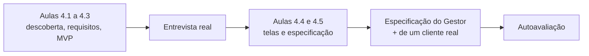
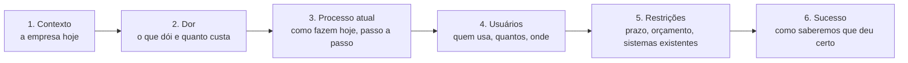
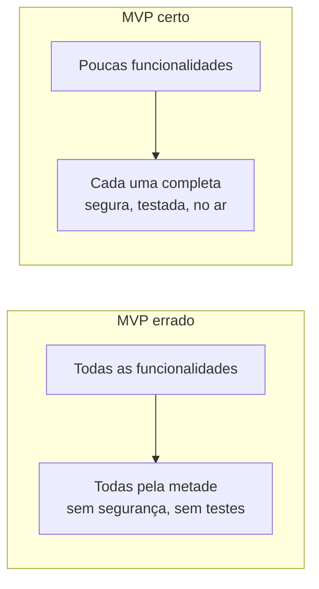
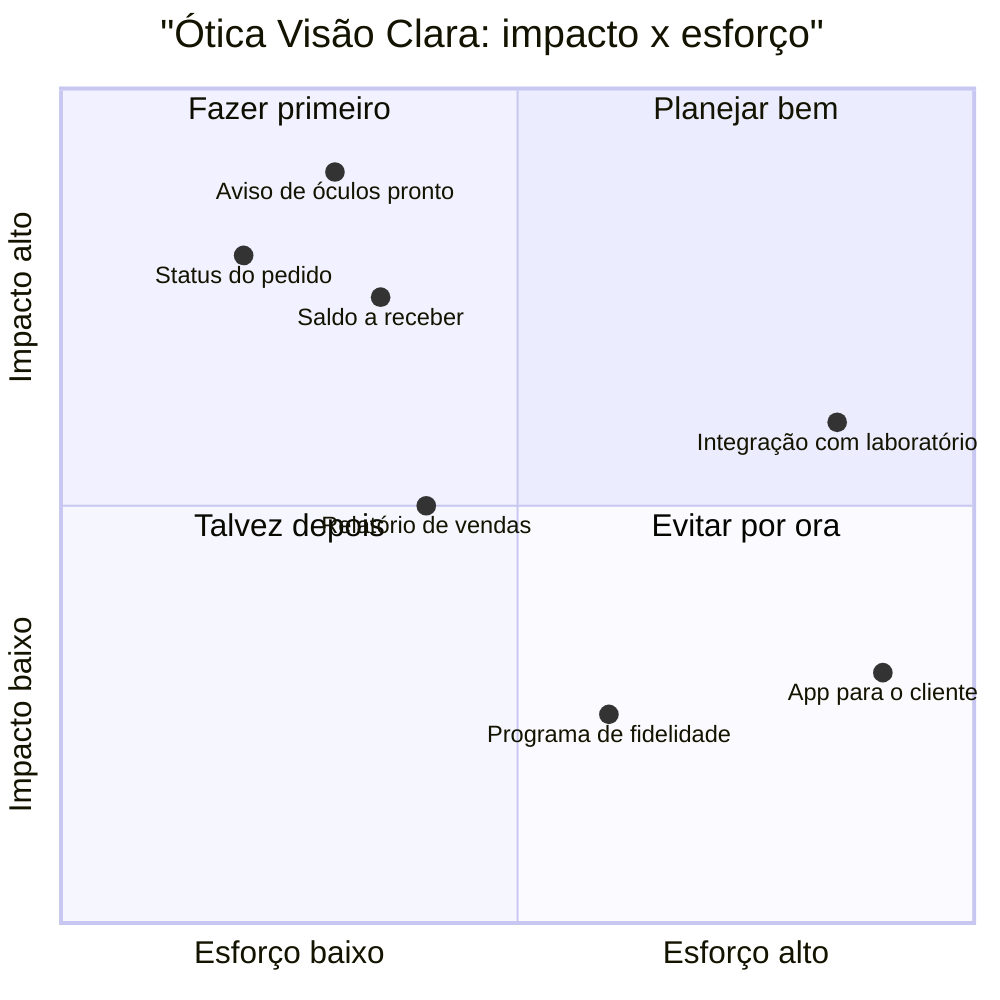
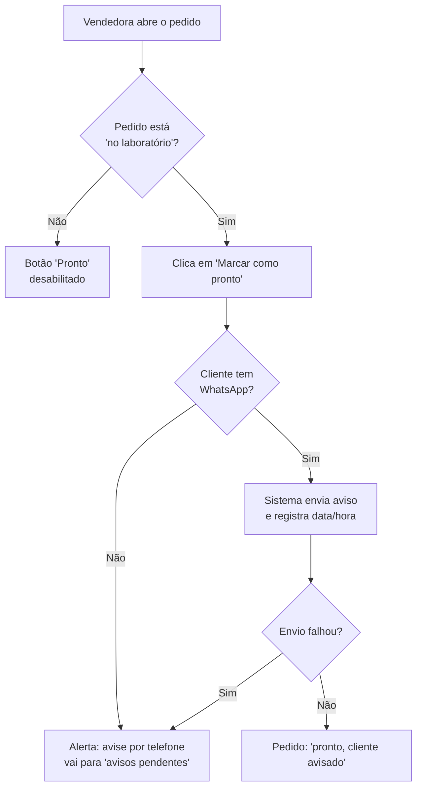
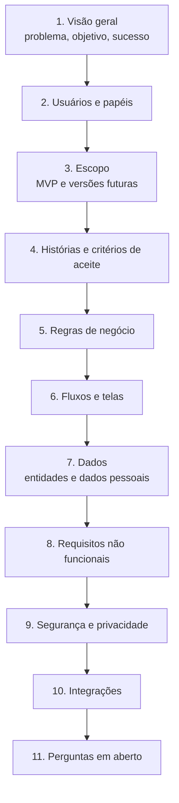

# Módulo 4: Da ideia à especificação

**Semanas 7 e 8 · cerca de 22 horas**

## Objetivos de aprendizagem

A maior parte dos projetos de software que dão errado não falha no código. Falha **antes**: ninguém entendeu direito o problema, o escopo cresceu sem controle, o cliente esperava uma coisa e recebeu outra. Com IA, isso piora, porque é tão fácil gerar código que se constrói rápido a coisa errada. Este módulo ensina a parte que o Claude não pode fazer por você: **entender o cliente e transformar a conversa em um documento que define exatamente o que será construído**.

Ao final deste módulo você será capaz de:
1. Conduzir uma entrevista de descoberta que revela o problema real, e não só o pedido.
2. Escrever requisitos como histórias de usuário com critérios de aceite verificáveis.
3. Recortar um MVP: decidir o que entra na primeira versão e o que fica para depois.
4. Desenhar fluxos e telas simples antes de qualquer código.
5. Produzir um documento de especificação completo, incluindo segurança e privacidade, que o Claude consegue seguir.

### Como estudar este módulo

*Figura: o módulo vai da conversa com o cliente ao documento de especificação.*

| Semana | O que fazer | Horas |
|---|---|---|
| 7 | Aulas 4.1 a 4.3, exercícios 1 a 3, entrevista de descoberta | 11 |
| 8 | Aulas 4.4 e 4.5, exercícios 4 e 5, especificações, autoavaliação | 11 |

---

## Aula 4.1: A entrevista de descoberta

O cliente chega dizendo "quero um sistema de gestão". Isso não é um requisito, é um desejo. Por trás dele há uma **dor** concreta (perder vendas, não saber o lucro, funcionário que sai e leva os clientes). Sua primeira tarefa é encontrar essa dor, porque é ela que define o que construir, quanto o sistema vale para o cliente e quanto você pode cobrar.

### Pedido × problema

| O cliente diz | O problema real pode ser |
|---|---|
| "Quero um CRM" | "Os vendedores esquecem de retornar os orçamentos e perdemos 30% das vendas" |
| "Quero um app de agenda" | "As faltas de pacientes custam R$ 8 mil por mês" |
| "Quero um ERP" | "Não sei quanto tenho em estoque e compro produtos repetidos" |
| "Quero automatizar o WhatsApp" | "Duas atendentes não dão conta de 300 mensagens por dia" |

Se você constrói o pedido, entrega um sistema. Se você resolve o problema, entrega **resultado**, e é isso que o cliente paga com gosto.

### A estrutura da entrevista (60 a 90 minutos)


*Figura: os seis blocos da entrevista de descoberta, do contexto geral à definição de sucesso.*

#### 1. Contexto
- O que a empresa faz? Quantas pessoas? Quantos clientes atende por mês?
- Que ferramentas usam hoje (planilhas, sistemas, cadernos, WhatsApp)?

#### 2. Dor
- "O que te fez procurar um sistema **agora**?" (A pergunta mais reveladora. Algo aconteceu.)
- "Quanto isso custa hoje? Em dinheiro, horas ou clientes perdidos?"
- "Se nada mudar, o que acontece em 6 meses?"

#### 3. Processo atual
- "Me mostra como vocês fazem hoje, do começo ao fim." Peça para **ver**, não só ouvir: a planilha, o caderno, a tela do sistema atual.
- "O que acontece quando dá errado?" (As exceções escondem metade dos requisitos.)

#### 4. Usuários
- Quem vai usar? Quantos? Qual a familiaridade com tecnologia?
- Usam no computador, no celular, no balcão, na rua?
- Quem pode ver o quê? (Pergunta de segurança disfarçada de pergunta de negócio.)

#### 5. Restrições
- Prazo: há uma data que importa (início de temporada, fim do contrato com o sistema atual)?
- Orçamento: qual faixa de investimento faz sentido? (Pergunte; não adivinhe.)
- Sistemas existentes que precisam conversar com o novo (contador, banco, nota fiscal, e-commerce).
- Dados: quantos registros existem hoje? Precisam ser migrados?

#### 6. Sucesso
- "Daqui a 3 meses, o que precisa ter mudado para você dizer que valeu a pena?"
- Transforme a resposta em algo mensurável: "reduzir as faltas de 18% para menos de 8%".

### Técnicas que separam o profissional do amador

- **Pergunte "por quê?" até chegar ao dinheiro.** "Quero um relatório de vendas por vendedor." Por quê? "Para pagar comissão." Por quê é difícil hoje? "Porque eu calculo na mão e demora um dia inteiro todo mês." Agora você sabe que a funcionalidade real é **cálculo automático de comissão**, e que ela vale pelo menos um dia de trabalho por mês.
- **Peça exemplos concretos.** "Me conta o último orçamento que vocês perderam." Histórias reais revelam regras que ninguém lembra de mencionar.
- **Fale pouco.** Na descoberta, quem mais fala é o cliente. Anote tudo.
- **Não prometa nada na reunião.** "Vou estudar e te trago uma proposta." Prometer na hora é como você acaba entregando um ERP pelo preço de um formulário.
- **Grave (com permissão) ou leve alguém para anotar.** Depois, você pode pedir ao Claude para organizar a transcrição.

### Exemplo completo: a Ótica Visão Clara

Você entrevista a dona da Ótica Visão Clara (2 lojas, 7 funcionários). O pedido inicial: "um sistema para controlar as vendas".

Na entrevista, você descobre:
- **A dor que fez procurar agora:** um cliente reclamou no Instagram que o óculos ficou pronto e ninguém avisou; ele esperou 3 semanas. A dona descobriu que **40 óculos prontos** estavam parados no laboratório.
- **O processo atual:** a venda é anotada num talão de papel, a receita fica numa pasta, o pedido ao laboratório vai por WhatsApp, e o aviso ao cliente depende da memória da vendedora.
- **Quanto custa:** óculos parados ocupam espaço, clientes insatisfeitos não voltam, e a loja paga o laboratório antes de receber o restante do cliente.
- **Sucesso:** "nenhum óculos pronto parado mais de 2 dias sem aviso" e "saber quanto tenho a receber de saldo dos clientes".

O sistema que resolve **não** é "um ERP de ótica". É: registro de venda com receita, status do pedido no laboratório, **aviso automático por WhatsApp quando fica pronto** e controle do saldo a receber. Muito menor, muito mais valioso, e você sabe exatamente como medir o sucesso.

### Organizando as anotações com o Claude

Depois da reunião, cole suas anotações (ou a transcrição) e peça:

```text
Abaixo estão as anotações de uma entrevista de descoberta com uma ótica.
Organize em: (1) problema principal e quanto custa, (2) processo atual passo a
passo, (3) usuários e o que cada um faz, (4) restrições, (5) critérios de
sucesso mensuráveis, (6) perguntas que ficaram sem resposta e que eu preciso
fazer ao cliente. Não invente informações que não estejam nas anotações;
marque como "a confirmar" tudo o que for suposição.
```

A última frase é essencial: sem ela, o Claude preenche as lacunas com suposições plausíveis, e você não sabe o que veio do cliente e o que veio da IA.

> 📌 **Em resumo**
> - O pedido do cliente esconde uma dor; você é pago para resolver a dor.
> - A entrevista tem 6 blocos: contexto, dor, processo atual, usuários, restrições, sucesso.
> - Pergunte "por quê?" até chegar ao dinheiro, peça exemplos reais e não prometa nada na reunião.
> - Use o Claude para organizar as anotações, marcando o que é suposição.

### Para ir além
- [Sebrae](https://sebrae.com.br/sites/PortalSebrae): conteúdos sobre gestão de pequenas empresas, úteis para entender a realidade dos seus clientes.

---

## Aula 4.2: Requisitos, histórias de usuário e critérios de aceite

Depois da descoberta, você tem uma pilha de anotações. Agora precisa transformá-las em algo preciso o suficiente para três públicos: **o cliente** (que aprova), **o Claude** (que implementa) e **os testes** (que provam). O formato que funciona para os três é a história de usuário com critérios de aceite.

### Requisito funcional e não funcional

| Tipo | O que descreve | Exemplo na ótica |
|---|---|---|
| **Funcional** | O que o sistema **faz** | "Registrar uma venda com a receita do cliente" |
| **Não funcional** | **Como** o sistema deve se comportar | "Funcionar no celular da vendedora", "Avisar o cliente em até 1 hora depois do óculos ficar pronto", "Backup diário", "Só a dona vê o faturamento" |

Os requisitos não funcionais são onde moram a **segurança, a disponibilidade e o desempenho**, justamente os seus maiores medos. Clientes quase nunca falam deles espontaneamente. **Você** precisa perguntar e escrever.

### A história de usuário

Formato:

> **Como** [tipo de usuário], **quero** [ação], **para** [benefício].

Exemplos da ótica:
- **Como** vendedora, **quero** marcar um pedido como "pronto" quando chega do laboratório, **para** que o cliente seja avisado sem eu precisar lembrar.
- **Como** dona, **quero** ver o total de saldos a receber, **para** saber quanto dinheiro vai entrar.
- **Como** cliente da ótica, **quero** receber uma mensagem quando meu óculos ficar pronto, **para** não ter que ligar perguntando.

O "para" é o mais importante: ele explica o **porquê**, e permite que você (e o Claude) tomem boas decisões nos detalhes.

### Critérios de aceite: a parte que vira teste

Uma história sem critérios de aceite é vaga. Os critérios dizem **exatamente** quando ela está pronta. O formato **Dado / Quando / Então** traduz direto para testes automatizados:

```text
História: aviso automático de óculos pronto

Critério 1
Dado um pedido com status "no laboratório" e cliente com WhatsApp cadastrado
Quando a vendedora marca o pedido como "pronto"
Então o cliente recebe a mensagem "Olá, [nome]! Seu óculos está pronto
     para retirada na loja [loja]." em até 5 minutos
E o pedido registra a data e hora do aviso

Critério 2
Dado um pedido cujo cliente não tem WhatsApp cadastrado
Quando a vendedora marca como "pronto"
Então o sistema mostra o alerta "Cliente sem WhatsApp: avise por telefone"
E o pedido aparece na lista "avisos pendentes"

Critério 3
Dado um pedido marcado como "pronto" há mais de 2 dias sem retirada
Quando o dia começa
Então o sistema envia um segundo lembrete ao cliente
E mostra o pedido em destaque para a gerente

Critério 4 (segurança)
Dado um usuário da loja Centro
Quando ele tenta ver os pedidos da loja Shopping
Então o sistema recusa, a menos que ele seja a dona
```

> 🎯 **Ideia-chave:** cada critério de aceite vira um teste automatizado. Se você escreveu bons critérios, você já escreveu os testes; o Claude só precisa traduzi-los para código.

### Regras de negócio: o detalhe que o cliente esquece

Além das histórias, registre as **regras de negócio** em uma lista própria. São as leis do negócio que o sistema precisa respeitar:

| Código | Regra |
|---|---|
| RN01 | O sinal mínimo de uma venda é 30% do valor total. |
| RN02 | A venda só pode ser enviada ao laboratório depois que o sinal for pago. |
| RN03 | Desconto acima de 10% exige aprovação da gerente. |
| RN04 | Receitas com mais de 12 meses exigem confirmação "cliente ciente de que a receita é antiga". |

Numerar as regras permite citá-las: nos critérios de aceite, nos testes, nas conversas com o cliente ("a RN03 mudou?") e nos pedidos ao Claude ("implemente a RN03").

### Requisitos não funcionais que você sempre pergunta

Use esta lista em todo projeto. Ela cobre seus três medos:

| Área | Pergunta ao cliente | Exemplo de requisito |
|---|---|---|
| **Disponibilidade** | "Se o sistema ficar fora do ar uma hora, o que acontece?" | "Disponível 99,5% do tempo em horário comercial" |
| **Dados** | "Se perder os dados de um dia, qual o prejuízo?" | "Backup diário com retenção de 30 dias; perda máxima de 24h" |
| **Acesso** | "Quem pode ver o quê? Funcionário que sai precisa ser bloqueado na hora?" | "Bloqueio imediato de usuário; só a dona vê faturamento" |
| **Privacidade** | "Que dados pessoais vocês guardam? Há dados de saúde?" | "Receitas oftalmológicas são dados de saúde: acesso restrito e registrado" |
| **Volume** | "Quantos registros por mês? Quantos usuários ao mesmo tempo?" | "Até 1.000 vendas/mês, 10 usuários simultâneos" |
| **Dispositivos** | "Computador, celular, tablet? A internet da loja é estável?" | "Funcionar em celular Android; tolerar internet lenta" |
| **Integrações** | "Precisa conversar com algum sistema?" | "Enviar pedidos ao laboratório por e-mail" |
| **Manutenção** | "Quem vai pedir mudanças? Com que frequência?" | Base para o plano de manutenção (Módulo 16) |

> ⚖️ **Atenção à LGPD:** receita oftalmológica é dado referente à saúde, que a lei classifica como **dado pessoal sensível**, com regras mais rígidas. Identificar dados sensíveis já na especificação evita retrabalho e risco legal. Você vai aprofundar no Módulo 14.

### Exemplo completo: do relato à história

**Relato do cliente (Autopeças Silva):** "Às vezes o vendedor vende uma peça que já acabou, porque o estoque do sistema está errado."

**Histórias:**
- **Como** vendedor, **quero** ver o estoque atual da peça no momento da venda, **para** não vender o que não tenho.
- **Como** gerente, **quero** que o estoque baixe automaticamente quando a venda é finalizada, **para** não depender de lançamento manual.

**Regra de negócio:** RN05: não é possível finalizar uma venda com quantidade maior que o estoque disponível, exceto com a marcação "encomenda".

**Critério de aceite (o mais importante):**
```text
Dado uma peça com 1 unidade em estoque
Quando dois vendedores finalizam, ao mesmo tempo, vendas de 1 unidade dessa peça
Então apenas uma venda é finalizada
E a outra recebe a mensagem "Estoque insuficiente: restam 0 unidades"
```

Esse último critério é o que um iniciante nunca escreve, e é exatamente o que derruba ERPs (Aula 1.4). Agora ele está na especificação, vai virar teste, e o Claude vai implementar com uma transação (Módulo 7).

> 📌 **Em resumo**
> - Requisitos funcionais dizem o que o sistema faz; os não funcionais dizem como (segurança, disponibilidade, desempenho).
> - História de usuário: como [usuário], quero [ação], para [benefício].
> - Critérios de aceite no formato Dado/Quando/Então viram testes automatizados.
> - Numere as regras de negócio e pergunte sempre a lista de requisitos não funcionais.

### Para ir além
- [Histórias de usuário (Atlassian, em português)](https://www.atlassian.com/br/agile/project-management/user-stories)

---

## Aula 4.3: Recortar o MVP: o que entra e o que fica para depois

Depois da descoberta, o cliente vai querer tudo: relatórios, aplicativo, integração com o banco, inteligência artificial. Se você aceitar construir tudo de uma vez, o projeto atrasa, estoura o orçamento e chega ao cliente meses depois, quando a dor já mudou. O sênior sabe **cortar**.

### O que é MVP

**MVP** (Produto Mínimo Viável) é a menor versão do sistema que **resolve a dor principal** de verdade, em uso real. Não é um protótipo de mentira, nem um sistema mal feito. É um sistema **completo em qualidade e pequeno em escopo**.


*Figura: o MVP certo corta funcionalidades, nunca qualidade. Segurança e testes não são negociáveis em nenhuma versão.*

> ⚠️ **O que nunca sai do MVP:** login seguro, permissões, isolamento de dados, validação de entrada, backup e HTTPS. Cortar isso não é "MVP", é entregar um risco. Se o orçamento não comporta esses itens, o escopo funcional é que precisa diminuir.

### A técnica MoSCoW

Classifique cada história em quatro grupos:

| Grupo | Significa | Pergunta para decidir |
|---|---|---|
| **Must** (precisa) | Sem isso, não resolve a dor | "Se faltar, o cliente usaria o sistema mesmo assim?" Se não, é Must |
| **Should** (deveria) | Importante, mas há um jeito provisório de contornar | "Dá para fazer na mão por 2 meses?" |
| **Could** (poderia) | Bom de ter | "Alguém sentiria falta na primeira semana?" |
| **Won't (now)** (não agora) | Fica para uma próxima versão | Registre, para o cliente ver que não foi esquecido |

### A matriz impacto × esforço

Para decidir a ordem dentro do Must e do Should:


*Figura: a matriz de priorização da ótica. O que tem alto impacto e baixo esforço vem primeiro; o que tem baixo impacto e alto esforço fica para depois.*

### Versões, não "tudo ou nada"

Apresente ao cliente um **roteiro em versões**. Isso transforma o "não" em "agora não, na versão 2", e abre caminho para contratos de evolução (Módulo 16):

| Versão | Conteúdo | Prazo estimado |
|---|---|---|
| **v1 (MVP)** | Venda com receita, status do pedido, aviso automático por WhatsApp, saldo a receber, 2 lojas, login com papéis | 6 semanas |
| **v2** | Relatório de vendas por vendedora, comissões, lembrete de troca anual de lentes | +4 semanas |
| **v3** | Integração direta com o laboratório, catálogo de armações | a definir |

### Como conversar com o cliente sobre corte

O cliente não quer ouvir "isso não cabe". Ele quer ouvir como chegar ao resultado mais rápido. Use este roteiro:

1. **Relembre a dor e o critério de sucesso.** "Combinamos que o sucesso é nenhum óculos parado mais de 2 dias. Certo?"
2. **Mostre o que resolve isso.** "Essas 5 funcionalidades resolvem. Com elas, em 6 semanas vocês já estão usando."
3. **Mostre o custo do resto.** "O app para o cliente sozinho dobraria o prazo, e não mexe no problema principal."
4. **Ofereça a sequência.** "Começamos com isso; com o sistema rodando, decidimos juntos a versão 2 com dados reais de uso."

> 💡 Clientes que veem o sistema funcionando **mudam de ideia** sobre o que querem. Muitas funcionalidades do "Won't" nunca mais são pedidas, e outras, que ninguém imaginou, aparecem. O MVP protege o cliente de pagar por coisas que ele não usaria.

### Exemplo completo: o Gestor

Para o Gestor (o projeto-guia), a classificação fica assim:

| Must (v1) | Should (v1 se der) | Could (v2) | Won't now |
|---|---|---|---|
| Cadastro de empresa e usuários com papéis | Importar clientes de planilha | Relatório de conversão do funil | App mobile nativo |
| Login seguro, recuperação de senha | Etiquetas em clientes | Metas por vendedor | Emissão de nota fiscal |
| Clientes (CRM) e funil de oportunidades | Anexos (PDF) | Automação de follow-up | Integração com bancos |
| Contas a receber e a pagar | | IA para resumir conversas | Multi-idioma |
| Assinatura com cobrança automática | | | |
| WhatsApp: receber e responder mensagens | | | |
| Auditoria, backup, monitoramento | | | |

> 📌 **Em resumo**
> - MVP é pequeno em escopo e completo em qualidade.
> - Segurança, permissões, backup e HTTPS nunca saem do MVP.
> - Use MoSCoW e a matriz impacto × esforço para cortar e ordenar.
> - Apresente versões; "não agora" vira oportunidade de contrato futuro.

### Para ir além
- [Shape Up (Basecamp, livro gratuito, em inglês)](https://basecamp.com/shapeup): um método muito usado para definir escopo com prazo fixo.

---

## Aula 4.4: Fluxos e telas antes do código

Com IA, é tentador pular direto para o código: "o Claude faz a tela em 5 minutos". O problema é que o cliente só descobre que a tela não serve depois que ela existe, e cada mudança depois disso custa caro. Um desenho de 20 minutos, aprovado pelo cliente, economiza dias.

### Três níveis de desenho

| Nível | O que é | Ferramenta | Quando usar |
|---|---|---|---|
| **Fluxo** | Caixas e setas: os passos que o usuário percorre | Papel, Mermaid, Excalidraw | Sempre, para os fluxos principais |
| **Wireframe** | Esboço da tela em blocos cinzas, sem cores | Papel, Excalidraw, Figma | Para as telas principais |
| **Protótipo clicável** | Telas navegáveis, com aparência quase final | Figma, ou o próprio Claude gerando HTML estático | Quando o cliente tem dificuldade de imaginar |

### Fluxo de usuário

Desenhe o caminho que o usuário faz para alcançar o objetivo, **incluindo os caminhos de erro**:


*Figura: o fluxo de marcar um pedido como pronto, com os caminhos de erro. Os losangos são decisões; cada saída precisa de um comportamento definido.*

Repare no losango "envio falhou?". Isso é um requisito que só apareceu porque você desenhou o fluxo: **serviços externos falham** (Aula 1.1), e o sistema precisa saber o que fazer.

### Wireframe

Um wireframe responde: **que informações aparecem e que ações existem** nesta tela. Não discuta cores e fontes nesta fase.

Você pode pedir ao Claude um wireframe em texto ou em HTML simples:

```text
Crie um wireframe em HTML estático, em tons de cinza, sem estilo elaborado,
da tela "Pedidos" da ótica. Deve conter: filtro por status (todos, no laboratório,
pronto, entregue), busca por nome do cliente, tabela com colunas (cliente,
data da venda, status, saldo a receber, ações), e o botão "Marcar como pronto"
nas linhas com status "no laboratório". Use dados fictícios. Deve funcionar
no celular (no celular, a tabela vira uma lista de cartões).
```

Mostre ao cliente no celular dele. Pergunte: "Falta alguma informação para você decidir o que fazer com cada pedido?".

### O que observar em cada tela

- **A informação mais importante está no topo?** Na lista de pedidos, o status e o saldo importam mais que a data.
- **Qual é a ação principal?** Deve haver uma, em destaque.
- **O que acontece quando a lista está vazia?** ("Nenhum pedido pronto. 🎉")
- **O que acontece quando dá erro?** Mensagem clara e o que fazer.
- **Quem vê esta tela, e o que muda para cada papel?** A vendedora não vê o saldo total da loja; a dona vê.

### O mapa de telas

Para o sistema inteiro, liste as telas e quem acessa cada uma. Esse mapa vira a base das permissões (Módulo 9):

| Tela | Dona | Gerente | Vendedora |
|---|---|---|---|
| Painel geral (faturamento, saldos) | ✔ | ✔ (só a loja dela) | ✘ |
| Nova venda | ✔ | ✔ | ✔ |
| Pedidos | ✔ (todas as lojas) | ✔ (loja dela) | ✔ (loja dela) |
| Clientes e receitas | ✔ | ✔ | ✔ (sem exportar) |
| Usuários e permissões | ✔ | ✘ | ✘ |
| Configurações e assinatura | ✔ | ✘ | ✘ |

### Exemplo completo: validando com a dona da ótica

Você leva ao cliente os 3 fluxos principais e 4 wireframes no celular. Em 30 minutos, ela aponta:
1. "A vendedora precisa ver o **telefone** do cliente na lista, para ligar quando não tem WhatsApp." (Nova coluna.)
2. "Pedido de lente de contato não vai para o laboratório, vai para o fornecedor." (Novo status, nova regra de negócio.)
3. "Eu queria ver os pedidos parados por laboratório, porque um deles sempre atrasa." (Filtro novo, e uma informação valiosa para a v2.)

Os três ajustes custaram 30 minutos de conversa. Descobertos depois do sistema pronto, custariam dias de retrabalho e a confiança do cliente.

> 📌 **Em resumo**
> - Desenhe antes de codificar: fluxos sempre, wireframes para as telas principais.
> - Todo fluxo inclui os caminhos de erro, especialmente quando há serviço externo.
> - Wireframes respondem que informações e ações existem; cores ficam para depois.
> - O mapa de telas por papel é a semente das permissões.

### Para ir além
- [Excalidraw](https://excalidraw.com/): quadro branco gratuito para fluxos e wireframes.
- [Figma](https://www.figma.com/pt-br/): ferramenta profissional de design de telas.

---

## Aula 4.5: O documento de especificação

Tudo o que você produziu (descoberta, histórias, regras, MVP, fluxos, telas) vai para **um documento**. Ele é o contrato técnico com o cliente, a fonte da verdade para o Claude e a base para o preço e o prazo. Um bom documento de especificação é o que permite que **qualquer pessoa** (você daqui a um ano, outro desenvolvedor ou uma sessão nova do Claude) entenda o sistema sem precisar perguntar.

### A estrutura

O modelo completo está em [templates/especificacao.md](templates/especificacao.md). As seções:


*Figura: as onze seções do documento de especificação, do problema às perguntas que ainda faltam responder.*

### A seção que quase todo mundo esquece: segurança e privacidade

Esta seção é a semente do seu Dossiê de Confiança (Módulo 17). Ela responde, para este sistema:

```markdown
## 9. Segurança e privacidade

### 9.1 Dados pessoais tratados
| Dado | De quem | Finalidade | Sensível? |
|---|---|---|---|
| Nome, telefone, WhatsApp | Clientes da ótica | Contato e aviso de pedido | Não |
| CPF | Clientes | Nota fiscal | Não, mas restrito |
| Receita oftalmológica | Clientes | Fabricação das lentes | **Sim (saúde)** |

### 9.2 Quem acessa o quê
(mapa de telas por papel da Aula 4.4)

### 9.3 Controles mínimos
- Login com senha forte; 2FA obrigatório para a dona.
- Bloqueio imediato de usuário desligado.
- Toda visualização de receita é registrada (quem, quando).
- Backup diário, retenção de 30 dias, restauração testada a cada trimestre.
- Dados hospedados em ___ (região), com criptografia em repouso.

### 9.4 Retenção e exclusão
- Receitas: mantidas por ___ anos (confirmar com o cliente e com orientação jurídica).
- A pedido do titular, os dados pessoais são excluídos ou anonimizados, exceto os
  que a lei obriga a manter (dados fiscais).
```

> ⚖️ Prazos de retenção de documentos fiscais e de saúde dependem de legislação específica. Na especificação, marque como "a confirmar com o contador/advogado do cliente". Você não precisa ser advogado; precisa **saber perguntar** e registrar a resposta.

### A especificação como contexto para o Claude

O documento fica em `docs/especificacao.md` no repositório. A partir daí, seus pedidos ficam curtos e precisos:

```text
Implemente a história H03 (aviso de óculos pronto) conforme
@docs/especificacao.md, incluindo os critérios de aceite 1 a 4 como testes
e a regra RN02. Plano primeiro.
```

E quando a especificação muda (o cliente pediu um ajuste), **você atualiza o documento primeiro**, depois o código. Nunca o contrário: senão, em pouco tempo, o documento mente e ninguém confia nele.

### Perguntas em aberto

Toda especificação tem uma seção de perguntas sem resposta. Isso não é falha, é honestidade:

| # | Pergunta | Para quem | Impacto se não responder |
|---|---|---|---|
| P1 | Por quanto tempo guardar receitas? | Cliente + jurídico | Política de exclusão indefinida |
| P2 | O laboratório aceita pedidos por e-mail estruturado? | Laboratório | Integração da v3 |
| P3 | Há um número de WhatsApp Business já verificado? | Cliente | Pode atrasar o aviso automático em 1 a 2 semanas |

### Use o Claude como revisor da especificação

Antes de mostrar ao cliente:

```text
Revise @docs/especificacao.md como um analista de sistemas sênior e um
especialista em segurança. Aponte: (1) histórias sem critério de aceite ou com
critério ambíguo, (2) regras de negócio contraditórias, (3) fluxos sem caminho
de erro, (4) dados pessoais sem finalidade ou sem controle de acesso definido,
(5) requisitos não funcionais faltando, (6) perguntas que eu deveria fazer ao
cliente. Não reescreva o documento; liste os problemas.
```

### Aprovação do cliente

Envie a especificação (ou um resumo dela em linguagem de negócio) para o cliente aprovar **por escrito** (um e-mail "aprovado" serve). Isso protege os dois lados: o cliente sabe o que vai receber, e você tem a referência quando surgir "mas eu achei que ia ter...". No Módulo 17, você vai ver como a especificação se conecta à proposta e ao contrato, e como tratar pedidos de mudança.

> 📌 **Em resumo**
> - A especificação reúne visão, usuários, escopo, histórias, regras, fluxos, dados, requisitos, segurança, integrações e perguntas em aberto.
> - A seção de segurança e privacidade lista dados pessoais, quem acessa, controles e retenção.
> - O documento vive em `docs/` e é o contexto principal do Claude; mudou o requisito, muda o documento primeiro.
> - Peça ao Claude para revisar e ao cliente para aprovar por escrito.

---

## Exercícios

### Exercício 1: Roteiro de entrevista (40 min)
Monte o seu roteiro de entrevista de descoberta com pelo menos 20 perguntas, distribuídas nos 6 blocos da Aula 4.1. Inclua pelo menos 4 perguntas sobre segurança e disponibilidade disfarçadas de negócio.

### Exercício 2: Do pedido à dor (30 min)
Para cada pedido, escreva 3 perguntas "por quê?" em sequência e uma dor provável: (a) "quero um app para meus motoboys"; (b) "quero um painel com gráficos"; (c) "quero que o sistema mande e-mail automático".

### Exercício 3: Histórias com critérios (60 min)
**Objetivo:** escrever critérios que viram testes.
Para o Gestor, escreva 5 histórias de usuário com pelo menos 2 critérios de aceite cada (Dado/Quando/Então), sendo pelo menos um critério de segurança no total.

<details>
<summary><strong>Resolução comentada (uma história)</strong></summary>

**H07:** Como gerente, quero mover uma oportunidade de etapa no funil, para acompanhar o andamento das vendas da minha equipe.

```text
Critério 1
Dado uma oportunidade na etapa "Proposta enviada"
Quando a gerente a move para "Negociação"
Então a oportunidade aparece na coluna "Negociação"
E o histórico registra: quem moveu, de qual etapa, para qual, quando

Critério 2
Dado uma oportunidade na etapa "Ganha"
Quando alguém tenta movê-la para outra etapa
Então o sistema pede confirmação "Reabrir uma venda ganha?"
E só o dono ou a gerente podem confirmar

Critério 3 (segurança)
Dado uma gerente da empresa A
Quando ela tenta mover uma oportunidade da empresa B (por exemplo, alterando o
id na requisição)
Então o sistema responde "não encontrado" e nada é alterado
```

Repare: o critério 3 usa "não encontrado" (404) em vez de "sem permissão" (403). Responder 403 confirmaria a existência do recurso da outra empresa; 404 não revela nada. Detalhes assim entram na especificação.
</details>

### Exercício 4: MoSCoW (40 min)
Liste 15 funcionalidades possíveis para um sistema de atendimento por WhatsApp para uma clínica, classifique em MoSCoW e desenhe a matriz impacto × esforço com as 7 principais.

### Exercício 5: Fluxo com erros (45 min)
Desenhe o fluxo de "cliente paga a assinatura do Gestor" incluindo: pagamento aprovado, recusado, Pix não pago no prazo, boleto pago com atraso e falha na comunicação com o provedor. Você vai reutilizar esse fluxo no Módulo 10.

---

## Tarefa de campo

**Faça uma entrevista de descoberta de verdade.** Escolha um cliente real, um potencial cliente, um conhecido que tem uma empresa, ou a sua própria operação (nesse caso, entreviste quem executa o processo no dia a dia).

1. Use o roteiro do exercício 1. Peça permissão para gravar.
2. Peça para **ver** o processo atual (planilhas, cadernos, telas).
3. Organize as anotações com o Claude (prompt da Aula 4.1).
4. Escreva a especificação no modelo, mesmo que você não vá construir esse sistema agora.
5. Valide os fluxos e wireframes com a pessoa entrevistada.
6. No diário de decisões, registre: a dor real, o critério de sucesso, o que você cortou do MVP e por quê.

---

## Entregável: Especificação do Gestor + especificação de um caso real

1. `docs/especificacao.md` do Gestor, completo, no repositório.
2. A especificação do caso real da tarefa de campo.

**Checklist de qualidade:**
- [ ] Problema e critério de sucesso mensuráveis.
- [ ] Papéis de usuário definidos e mapa de telas por papel.
- [ ] MVP e versões futuras separados, com justificativa.
- [ ] Pelo menos 8 histórias de usuário no Gestor, todas com critérios Dado/Quando/Então.
- [ ] Regras de negócio numeradas.
- [ ] Pelo menos 3 fluxos com caminhos de erro.
- [ ] Requisitos não funcionais cobrindo disponibilidade, backup, acesso, privacidade e volume.
- [ ] Seção de segurança e privacidade com a tabela de dados pessoais.
- [ ] Perguntas em aberto listadas.
- [ ] Revisada pelo Claude (prompt da Aula 4.5) e ajustada.
- [ ] A especificação do caso real foi validada com a pessoa entrevistada.

---

## Autoavaliação

Meta: 8 de 10.

1. Qual é a diferença entre o pedido do cliente e o problema real? Por que isso afeta o preço?
2. Qual é a pergunta mais reveladora da entrevista de descoberta, e por quê?
3. Classifique como funcional ou não funcional: (a) "gerar boleto"; (b) "o sistema deve responder em até 2 segundos"; (c) "só a dona vê o faturamento"; (d) "exportar clientes".
4. Reescreva como critério de aceite: "o sistema não pode deixar vender sem estoque".
5. O cliente quer 25 funcionalidades e tem orçamento para 10. O que você faz?
6. Por que login seguro e backup nunca saem do MVP, mesmo com orçamento apertado?
7. Por que desenhar o caminho de erro nos fluxos é tão importante quando há integração com serviço externo?
8. Uma clínica guarda o histórico de procedimentos dos pacientes. O que isso muda na especificação?
9. O cliente pediu uma mudança numa regra de negócio. Qual é a ordem correta: atualizar o código ou a especificação?
10. Para que serve a seção "perguntas em aberto"?

<details>
<summary><strong>Gabarito</strong></summary>

1. O pedido é a solução que o cliente imagina ("quero um CRM"); o problema é a dor concreta ("perdemos 30% dos orçamentos por falta de retorno"). Quando você conhece a dor e quanto ela custa, sabe quanto o sistema vale para o cliente, e pode cobrar pelo valor e não só pelas horas.
2. "O que te fez procurar um sistema agora?" Porque revela o acontecimento que tornou a dor urgente, o que mostra a prioridade real e o critério de sucesso.
3. (a) funcional; (b) não funcional (desempenho); (c) não funcional (segurança/acesso), embora vire regra implementada; (d) funcional.
4. "Dado uma peça com 0 unidades em estoque, quando o vendedor tenta finalizar uma venda de 1 unidade, então a venda não é finalizada e aparece a mensagem 'Estoque insuficiente'." Melhor ainda, acrescente o caso de duas vendas simultâneas da última unidade.
5. Classifica com MoSCoW e impacto × esforço, define um MVP que resolve a dor principal dentro do orçamento, e apresenta as demais em versões futuras, relembrando o critério de sucesso.
6. Porque sem eles o sistema é um risco: vazamento ou perda de dados causa prejuízo e responsabilidade legal maiores que qualquer economia. MVP corta funcionalidades, não qualidade.
7. Porque serviços externos falham (fora do ar, lentidão, recusa). Se o fluxo não define o que fazer, o Claude vai improvisar, ou o erro vai simplesmente sumir, e o cliente nunca é avisado.
8. Histórico de procedimentos é dado de saúde, portanto dado pessoal sensível na LGPD. A especificação precisa registrar isso, restringir e registrar os acessos, definir finalidade e retenção (a confirmar com orientação jurídica) e reforçar os controles de segurança.
9. Primeiro a especificação, depois o código (e os testes). Assim o documento continua sendo a fonte da verdade.
10. Para registrar com honestidade o que ainda não se sabe, para quem é a pergunta e qual o impacto, evitando que lacunas virem suposições silenciosas no código.
</details>

---

## Checklist de segurança do módulo

- [ ] Toda especificação tem a seção "Segurança e privacidade".
- [ ] Dados pessoais e sensíveis estão identificados, com finalidade.
- [ ] O mapa de telas por papel está definido.
- [ ] Os requisitos de disponibilidade e backup foram perguntados ao cliente e registrados.
- [ ] Os critérios de aceite incluem casos de segurança (isolamento, permissão).
- [ ] Retenção de dados está marcada como "a confirmar" com quem tem competência para responder.

---

## Para aprofundar (opcional)

| Material | Formato | Por que vale |
|---|---|---|
| [Shape Up](https://basecamp.com/shapeup) | Livro gratuito, em inglês | Como definir escopo com prazo fixo |
| [Histórias de usuário (Atlassian)](https://www.atlassian.com/br/agile/project-management/user-stories) | Texto, em português | Exemplos e boas práticas |
| [Lei Geral de Proteção de Dados (Lei 13.709/2018)](https://www.planalto.gov.br/ccivil_03/_ato2015-2018/2018/lei/l13709.htm) | Lei, em português | Leia os artigos 5º (definições) e 11 (dados sensíveis) |
