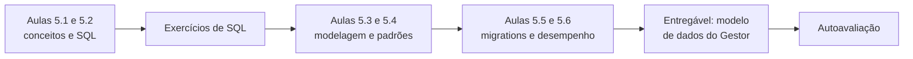
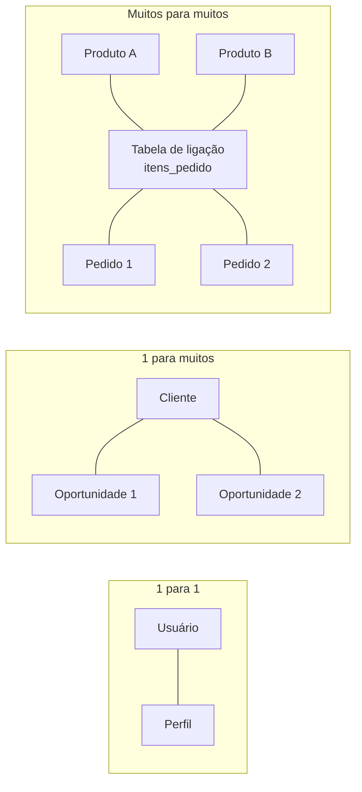
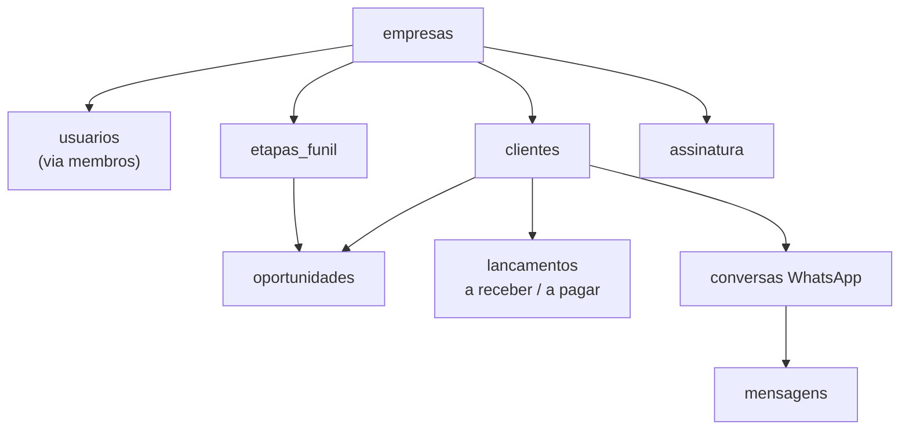
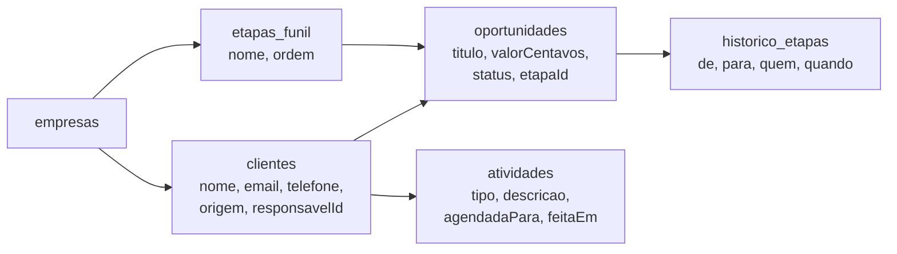
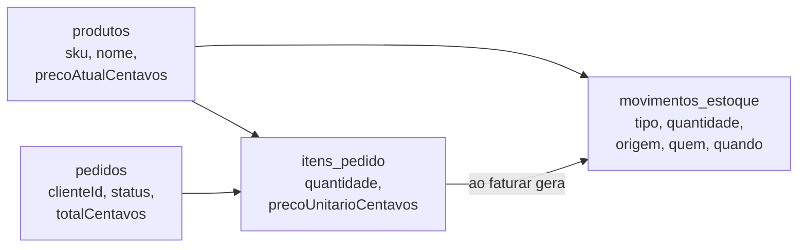
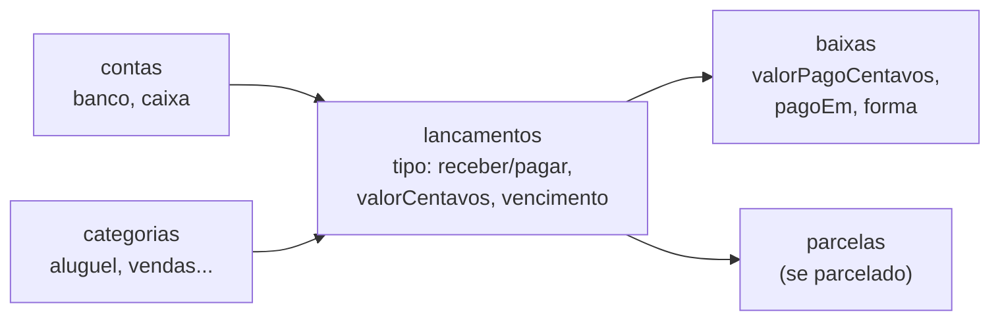
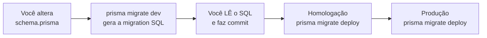

# Módulo 5: Banco de dados e modelagem

**Semanas 9 e 10 · cerca de 22 horas**

## Objetivos de aprendizagem

O código de um sistema pode ser reescrito. Os **dados** do cliente, não. Um erro no modelo de dados (dinheiro guardado do jeito errado, falta de histórico, tabelas sem dono) persiste por anos e contamina tudo que é construído em cima. E é no banco que moram os dados que podem vazar. Este módulo ensina a desenhar o banco como um sênior: a estrutura certa, as proteções certas e as decisões que o Claude não deve tomar sozinho.

Ao final deste módulo você será capaz de:
1. Explicar tabelas, colunas, chaves primárias, chaves estrangeiras e os três tipos de relacionamento.
2. Ler e escrever consultas SQL essenciais em PostgreSQL.
3. Modelar os dados de um CRM, de um ERP e de um financeiro, evitando as armadilhas clássicas.
4. Aplicar os padrões de dinheiro em centavos, datas em UTC, auditoria e exclusão lógica.
5. Usar migrations e o Prisma para evoluir o banco com segurança.
6. Identificar consultas lentas e resolvê-las com índices.

### Como estudar este módulo

*Figura: do conceito de tabela ao modelo completo do Gestor.*

| Semana | O que fazer | Horas |
|---|---|---|
| 9 | Aulas 5.1 a 5.3, exercícios 1 a 3 | 11 |
| 10 | Aulas 5.4 a 5.6, exercícios 4 e 5, entregável, autoavaliação | 11 |

---

## Aula 5.1: Tabelas, chaves e relacionamentos

Um banco de dados relacional é, no fundo, um conjunto de planilhas muito bem-comportadas que se referenciam umas às outras. Entender essa ideia é suficiente para ler qualquer modelo de dados que o Claude propuser e apontar o que está errado.

### Tabela, linha e coluna

| Conceito | Na planilha | No banco | Exemplo |
|---|---|---|---|
| **Tabela** | Uma aba | Um tipo de coisa | `clientes` |
| **Coluna** | Um cabeçalho | Um atributo, com tipo definido | `nome` (texto), `criadoEm` (data e hora) |
| **Linha** | Uma linha | Um registro | O cliente "Maria Souza" |

A grande diferença para a planilha: **cada coluna tem um tipo e regras**. Uma coluna de data não aceita "amanhã"; uma coluna obrigatória não aceita vazio; uma coluna única não aceita repetição. O banco **recusa** dados inválidos, o que é a sua última linha de defesa contra bugs.

### Tipos de dados que você vai usar

| Tipo (PostgreSQL) | Guarda | Use para |
|---|---|---|
| `text` / `varchar` | Texto | Nomes, e-mails, descrições |
| `integer` / `bigint` | Números inteiros | Quantidades, **dinheiro em centavos** |
| `boolean` | Verdadeiro/falso | `ativo`, `pago` |
| `date` | Data sem horário | Vencimentos, aniversários |
| `timestamptz` | Instante no tempo, com fuso | `criadoEm`, `pagoEm` |
| `uuid` | Identificador único aleatório | Ids |
| `jsonb` | Estrutura flexível | Dados de webhooks recebidos, configurações |
| enum | Lista fixa de opções | `status`: aberta, ganha, perdida |

### Chave primária: a identidade

Toda tabela tem uma **chave primária** (primary key), uma coluna que identifica cada linha de forma única e nunca muda. Normalmente é `id`.

Duas opções comuns:
- **Número sequencial** (1, 2, 3...): simples, mas revela informação ("sou o cliente 47, então essa empresa tem uns 47 clientes") e facilita adivinhar ids alheios.
- **UUID ou similar** (`a3f9c2e1-...`): aleatório, impossível de adivinhar. **Padrão desta formação** para tabelas expostas em URLs.

> ⚠️ Id aleatório **não substitui** a verificação de permissão. Ele só dificulta a adivinhação. A proteção real é o filtro por `empresaId` (Aula 2.5).

### Chave estrangeira: a referência

Uma **chave estrangeira** (foreign key) é uma coluna que aponta para a chave primária de outra tabela. É assim que as tabelas se relacionam:

```text
oportunidades
  id          = "op-81"
  titulo      = "Reforma da cozinha"
  clienteId   = "cl-12"   ← aponta para clientes.id
  empresaId   = "emp-3"   ← aponta para empresas.id
```

O banco garante que `clienteId` aponta para um cliente que **existe**. Se alguém tentar apagar o cliente "cl-12" com oportunidades ligadas a ele, o banco recusa (ou faz o que você configurou). Isso evita "registros órfãos", que quebram relatórios.

### Os três tipos de relacionamento


*Figura: os três tipos de relacionamento. O muitos para muitos sempre precisa de uma tabela no meio.*

| Tipo | Exemplo | Como se faz |
|---|---|---|
| **1 para 1** | Usuário ↔ configurações do usuário | Chave estrangeira única |
| **1 para muitos** | Um cliente tem muitas oportunidades | Chave estrangeira no lado "muitos" (`oportunidades.clienteId`) |
| **Muitos para muitos** | Um pedido tem muitos produtos; um produto está em muitos pedidos | **Tabela de ligação** (`itens_pedido` com `pedidoId`, `produtoId`, `quantidade`, `precoUnitarioCentavos`) |

### Normalização: cada informação em um só lugar

Regra prática: **cada fato é guardado uma única vez**. Se o nome do cliente aparece na tabela de clientes **e** em cada oportunidade, quando ele mudar de nome você terá dados contraditórios.

Exceção importante: **valores históricos**. O preço de um produto pode mudar, mas o preço **cobrado naquele pedido** não. Por isso `itens_pedido` guarda `precoUnitarioCentavos` no momento da venda, em vez de consultar o preço atual do produto. Isso não é duplicação, é **fotografia do momento**, e é obrigatório em sistemas financeiros e de vendas.

### Exemplo completo: o Gestor em blocos


*Figura: as principais tabelas do Gestor. Tudo nasce da empresa (o tenant), e é isso que permite isolar os dados de cada uma.*

Repare: **tudo pendura em `empresas`**. Essa é a espinha dorsal de um SaaS multi-empresa.

> 📌 **Em resumo**
> - Tabelas têm colunas com tipo e regras; o banco recusa dados inválidos.
> - Chave primária identifica; chave estrangeira referencia e impede órfãos.
> - Muitos para muitos sempre usa uma tabela de ligação.
> - Cada fato em um lugar só, exceto fotografias históricas (preço no momento da venda).

### Para ir além
- [Tutorial oficial do PostgreSQL (em inglês)](https://www.postgresql.org/docs/current/tutorial.html)

---

## Aula 5.2: SQL essencial em PostgreSQL

O Prisma (Aula 5.5) vai escrever a maior parte das consultas por você. Mesmo assim, você precisa de SQL para três coisas: **investigar problemas** (o dado gravado está certo?), **conferir relatórios** do cliente e **ler** o que o Claude escreve quando a consulta é complexa. Esta aula cobre o essencial.

### SQL: a linguagem do banco

**SQL** é a linguagem para falar com bancos relacionais. Ela tem quatro verbos principais:

| Comando | Faz | Exemplo |
|---|---|---|
| `SELECT` | Ler | `SELECT nome, email FROM clientes;` |
| `INSERT` | Criar | `INSERT INTO clientes (nome) VALUES ('Maria');` |
| `UPDATE` | Alterar | `UPDATE clientes SET telefone = '...' WHERE id = '...';` |
| `DELETE` | Apagar | `DELETE FROM clientes WHERE id = '...';` |

> ⚠️ **O `WHERE` esquecido.** `UPDATE clientes SET ativo = false;` sem `WHERE` desativa **todos** os clientes. `DELETE FROM lancamentos;` apaga **todos** os lançamentos. Em produção, nunca rode `UPDATE` ou `DELETE` à mão sem antes rodar o `SELECT` com o mesmo `WHERE` para ver o que será afetado, e sem estar dentro de uma transação (abaixo).

### Lendo dados: SELECT

```sql
-- clientes de uma empresa, em ordem alfabética
SELECT nome, email, cidade
FROM clientes
WHERE "empresaId" = 'emp-3'
  AND "excluidoEm" IS NULL
ORDER BY nome
LIMIT 50;
```

| Parte | Função |
|---|---|
| `SELECT colunas` | O que trazer |
| `FROM tabela` | De onde |
| `WHERE condição` | Filtro (`=`, `<>`, `>`, `<`, `LIKE`, `IN`, `IS NULL`) |
| `ORDER BY` | Ordenação (`DESC` para decrescente) |
| `LIMIT` | Quantos no máximo |

### Juntando tabelas: JOIN

```sql
-- oportunidades abertas, com o nome do cliente
SELECT o.titulo, o."valorCentavos", c.nome AS cliente
FROM oportunidades o
JOIN clientes c ON c.id = o."clienteId"
WHERE o."empresaId" = 'emp-3'
  AND o.status = 'aberta';
```

O `JOIN ... ON` diz como as tabelas se ligam (a chave estrangeira). `LEFT JOIN` traz as linhas da primeira tabela mesmo quando não há correspondência na segunda (por exemplo, clientes sem nenhuma oportunidade).

### Resumindo: GROUP BY

```sql
-- total a receber por mês de vencimento, em reais
SELECT date_trunc('month', vencimento) AS mes,
       COUNT(*) AS quantidade,
       SUM("valorCentavos") / 100.0 AS total_reais
FROM lancamentos
WHERE "empresaId" = 'emp-3'
  AND tipo = 'receber'
  AND "pagoEm" IS NULL
GROUP BY mes
ORDER BY mes;
```

Funções de agregação: `COUNT`, `SUM`, `AVG`, `MIN`, `MAX`. Repare na divisão por `100.0` **apenas para exibir**; o dado continua em centavos.

### Transações: tudo ou nada

Uma **transação** agrupa vários comandos para que aconteçam **todos ou nenhum**. Exemplo clássico: registrar um pagamento.

```sql
BEGIN;
  UPDATE lancamentos SET "pagoEm" = now() WHERE id = 'lan-55';
  INSERT INTO auditoria (acao, "registroId", "usuarioId") VALUES ('pagamento', 'lan-55', 'usu-9');
COMMIT;   -- confirma tudo
-- ou ROLLBACK; para desfazer tudo
```

Se o servidor cair entre o `UPDATE` e o `INSERT`, a transação garante que nenhum dos dois fique gravado pela metade. No Módulo 7 você vai ver transações no código; aqui, guarde o conceito e o uso em manutenção manual: **sempre** `BEGIN`, confira o resultado, depois `COMMIT`.

### Injeção de SQL: o ataque mais clássico

Se o sistema monta SQL juntando texto digitado pelo usuário, um atacante pode digitar SQL:

```typescript
// ❌ NUNCA
const sql = `SELECT * FROM clientes WHERE nome = '${nomeDigitado}'`;
// se nomeDigitado for:  ' OR '1'='1
// a consulta vira: SELECT * FROM clientes WHERE nome = '' OR '1'='1'
// e devolve TODOS os clientes de TODAS as empresas
```

A defesa: **consultas parametrizadas**, em que o valor é enviado separado do comando. O Prisma faz isso automaticamente. Se o Claude usar `$queryRawUnsafe` ou montar SQL com crases e `${}`, é um alerta vermelho (está no seu checklist de revisão).

### Onde rodar SQL com segurança

- **No desenvolvimento:** à vontade, em um banco local com dados fictícios. Ferramentas: `psql` (terminal), o Prisma Studio (`npx prisma studio`), DBeaver ou o painel do provedor.
- **Em produção:** com um usuário **somente leitura** para investigar. Alterações manuais só com transação, com registro do que foi feito e, de preferência, depois de um backup.

### Exemplo completo: investigando uma reclamação

A gerente da Imobiliária Lar Novo diz: "o painel mostra 12 oportunidades ganhas em outubro, mas eu contei 14".

```sql
-- 1. quantas o banco tem?
SELECT COUNT(*) FROM oportunidades
WHERE "empresaId" = 'emp-7' AND status = 'ganha'
  AND "ganhaEm" >= '2026-10-01' AND "ganhaEm" < '2026-11-01';
-- resultado: 14

-- 2. quais são, e por que o painel não mostra duas?
SELECT id, titulo, "ganhaEm", "excluidoEm" FROM oportunidades
WHERE "empresaId" = 'emp-7' AND status = 'ganha'
  AND "ganhaEm" >= '2026-10-01' AND "ganhaEm" < '2026-11-01'
ORDER BY "ganhaEm";
```

Você descobre que as duas que faltam foram ganhas em 31/10 depois das 21h. Em UTC, já era 1º de novembro. O painel usa o mês em UTC; a gerente pensa no horário de Brasília. Causa encontrada em 10 minutos, com um teste para escrever (Aula 3.5) e uma regra que já está no seu CLAUDE.md.

> 📌 **Em resumo**
> - SELECT, INSERT, UPDATE, DELETE; JOIN para ligar tabelas; GROUP BY para resumir.
> - Nunca rode UPDATE ou DELETE sem antes ver o SELECT com o mesmo WHERE, dentro de uma transação.
> - Transação: tudo ou nada.
> - Injeção de SQL se evita com consultas parametrizadas; SQL montado com texto do usuário é proibido.

### Para ir além
- [Tutorial do PostgreSQL (em inglês)](https://www.postgresql.org/docs/current/tutorial.html): capítulos 2 e 3.

---

## Aula 5.3: Modelar CRM, ERP e financeiro

Agora você junta tudo para desenhar modelos de verdade. O objetivo não é decorar tabelas, é aprender **o raciocínio**: identificar as entidades, os relacionamentos, o que precisa de histórico e onde estão as armadilhas de cada tipo de sistema.

### O método em 5 passos

1. **Liste os substantivos** da especificação: cliente, oportunidade, etapa, atividade, lançamento... Cada um é candidato a tabela.
2. **Liste os atributos** de cada um, com tipo: nome (texto), valor (centavos), vencimento (data).
3. **Desenhe os relacionamentos** e o tipo (1:1, 1:N, N:N).
4. **Marque o que precisa de histórico**: preços, status, valores, quem fez o quê.
5. **Marque dados pessoais e sensíveis** (vem da especificação, seção 9).

### Modelo de um CRM


*Figura: o núcleo de um CRM. A tabela de histórico de etapas é o que permite medir o tempo de cada fase do funil.*

**Armadilhas de CRM:**
- **Etapas fixas no código.** Cada empresa quer o próprio funil. Etapas são **dados** (`etapas_funil` com `empresaId` e `ordem`), não um enum.
- **Sem histórico de etapas.** Sem ele, você não consegue responder "quanto tempo em média uma proposta leva para fechar?", que é a pergunta que todo dono faz.
- **Responsável sem regra.** Quando um vendedor sai, os clientes dele precisam ser transferidos. Modele `responsavelId` e preveja a transferência.

### Modelo de um ERP (núcleo de estoque e vendas)


*Figura: o núcleo de um ERP. O estoque não é um número solto, é a soma dos movimentos, o que permite saber de onde veio cada diferença.*

**Armadilhas de ERP:**
- **Estoque como um número que se edita.** Se `produtos.estoque = 15` é alterado diretamente, quando o número estiver errado ninguém sabe por quê. O padrão sênior é o **livro de movimentos**: cada entrada, saída e ajuste é uma linha em `movimentos_estoque`. O saldo é a soma (ou um campo calculado e conferido contra a soma).
- **Preço consultado do produto.** O item do pedido precisa guardar o preço do momento (Aula 5.1).
- **Venda simultânea do último item.** Resolvido com transação e trava (Módulo 7), mas o modelo precisa permitir: o saldo é verificado e baixado dentro da mesma transação.

### Modelo de um financeiro


*Figura: o núcleo de um financeiro. Separar o lançamento (o que se deve) da baixa (o que se pagou) permite pagamentos parciais e conciliação.*

**Armadilhas de financeiro:**
- **Float para dinheiro.** Proibido (Aula 5.4).
- **Pagamento como um campo "pago: sim/não".** A vida real tem pagamento parcial, pagamento em duas formas, estorno. Separe **lançamento** (o título: "R$ 1.000 vence dia 10") de **baixa** (o pagamento: "R$ 400 em 08/11 via Pix").
- **Apagar lançamentos.** Em financeiro, nada se apaga: **estorna-se** (um lançamento novo que anula o anterior) ou **cancela-se** (status, com motivo e autor). O histórico é obrigação contábil e prova em caso de disputa.
- **Saldo editável.** Igual ao estoque: o saldo é calculado a partir dos lançamentos e baixas.

### O padrão comum: livro-razão

Repare que estoque e financeiro usam a mesma ideia: **não se edita um saldo; registra-se cada movimento**. Isso tem nome em contabilidade (razão) e em engenharia de software (registro de eventos). Sempre que o cliente disser "eu preciso confiar nesse número", pense em livro de movimentos.

### Exemplo completo: modelando com o Claude

Você não vai desenhar sozinho. Vai **dirigir**:

```text
(modo de planejamento)
Com base em @docs/especificacao.md, proponha o modelo de dados do Gestor.
Para cada tabela: colunas com tipo, chaves, relacionamentos, índices.
Regras obrigatórias (ver CLAUDE.md): empresaId em toda tabela de negócio,
dinheiro em centavos inteiros, datas sem horário como date, instantes como
timestamptz, exclusão lógica com excluidoEm.
Para o financeiro, separe lançamento de baixa. Para o funil, etapas
configuráveis por empresa com histórico de mudanças.
Marque as colunas com dados pessoais.
Apresente como um diagrama Mermaid e uma tabela. Liste dúvidas.
```

Depois, revise com as armadilhas desta aula na mão.

> 📌 **Em resumo**
> - Modele em 5 passos: substantivos, atributos, relacionamentos, histórico, dados pessoais.
> - CRM: etapas configuráveis e histórico de etapas.
> - ERP e financeiro: livro de movimentos, nunca saldo editável; separar lançamento de baixa.
> - Em financeiro nada se apaga: estorna-se ou cancela-se com motivo.

### Para ir além
- [dbdiagram.io](https://dbdiagram.io/): desenhe e compartilhe diagramas de banco de dados.

---

## Aula 5.4: Padrões de sênior: dinheiro, datas, auditoria e exclusão lógica

Existem quatro decisões de modelagem que, feitas errado, causam os bugs mais caros e mais constrangedores em sistemas empresariais. A boa notícia: as soluções são padrões conhecidos, e você vai aplicá-los em todo projeto, a partir de hoje.

### 1. Dinheiro: inteiro em centavos

Computadores guardam números com vírgula (ponto flutuante) de forma aproximada:

```typescript
0.1 + 0.2              // 0.30000000000000004
1.15 * 100             // 114.99999999999999
```

Em uma cobrança, um centavo de diferença gera conciliação que não fecha, cliente reclamando e contador desconfiado. A solução: **guarde dinheiro como número inteiro de centavos**.

| Valor | Guardado como |
|---|---|
| R$ 150,50 | `15050` |
| R$ 0,01 | `1` |
| R$ 1.000.000,00 | `100000000` |

Regras práticas:
- Coluna `valorCentavos` do tipo `integer` (até cerca de R$ 21 milhões) ou `bigint` (para valores maiores).
- Cálculos de porcentagem: calcule e **arredonde para inteiro** (`Math.round`) em cada passo, com a regra de arredondamento definida na especificação.
- Divisão em parcelas: R$ 100,00 em 3 vezes não é 33,33 × 3 (dá 99,99). A última parcela absorve a diferença: 33,33 + 33,33 + 33,34.
- Converta para reais **só na hora de exibir** (`Intl.NumberFormat('pt-BR', { style: 'currency', currency: 'BRL' })`).

### 2. Datas e horas: UTC e o tipo certo

Duas coisas diferentes que iniciantes misturam:

| Conceito | Exemplo | Tipo no banco | Fuso |
|---|---|---|---|
| **Instante** (momento exato no tempo) | "O pagamento foi confirmado às 14h32" | `timestamptz` | Guardado em UTC, exibido no fuso do usuário |
| **Data de calendário** (dia, sem hora) | "Vence dia 10/11" | `date` | Sem fuso |

O bug clássico (você já viu na Aula 3.5): guardar um vencimento como instante à meia-noite UTC, que no Brasil vira 21h do dia anterior.

Regras:
- `criadoEm`, `pagoEm`, `enviadoEm`: `timestamptz`.
- `vencimento`, `dataNascimento`, `competencia`: `date`.
- "Hoje" para regras de negócio (está vencido?) é calculado no fuso do cliente (`America/Sao_Paulo`), não do servidor.
- Testes cobrem virada de dia, de mês e de ano.

### 3. Auditoria: quem fez o quê, quando

Em todo sistema de empresa, um dia alguém vai perguntar: **"quem mudou isso?"**. Sem auditoria, você não sabe responder, e numa disputa (funcionário que deu desconto indevido, cobrança apagada) isso é grave.

Duas camadas:

**a) Colunas de rastreio em toda tabela:**
```text
criadoEm, criadoPorId, atualizadoEm, atualizadoPorId
```

**b) Tabela de auditoria para ações sensíveis:**

| Coluna | Exemplo |
|---|---|
| `id` | |
| `empresaId` | emp-3 |
| `usuarioId` | usu-9 |
| `acao` | `lancamento.valor_alterado` |
| `entidade`, `entidadeId` | lancamentos, lan-55 |
| `antes`, `depois` | `{ "valorCentavos": 100000 }` → `{ "valorCentavos": 80000 }` |
| `ip` | (endereço de origem) |
| `criadoEm` | 2026-11-08 14:32 |

O que é "sensível": mudanças em valores, permissões, dados bancários, exclusões, exportações de dados e acesso a dados sensíveis (como a receita da ótica).

> ⚠️ A tabela de auditoria só recebe **inserções**. Ninguém (nem o sistema) altera ou apaga registros dela. Se der, ela não serve como prova.

### 4. Exclusão lógica: apagar sem apagar

Quando um usuário "exclui" um cliente, você raramente quer apagar a linha do banco: há oportunidades, lançamentos e histórico ligados a ele. A solução é a **exclusão lógica**: uma coluna `excluidoEm`. Excluir é preencher a data; as consultas normais filtram `excluidoEm IS NULL`.

Vantagens: dá para desfazer ("excluí sem querer!"), o histórico continua íntegro e você tem prova do que existia.

Cuidado com a LGPD: quando um titular pede a **eliminação** dos dados pessoais dele, a exclusão lógica não basta. Você precisa apagar de fato, ou **anonimizar** (trocar nome, e-mail e telefone por valores sem significado), mantendo só o que a lei obriga a guardar (por exemplo, dados fiscais). Você vai ver o procedimento no Módulo 14.

### Exemplo completo: o modelo de `lancamentos` com os quatro padrões

```prisma
model Lancamento {
  id              String    @id @default(uuid())
  empresaId       String
  empresa         Empresa   @relation(fields: [empresaId], references: [id])
  tipo            TipoLancamento        // receber | pagar
  descricao       String
  valorCentavos   Int                   // 1. dinheiro em centavos
  vencimento      DateTime  @db.Date    // 2. data sem horário
  clienteId       String?
  categoriaId     String?
  status          StatusLancamento @default(aberto)
  baixas          Baixa[]
  criadoEm        DateTime  @default(now()) @db.Timestamptz  // 2. instante em UTC
  criadoPorId     String                // 3. rastreio
  atualizadoEm    DateTime  @updatedAt @db.Timestamptz
  excluidoEm      DateTime? @db.Timestamptz                  // 4. exclusão lógica

  @@index([empresaId, vencimento])
  @@index([empresaId, status])
}
```

Você não precisa saber escrever isso de cabeça. Precisa saber **conferir** que os quatro padrões estão lá.

> 📌 **Em resumo**
> - Dinheiro: inteiro em centavos, arredondar a cada passo, converter só para exibir.
> - Datas: instante em `timestamptz` (UTC), dia de calendário em `date`; "hoje" no fuso do cliente.
> - Auditoria: colunas de rastreio em tudo e tabela de auditoria só de inserção para ações sensíveis.
> - Exclusão lógica com `excluidoEm`, e eliminação ou anonimização real quando a LGPD exigir.

---

## Aula 5.5: Migrations e o Prisma

O banco de dados de um sistema muda ao longo da vida: colunas novas, tabelas novas, regras novas. Se essas mudanças forem feitas à mão, em algum momento o banco do seu computador, o de homologação e o de produção ficam diferentes, e o sistema quebra só em produção. **Migrations** resolvem isso.

### O que é um ORM e por que o Prisma

Um **ORM** traduz entre o código (objetos TypeScript) e o banco (tabelas SQL). Com o **Prisma**, você descreve o modelo em um arquivo (`prisma/schema.prisma`) e ele:
1. Gera o SQL para criar e alterar as tabelas (migrations).
2. Gera um cliente tipado: `db.cliente.findMany(...)`, com o TypeScript avisando se você errar o nome de uma coluna.
3. Usa consultas parametrizadas, o que protege contra injeção de SQL.

O Drizzle é uma alternativa popular, mais próxima do SQL. As duas são boas escolhas; esta formação usa o Prisma por ser muito bem conhecido pelo Claude e ter migrations simples.

### O que é uma migration

Uma **migration** é um arquivo com as instruções para levar o banco de uma versão para a próxima. Elas ficam em `prisma/migrations/`, vão para o Git e são aplicadas **na mesma ordem** em todos os ambientes.


*Figura: o caminho de uma mudança no banco. A mesma migration, revisada e versionada, é aplicada em cada ambiente na ordem.*

```bash
# no desenvolvimento: gera e aplica a migration
npx prisma migrate dev --name adiciona_origem_cliente

# em homologação e produção: só aplica as migrations já existentes
npx prisma migrate deploy
```

### Leia o SQL da migration (sempre)

O arquivo gerado mostra exatamente o que vai acontecer no banco:

```sql
-- prisma/migrations/20261108_adiciona_origem_cliente/migration.sql
CREATE TYPE "OrigemCliente" AS ENUM ('indicacao', 'instagram', 'google', 'outro', 'nao_informado');
ALTER TABLE "Cliente" ADD COLUMN "origem" "OrigemCliente" NOT NULL DEFAULT 'nao_informado';
```

Sinais de perigo que você procura:

| No SQL | Risco |
|---|---|
| `DROP TABLE` / `DROP COLUMN` | **Perda de dados** irreversível |
| `ALTER COLUMN ... TYPE` | Conversão que pode falhar ou truncar dados |
| `ADD COLUMN ... NOT NULL` sem `DEFAULT` | Falha em tabelas que já têm dados |
| Renomear coluna | O Prisma pode interpretar como "apagar e criar", **perdendo os dados** |

> ⚠️ **Regra de ouro das migrations:** nunca aplique em produção uma migration que apaga ou altera colunas com dados sem (1) ter lido o SQL, (2) ter um backup recente e testado e (3) ter testado a mesma migration em uma cópia do banco. O Prisma avisa quando uma mudança vai perder dados; **não ignore o aviso**.

### Mudanças seguras em etapas

Para mudanças arriscadas em sistemas que já estão em uso, use o padrão **expandir e contrair**:

1. **Expandir:** crie a coluna nova sem apagar a antiga.
2. **Migrar dados:** copie os dados da antiga para a nova.
3. **Mudar o código** para usar a nova.
4. **Contrair:** só depois de tudo estável, em outra entrega, remova a antiga.

Exemplo: trocar `telefone` (texto livre) por `telefoneE164` (formato padronizado `+5511999998888`). Fazer em quatro passos permite voltar atrás em qualquer momento, sem perder dados e sem tirar o sistema do ar.

### Dados de exemplo (seed)

Um script de **seed** popula o banco de desenvolvimento com dados fictícios: 2 empresas, 5 usuários com papéis diferentes, 50 clientes, lançamentos variados. Isso permite testar isolamento e permissões de verdade, sem nunca usar dados reais de clientes.

```text
Crie prisma/seed.ts com: empresas "Ótica Teste" e "Imobiliária Teste"; em cada
uma, um dono, uma gerente e uma atendente (senhas fictícias documentadas no
README); 30 clientes por empresa com nomes inventados; oportunidades em todas as
etapas; lançamentos vencidos, a vencer e pagos. Nenhum dado real.
```

### Exemplo completo: adicionando um campo ao Gestor, do jeito certo

1. Especificação atualizada: clientes ganham "origem" (H12).
2. Pedido ao Claude (como na Aula 3.3), com plano aprovado.
3. Claude altera `schema.prisma` e roda `migrate dev`.
4. **Você lê** o `migration.sql`: um `ADD COLUMN` com `DEFAULT`. Seguro.
5. Testes passam; commit inclui o schema **e** a pasta da migration.
6. No deploy (Módulo 12), o pipeline roda `prisma migrate deploy` antes de iniciar a nova versão.

> 📌 **Em resumo**
> - O Prisma descreve o modelo em `schema.prisma`, gera migrations e um cliente tipado e seguro.
> - Migrations vão para o Git e são aplicadas na mesma ordem em todos os ambientes.
> - Leia o SQL de toda migration; DROP, ALTER TYPE e renomeações exigem backup e teste prévio.
> - Mudanças arriscadas em etapas: expandir, migrar, mudar o código, contrair.

### Para ir além
- [Documentação do Prisma (em inglês)](https://www.prisma.io/docs)
- [Documentação do Drizzle (em inglês)](https://orm.drizzle.team/docs/overview)

---

## Aula 5.6: Desempenho: índices e consultas lentas

O sistema funcionava rápido com 50 clientes de teste. Seis meses depois, com 40 mil lançamentos, a tela do financeiro leva 9 segundos e o cliente acha que "o sistema está caindo". Na maioria das vezes, a causa é a mesma, e a solução também: **índices**.

### O que é um índice

Pense no índice remissivo de um livro. Sem ele, para achar "juros", você lê o livro inteiro. Com ele, vai direto à página. Um índice no banco faz o mesmo: em vez de varrer todas as linhas da tabela, o banco vai direto às que importam.

| Situação | Sem índice | Com índice |
|---|---|---|
| Buscar lançamentos da empresa X em 2 milhões de linhas | Lê 2 milhões | Lê só as da empresa X |
| Tempo típico | segundos | milissegundos |

### Onde criar índices

| Coluna(s) | Por quê |
|---|---|
| `empresaId` (em toda tabela de negócio) | **Toda** consulta filtra por ela |
| `empresaId` + a coluna mais filtrada (`vencimento`, `status`, `criadoEm`) | Índice composto para as telas principais |
| Chaves estrangeiras (`clienteId`, `oportunidadeId`) | Usadas em JOINs |
| Colunas de busca única (`email`, `cpf` dentro da empresa) | Também garantem unicidade |

Índices têm custo: ocupam espaço e deixam as gravações um pouco mais lentas. Não indexe tudo; indexe o que as consultas reais usam.

### Encontrando a consulta lenta

No PostgreSQL, `EXPLAIN ANALYZE` mostra como o banco executa uma consulta:

```sql
EXPLAIN ANALYZE
SELECT * FROM lancamentos
WHERE "empresaId" = 'emp-3' AND vencimento < '2026-11-01' AND status = 'aberto';
```

Procure no resultado:
- **`Seq Scan`** em tabela grande: o banco está lendo tudo. Candidato a índice.
- **`Index Scan`**: está usando um índice. Bom.
- **Tempo total** (`Execution Time`).

Você não precisa interpretar tudo. Cole o resultado para o Claude: *"esta consulta leva 4 segundos com 2 milhões de linhas; explique o plano de execução e sugira um índice"*.

### O problema N+1

Um padrão de lentidão muito comum em código gerado por IA:

```typescript
// ❌ 1 consulta para as oportunidades + 1 consulta por oportunidade = N+1
const oportunidades = await db.oportunidade.findMany({ where: { empresaId } });
for (const o of oportunidades) {
  o.cliente = await db.cliente.findFirst({ where: { id: o.clienteId, empresaId } });
}

// ✔ 1 consulta só, trazendo o cliente junto
const oportunidades = await db.oportunidade.findMany({
  where: { empresaId },
  include: { cliente: { select: { nome: true } } },
});
```

Com 500 oportunidades, a primeira versão faz 501 consultas. Sinal para procurar na revisão: **consulta ao banco dentro de um laço (`for`, `map`)**.

### Paginação: nunca traga tudo

Toda lista que pode crescer precisa de paginação: mostre 50 por vez. `findMany` sem `take` (limite) em uma tabela que cresce é uma bomba-relógio. Acrescente ao CLAUDE.md: *"toda listagem é paginada, com no máximo 100 itens por página"*.

### Exemplo completo: a tela lenta do financeiro

A Contabilidade Exata reclama: a tela de contas a receber leva 9 segundos.

1. **Reproduzir** em homologação com volume parecido (o seed pode gerar 200 mil lançamentos fictícios).
2. **Medir:** nos logs, a consulta de listagem leva 8,7 s.
3. **`EXPLAIN ANALYZE`:** `Seq Scan on lancamentos`, lendo 1,8 milhão de linhas.
4. **Causa:** existe índice em `empresaId`, mas a consulta filtra por `empresaId`, `tipo` e `status` e ordena por `vencimento`.
5. **Solução:** índice composto `@@index([empresaId, tipo, status, vencimento])`, via migration, e paginação com 50 itens.
6. **Resultado:** 40 ms. Registre no diário: o problema, a medição antes e depois, e a solução.

> 📌 **Em resumo**
> - Índices fazem o banco ir direto às linhas certas; `empresaId` sempre tem índice.
> - `EXPLAIN ANALYZE` mostra se a consulta varre a tabela inteira.
> - Procure consultas dentro de laços (N+1) e use `include` ou JOIN.
> - Toda lista que cresce é paginada.

### Para ir além
- [PgBouncer](https://www.pgbouncer.org/): gerenciador de conexões, útil quando o sistema crescer (Módulo 15).

---

## Exercícios

### Exercício 1: SQL na prática (90 min)
**Objetivo:** escrever consultas reais.
Com o banco local do Gestor populado pelo seed (peça ao Claude para criá-lo, como na Aula 5.5), escreva consultas para:
1. Os 10 clientes mais recentes de uma empresa.
2. Quantas oportunidades há em cada etapa do funil de uma empresa.
3. O total vencido e não pago, em reais, por cliente, do maior para o menor.
4. Clientes que não têm nenhuma oportunidade (dica: `LEFT JOIN` e `IS NULL`).

<details>
<summary><strong>Resolução comentada (itens 3 e 4)</strong></summary>

```sql
-- 3. total vencido por cliente
SELECT c.nome, SUM(l."valorCentavos") / 100.0 AS vencido_reais
FROM lancamentos l
JOIN clientes c ON c.id = l."clienteId"
WHERE l."empresaId" = 'emp-3'
  AND l.tipo = 'receber'
  AND l.status = 'aberto'
  AND l.vencimento < CURRENT_DATE
  AND l."excluidoEm" IS NULL
GROUP BY c.nome
ORDER BY vencido_reais DESC;
```
Atenção: `CURRENT_DATE` usa o fuso do servidor do banco. Em produção, o "hoje" do cliente deve vir da aplicação, calculado em `America/Sao_Paulo`. Se o servidor estiver em UTC, entre 21h e meia-noite de Brasília o resultado estaria um dia adiantado. Pagamentos parciais (baixas) também deveriam ser descontados; esta versão simplifica.

```sql
-- 4. clientes sem oportunidades
SELECT c.nome
FROM clientes c
LEFT JOIN oportunidades o ON o."clienteId" = c.id
WHERE c."empresaId" = 'emp-3'
  AND o.id IS NULL;
```
O `LEFT JOIN` mantém todos os clientes; para os sem oportunidade, as colunas de `o` vêm vazias (`NULL`), e o `WHERE` filtra exatamente esses.
</details>

### Exercício 2: Modele um ERP de autopeças (60 min)
Desenhe (Mermaid ou dbdiagram.io) o modelo de produtos, estoque com livro de movimentos, pedidos, itens, clientes e fornecedores para a Autopeças Silva. Marque os campos de dinheiro, datas e auditoria.

### Exercício 3: Caça aos padrões (40 min)
Encontre os problemas neste modelo e reescreva-o:
```text
tabela pagamentos: id (número sequencial), cliente (texto com o nome),
valor (decimal com ponto), data (texto "10/11/2026"), pago (sim/não)
```

<details>
<summary><strong>Resolução comentada</strong></summary>

1. **Id sequencial** em tabela exposta: troque por UUID.
2. **Cliente como texto com o nome**: deve ser `clienteId` (chave estrangeira), senão nomes repetidos e mudanças de nome quebram tudo.
3. **Valor decimal com ponto flutuante**: `valorCentavos` inteiro.
4. **Data como texto**: impossível ordenar e comparar. Use `date` para vencimento e `timestamptz` para o momento do pagamento.
5. **"Pago: sim/não"**: não suporta pagamento parcial nem estorno. Separe lançamento e baixas.
6. Faltam: `empresaId`, colunas de rastreio (`criadoEm`, `criadoPorId`), `excluidoEm` e índices.
</details>

### Exercício 4: Leia uma migration (30 min)
Peça ao Claude para renomear a coluna `telefone` para `celular` no modelo Cliente, **sem aplicar**. Leia o SQL gerado (`npx prisma migrate dev --create-only`) e diga se haveria perda de dados. Depois, peça a versão segura.

### Exercício 5: Encontre a lentidão (60 min)
Gere 200 mil lançamentos fictícios no banco local, meça uma consulta de listagem com `EXPLAIN ANALYZE`, crie o índice adequado por migration e meça de novo. Registre antes e depois.

---

## Tarefa de campo

**Modele os dados do caso real** do Módulo 4 (o cliente ou a sua operação). Use o método de 5 passos, marque os dados pessoais e sensíveis e identifique qual padrão de livro de movimentos se aplica. Se a empresa já usa planilhas, analise uma delas (com dados anonimizados) e liste os problemas que o seu modelo resolve (dados repetidos, valores inconsistentes, falta de histórico).

---

## Entregável: Modelo de dados do Gestor

No repositório do Gestor:
1. `prisma/schema.prisma` completo para o MVP.
2. Migrations geradas e revisadas.
3. `prisma/seed.ts` com dados fictícios de 2 empresas.
4. `docs/modelo-de-dados.md` com o diagrama, a explicação de cada tabela e a lista de dados pessoais.

**Checklist de qualidade:**
- [ ] Toda tabela de negócio tem `empresaId` obrigatório e índice.
- [ ] Dinheiro em centavos inteiros; nenhuma coluna `Float` ou `Decimal` para valores.
- [ ] Vencimentos como `date`; instantes como `timestamptz`.
- [ ] Colunas de rastreio e `excluidoEm` nas tabelas de negócio.
- [ ] Tabela de auditoria criada.
- [ ] Financeiro separa lançamentos e baixas; funil tem etapas configuráveis e histórico.
- [ ] Ids aleatórios (UUID) nas tabelas expostas.
- [ ] Você leu o SQL de todas as migrations.
- [ ] O seed não contém nenhum dado real.
- [ ] Dados pessoais estão marcados no documento.

---

## Autoavaliação

Meta: 8 de 10.

1. Por que o item de pedido guarda o preço unitário, se o produto já tem preço?
2. Como você modela "um pedido tem muitos produtos e um produto está em muitos pedidos"?
3. Qual o risco de `UPDATE lancamentos SET status = 'pago'` rodado em produção?
4. O que é injeção de SQL e como o Prisma protege contra ela?
5. Por que guardar R$ 99,90 como `9990` e não como `99.90`?
6. Um vencimento gravado como `2026-11-10T00:00:00Z` aparece como 09/11 para o usuário. Por quê, e qual a correção no modelo?
7. Por que o saldo de estoque não deve ser um número editável?
8. Um titular pediu a eliminação dos seus dados pessoais. A exclusão lógica resolve? O que fazer?
9. O Prisma avisou que a migration vai apagar uma coluna com dados. O que você faz antes de aplicar em produção?
10. A tela de clientes ficou lenta. Qual a primeira hipótese e como confirmar?

<details>
<summary><strong>Gabarito</strong></summary>

1. Porque o preço do produto muda com o tempo, mas o preço cobrado naquele pedido não pode mudar. O item guarda a fotografia do momento da venda.
2. Com uma tabela de ligação (`itens_pedido`) com `pedidoId`, `produtoId`, `quantidade` e `precoUnitarioCentavos`.
3. Sem `WHERE`, marca **todos** os lançamentos de todas as empresas como pagos. Sempre rode antes o `SELECT` com o mesmo `WHERE`, dentro de uma transação, e confira a quantidade afetada.
4. É quando texto digitado pelo usuário é interpretado como parte do comando SQL, permitindo ler ou alterar dados indevidos. O Prisma envia os valores separados do comando (consultas parametrizadas), então o texto nunca vira SQL.
5. Porque números de ponto flutuante são aproximados e geram erros de centavos em somas e multiplicações. Inteiros em centavos são exatos.
6. Meia-noite em UTC corresponde a 21h do dia anterior em Brasília, e a exibição converte para o fuso local. Vencimento é uma data de calendário: deve ser gravado como `date`, sem horário e sem fuso.
7. Porque quando o número estiver errado não há como saber por quê. Com um livro de movimentos (entradas, saídas, ajustes), o saldo é a soma, e cada diferença tem origem, autor e data.
8. Não. A exclusão lógica mantém os dados. É preciso apagar de fato ou anonimizar os dados pessoais, mantendo apenas o que a lei obriga a guardar, e registrar o atendimento do pedido.
9. Ler o SQL, confirmar que a perda é intencional (ou reescrever com expandir e contrair), garantir um backup recente com restauração testada e testar a migration em uma cópia do banco de produção.
10. Falta de índice adequado ou ausência de paginação (ou N+1). Confirme medindo o tempo da consulta nos logs e rodando `EXPLAIN ANALYZE` para ver se há `Seq Scan` em tabela grande.
</details>

---

## Checklist de segurança do módulo

- [ ] `empresaId` em toda tabela de negócio.
- [ ] Ids aleatórios nas tabelas expostas em URLs.
- [ ] Nenhuma consulta com SQL montado a partir de texto do usuário.
- [ ] Tabela de auditoria só de inserção.
- [ ] Dados pessoais e sensíveis marcados no modelo.
- [ ] Seed só com dados fictícios.
- [ ] Usuário de banco somente leitura para investigar produção.
- [ ] Nenhuma migration destrutiva sem backup testado.

---

## Para aprofundar (opcional)

| Material | Formato | Por que vale |
|---|---|---|
| [Tutorial do PostgreSQL](https://www.postgresql.org/docs/current/tutorial.html) | Texto, em inglês | A base oficial de SQL |
| [Documentação do Prisma](https://www.prisma.io/docs) | Texto, em inglês | Modelagem, migrations e consultas |
| [Row Level Security no PostgreSQL](https://www.postgresql.org/docs/current/ddl-rowsecurity.html) | Texto, em inglês | Uma camada extra de isolamento que você verá no Módulo 9 |
