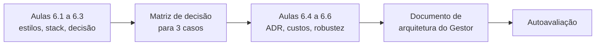
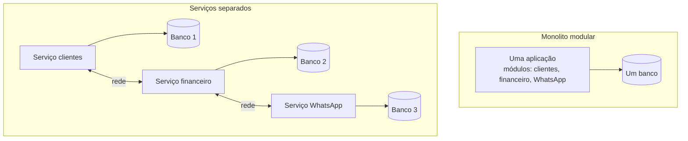
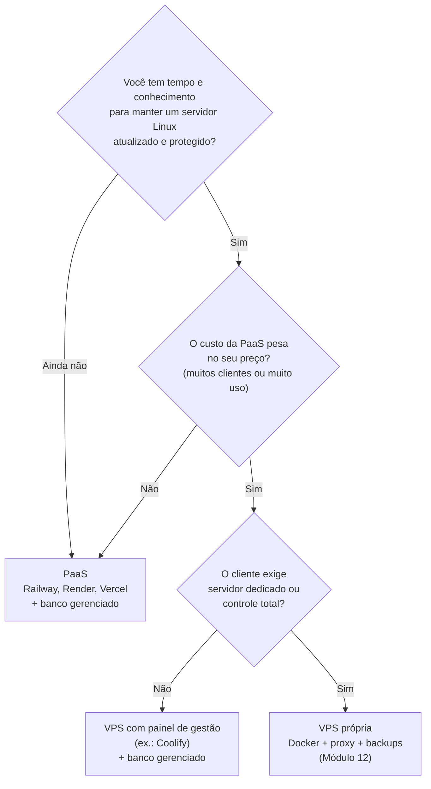
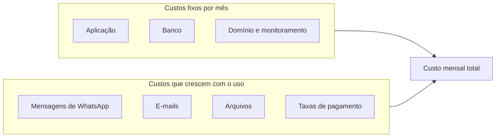
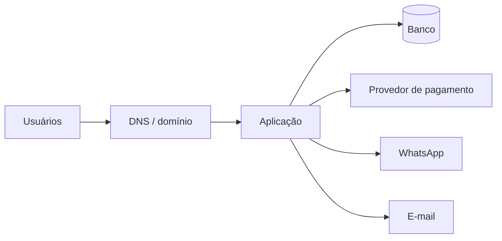
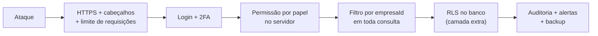

# Módulo 6: Arquitetura e escolha da stack

**Semanas 11 e 12 · cerca de 22 horas**

## Objetivos de aprendizagem

Hoje, quando o Claude diz "vamos usar tal banco" ou "vamos hospedar em tal lugar", você aceita. Neste módulo você aprende a **tomar essas decisões** e a **justificá-las** para o cliente. Arquitetura é o conjunto de escolhas difíceis de mudar depois: como o sistema é dividido, quais tecnologias usa, onde roda. Uma boa arquitetura para uma pequena empresa é quase sempre **simples**, e a simplicidade é uma das maiores defesas contra sistemas que caem e vazam.

Ao final deste módulo você será capaz de:
1. Comparar monolito, serviços separados e serverless, e escolher o adequado para cada caso.
2. Justificar a stack padrão desta formação e saber quando trocá-la.
3. Usar uma matriz de decisão para escolher estrutura e hospedagem por tipo de sistema.
4. Registrar decisões de arquitetura em ADRs.
5. Estimar o custo mensal de infraestrutura de um sistema.
6. Desenhar a arquitetura pensando em disponibilidade e proteção de dados desde o início.

### Como estudar este módulo

*Figura: das opções de arquitetura ao documento que justifica as escolhas do Gestor.*

| Semana | O que fazer | Horas |
|---|---|---|
| 11 | Aulas 6.1 a 6.3, exercícios 1 a 3 | 11 |
| 12 | Aulas 6.4 a 6.6, exercícios 4 e 5, entregável, autoavaliação | 11 |

---

## Aula 6.1: Monolito, serviços e serverless

Na internet você vai ler que "empresas modernas usam microsserviços". É verdade para Netflix e Mercado Livre, com centenas de engenheiros. Para um ERP de 15 usuários, microsserviços são uma das formas mais eficazes de criar um sistema caro, lento de construir e que cai mais. Esta aula ensina a escolher pelo tamanho real do problema.

### Três estilos


*Figura: monolito modular e serviços separados. No monolito, as partes conversam dentro do mesmo programa; nos serviços, pela rede, o que acrescenta pontos de falha.*

| Estilo | O que é | Vantagens | Desvantagens |
|---|---|---|---|
| **Monolito modular** | Uma única aplicação, organizada internamente em módulos bem separados | Simples de construir, testar, publicar e depurar; um só lugar para proteger | Escala como um bloco só (raramente um problema para PMEs) |
| **Serviços separados** (microsserviços) | Várias aplicações pequenas que conversam pela rede | Times independentes, escala por parte | Muito mais complexo: rede pode falhar, dados espalhados, mais superfície de ataque, mais custo |
| **Serverless** | Funções que só rodam quando chamadas, sem servidor fixo | Sem servidor para manter, paga por uso, escala sozinho | Limites de tempo de execução, "partida a frio", dependência do fornecedor |

### Por que o monolito modular é o padrão desta formação

- **Menos partes, menos falhas.** Cada serviço a mais é mais uma coisa que pode cair, mais um lugar com segredos, mais uma conexão que pode ser interceptada.
- **O Claude trabalha melhor.** Em um repositório único, ele vê o sistema inteiro e consegue fazer mudanças consistentes.
- **Manutenção barata.** Quando o cliente pedir uma mudança daqui a um ano, você abre **um** projeto.
- **Dá para separar depois.** Se um módulo crescer muito (por exemplo, o WhatsApp recebendo milhões de mensagens), ele pode virar um serviço. Começar separado e juntar depois é muito mais difícil.

> 🎯 **Regra prática:** comece com monolito modular. Separe uma parte em serviço próprio apenas quando houver **um motivo concreto e medido** (essa parte precisa escalar muito diferente das outras, ou tem requisitos de segurança totalmente distintos). O artigo "MonolithFirst", de Martin Fowler, defende exatamente isso.

### "Modular" é a palavra importante

Monolito não é bagunça. Dentro do projeto, cada módulo (clientes, financeiro, WhatsApp, assinaturas) tem sua pasta, suas regras e sua interface. Um módulo não mexe diretamente nas tabelas do outro; ele chama funções do outro.

```text
src/server/
├── clientes/       # só este módulo grava na tabela clientes
├── financeiro/     # usa clientes.buscarPorId(), não consulta a tabela direto
├── whatsapp/
└── assinaturas/
```

### Partes que rodam fora do fluxo principal

Mesmo em um monolito, algumas tarefas não devem acontecer "na hora" do clique do usuário:

| Tarefa | Por que não na hora | Solução |
|---|---|---|
| Enviar 500 lembretes de cobrança | Demora; se falhar no meio, o usuário fica esperando | **Fila de tarefas** com um processo trabalhador (worker) |
| Gerar relatório pesado | Pode levar minutos | Tarefa em segundo plano + aviso quando ficar pronto |
| Rodar todo dia às 7h | Ninguém clica | **Tarefa agendada** (cron) |
| Receber webhook de pagamento | Precisa responder rápido ao provedor | Registrar e processar em segundo plano |

Isso não é "microsserviço": é o mesmo código, rodando em um segundo processo. Você vai construir no Módulo 7.

### Exemplo completo: a proposta do Claude que você recusou

Você pediu ao Claude uma arquitetura para o sistema de atendimento de uma clínica (3 recepcionistas, 400 mensagens por dia). A proposta dele: "serviço de mensagens em Go, serviço de agenda em Node, fila com Kafka, banco separado para cada serviço, orquestração com Kubernetes".

Sua análise:
- 400 mensagens por dia são **uma a cada 2 minutos**. Qualquer monolito simples aguenta 1.000 vezes isso.
- Kafka e Kubernetes exigem conhecimento especializado para operar com segurança. Quem vai manter isso às 23h de um sábado?
- Três bancos significam três backups, três senhas, três lugares para vazar.

Sua decisão: monolito Next.js, um PostgreSQL, uma fila simples para os envios do WhatsApp. Custo mensal 10 vezes menor, manutenção possível por uma pessoa, e menos pontos de falha. **Você acabou de tomar uma decisão de arquitetura, e ela vai num ADR (Aula 6.4).**

> 📌 **Em resumo**
> - Monolito modular: o padrão para sistemas de pequenas e médias empresas.
> - Serviços separados só com motivo concreto e medido; cada serviço a mais é mais um ponto de falha e de vazamento.
> - Serverless troca manutenção de servidor por limites e dependência do fornecedor.
> - Tarefas demoradas ou agendadas rodam em segundo plano, no mesmo projeto.

### Para ir além
- [MonolithFirst, de Martin Fowler (em inglês)](https://martinfowler.com/bliki/MonolithFirst.html)
- [Modelo C4 de diagramas de arquitetura (em inglês)](https://c4model.com/)

---

## Aula 6.2: A stack padrão desta formação, e por que ela foi escolhida

**Stack** é o conjunto de tecnologias de um sistema: linguagem, framework, banco, hospedagem. Escolher stack é uma decisão de longo prazo: você vai conviver com ela por anos e vai ensinar o cliente a confiar nela. Esta aula explica cada escolha padrão da formação e os critérios por trás, para que você saiba quando trocar.

### Os critérios de uma boa stack (para quem trabalha com IA)

| Critério | Pergunta | Por que importa para você |
|---|---|---|
| **Popularidade** | Muita gente usa? | O Claude conhece bem; há respostas para todo problema; é fácil achar outro desenvolvedor se o cliente precisar |
| **Maturidade** | Existe há anos, com versões estáveis? | Menos surpresas, falhas de segurança corrigidas rápido |
| **Tipagem** | O compilador pega erros? | Pega erros do Claude antes do cliente |
| **Ecossistema** | Há bibliotecas oficiais para pagamento, e-mail, WhatsApp? | Menos código próprio para manter |
| **Hospedagem** | Roda em vários provedores? | Você não fica preso a um fornecedor |
| **Custo de operação** | Uma pessoa consegue manter? | Você é, muitas vezes, essa pessoa |

### A stack padrão

| Camada | Escolha | Por quê | Alternativa comum |
|---|---|---|---|
| Linguagem | **TypeScript** | Uma linguagem no frontend e no backend; tipos pegam erros; o Claude é excelente nela | Python (ótimo para dados e IA), PHP (muito comum em hospedagens brasileiras) |
| Framework web | **Next.js** | Frontend e backend no mesmo projeto (monolito); muito popular; roda em PaaS e em VPS | Remix/React Router, Laravel (PHP), Django (Python) |
| Banco | **PostgreSQL** | Confiável, gratuito, poderoso, disponível em todo provedor; suporta isolamento por linha (Módulo 9) | MySQL |
| Acesso ao banco | **Prisma** | Tipado, migrations simples, protege contra injeção de SQL | Drizzle |
| Validação | **Zod** | Uma definição serve para validar e para tipar | Valibot |
| Login | **Better Auth** | Biblioteca de código aberto, roda no seu servidor, dados de usuário no seu banco, suporta 2FA e organizações | Supabase Auth, Clerk (serviços gerenciados) |
| Interface | **Tailwind CSS + componentes shadcn/ui** | Rápido de montar, consistente, o Claude conhece bem | Outras bibliotecas de componentes |
| Testes | **Vitest + Playwright** | Rápidos e modernos | Jest, Cypress |
| Pagamentos | **Asaas, Mercado Pago, Stripe** | Atrás de uma interface própria, para trocar (Módulo 10) | Pagar.me, Iugu |

> 💡 **Versões mudam.** Esta tabela fala de **escolhas**, não de versões. No início de cada projeto, peça ao Claude para verificar as versões estáveis atuais e registre no CLAUDE.md.

### Login: biblioteca × serviço gerenciado

Esta é uma decisão que você vai tomar em quase todo projeto:

| | Biblioteca no seu servidor (Better Auth) | Serviço gerenciado (Clerk, Supabase Auth, Auth0) |
|---|---|---|
| Onde ficam os usuários | No seu banco | No fornecedor (ou no banco dele) |
| Custo | Nenhum adicional | Gratuito até um limite, depois por usuário ativo |
| Controle | Total | Limitado ao que o serviço oferece |
| Esforço | Mais configuração | Menos configuração |
| LGPD | Dados no seu ambiente | Mais um operador de dados para listar e avaliar |
| Risco | Você precisa configurar certo | Dependência do fornecedor |

Para SaaS que você vai vender em escala, o custo por usuário de serviços gerenciados pode pesar. Para um sistema interno pequeno, um serviço gerenciado pode economizar tempo. **Nunca escreva o seu próprio sistema de login do zero** (guardar senhas, sessões, recuperação). É uma das áreas mais fáceis de errar com consequências graves.

### Supabase: o atalho que vale conhecer

O **Supabase** é uma plataforma que oferece, juntos, PostgreSQL gerenciado, login, armazenamento de arquivos e isolamento por linha (Row Level Security). Para projetos menores ou protótipos, é um atalho poderoso. O cuidado: com Supabase, é comum o frontend acessar o banco **diretamente**, e aí a segurança depende 100% das regras de RLS estarem certas. Um erro nessas regras expõe os dados. Se usar, trate as regras de RLS como código crítico: com testes e revisão.

### Quando trocar a stack padrão

| Situação | Considere |
|---|---|
| O cliente já tem uma equipe que usa PHP/Laravel e vai manter o sistema | Laravel |
| O sistema é principalmente análise de dados ou IA | Python (FastAPI ou Django) no backend |
| O cliente exige hospedar na infraestrutura dele (servidor Windows, por exemplo) | Avalie compatibilidade antes de prometer |
| É um site institucional sem login | Um gerador de site estático; não precisa de backend |
| App de celular é o produto principal | React Native/Expo, com o mesmo backend |

> ⚠️ **Não troque de stack a cada projeto.** Cada stack nova é um conjunto novo de armadilhas de segurança para aprender. Profundidade em uma stack vale mais que superficialidade em cinco. Domine a padrão; troque só com motivo.

### Exemplo completo: justificando a stack para o cliente

O dono da Autopeças Silva pergunta: "por que essa tecnologia e não a do meu sobrinho, que faz em WordPress?".

Sua resposta, em linguagem de negócio:
> "WordPress é ótimo para sites e lojas simples. Para um sistema de estoque e vendas, com regras e vários usuários, eu uso tecnologias que grandes empresas usam: TypeScript, Next.js e PostgreSQL. Isso significa três coisas para você: o sistema detecta muitos erros antes de chegarem ao seu balcão; qualquer bom desenvolvedor do mercado consegue dar manutenção, então você não fica refém de mim; e ele roda em vários provedores de hospedagem, então você não fica refém de um fornecedor."

Note que a resposta fala de **riscos do cliente** (erros, dependência), não de tecnologia.

> 📌 **Em resumo**
> - Escolha stack por popularidade, maturidade, tipagem, ecossistema, portabilidade e custo de operação.
> - A stack padrão: TypeScript, Next.js, PostgreSQL, Prisma, Zod, Better Auth, Tailwind, Vitest/Playwright.
> - Nunca escreva login do zero; use biblioteca ou serviço maduro.
> - Troque de stack só com motivo concreto; profundidade vale mais que variedade.

### Para ir além
- [Documentação do Better Auth (em inglês)](https://www.better-auth.com/docs/introduction)
- [Row Level Security no Supabase (em inglês)](https://supabase.com/docs/guides/database/postgres/row-level-security)

---

## Aula 6.3: Matriz de decisão: qual estrutura para cada sistema

Você vai receber pedidos muito diferentes: um sistema interno para 5 pessoas, um ERP sob medida, um SaaS que você quer vender para 500 empresas. A estrutura não é a mesma. Esta aula te dá uma matriz para decidir rápido e com critério, e é o que permite responder com segurança quando o cliente pergunta "por que assim?".

### As decisões que você precisa tomar em todo projeto

1. **Modelo de uso:** um cliente, sua operação ou muitos clientes (multi-tenant)?
2. **Hospedagem:** PaaS, VPS ou mista?
3. **Banco:** gerenciado ou no seu servidor?
4. **Login:** biblioteca ou serviço?
5. **Tarefas em segundo plano:** precisa? Quais?
6. **Arquivos:** onde guardar?
7. **Região:** onde os dados ficam fisicamente?

### A matriz por tipo de projeto

| Decisão | Sistema interno (sua operação, até 20 usuários) | Sob medida para um cliente (ERP, CRM, financeiro) | SaaS para muitas empresas |
|---|---|---|---|
| Multi-tenant | Não | Normalmente não (mas filiais, sim) | **Sim, desde o primeiro dia** |
| Hospedagem | PaaS (menos manutenção) | PaaS ou VPS, conforme orçamento e exigências do cliente | PaaS no início; VPS ou nuvem maior quando o custo justificar |
| Banco | Gerenciado | Gerenciado (backup automático) | Gerenciado, com réplica e backups com recuperação por ponto no tempo |
| Login | Biblioteca ou serviço | Biblioteca | Biblioteca (custo por usuário de serviços pesa em escala) |
| 2FA | Recomendado | Obrigatório para administradores | Obrigatório para donos de conta; opcional para os demais |
| Segundo plano | Raramente | Lembretes, relatórios | Cobrança, notificações, webhooks, limpeza |
| Ambientes | Produção + local | Homologação + produção | Homologação + produção, com deploy automático |
| Monitoramento | Básico | Disponibilidade + erros | Disponibilidade, erros, desempenho, alertas 24h |

### PaaS × VPS: a decisão de hospedagem

Esta é a pergunta que mais vai aparecer. Os critérios:


*Figura: a decisão entre PaaS e VPS. A PaaS é o padrão enquanto você não domina a operação de servidores ou enquanto o custo não pesa.*

| | PaaS | VPS |
|---|---|---|
| Quem atualiza o sistema operacional | O fornecedor | **Você** |
| HTTPS | Automático | Você configura (simples com Caddy) |
| Deploy | `git push` | Você monta o processo |
| Custo com poucos clientes | Baixo | Baixo |
| Custo com muito uso | Pode subir rápido | Previsível |
| Risco de segurança por descuido | Menor | **Maior** (servidor esquecido sem atualização é um alvo) |

> 🎯 **Recomendação desta formação:** comece seus primeiros projetos de clientes em **PaaS com banco gerenciado**. Aprenda a operar VPS no Módulo 12 com o Gestor. Quando você já dominar a operação (checklist do Módulo 14 em dia), a VPS vira uma opção para reduzir custo em escala.

### Região dos dados e LGPD

A LGPD **não proíbe** guardar dados fora do Brasil, mas a transferência internacional de dados tem regras (artigos 33 a 36 da lei e regulamentação da ANPD). Na prática:
- Muitos provedores oferecem região em São Paulo. Para clientes que perguntam "meus dados ficam no Brasil?", isso simplifica a resposta.
- Se usar região fora do Brasil, registre no ADR, verifique os termos do fornecedor sobre proteção de dados e informe o cliente.
- Latência: servidor no Brasil responde mais rápido para usuários brasileiros (dezenas de milissegundos de diferença; perceptível em telas com muitas requisições).

> ⚖️ Para clientes com dados sensíveis (saúde, financeiro detalhado), recomende que o encarregado de dados ou o advogado do cliente valide a escolha de região e de fornecedores.

### Exemplo completo: três decisões, três estruturas

| | Ótica Visão Clara | Escritório Contábil Exato (sua operação) | Gestor (SaaS) |
|---|---|---|---|
| Modelo | Sob medida, 2 lojas | Interno, 6 usuários | SaaS multi-empresa |
| Hospedagem | PaaS, região São Paulo | PaaS | PaaS no início, VPS planejada para 200+ clientes |
| Banco | PostgreSQL gerenciado com backup diário | PostgreSQL gerenciado | PostgreSQL gerenciado com recuperação por ponto no tempo |
| Destaques | Receitas (dado de saúde): auditoria de acesso; filial como "loja", não como tenant | 2FA para todos, porque guarda dados de 80 empresas clientes | Isolamento por empresa testado em toda rota; cobrança automática |
| Segundo plano | Avisos de WhatsApp | Lembretes de honorários | Cobrança, webhooks, WhatsApp, lembretes |

> 📌 **Em resumo**
> - Em todo projeto decida: modelo de uso, hospedagem, banco, login, segundo plano, arquivos e região.
> - A estrutura muda conforme o projeto seja interno, sob medida ou SaaS.
> - PaaS com banco gerenciado é o padrão enquanto você não domina a operação de servidores.
> - Região dos dados importa para a LGPD e para a conversa com o cliente; registre a escolha.

### Para ir além
- [Coolify (em inglês)](https://coolify.io/docs/): painel de código aberto para gerenciar aplicações em VPS.
- [ANPD](https://www.gov.br/anpd/pt-br): regulamentação sobre transferência internacional de dados.

---

## Aula 6.4: Registro de decisões de arquitetura (ADR)

Daqui a um ano, o cliente vai perguntar "por que não usamos o Mercado Pago?", ou outro desenvolvedor vai olhar o projeto e pensar "que escolha estranha". Sem registro, você não lembra por quê. O Claude também não, porque cada sessão começa do zero. O **ADR** resolve isso com um documento curto por decisão.

### O que é um ADR

**ADR** (Architecture Decision Record) é um arquivo curto que registra **uma** decisão importante: o contexto, as opções consideradas, a escolha e as consequências. Os ADRs ficam em `docs/decisoes/`, numerados, e nunca são apagados: quando uma decisão muda, um ADR novo **substitui** o antigo.

```text
docs/decisoes/
├── 0001-monolito-modular-com-nextjs.md
├── 0002-postgresql-gerenciado-regiao-sao-paulo.md
├── 0003-better-auth-para-login.md
├── 0004-asaas-como-provedor-principal.md
└── 0005-isolamento-por-empresaId-mais-rls.md
```

### A estrutura

O modelo está em [templates/adr.md](templates/adr.md). Exemplo:

```markdown
# ADR 0004: Asaas como provedor de pagamento principal

**Status:** aceito · **Data:** 2026-11-20 · **Decidido por:** [você], com aprovação do cliente

## Contexto
O Gestor cobra assinatura mensal de empresas brasileiras. Clientes pedem Pix e
boleto; parte paga com cartão. Precisamos de cobrança recorrente automática,
webhooks confiáveis e conciliação simples.

## Opções consideradas
1. Asaas: Pix, boleto e cartão nativos; assinaturas; painel em português.
2. Mercado Pago: muito conhecido pelo público; assinaturas; Pix.
3. Stripe: melhor documentação e ferramentas; Pix e boleto disponíveis no Brasil;
   forte para clientes internacionais.

## Decisão
Asaas como principal. A integração fica atrás de uma interface própria
(src/server/pagamentos/provedor.ts) para permitir trocar ou adicionar provedores.

## Consequências
+ Pix e boleto com conciliação automática.
+ Troca de provedor possível sem reescrever o sistema.
- Taxas devem ser revisadas a cada 6 meses (consultar a página oficial).
- Dependência de um provedor: se ele ficar fora do ar, novas cobranças atrasam
  (cobranças já emitidas continuam válidas). Ver plano de contingência no runbook.

## Como saberemos que erramos
Taxa de falha de cobrança acima de 5% em um mês, ou mais de 3 incidentes do
provedor em um trimestre.
```

### Que decisões merecem ADR

| Merece ADR | Não precisa |
|---|---|
| Estilo de arquitetura (monolito, serviços) | Nome de uma função |
| Linguagem, framework, banco | Biblioteca pequena e fácil de trocar |
| Hospedagem e região dos dados | Cor do botão |
| Login e estratégia de isolamento | Ajuste de layout |
| Provedor de pagamento, de e-mail, de WhatsApp | |
| Qualquer escolha que troca segurança por conveniência | |
| Qualquer escolha difícil ou cara de desfazer | |

> 🎯 **A seção mais importante é "Consequências".** Toda decisão tem lado ruim. Escrever o lado ruim é o que torna o ADR honesto, e é o que permite que você, numa conversa com o cliente, diga: "sabíamos desse risco, e este é o plano".

### ADRs como contexto para o Claude

Acrescente ao CLAUDE.md:

```markdown
## Decisões de arquitetura
Antes de propor mudanças de arquitetura, leia docs/decisoes/. Não contrarie um ADR
aceito; se achar que ele deve mudar, proponha um novo ADR e explique por quê.
```

Isso evita uma situação comum: o Claude, numa sessão nova, sugerir "vamos trocar o Prisma pelo Drizzle" ou "vamos colocar uma fila Redis" sem saber que a decisão contrária já foi tomada, com motivos.

### Peça ao Claude para escrever o ADR

```text
Escreva um ADR no formato de docs/decisoes/0001-*.md para a decisão que tomamos
nesta sessão: usar PaaS com região São Paulo em vez de VPS. Inclua as opções que
discutimos, os prós e contras de cada uma, os riscos da decisão e como saberíamos
que erramos. Seja honesto sobre as desvantagens.
```

Você revisa, ajusta e faz commit. Cinco minutos que valem horas no futuro.

### Exemplo completo: o ADR que salvou uma conversa difícil

Oito meses depois de entregar o sistema da Ótica Visão Clara, o provedor de hospedagem ficou fora do ar por 3 horas num sábado. A dona liga, irritada. Você abre o ADR 0002 ("PaaS com banco gerenciado") e encontra a seção de consequências: "dependência do provedor; disponibilidade histórica informada pelo fornecedor; contingência: backup diário exportado para outro provedor, restauração estimada em 2 horas". Com isso, você explica o que aconteceu, o que estava previsto e o que fazer. Se o risco ficou inaceitável, você propõe um ADR novo (por exemplo, réplica em outro provedor), com custo. A conversa vira **decisão de negócio**, não desculpa.

> 📌 **Em resumo**
> - ADR registra uma decisão: contexto, opções, decisão, consequências, como saber se erramos.
> - Fica em `docs/decisoes/`, numerado; decisões mudam com um ADR novo, nunca apagando o antigo.
> - Toda decisão difícil de desfazer ou que troca segurança por conveniência merece ADR.
> - O CLAUDE.md manda o Claude ler os ADRs antes de propor mudanças de arquitetura.

### Para ir além
- [ADR GitHub (em inglês)](https://adr.github.io/): coleção de modelos e práticas de ADR.

---

## Aula 6.5: Custos de infraestrutura desde o início

"Quanto vai custar por mês para manter isso no ar?" é uma das primeiras perguntas do cliente, e uma das que você hoje não sabe responder. Errar essa conta tem dois efeitos ruins: cobrar barato e pagar a diferença do seu bolso, ou assustar o cliente com um número inventado. Esta aula ensina a estimar com método.

### As peças que custam

| Peça | O que paga | Como costuma ser cobrada |
|---|---|---|
| **Aplicação** (servidor ou PaaS) | Processamento e memória | Por mês fixo (VPS) ou por uso (PaaS, serverless) |
| **Banco de dados gerenciado** | Armazenamento, processamento, backups | Por mês, por tamanho do plano |
| **Armazenamento de arquivos** | GB guardados e GB baixados | Por GB |
| **Domínio** | Registro anual | Por ano |
| **E-mail transacional** | Mensagens enviadas | Gratuito até um limite, depois por volume |
| **WhatsApp (API oficial)** | Conversas iniciadas, por categoria | Por mensagem ou conversa, conforme a política vigente da Meta |
| **Monitoramento e erros** | Eventos, verificações | Gratuito até um limite |
| **Provedor de pagamento** | Cada transação | Percentual e/ou valor fixo por cobrança |
| **Backup externo** | Cópias em outro provedor | Por GB |
| **Claude** (para você construir e manter) | Sua assinatura | Mensal |

> ⚠️ **Preços mudam.** Esta formação não fixa valores. Antes de cada proposta, consulte as **páginas oficiais de preço** de cada serviço e anote a data da consulta na sua calculadora. Atenção especial a preços em dólar: o câmbio muda o seu custo todo mês.

### Custo fixo × custo variável


*Figura: custo fixo e variável. Em sistemas com WhatsApp, o variável pode superar o fixo; ele precisa entrar no preço por cliente.*

Para um **sistema sob medida**, normalmente o cliente paga a infraestrutura (direto ou embutida na mensalidade). Para um **SaaS**, você paga tudo e precisa que o preço da assinatura cubra com folga o custo por cliente.

### Como estimar: o método em 4 passos

1. **Liste as peças** que o sistema usa (da especificação e da arquitetura).
2. **Estime o volume** com os números da descoberta: usuários, registros por mês, mensagens por dia, GB de arquivos.
3. **Consulte o preço oficial** de cada peça para aquele volume, e anote a data.
4. **Some e aplique uma margem de segurança** de 30% a 50% (uso cresce, câmbio varia, você vai esquecer algo).

### O custo que ninguém conta: o seu tempo

Infraestrutura não é só a fatura do provedor. Há o **tempo de operação**: aplicar atualizações, conferir backups, responder alertas, renovar coisas. Um sistema em VPS pode ter fatura menor e custo total maior, se exigir 4 horas suas por mês. Esse tempo entra no **plano de manutenção** (Módulo 16).

| | PaaS | VPS |
|---|---|---|
| Fatura mensal típica com 1 cliente | Um pouco maior | Menor |
| Horas suas de operação por mês | Poucas | Mais |
| Custo total | Frequentemente parecido no início | Fica melhor com muitos clientes no mesmo servidor |

### Exemplo completo: estimando o Gestor para 50 empresas

Volumes estimados: 50 empresas, média de 5 usuários, 2.000 clientes cadastrados por empresa, 300 mensagens de WhatsApp por empresa por mês, 1 GB de anexos por empresa.

| Peça | Volume | Preço (consultar página oficial em __/__/____) | Custo mensal |
|---|---|---|---|
| Aplicação (PaaS) | 1 serviço web + 1 worker | ___ | ___ |
| Banco gerenciado | ~5 GB, backups diários | ___ | ___ |
| Arquivos | 50 GB guardados | ___ | ___ |
| WhatsApp | 15.000 mensagens | ___ (varia por categoria de mensagem) | ___ |
| E-mail | 5.000 e-mails | ___ | ___ |
| Monitoramento | | ___ | ___ |
| **Subtotal** | | | ___ |
| **+ 40% de margem** | | | ___ |
| **Custo por empresa** | ÷ 50 | | ___ |

Esse "custo por empresa" é o piso do seu preço de assinatura. No Módulo 17 você vai somar a ele o seu tempo, o custo de suporte e a margem de lucro. A [calculadora de preço](templates/calculadora-de-preco.md) já traz essa estrutura.

> 💡 **Alerta de custo:** configure limites e alertas de gasto em todo provedor que cobra por uso. Um robô chamando sua API em laço, ou um bug que manda mensagens de WhatsApp repetidas, pode gerar uma fatura assustadora em uma noite. Rate limit (Módulo 13) e idempotência (Módulo 7) também protegem o bolso.

> 📌 **Em resumo**
> - Liste as peças, estime o volume com dados da descoberta, consulte o preço oficial, some e acrescente margem.
> - Separe custos fixos e variáveis; WhatsApp e taxas de pagamento crescem com o uso.
> - Seu tempo de operação é custo e entra no plano de manutenção.
> - Configure alertas de gasto em todo serviço cobrado por uso.

---

## Aula 6.6: Arquitetura para não cair e não vazar

Os seus dois maiores medos são decididos, em grande parte, **na arquitetura**, antes de qualquer linha de código. Esta aula junta o que você viu em uma visão única: onde estão os pontos de falha, onde estão os pontos de vazamento, e quais decisões de desenho reduzem cada um.

### Ponto único de falha

Um **ponto único de falha** é uma peça que, se parar, para tudo. Mapeie-os em toda arquitetura:


*Figura: os pontos onde o Gestor pode falhar. Cada caixa precisa de uma resposta para "e se isto parar?".*

| Peça | Se parar... | Mitigação |
|---|---|---|
| Domínio | Ninguém acessa | Renovação automática, alerta de vencimento, DNS em provedor confiável |
| Aplicação | Sistema fora do ar | Plataforma que reinicia sozinha; mais de uma instância quando o SLA exigir; deploy que não derruba (Módulo 12) |
| Banco | Sistema fora do ar **e risco de perda** | Banco gerenciado; backup automático; restauração testada; réplica quando o SLA exigir |
| Pagamento | Novas cobranças não saem | Cobranças já emitidas seguem válidas; reprocessar depois; avisar clientes |
| WhatsApp | Mensagens não chegam | Fila com nova tentativa; alternativa por e-mail; aviso no painel |
| E-mail | Recuperação de senha não chega | Provedor confiável; monitorar taxa de entrega |

Repare que **nem tudo precisa de redundância**. O que define é o requisito de disponibilidade da especificação. Para a ótica (horário comercial, 99,5%), uma instância da aplicação que reinicia sozinha e um banco gerenciado com backup bastam. Para um SaaS com 500 empresas, a exigência sobe.

### Disponibilidade em números

| Disponibilidade | Tempo fora do ar permitido por mês (aprox.) | Exige |
|---|---|---|
| 99% | ~7 horas | Uma instância, backup, monitoramento |
| 99,5% | ~3,6 horas | O acima + deploy sem queda + resposta rápida a alertas |
| 99,9% | ~43 minutos | O acima + redundância da aplicação + banco com alta disponibilidade + plantão |
| 99,99% | ~4 minutos | Engenharia dedicada. **Não prometa** isso sozinho |

> ⚠️ **Nunca prometa uma disponibilidade que a sua arquitetura não sustenta**, nem uma melhor que a dos fornecedores que você usa. Se o provedor de hospedagem garante 99,9%, você não pode garantir 99,99%. Isso vai para o SLA (Módulo 16).

### Superfície de ataque: onde pode vazar

**Superfície de ataque** é o conjunto de portas pelas quais alguém pode tentar entrar. Quanto menor, melhor:

| Porta | Risco | Decisão de arquitetura que reduz |
|---|---|---|
| Rotas da aplicação | Acesso sem permissão, IDOR | Toda rota passa por uma camada central de autenticação e autorização |
| Banco de dados | Acesso direto | Banco **sem acesso público** na internet; só a aplicação conecta |
| Painéis administrativos | Senha fraca | 2FA obrigatório; acesso só para quem precisa |
| Servidor (se VPS) | Invasão do sistema operacional | SSH só com chave; firewall; atualizações automáticas (Módulo 14) |
| Webhooks | Mensagens falsas ("pagamento aprovado") | Verificação de assinatura; reconsultar o provedor |
| Arquivos enviados | Arquivo malicioso, acesso a arquivo alheio | Armazenamento privado; links temporários; validar tipo e tamanho |
| Dependências | Biblioteca comprometida | Poucas dependências; atualizações e auditoria |
| Contas das ferramentas (GitHub, hospedagem) | Invasão da conta = acesso a tudo | 2FA em tudo; acessos mínimos |

### Defesa em profundidade

Nenhuma proteção é perfeita. Por isso, use **camadas**: se uma falhar, a próxima segura.


*Figura: defesa em profundidade no Gestor. Mesmo que uma camada falhe por um bug, as seguintes limitam o dano, e a última garante que você descubra e recupere.*

### Exemplo completo: a arquitetura do Gestor

O documento de arquitetura do Gestor (seu entregável) terá:

1. **Diagrama** de contexto: usuários, Gestor, provedores (pagamento, WhatsApp, e-mail), hospedagem.
2. **Decisões** (ADRs 0001 a 0006): monolito modular, PaaS com região São Paulo, PostgreSQL gerenciado, Better Auth, Asaas atrás de interface, isolamento por `empresaId` com RLS como camada extra.
3. **Pontos de falha** e mitigação (tabela desta aula).
4. **Superfície de ataque** e controles (tabela desta aula).
5. **Requisitos de disponibilidade e recuperação**: 99,5%; perda máxima de dados de 24 horas no MVP, reduzida para minutos com recuperação por ponto no tempo quando houver mais clientes; tempo de recuperação de até 4 horas.
6. **Custo mensal estimado** (Aula 6.5).

> 📌 **Em resumo**
> - Mapeie os pontos únicos de falha e defina a mitigação conforme o requisito de disponibilidade.
> - Não prometa disponibilidade maior que a dos seus fornecedores nem que a sua arquitetura sustenta.
> - Reduza a superfície de ataque: banco sem acesso público, 2FA, webhooks verificados, poucas dependências.
> - Defesa em profundidade: várias camadas, para que um bug não vire um vazamento.

### Para ir além
- [Livro de SRE do Google, capítulo de objetivos de nível de serviço (em inglês)](https://sre.google/sre-book/service-level-objectives/)

---

## Exercícios

### Exercício 1: Recuse a complexidade (30 min)
O Claude propôs, para um CRM de 8 usuários, "microsserviços com API Gateway, Redis, RabbitMQ e três bancos". Escreva a sua resposta recusando, com 3 argumentos e uma proposta alternativa.

### Exercício 2: Matriz para três casos (60 min)
Aplique a matriz da Aula 6.3 a: (a) uma escola de idiomas que quer controlar matrículas e mensalidades de 300 alunos; (b) o sistema de atendimento interno da sua própria operação; (c) um SaaS de agenda para salões de beleza. Para cada um, preencha todas as linhas da matriz.

<details>
<summary><strong>Resolução comentada (c: SaaS de agenda para salões)</strong></summary>

- **Multi-tenant:** sim, desde o primeiro dia; cada salão é uma empresa.
- **Hospedagem:** PaaS no início, região São Paulo (latência e conversa com clientes); planejar VPS quando o custo por salão pesar.
- **Banco:** gerenciado, com recuperação por ponto no tempo assim que houver clientes pagantes (perder agendamentos do dia é grave).
- **Login:** biblioteca (Better Auth), porque em escala o custo por usuário de um serviço gerenciado pesa; 2FA obrigatório para donos.
- **Segundo plano:** lembretes de agendamento (WhatsApp/SMS), cobrança da assinatura, processamento de webhooks.
- **Arquivos:** fotos de trabalhos, em armazenamento privado com links temporários.
- **Monitoramento:** disponibilidade, erros e alertas, porque salões trabalham aos sábados e à noite.
- **Ponto de atenção:** custo variável de mensagens de lembrete; precisa entrar no preço por salão.
</details>

### Exercício 3: Prós e contras de login (30 min)
Para o Gestor, compare Better Auth, Supabase Auth e Clerk em uma tabela com: onde ficam os dados, custo em 50 e em 500 empresas (consulte as páginas oficiais), esforço, 2FA e organizações (multi-empresa).

### Exercício 4: Escreva 3 ADRs (60 min)
Escreva os ADRs 0001 (estilo de arquitetura), 0002 (hospedagem e região) e 0003 (login) do Gestor, usando o modelo. A seção de consequências deve ter pelo menos 2 pontos negativos em cada.

### Exercício 5: Mapa de riscos (45 min)
Desenhe o diagrama de pontos de falha e a tabela de superfície de ataque do caso real da tarefa de campo do Módulo 4.

---

## Tarefa de campo

**Estime o custo mensal real** do caso do Módulo 4 (ou da sua operação). Consulte as páginas oficiais de preço de pelo menos 4 serviços, anote a data da consulta, estime os volumes a partir da entrevista e preencha a seção de custos da [calculadora de preço](templates/calculadora-de-preco.md). Registre no diário: qual peça mais pesou e se a escolha de hospedagem mudaria com isso.

---

## Entregável: Documento de arquitetura do Gestor

`docs/arquitetura.md` + `docs/decisoes/` no repositório, contendo:
1. Diagrama de contexto e diagrama dos módulos internos.
2. ADRs de 0001 a 0006 (pelo menos).
3. Tabela de pontos de falha e mitigação.
4. Tabela de superfície de ataque e controles.
5. Requisitos de disponibilidade, perda máxima de dados e tempo de recuperação.
6. Estimativa de custo mensal para 10 e para 50 empresas.

**Checklist de qualidade:**
- [ ] A escolha de monolito (ou outra) está justificada com o volume real.
- [ ] Cada ADR tem opções, decisão, consequências negativas e "como saberemos que erramos".
- [ ] A região dos dados está definida e justificada.
- [ ] O banco não tem acesso público.
- [ ] Todo ponto de falha tem mitigação compatível com o requisito de disponibilidade.
- [ ] A disponibilidade prometida não é maior que a dos fornecedores.
- [ ] Os custos citam a data da consulta aos preços oficiais.
- [ ] O CLAUDE.md manda ler `docs/decisoes/` antes de mudanças de arquitetura.

---

## Autoavaliação

Meta: 8 de 10.

1. Por que o monolito modular é o padrão para sistemas de pequenas e médias empresas?
2. O que torna um monolito "modular"?
3. Cite três tarefas que devem rodar em segundo plano e por quê.
4. Quais critérios tornam uma stack boa para quem trabalha com IA?
5. Por que nunca escrever o próprio sistema de login do zero?
6. Um cliente sem orçamento para manutenção pede hospedagem em VPS "porque é mais barato". O que você responde?
7. Para que serve a seção "consequências" de um ADR?
8. Seu SaaS tem custo de infraestrutura de R$ 900 por mês e 30 clientes. Qual o piso do preço por cliente, e o que falta somar?
9. O cliente quer 99,99% de disponibilidade e a hospedagem garante 99,9%. O que você faz?
10. Cite 4 camadas de defesa em profundidade no Gestor.

<details>
<summary><strong>Gabarito</strong></summary>

1. Porque tem menos partes (menos pontos de falha e de vazamento), é mais simples de construir, testar, publicar e manter, o Claude enxerga o sistema inteiro, e é possível separar partes depois, se houver motivo medido.
2. Organização interna em módulos com responsabilidades claras, em que cada módulo cuida das próprias tabelas e regras e os outros o acessam por funções, não mexendo direto nos dados dele.
3. Exemplos: envio de lembretes em massa (demora e pode falhar no meio), geração de relatórios pesados (pode levar minutos), tarefas diárias agendadas (ninguém clica), processamento de webhooks (o provedor espera resposta rápida).
4. Popularidade (o Claude conhece bem e há muitas respostas), maturidade, tipagem, ecossistema de bibliotecas oficiais, portabilidade entre provedores e custo de operação.
5. Porque login envolve guardar senhas, sessões, recuperação e proteção contra ataques, áreas em que erros pequenos causam vazamentos graves. Bibliotecas e serviços maduros já resolveram isso com revisão de muita gente.
6. Que a fatura pode ser menor, mas a VPS exige atualizações, proteção e monitoramento constantes; sem manutenção, um servidor desatualizado vira alvo. Sem orçamento para manutenção, a PaaS (com banco gerenciado) é mais segura.
7. Para registrar com honestidade os efeitos negativos e os riscos da decisão, permitindo planejar mitigação e explicar ao cliente, no futuro, que o risco era conhecido e qual era o plano.
8. R$ 30 por cliente é o custo puro (900 ÷ 30), antes da margem de segurança. Faltam: margem de segurança (30 a 50%), seu tempo de operação e suporte, custos variáveis por cliente (mensagens, taxas), impostos e lucro.
9. Explica que não é possível garantir mais que os fornecedores e que 99,99% exige engenharia dedicada. Oferece uma meta compatível (por exemplo, 99,5% ou 99,9% com custo maior para redundância) e registra no SLA.
10. HTTPS com cabeçalhos e limite de requisições; login com 2FA; permissão por papel no servidor; filtro por empresaId em toda consulta; RLS no banco; auditoria, alertas e backup.
</details>

---

## Checklist de segurança do módulo

- [ ] Arquitetura simples, sem serviços desnecessários.
- [ ] Banco sem acesso público pela internet.
- [ ] Região dos dados definida e registrada em ADR.
- [ ] Fornecedores que tratam dados pessoais listados (para a LGPD).
- [ ] Pontos de falha mapeados e mitigados conforme o requisito.
- [ ] Alertas de gasto configurados nos serviços cobrados por uso.
- [ ] Camadas de defesa em profundidade definidas no documento de arquitetura.

---

## Para aprofundar (opcional)

| Material | Formato | Por que vale |
|---|---|---|
| [Modelo C4](https://c4model.com/) | Texto, em inglês | Um jeito padronizado de desenhar arquiteturas |
| [The Twelve-Factor App](https://12factor.net/pt_br/) | Texto, em português | Princípios de aplicações fáceis de hospedar e escalar |
| [Livro de SRE do Google](https://sre.google/sre-book/table-of-contents/) | Livro gratuito, em inglês | A referência sobre confiabilidade |
