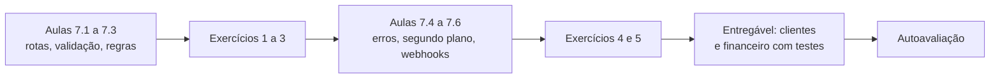
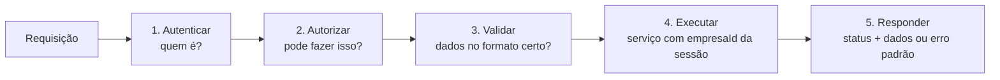
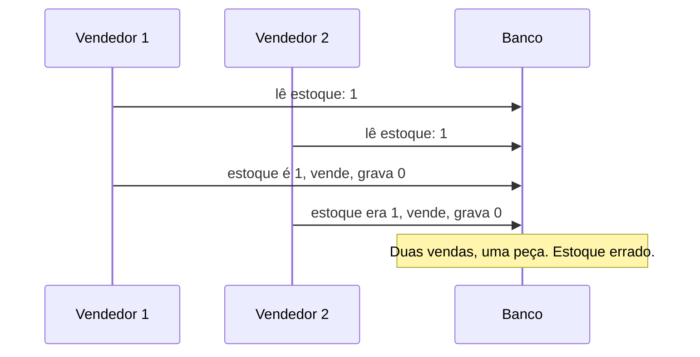
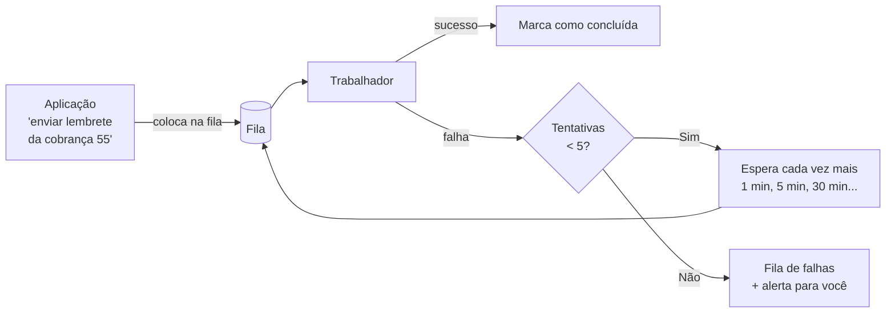
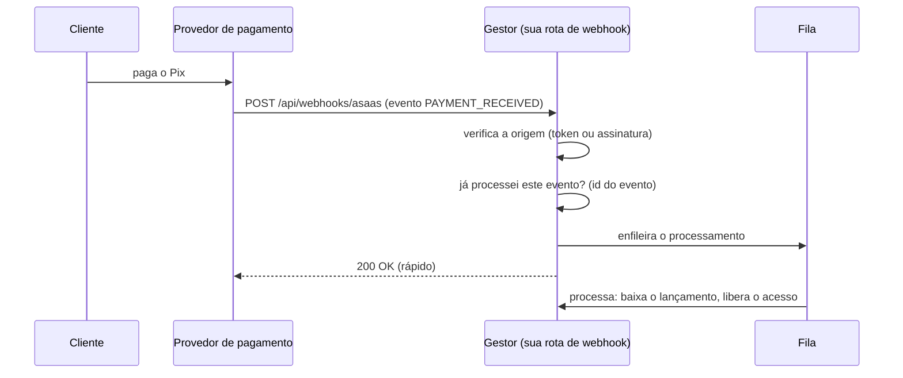

# Módulo 7: Backend e APIs

**Semanas 13 e 14 · cerca de 24 horas**

## Objetivos de aprendizagem

O backend é a cozinha do restaurante: é onde as regras de negócio rodam, os dados são gravados e as decisões de segurança acontecem. Um backend robusto é o que impede que um erro de tela vire um dado corrompido, que um pedido duplicado vire uma cobrança duplicada e que uma falha de um fornecedor derrube o sistema. Neste módulo você constrói o backend dos módulos de clientes e financeiro do Gestor, com os padrões que um sênior usa.

Ao final deste módulo você será capaz de:
1. Projetar rotas de API e ações de servidor com nomes, métodos e respostas consistentes.
2. Validar toda entrada com Zod e devolver erros claros e seguros.
3. Implementar regras de negócio na camada de serviço, com transações quando necessário.
4. Tratar erros e gravar logs úteis, sem expor dados sensíveis.
5. Criar tarefas em segundo plano e agendadas que sobrevivem a falhas.
6. Receber webhooks com verificação de origem e idempotência.

### Como estudar este módulo

*Figura: o módulo vai da estrutura básica das rotas até os mecanismos que tornam o backend resistente a falhas.*

| Semana | O que fazer | Horas |
|---|---|---|
| 13 | Aulas 7.1 a 7.3, exercícios 1 a 3 | 11 |
| 14 | Aulas 7.4 a 7.6, exercícios 4 e 5, tarefa, entregável, autoavaliação | 13 |

---

## Aula 7.1: Rotas, APIs e ações de servidor

Toda vez que o usuário clica em "Salvar", o frontend precisa pedir algo ao backend. Esse pedido chega por uma **rota**. Se cada rota for feita de um jeito, o sistema vira uma colcha de retalhos difícil de proteger. Esta aula define o padrão que todas as rotas do Gestor vão seguir.

### Duas formas de o frontend falar com o backend no Next.js

| Forma | O que é | Quando usar |
|---|---|---|
| **Route Handlers** (rotas de API) | Endereços HTTP como `GET /api/clientes`, que qualquer programa pode chamar | APIs consumidas por outros sistemas, webhooks, app de celular, integrações |
| **Server Actions** (ações de servidor) | Funções do servidor chamadas diretamente por formulários e botões do próprio sistema | Formulários e ações das telas do próprio Gestor |

> ⚠️ **Server Actions também são rotas públicas.** Por baixo, o Next.js cria um endereço HTTP para cada ação. Qualquer pessoa pode chamá-lo diretamente, sem passar pela tela. Portanto, **toda Server Action verifica login, permissão e valida a entrada**, exatamente como uma rota de API. O Claude às vezes esquece isso porque "a ação só é chamada pelo botão". Está no seu checklist.

### Desenho de API REST: recursos e verbos

O padrão REST organiza a API em torno de **recursos** (substantivos) e **verbos** HTTP (Aula 1.2):

| Ação | Método e caminho | Resposta de sucesso |
|---|---|---|
| Listar clientes | `GET /api/clientes?pagina=1&busca=maria` | `200` com a lista e informações de paginação |
| Ver um cliente | `GET /api/clientes/{id}` | `200` com o cliente |
| Criar cliente | `POST /api/clientes` | `201` com o cliente criado |
| Alterar cliente | `PATCH /api/clientes/{id}` | `200` com o cliente alterado |
| Excluir cliente | `DELETE /api/clientes/{id}` | `204` (sem conteúdo) |
| Ação específica | `POST /api/lancamentos/{id}/baixas` | `201` com a baixa registrada |

Regras de consistência para o CLAUDE.md:
- Caminhos no plural e em português, como o domínio: `/api/clientes`, `/api/lancamentos`.
- O `empresaId` **nunca** aparece no caminho nem no corpo; vem da sessão.
- Listas sempre paginadas.
- Erros sempre no mesmo formato (Aula 7.2).

### A anatomia de uma rota segura

Toda rota do Gestor segue o mesmo esqueleto, em 5 passos:


*Figura: os cinco passos de toda rota. Se qualquer passo falhar, a rota responde com erro e não executa os seguintes.*

```typescript
// src/app/api/clientes/route.ts
export async function POST(req: Request) {
  const sessao = await exigirSessao(req);                       // 1. 401 se não logado
  exigirPermissao(sessao, "clientes:criar");                    // 2. 403 se não pode
  const dados = criarClienteSchema.parse(await req.json());     // 3. 400 se inválido
  const cliente = await clientesService.criar(sessao, dados);   // 4. empresaId vem da sessão
  return Response.json(cliente, { status: 201 });               // 5.
}
```

Repare que a rota é **fina**: ela não tem regra de negócio. Só orquestra os passos. A regra fica no serviço (Aula 7.3). Os erros lançados em cada passo são convertidos em resposta por um tratador central (Aula 7.4).

### Centralize o que se repete

Em vez de cada rota implementar a autenticação do seu jeito, crie **funções únicas** usadas por todas:

| Função | Faz | Onde |
|---|---|---|
| `exigirSessao()` | Lê a sessão; lança erro 401 se não houver | `src/server/auth/sessao.ts` |
| `exigirPermissao(sessao, acao)` | Confere o papel; lança erro 403 | `src/server/auth/permissoes.ts` |
| `comTratamentoDeErros(handler)` | Converte erros em respostas padronizadas e registra logs | `src/server/http/erros.ts` |

Assim, uma correção de segurança é feita **em um lugar** e vale para o sistema todo. E na revisão você confere uma coisa simples: "toda rota chama `exigirSessao` e `exigirPermissao`?".

> 💡 **Teste que garante o padrão:** peça ao Claude um teste que percorre todas as rotas da pasta `src/app/api` e confirma que cada uma responde 401 quando chamada sem login. Se alguém (você, o Claude, outro desenvolvedor) criar uma rota esquecendo a autenticação, o teste quebra.

### Exemplo completo: o pedido de rotas de clientes

```text
Implemente o CRUD de clientes do Gestor conforme @docs/especificacao.md (H01 a H04).

Padrão obrigatório (ver CLAUDE.md):
- Rotas em src/app/api/clientes e src/app/api/clientes/[id]
- Cada rota: exigirSessao → exigirPermissao → validação Zod → clientesService → resposta
- Listagem paginada (50 por página, máximo 100), com busca por nome ou e-mail
- Exclusão lógica (excluidoEm)
- Ao buscar por id um cliente de outra empresa, responda 404 (não 403)

Testes (integração, com banco de teste):
- 401 sem login em todas as rotas
- 403 para papel sem permissão
- 400 com dados inválidos
- Isolamento: usuário da empresa A recebe 404 em GET, PATCH e DELETE de cliente da empresa B
- Paginação e busca

Plano primeiro.
```

> 📌 **Em resumo**
> - Route Handlers para APIs e integrações; Server Actions para as telas do próprio sistema.
> - Server Actions são rotas públicas: verifique login, permissão e validação nelas também.
> - Toda rota segue: autenticar, autorizar, validar, executar o serviço, responder.
> - Centralize autenticação, permissão e tratamento de erros em funções únicas.

### Para ir além
- [Documentação do Next.js (em inglês)](https://nextjs.org/docs): seções sobre Route Handlers e Server Actions.

---

## Aula 7.2: Validação de entrada e respostas de erro

"Nunca confie no que vem de fora" é a regra mais antiga da segurança de sistemas. Tudo o que entra no backend (formulários, parâmetros de URL, webhooks, arquivos) pode estar errado por engano ou de propósito. A validação é o portão de entrada, e ela também é o que mantém o banco limpo.

### Por que validar no servidor (de novo)

O formulário no navegador pode até impedir um e-mail sem "@". Mas qualquer pessoa pode chamar a rota diretamente, com qualquer conteúdo. Sem validação no servidor:
- Dados inválidos entram no banco e quebram relatórios meses depois.
- Valores absurdos passam (desconto de 500%, quantidade negativa, vencimento no ano 3000).
- Campos que o usuário não deveria controlar são alterados (`papel: "dono"`, `empresaId: "outra"`).

### Zod: uma definição, três usos

O **Zod** descreve o formato esperado dos dados. A mesma definição:
1. **Valida** no servidor (recusa o que não bate).
2. **Gera o tipo** TypeScript (o código sabe o formato).
3. Pode ser **reaproveitada no formulário** do frontend (mensagens de erro iguais).

```typescript
// src/server/clientes/schemas.ts
import { z } from "zod";

export const criarClienteSchema = z.object({
  nome: z.string().trim().min(2, "Nome muito curto").max(120),
  email: z.string().trim().toLowerCase().email("E-mail inválido").optional(),
  telefone: z.string().regex(/^\+55\d{10,11}$/, "Use o formato +55DDNÚMERO").optional(),
  cpfCnpj: z.string().regex(/^\d{11}$|^\d{14}$/, "CPF ou CNPJ só com números").optional(),
  origem: z.enum(["indicacao", "instagram", "google", "outro"]),
}).strict();   // recusa qualquer campo extra

export type CriarClienteInput = z.infer<typeof criarClienteSchema>;
```

### O `.strict()` e a atribuição em massa

Repare no `.strict()`. Sem ele, um atacante pode mandar campos extras:

```json
{ "nome": "Maria", "origem": "google", "empresaId": "emp-OUTRA", "criadoPorId": "usu-dono" }
```

Se o código fizer `db.cliente.create({ data: { ...dadosRecebidos } })`, esses campos extras vão direto para o banco. Isso se chama **atribuição em massa** (mass assignment) e é uma falha clássica. Defesas, em camadas:
1. Schema com `.strict()` (ou com `.pick()` só dos campos permitidos).
2. No serviço, montar o objeto gravado **campo a campo**, colocando `empresaId` e `criadoPorId` a partir da sessão.

### O que validar além do formato

| Tipo de validação | Exemplo | Onde fica |
|---|---|---|
| **Formato** | E-mail válido, CPF com 11 dígitos | Schema Zod |
| **Limites** | Nome até 120 caracteres; valor até R$ 1 milhão; desconto entre 0 e 100% | Schema Zod |
| **Coerência** | `dataInicio <= dataFim`; parcelas entre 1 e 24 | Schema Zod (`.refine`) |
| **Regra de negócio** | Desconto acima de 10% exige papel gerente | Serviço (Aula 7.3) |
| **Existência e posse** | O `clienteId` informado existe **e é da mesma empresa** | Serviço, com consulta filtrada por `empresaId` |

> 🎯 **Ponto que o Claude erra com frequência:** validar que o `clienteId` de uma nova oportunidade **pertence à empresa da sessão**. Sem isso, um usuário cria uma oportunidade ligada ao cliente de outra empresa e, dependendo da tela, passa a ver o nome dele. Toda chave estrangeira recebida do frontend é verificada com `empresaId`.

### Respostas de erro: claras para o usuário, opacas para o atacante

Defina **um formato único** para todos os erros:

```json
{
  "erro": {
    "codigo": "VALIDACAO",
    "mensagem": "Alguns campos estão inválidos.",
    "campos": { "email": "E-mail inválido" },
    "requisicaoId": "req_8f2a1c"
  }
}
```

| Situação | Status | Código | O que dizer |
|---|---|---|---|
| Dados inválidos | 400 | `VALIDACAO` | Quais campos e por quê |
| Não logado | 401 | `NAO_AUTENTICADO` | "Faça login para continuar" |
| Sem permissão | 403 | `SEM_PERMISSAO` | "Você não tem permissão para esta ação" |
| Não existe **ou é de outra empresa** | 404 | `NAO_ENCONTRADO` | "Registro não encontrado" |
| Conflito (e-mail já cadastrado, estoque insuficiente) | 409 | `CONFLITO` | O motivo, em linguagem de negócio |
| Muitas requisições | 429 | `LIMITE` | "Tente novamente em alguns instantes" |
| Erro inesperado | 500 | `INTERNO` | "Algo deu errado. Código: req_8f2a1c" |

**Nunca devolva ao usuário:** mensagens internas do banco, nomes de tabelas, trechos de código, caminhos de arquivo ou o "stack trace" (a pilha de chamadas do erro). Isso dá ao atacante um mapa do seu sistema. O detalhe completo vai para o **log**, identificado pelo `requisicaoId`; o usuário recebe só o código para informar ao suporte.

### Exemplo completo: lançamento a receber

```typescript
export const criarLancamentoSchema = z.object({
  descricao: z.string().trim().min(3).max(200),
  valorCentavos: z.number().int("Valor deve ser em centavos")
                  .positive().max(100_000_000),          // até R$ 1 milhão
  vencimento: z.string().date(),                           // "AAAA-MM-DD"
  clienteId: z.string().uuid(),
  categoriaId: z.string().uuid().optional(),
  parcelas: z.number().int().min(1).max(24).default(1),
}).strict();
```

No serviço, além do schema: confirmar que `clienteId` e `categoriaId` são da empresa da sessão; que o vencimento não está mais de 5 anos no passado (provável erro de digitação, conforme regra de negócio RN11 da especificação); e dividir as parcelas com a última absorvendo o resto dos centavos (Aula 5.4).

> 📌 **Em resumo**
> - Toda entrada é validada no servidor; o Zod valida, tipa e pode ser reaproveitado no formulário.
> - Use `.strict()` e monte o objeto gravado campo a campo, contra atribuição em massa.
> - Verifique que toda chave estrangeira recebida pertence à empresa da sessão.
> - Erros em formato único: claros para o usuário, sem detalhes internos; o detalhe vai para o log.

### Para ir além
- [Documentação do Zod (em inglês)](https://zod.dev)
- [Guia de validação de entrada da OWASP (em inglês)](https://cheatsheetseries.owasp.org/cheatsheets/Input_Validation_Cheat_Sheet.html)

---

## Aula 7.3: Regras de negócio no serviço, e transações

A camada de serviço é onde mora o conhecimento do negócio do cliente: como calcula multa, quem pode dar desconto, o que acontece quando um pedido é cancelado. Concentrar as regras ali torna o sistema fácil de testar, de mudar e de explicar. E é ali que entram as **transações**, que impedem os erros mais caros de ERPs e financeiros.

### O serviço: uma função por ação de negócio

```typescript
// src/server/financeiro/lancamentos.service.ts
export async function registrarBaixa(sessao: Sessao, lancamentoId: string, dados: BaixaInput) {
  const lancamento = await lancamentosRepo.buscar(sessao.empresaId, lancamentoId);
  if (!lancamento) throw new NaoEncontrado();

  if (lancamento.status === "cancelado")
    throw new Conflito("Lançamento cancelado não pode receber pagamento");

  const saldo = calcularSaldo(lancamento);                    // regra pura, testável
  if (dados.valorPagoCentavos > saldo)
    throw new Conflito("Valor maior que o saldo em aberto");

  return db.$transaction(async (tx) => {
    const baixa = await tx.baixa.create({ data: { /* campo a campo */ } });
    const novoSaldo = saldo - dados.valorPagoCentavos;
    await tx.lancamento.update({
      where: { id: lancamento.id },
      data: { status: novoSaldo === 0 ? "pago" : "parcial" },
    });
    await auditar(tx, sessao, "lancamento.baixa", lancamento.id, { valor: dados.valorPagoCentavos });
    return baixa;
  });
}
```

O que você deve reconhecer:
- **Busca sempre com `empresaId`** da sessão (`lancamentosRepo.buscar(sessao.empresaId, ...)`).
- **Regras explícitas**, cada uma com um erro de negócio claro.
- **Cálculos em funções puras** (`calcularSaldo`), que recebem dados e devolvem um resultado sem acessar o banco. São as mais fáceis de testar.
- **Gravações relacionadas dentro de uma transação**, incluindo a auditoria.

### Funções puras: onde ficam os cálculos

Uma **função pura** sempre devolve o mesmo resultado para a mesma entrada e não mexe em nada fora dela (não acessa banco, não envia e-mail). Cálculos de multa, juros, saldo, comissão, impostos e parcelas devem ser puros. Vantagens:
- Testes rápidos e completos, sem banco (Aula 3.4).
- Fácil de mostrar ao cliente: "aqui está a regra, e aqui estão os testes que provam".
- Fácil de mudar com segurança quando a regra mudar.

### Transações: tudo ou nada

Você viu o conceito em SQL (Aula 5.2). No código, use `db.$transaction` sempre que **duas ou mais gravações precisam acontecer juntas**:

| Situação | Gravações que precisam ser atômicas |
|---|---|
| Registrar pagamento | Baixa + status do lançamento + auditoria |
| Finalizar venda | Pedido + itens + movimentos de estoque |
| Transferir clientes de um vendedor | Todos os clientes + histórico |
| Criar empresa no SaaS | Empresa + usuário dono + etapas padrão do funil + assinatura em teste |

Sem transação, se o servidor cair no meio, você fica com dados pela metade: um pagamento registrado com o lançamento ainda "aberto", ou uma venda sem baixa de estoque.

### Concorrência: dois usuários ao mesmo tempo

O caso clássico (Aula 4.2): dois vendedores vendem a última unidade ao mesmo tempo.


*Figura: a condição de corrida. Os dois leem o mesmo valor antes de qualquer um gravar, e ambos acham que há estoque.*

Soluções, da mais simples à mais robusta:

| Técnica | Como funciona | Exemplo |
|---|---|---|
| **Atualização condicional** | A gravação só acontece se a condição ainda for verdadeira, em um único comando | `UPDATE produtos SET estoque = estoque - 1 WHERE id = $1 AND estoque >= 1`; se 0 linhas foram afetadas, não havia estoque |
| **Restrição no banco** | O banco recusa estados inválidos | `CHECK (estoque >= 0)` |
| **Trava de linha** | A transação trava a linha até terminar (`SELECT ... FOR UPDATE`) | Quando a regra envolve vários passos |

Peça explicitamente ao Claude: *"esta operação precisa ser segura contra concorrência: use atualização condicional ou trava de linha, e escreva um teste que dispara duas operações simultâneas e confirma que só uma vence"*.

### Exemplo completo: finalizar venda no ERP

Especificação: RN05 (sem venda sem estoque, exceto encomenda), RN03 (desconto acima de 10% exige gerente), estoque como livro de movimentos (Aula 5.3).

O serviço `finalizarVenda`:
1. Busca o pedido com `empresaId`; recusa se já finalizado.
2. Aplica as regras de desconto conforme o papel (função pura testada).
3. Abre transação:
   - Para cada item, cria o movimento de saída e baixa o saldo com atualização condicional; se algum item falhar, **a transação inteira é desfeita** e o vendedor recebe "Estoque insuficiente: [peça]".
   - Grava o pedido como finalizado, com total calculado no servidor.
   - Grava a auditoria.
4. Depois da transação, agenda (em segundo plano) a emissão da nota e o e-mail ao cliente.

Repare no passo 4: **coisas externas ficam fora da transação**. Se o e-mail fosse enviado dentro dela e a transação falhasse depois, o cliente receberia o e-mail de uma venda que não existe.

> 📌 **Em resumo**
> - Uma função de serviço por ação de negócio, com regras explícitas e erros claros.
> - Cálculos em funções puras, testadas sem banco.
> - Transação sempre que duas ou mais gravações precisam acontecer juntas, incluindo a auditoria.
> - Proteja contra concorrência com atualização condicional, restrições no banco ou trava; chamadas externas ficam fora da transação.

### Para ir além
- [Documentação do Prisma (em inglês)](https://www.prisma.io/docs): seção sobre transações.

---

## Aula 7.4: Tratamento de erros e logs

Quando algo dá errado em produção, existem duas situações: você descobre pelos logs em 5 minutos, ou você descobre pelo cliente irritado e passa 3 horas adivinhando. Logs bem feitos são o que transformam "o sistema não funciona" em "a requisição req_8f2a1c falhou porque o Asaas respondeu 503 às 14h32".

### Dois tipos de erro

| Tipo | Exemplo | O que fazer |
|---|---|---|
| **Erro esperado** (de negócio ou de entrada) | Validação, sem permissão, estoque insuficiente | Responder com o status e a mensagem certos; registrar como informação |
| **Erro inesperado** (bug ou falha de infraestrutura) | Banco fora do ar, variável `undefined`, provedor respondendo 500 | Responder 500 genérico; registrar como erro com todo o detalhe; alertar |

Crie classes de erro de negócio (`NaoEncontrado`, `SemPermissao`, `Conflito`, `Validacao`) e um **tratador central** que converte cada uma no status certo. Tudo o que não for uma delas vira 500.

### As regras do tratamento de erros

1. **Nunca engula erros.** `catch (e) {}` é proibido. Se você captura, ou trata de verdade, ou registra e relança.
2. **Não mostre detalhes internos ao usuário** (Aula 7.2).
3. **Falhe cedo e alto.** Se uma variável de ambiente obrigatória está faltando, o sistema deve se recusar a iniciar, em vez de funcionar pela metade. Valide as variáveis com Zod na inicialização.
4. **Um erro, um registro.** Não registre o mesmo erro em cinco camadas; registre no tratador central.

### Logs estruturados

Um log estruturado é uma linha em formato JSON, com campos fixos, que ferramentas conseguem filtrar:

```json
{
  "nivel": "error",
  "momento": "2026-11-08T17:32:10.512Z",
  "requisicaoId": "req_8f2a1c",
  "empresaId": "emp-3",
  "usuarioId": "usu-9",
  "rota": "POST /api/lancamentos/lan-55/baixas",
  "duracaoMs": 2140,
  "mensagem": "Falha ao consultar provedor de pagamento",
  "erro": { "tipo": "ProvedorIndisponivel", "status": 503 }
}
```

Com isso, você responde em segundos: "quantos erros a empresa emp-3 teve hoje?", "qual rota está lenta?", "o que aconteceu com a requisição que o cliente informou?".

| Nível | Quando |
|---|---|
| `debug` | Detalhes para investigação; desligado em produção |
| `info` | Acontecimentos normais importantes (pagamento confirmado, usuário criado) |
| `warn` | Algo estranho mas tratado (nova tentativa de envio, limite quase atingido) |
| `error` | Falha que precisa de atenção |

### O que **nunca** vai para o log

Logs são lidos por muita gente e ficam guardados em ferramentas de terceiros. Um log com dados sensíveis é um vazamento lento.

| Nunca registre | Registre no lugar |
|---|---|
| Senhas, tokens, chaves de API, cookies de sessão | Nada; ou "token presente: sim" |
| Número de cartão, CVV | Nada |
| CPF, CNPJ completos | Só os últimos dígitos, se necessário |
| Conteúdo de mensagens do WhatsApp | O id da mensagem |
| Dados de saúde (receitas, procedimentos) | O id do registro |
| O objeto `usuario` ou `req.body` inteiro | Só os campos necessários |

Coloque no CLAUDE.md (já está no modelo) e use uma função de log que **remove campos sensíveis automaticamente** (`senha`, `token`, `authorization`, `cpf`, `cartao`).

### Ferramentas de erro em produção

Além dos logs, use uma ferramenta de **rastreamento de erros** (como o Sentry), que:
- Agrupa erros iguais ("este erro aconteceu 47 vezes hoje, com 12 usuários").
- Mostra em qual linha de código e em qual versão.
- Envia alerta para você quando aparece um erro novo.

Configure o filtro de dados pessoais da ferramenta e confirme que ele está ativo. Você vai integrar no Módulo 15.

### Exemplo completo: o mistério das 14h32

Um cliente do Gestor reclama: "tentei registrar um pagamento e deu erro, código req_8f2a1c".

1. Você filtra os logs por `requisicaoId = req_8f2a1c`. Encontra o registro acima: o provedor de pagamento respondeu 503.
2. Filtra por `erro.tipo = ProvedorIndisponivel` na última hora: 23 ocorrências, todas entre 14h30 e 14h41.
3. Consulta a página de status do provedor: houve instabilidade nesse horário.
4. Conclusão em 5 minutos: não é bug seu. Ação: confirmar que as tentativas foram refeitas (Aula 7.5), avisar o cliente com transparência, e registrar o incidente.

Sem logs estruturados, você estaria tentando reproduzir um erro que já não existe.

> 📌 **Em resumo**
> - Erros esperados viram respostas claras; inesperados viram 500 genérico, log detalhado e alerta.
> - Nunca engula erros; valide as variáveis de ambiente na inicialização.
> - Logs estruturados em JSON, com `requisicaoId`, empresa, usuário, rota e duração.
> - Nunca registre senhas, tokens, documentos, cartões, mensagens ou dados de saúde.

### Para ir além
- [Guia de logs da OWASP (em inglês)](https://cheatsheetseries.owasp.org/cheatsheets/Logging_Cheat_Sheet.html)
- [Documentação do Sentry (em inglês)](https://docs.sentry.io/)

---

## Aula 7.5: Tarefas em segundo plano e agendadas

Algumas coisas não podem depender de um clique: enviar os lembretes de cobrança às 8h, gerar a fatura mensal de cada assinante, tentar de novo uma mensagem de WhatsApp que falhou. Se essas tarefas forem feitas de qualquer jeito, elas falham em silêncio, e você descobre quando o cliente pergunta por que ninguém foi cobrado este mês.

### Fila de tarefas: o conceito

Uma **fila** guarda tarefas a fazer. Um ou mais **trabalhadores** (workers) pegam as tarefas e executam. Se uma tarefa falhar, ela volta para a fila e é tentada de novo mais tarde.


*Figura: o ciclo de uma tarefa em segundo plano. Falhas são tentadas de novo com espera crescente; depois de várias tentativas, a tarefa vai para uma fila de falhas e você é avisado.*

### Onde guardar a fila

| Opção | Como funciona | Quando usar |
|---|---|---|
| **Tabela no PostgreSQL** (com bibliotecas como pg-boss ou graphile-worker) | A fila é uma tabela no mesmo banco | Padrão desta formação: sem peça nova para manter |
| **Redis + BullMQ** | Fila em um banco em memória | Volume muito alto de tarefas |
| **Serviço gerenciado de filas e agendamentos** | Fornecedor cuida de tudo | Quando estiver em serverless e não tiver processo contínuo |

> 💡 Começar com a fila no próprio PostgreSQL mantém a arquitetura simples (Aula 6.1): uma peça a menos para proteger, fazer backup e monitorar.

### As quatro propriedades de uma tarefa robusta

1. **Idempotente:** rodar duas vezes tem o mesmo efeito que rodar uma. Se a tarefa "enviar lembrete" rodar de novo por causa de uma nova tentativa, o cliente não pode receber dois lembretes. Técnica: antes de enviar, verifique se já foi enviado (`lembreteEnviadoEm`), e grave a marcação junto com o envio.
2. **Com novas tentativas e espera crescente:** falhas temporárias (provedor instável) se resolvem sozinhas.
3. **Com limite:** depois de N tentativas, para e avisa. Sem limite, uma tarefa defeituosa tenta para sempre (e pode gerar custo).
4. **Observável:** você consegue ver quantas tarefas estão na fila, quantas falharam e por quê.

### Tarefas agendadas (cron)

Para o que acontece em horários fixos, use um **agendador** (cron). A expressão cron descreve quando:

| Expressão | Significa |
|---|---|
| `0 8 * * 1-5` | Às 8h, de segunda a sexta |
| `*/15 * * * *` | A cada 15 minutos |
| `0 3 * * *` | Todo dia às 3h (bom para limpezas e relatórios) |

Atenção ao **fuso**: muitos agendadores usam UTC. "8h de Brasília" é `0 11 * * *` em UTC. Escreva o fuso explicitamente na configuração.

Boas práticas para tarefas agendadas:
- A tarefa agendada **não faz o trabalho pesado**; ela **enfileira** tarefas individuais ("lembrete da cobrança 55", "lembrete da cobrança 56"). Assim, uma falha em um item não trava os outros.
- **Uma execução por vez:** se você tiver duas instâncias da aplicação, o agendador não pode rodar nas duas (enviaria tudo em dobro). Use um mecanismo de trava ou um processo único para o agendador.
- **Registre cada execução:** começou, terminou, quantos itens, quantas falhas. Se a execução das 8h não aconteceu, você precisa saber (Módulo 15: monitoramento de tarefas).

### O que vai para segundo plano no Gestor

| Tarefa | Gatilho | Idempotência |
|---|---|---|
| Lembrete de cobrança 3 dias antes do vencimento | Agendada, 8h | `lembreteEnviadoEm` por lançamento |
| Envio de mensagem de WhatsApp | Ação do usuário | Id único por mensagem |
| Processar webhook de pagamento | Webhook recebido (Aula 7.6) | Id do evento do provedor |
| Bloquear acesso de assinatura inadimplente | Agendada, diária | Estado da assinatura |
| Limpeza de sessões expiradas | Agendada, 3h | Natural (apagar o que já expirou) |

### Exemplo completo: os lembretes que saíram em dobro

O Escritório Contábil Exato reclama: alguns clientes receberam o lembrete de honorários **três vezes**.

Investigação (método da Aula 3.5):
- Logs: a tarefa agendada rodou uma vez, às 8h. Mas o envio de 14 lembretes foi tentado 3 vezes.
- Causa: o provedor de e-mail demorou a responder; a tarefa expirou por tempo, foi tentada de novo, e o e-mail **tinha sido enviado** nas tentativas anteriores. A marcação `lembreteEnviadoEm` só era gravada no final, depois de todos os envios.

Correção:
1. Cada lembrete vira uma tarefa individual na fila.
2. Cada tarefa verifica `lembreteEnviadoEm` antes de enviar e o grava logo após o envio.
3. O envio usa uma **chave de idempotência** no provedor de e-mail (muitos provedores aceitam), para que ele mesmo descarte duplicatas.
4. Teste: simular uma tarefa executada duas vezes e confirmar que só um e-mail é enviado.

> 📌 **Em resumo**
> - Tarefas demoradas, agendadas ou que dependem de terceiros vão para uma fila, com trabalhador separado.
> - Tarefas robustas são idempotentes, têm novas tentativas com espera crescente, limite e observabilidade.
> - Agendamentos só enfileiram itens individuais, rodam uma vez por horário e consideram o fuso.
> - Comece com a fila no PostgreSQL para manter a arquitetura simples.

### Para ir além
- [Documentação do BullMQ (em inglês)](https://docs.bullmq.io/): para quando o volume justificar Redis.

---

## Aula 7.6: Webhooks e idempotência

O provedor de pagamento confirma que o cliente pagou. O WhatsApp avisa que chegou uma mensagem. Esses avisos chegam por **webhooks**, e são o ponto onde muitos sistemas falham de forma grave: pagamentos confirmados duas vezes, acessos liberados sem pagamento, mensagens perdidas. Esta aula é a base para os Módulos 10 e 11.

### O que é um webhook

É o contrário de uma API comum. Em vez de o seu sistema perguntar "já pagou?", o provedor **chama o seu sistema** quando algo acontece:


*Figura: o fluxo de um webhook bem feito. A rota verifica a origem, evita duplicatas, enfileira e responde rápido; o trabalho pesado acontece depois.*

### Os cinco perigos dos webhooks, e as defesas

| Perigo | Exemplo | Defesa |
|---|---|---|
| **Webhook falso** | Alguém descobre a sua URL e envia "pagamento aprovado" | Verificar a **assinatura** (HMAC) ou o **token** que o provedor envia, comparando com o segredo guardado em variável de ambiente |
| **Duplicado** | O provedor reenvia o mesmo evento (ele faz isso quando não recebe resposta a tempo) | **Idempotência**: guardar o id de cada evento processado e ignorar repetidos |
| **Fora de ordem** | "Pagamento estornado" chega antes de "pagamento recebido" | Não confiar na ordem; usar o estado atual (reconsultar o provedor) e regras de transição de status |
| **Lento demais** | Seu processamento demora; o provedor desiste e reenvia | Responder 200 rápido e processar em segundo plano |
| **Perdido** | Seu sistema estava fora do ar quando o webhook chegou | Provedores reenviam por um tempo; além disso, uma **tarefa de conciliação** periódica consulta o provedor e corrige divergências |

### Verificação de origem

Cada provedor tem seu mecanismo (consulte a documentação oficial de cada um):
- **Assinatura HMAC:** o provedor calcula um código a partir do conteúdo da mensagem e de um segredo compartilhado, e envia em um cabeçalho. Você recalcula e compara. Se alguém alterar uma vírgula, o código não bate. (Stripe usa esse modelo.)
- **Token no cabeçalho:** o provedor envia um token que você configurou no painel. (Asaas usa esse modelo.)
- **Assinatura de mensagens:** o WhatsApp (API oficial da Meta) assina cada notificação com o segredo do aplicativo.

> ⚠️ **Defesa extra para pagamentos:** mesmo com a origem verificada, para eventos que liberam acesso ou dão baixa em valores, **reconsulte o provedor pela API** ("qual é o status atual da cobrança X?") antes de agir. Assim, um webhook falsificado ou um bug de interpretação não libera nada sozinho.

### Idempotência na prática

```text
tabela eventos_recebidos
  provedor        "asaas"
  eventoId        "evt_9f8e7d"     ← único junto com o provedor
  tipo            "PAYMENT_RECEIVED"
  recebidoEm      2026-11-08 14:32
  processadoEm    2026-11-08 14:32
  payload         { ... } (sem dados de cartão)
```

Fluxo:
1. Recebeu um evento. Verificou a origem.
2. Tenta inserir em `eventos_recebidos` com `(provedor, eventoId)` **único**. Se o banco recusar por duplicidade, o evento já foi recebido: responda 200 e não faça nada.
3. Enfileire o processamento.
4. O processamento também é idempotente: "dar baixa no lançamento" verifica se a baixa daquela cobrança já existe.

A restrição de unicidade no banco é a garantia mais forte: mesmo com dois webhooks idênticos chegando no mesmo milissegundo, só um entra.

### Idempotência também nas suas chamadas

O mesmo vale quando **você** chama um provedor: se a criação de uma cobrança der erro de rede, você não sabe se ela foi criada. Se tentar de novo, pode criar duas. Solução: **chave de idempotência** (Stripe e outros aceitam um cabeçalho com uma chave única por operação; repetir a chamada com a mesma chave não cria outra cobrança) ou, onde não houver, uma **referência externa** sua (o id do lançamento) para consultar antes de recriar.

### Exemplo completo: a rota de webhook do Gestor

Pedido ao Claude:

```text
Implemente POST /api/webhooks/asaas conforme a documentação oficial atual do
Asaas sobre webhooks (consulte antes).

Requisitos:
1. Verificar o token de autenticação do webhook com comparação de tempo constante;
   recusar com 401 se inválido, sem detalhes.
2. Validar o corpo com Zod (apenas os campos que usamos).
3. Inserir em eventos_recebidos com unicidade (provedor, eventoId);
   se duplicado, responder 200 sem processar.
4. Enfileirar a tarefa processarEventoAsaas e responder 200 em menos de 1 segundo.
5. A tarefa reconsulta a cobrança na API do Asaas antes de qualquer baixa ou
   liberação de acesso, e é idempotente.
6. Logs sem dados pessoais nem de cartão.

Testes: token inválido → 401; evento duplicado → processado uma vez só;
evento válido → tarefa enfileirada; tarefa executada duas vezes → uma baixa só;
eventos fora de ordem (estorno antes de recebimento) → estado final correto.
```

> 📌 **Em resumo**
> - Webhook é o provedor chamando o seu sistema; trate como entrada não confiável.
> - Verifique a origem (assinatura ou token), registre o id do evento com unicidade, enfileire e responda rápido.
> - Não confie na ordem; para pagamentos, reconsulte o provedor antes de agir.
> - Use chaves de idempotência também nas chamadas que você faz, e uma conciliação periódica para pegar o que se perdeu.

### Para ir além
- [Webhooks no Stripe (em inglês)](https://docs.stripe.com/webhooks)
- [Webhooks no Asaas (em português)](https://docs.asaas.com/docs/sobre-os-webhooks)
- [Requisições idempotentes no Stripe (em inglês)](https://docs.stripe.com/api/idempotent_requests)

---

## Exercícios

### Exercício 1: Desenhe a API do financeiro (45 min)
Liste todas as rotas (método, caminho, status de sucesso e erros possíveis) para lançamentos, baixas, categorias e contas do Gestor. Marque quais papéis podem chamar cada uma.

### Exercício 2: Schema à prova de ataque (45 min)
Escreva (ou peça ao Claude e revise) o schema Zod para "criar oportunidade" e liste 6 tentativas de ataque ou erro que ele deve recusar. Inclua pelo menos: campo extra `empresaId`, valor negativo, `clienteId` de outra empresa (esse não é o schema que pega; diga onde é).

### Exercício 3: Corrida pelo último item (60 min)
**Objetivo:** ver uma condição de corrida acontecer e ser corrigida.
1. Peça ao Claude uma função de baixa de estoque **ingênua** (lê, confere, grava) e um teste que dispara 10 baixas simultâneas de 1 unidade sobre um estoque de 5.
2. Rode e observe o resultado (provavelmente estoque negativo ou mais de 5 vendas).
3. Peça a correção com atualização condicional e rode de novo.

<details>
<summary><strong>Resolução comentada</strong></summary>

Com a versão ingênua, várias chamadas leem `estoque = 5` (ou outro valor) antes que as outras gravem, e todas acham que há estoque. O resultado típico é mais de 5 vendas aprovadas e estoque negativo, ou um saldo final que não bate com o número de vendas.

Com a atualização condicional:
```sql
UPDATE produtos SET estoque = estoque - 1
WHERE id = $1 AND estoque >= 1
```
o banco executa cada comando de forma atômica. Exatamente 5 chamadas afetam 1 linha (sucesso) e 5 afetam 0 linhas (sem estoque). O teste deve verificar: 5 sucessos, 5 recusas com "Estoque insuficiente", estoque final 0. Acrescentar `CHECK (estoque >= 0)` no banco é a rede de segurança final: mesmo que algum código futuro esqueça a condição, o banco recusa.
</details>

### Exercício 4: Logs limpos (40 min)
Peça ao Claude a função de log do Gestor com remoção automática de campos sensíveis e um teste que registra um objeto com `senha`, `token`, `cpf` e `authorization` e confirma que nenhum desses valores aparece na saída.

### Exercício 5: Webhook duplicado e falso (60 min)
Implemente a rota de webhook de exemplo (pode ser de um provedor fictício, com token) e escreva os testes da Aula 7.6. Depois, tente "atacar" a sua rota com `curl`: sem token, com token errado, e com o mesmo evento enviado 3 vezes.

---

## Tarefa de campo

**Mapeie as regras de negócio do caso real** (Módulo 4) que precisam de transação e as que precisam de tarefa em segundo plano. Para cada uma, escreva: o que acontece se o servidor cair no meio, e qual técnica protege. Leve a lista para o cliente e confirme 2 regras de negócio que você tinha marcado como "a confirmar".

---

## Entregável: Módulos de clientes e financeiro do Gestor

No repositório, via pull requests:
1. CRUD de clientes (H01 a H04).
2. Lançamentos a receber e a pagar, com baixas parciais, parcelas e auditoria.
3. Tarefa agendada de lembrete de vencimento, idempotente.
4. Rota de webhook genérica com verificação de origem e tabela de eventos recebidos.
5. Tratador central de erros e função de log com remoção de dados sensíveis.

**Checklist de qualidade:**
- [ ] Toda rota e Server Action: sessão → permissão → validação → serviço → resposta.
- [ ] Teste automático que confirma 401 em todas as rotas sem login.
- [ ] Testes de isolamento (404 para recurso de outra empresa) em todas as operações.
- [ ] Schemas com `.strict()`; chaves estrangeiras verificadas com `empresaId`.
- [ ] Cálculos financeiros em funções puras com testes de centavos e arredondamento.
- [ ] Baixa de pagamento em transação, com auditoria.
- [ ] Erros no formato padrão, sem detalhes internos.
- [ ] Logs estruturados, sem dados sensíveis (teste comprova).
- [ ] Tarefa de lembrete idempotente (teste com execução dupla).
- [ ] Webhook: origem verificada, duplicados ignorados, resposta rápida.

---

## Autoavaliação

Meta: 8 de 10.

1. Por que uma Server Action precisa verificar login e permissão, se ela só é chamada por um botão da tela?
2. Quais são os 5 passos de uma rota segura?
3. O que é atribuição em massa e quais as duas defesas?
4. Um usuário tenta acessar um cliente de outra empresa pelo id. Por que responder 404 e não 403?
5. Por que o envio de e-mail não deve ficar dentro da transação que finaliza a venda?
6. Explique a condição de corrida na venda do último item e uma solução.
7. Cite 4 tipos de informação que nunca vão para o log.
8. O que torna uma tarefa em segundo plano "idempotente", e por que isso importa?
9. O provedor enviou o mesmo webhook de pagamento 3 vezes. Como o sistema garante uma baixa só?
10. Mesmo com a origem do webhook verificada, por que reconsultar o provedor antes de liberar o acesso?

<details>
<summary><strong>Gabarito</strong></summary>

1. Porque por baixo ela é uma rota HTTP pública: qualquer pessoa pode chamá-la diretamente, sem a tela, com qualquer conteúdo.
2. Autenticar (quem é), autorizar (pode fazer), validar (dados no formato certo), executar o serviço com o empresaId da sessão, responder com status e dados ou erro padronizado.
3. É quando campos extras enviados pelo cliente (como `empresaId` ou `papel`) são gravados diretamente no banco. Defesas: schema estrito (`.strict()` ou só os campos permitidos) e montar o objeto gravado campo a campo, com os campos sensíveis vindos da sessão.
4. Porque 403 confirma que o registro existe (e que pertence a outra empresa), o que já é informação para um atacante. 404 não revela nada.
5. Porque, se a transação falhar depois do envio, o cliente recebe e-mail de uma venda que não existe. Chamadas externas são feitas depois da transação confirmada, de preferência em segundo plano.
6. Dois vendedores leem o estoque (1) antes que qualquer um grave, e ambos vendem. Solução: atualização condicional (`... WHERE estoque >= 1`, verificando se a linha foi afetada), restrição `CHECK (estoque >= 0)` ou trava de linha na transação.
7. Senhas, tokens e chaves; dados de cartão; CPF/CNPJ completos; conteúdo de mensagens; dados de saúde; o corpo da requisição ou o objeto de usuário inteiros.
8. Executá-la duas vezes tem o mesmo efeito que uma vez. Importa porque tarefas são repetidas em novas tentativas, e sem idempotência o cliente recebe duas mensagens ou é cobrado duas vezes.
9. Registrando cada evento com unicidade (provedor + id do evento) no banco; os repetidos são recusados pela restrição e ignorados. Além disso, o processamento verifica se a baixa daquela cobrança já existe.
10. Como defesa em profundidade: se o segredo vazou, se houver um bug na verificação ou na interpretação do evento, a reconsulta à API garante que só o estado real do provedor libera acesso ou dá baixa.
</details>

---

## Checklist de segurança do módulo

- [ ] Todas as rotas e Server Actions autenticam, autorizam e validam.
- [ ] Teste automático garante 401 sem login em todas as rotas.
- [ ] Schemas estritos e chaves estrangeiras verificadas por empresa.
- [ ] Erros sem detalhes internos para o usuário.
- [ ] Logs sem dados sensíveis.
- [ ] Variáveis de ambiente validadas na inicialização.
- [ ] Webhooks com verificação de origem, idempotência e reconsulta para eventos financeiros.
- [ ] Operações financeiras em transação, com auditoria.

---

## Para aprofundar (opcional)

| Material | Formato | Por que vale |
|---|---|---|
| [OWASP Cheat Sheet Series](https://cheatsheetseries.owasp.org/) | Texto, em inglês | Guias de validação, logs e autorização |
| [Webhooks de assinaturas no Stripe](https://docs.stripe.com/billing/subscriptions/webhooks) | Texto, em inglês | Exemplo completo dos eventos de uma assinatura |
| [Webhooks do Mercado Pago](https://www.mercadopago.com.br/developers/pt/docs/your-integrations/notifications/webhooks) | Texto, em português | Como o Mercado Pago notifica e assina os eventos |
