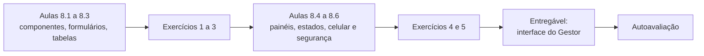
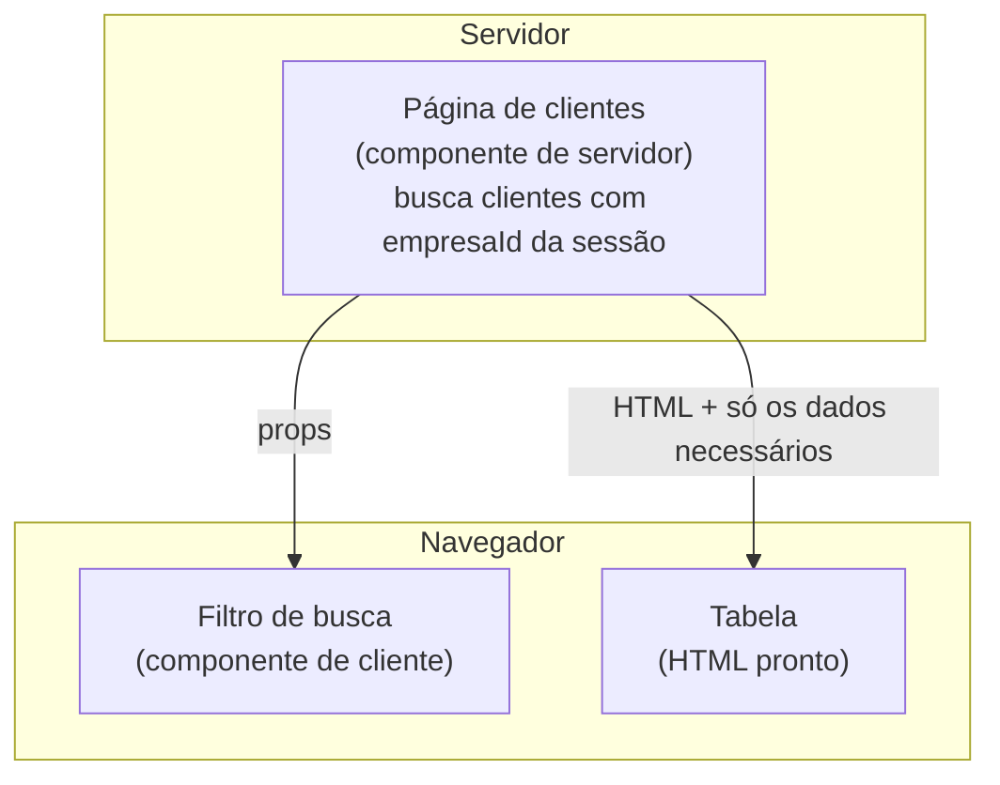
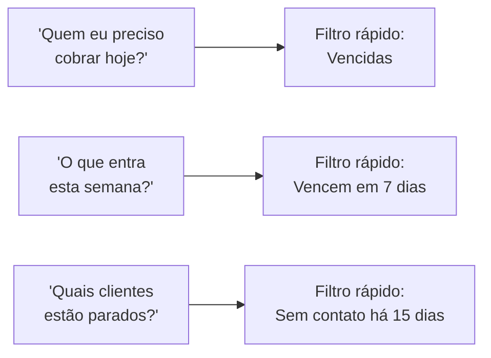
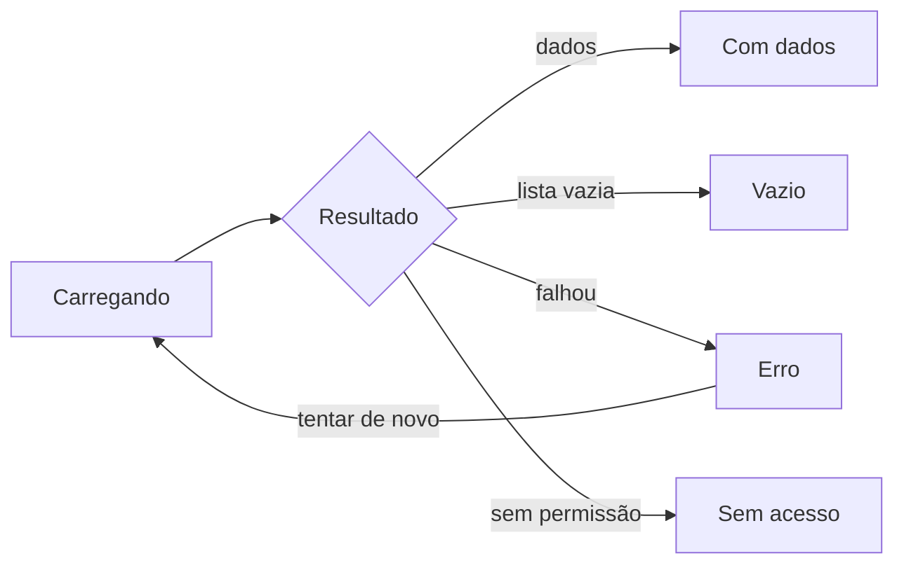

# Módulo 8: Frontend e experiência do usuário

**Semanas 15 e 16 · cerca de 22 horas**

## Objetivos de aprendizagem

O cliente julga o sistema pela tela. Um backend impecável com uma interface confusa gera ligações de suporte, erros de digitação e funcionários que voltam para a planilha. E o frontend também tem riscos de segurança próprios: dados que vazam para o navegador, scripts maliciosos injetados por usuários. Neste módulo você constrói a interface do Gestor com clareza, consistência e segurança.

Ao final deste módulo você será capaz de:
1. Explicar componentes, e a diferença entre componentes de servidor e de cliente no Next.js.
2. Construir formulários com validação, mensagens claras e proteção contra envio duplo.
3. Montar listas e tabelas com busca, filtros e paginação.
4. Desenhar painéis com indicadores que respondem perguntas do dono.
5. Tratar os estados de carregamento, vazio e erro em todas as telas.
6. Garantir que as telas funcionem no celular, sejam acessíveis e não exponham dados nem aceitem scripts maliciosos.

### Como estudar este módulo

*Figura: o módulo vai das peças básicas da interface até a qualidade final (celular, acessibilidade, segurança).*

| Semana | O que fazer | Horas |
|---|---|---|
| 15 | Aulas 8.1 a 8.3, exercícios 1 a 3 | 11 |
| 16 | Aulas 8.4 a 8.6, exercícios 4 e 5, tarefa, entregável, autoavaliação | 11 |

---

## Aula 8.1: Componentes, e onde cada um roda

Uma tela moderna é montada como um jogo de blocos: botões, campos, cartões, tabelas, cada um um **componente** reutilizável. Entender componentes permite pedir ao Claude telas consistentes e revisar se algo sensível está indo parar no navegador.

### O que é um componente

Um **componente** é uma peça de interface com nome, que recebe informações (chamadas **props**) e desenha algo. No React (a base do Next.js):

```tsx
type Props = { valorCentavos: number; status: "aberto" | "pago" | "vencido" };

export function ValorComStatus({ valorCentavos, status }: Props) {
  return (
    <span className={status === "vencido" ? "text-red-700" : "text-gray-900"}>
      {formatarMoeda(valorCentavos)} · {rotuloStatus[status]}
    </span>
  );
}
```

Uso: `<ValorComStatus valorCentavos={15050} status="vencido" />` mostra "R$ 150,50 · Vencido" em vermelho. Se amanhã o cliente quiser o vencido em laranja, você muda **em um lugar**.

### Componentes de servidor × de cliente

No Next.js (App Router), cada componente roda em um de dois lugares:

| | Componente de servidor (padrão) | Componente de cliente (`"use client"`) |
|---|---|---|
| Onde roda | No servidor; o navegador recebe só o HTML pronto | No navegador |
| Pode acessar o banco e segredos | **Sim** | **Não** |
| Pode reagir a cliques, digitação, estado | Não | Sim |
| Vai para o navegador como código | Não | Sim, todo o código dele |
| Use para | Buscar dados e montar a página | Interatividade: formulários, filtros, menus, gráficos |


*Figura: a página busca os dados no servidor e envia ao navegador só o HTML e os dados necessários. Só o filtro, que precisa reagir à digitação, roda como código no navegador.*

### O risco escondido: o que você passa para o componente de cliente vai para o navegador

Tudo que um componente de servidor passa como prop para um componente de cliente **é enviado ao navegador**, e qualquer um vê (F12). Erro típico:

```tsx
// ❌ a página passa o objeto inteiro do usuário para um componente de cliente
<MenuUsuario usuario={usuario} />
// usuario contém: nome, email, hashDaSenha, tokenDeRecuperacao, papel, empresaId...
```

```tsx
// ✔ passa só o que a tela precisa mostrar
<MenuUsuario nome={usuario.nome} papel={usuario.papel} />
```

Regra para o CLAUDE.md: *"componentes de cliente recebem só os campos necessários para exibir, nunca objetos inteiros vindos do banco"*. No serviço, use `select` do Prisma para buscar só as colunas que a tela usa.

### Biblioteca de componentes: consistência sem esforço

Em vez de cada tela ter um botão diferente, use uma **biblioteca de componentes**. O padrão desta formação é **shadcn/ui** (componentes prontos que ficam no seu projeto) com **Tailwind CSS** (estilos por classes). Vantagens:
- Telas consistentes: o cliente aprende uma vez onde fica cada coisa.
- Acessibilidade já embutida nos componentes (menus que funcionam com teclado, por exemplo).
- O Claude conhece muito bem, e gera telas no padrão quando você pede.

Crie no projeto uma pasta `src/components/ui` (os componentes base) e `src/components/gestor` (os componentes do negócio: `ValorComStatus`, `SeletorDeCliente`, `EtiquetaDeEtapa`).

### Exemplo completo: o pedido da tela de clientes

```text
Crie a página /clientes do Gestor.

- Componente de servidor busca a primeira página de clientes via
  clientesService.listar(sessao, filtros), com select apenas de: id, nome,
  email, telefone, cidade, origem, criadoEm.
- Busca e filtro por origem em um componente de cliente que atualiza a URL
  (?busca=&origem=&pagina=), para o filtro ficar no link e poder ser compartilhado.
- Tabela com shadcn/ui; no celular, vira lista de cartões.
- Botão "Novo cliente" só aparece para quem tem permissão clientes:criar
  (a rota continua verificando no servidor).
- Nenhum objeto inteiro do banco passado para componentes de cliente.
```

> 📌 **Em resumo**
> - Componentes são peças reutilizáveis; mude em um lugar, muda no sistema todo.
> - Componentes de servidor buscam dados e podem usar segredos; os de cliente cuidam da interação e vão inteiros para o navegador.
> - Tudo passado a um componente de cliente fica visível no navegador: passe só o necessário.
> - Use uma biblioteca de componentes para consistência e acessibilidade.

### Para ir além
- [Aprenda React (documentação oficial, em inglês)](https://react.dev/learn)
- [shadcn/ui (em inglês)](https://ui.shadcn.com/docs)
- [Tailwind CSS (em inglês)](https://tailwindcss.com/docs)

---

## Aula 8.2: Formulários que não deixam errar

Formulários são onde os dados entram no sistema. Um formulário ruim gera dados sujos, retrabalho e cobranças erradas. Um bom formulário guia o usuário, avisa o erro na hora e impede os acidentes clássicos, como clicar duas vezes em "Salvar" e criar duas cobranças.

### Os princípios de um bom formulário

| Princípio | Na prática |
|---|---|
| **Peça só o necessário** | Cada campo a mais é um motivo para desistir. Campos opcionais claramente marcados |
| **Rótulo sempre visível** | O rótulo fica em cima do campo, não só como texto de exemplo dentro dele (que some quando o usuário digita) |
| **Formato ajudado** | Máscara para telefone, CPF e moeda; teclado numérico no celular para números |
| **Erro na hora, perto do campo** | "E-mail inválido" logo abaixo do campo de e-mail, não um alerta genérico no topo |
| **Mesma regra no frontend e no backend** | O mesmo schema Zod (Aula 7.2) valida nos dois lugares |
| **Proteção contra envio duplo** | O botão fica desabilitado e mostra "Salvando..." enquanto envia |
| **Confirmação clara** | "Cliente cadastrado" e o que fazer em seguida |

### O mesmo schema nos dois lados

```tsx
"use client";
import { useForm } from "react-hook-form";
import { zodResolver } from "@hookform/resolvers/zod";
import { criarClienteSchema } from "@/server/clientes/schemas.shared";

const form = useForm({ resolver: zodResolver(criarClienteSchema) });
```

Repare no arquivo `schemas.shared`: schemas usados no frontend ficam em um arquivo **sem nada sensível**, porque vão para o navegador. Nunca importe em um componente de cliente um arquivo que também importa o banco ou segredos.

### Dinheiro e datas no formulário

- **Valor em reais:** o usuário digita "1.500,00"; o formulário converte para `150000` centavos antes de enviar. Use um componente único `CampoMoeda` em todo o sistema.
- **Datas:** use o seletor de data nativo (`type="date"`), que envia `AAAA-MM-DD` e evita confusão entre dia e mês.
- **Percentual:** limite visual e no schema (0 a 100), com uma casa decimal se a regra pedir.

### Envio duplo e idempotência na tela

O usuário clica em "Gerar cobrança", a internet está lenta, ele clica de novo. Defesas, em camadas:
1. **Botão desabilitado** durante o envio.
2. **Chave de idempotência** gerada quando o formulário abre e enviada junto: se o servidor receber duas vezes a mesma chave, cria só uma cobrança (o mesmo princípio da Aula 7.6).
3. **Restrição no banco** quando houver uma unicidade natural (por exemplo, uma cobrança por lançamento e parcela).

### Ações destrutivas

Excluir, cancelar, estornar: essas ações precisam de **confirmação que faz pensar**:
- Diálogo dizendo exatamente o que vai acontecer: "Cancelar a cobrança de R$ 1.500,00 de Maria Souza, vencimento 10/11? O cliente será avisado."
- Para ações muito graves (excluir a empresa inteira, por exemplo), peça para digitar o nome da empresa.
- Ofereça **desfazer** quando possível (a exclusão lógica da Aula 5.4 permite).

### Mensagens de erro que ajudam

| Ruim | Bom |
|---|---|
| "Erro de validação" | "Informe um e-mail no formato `nome@empresa.com.br`" |
| "Erro 409" | "Já existe um cliente com este CPF: Maria Souza. Abrir cadastro?" |
| "Erro interno" | "Não conseguimos salvar agora. Tente de novo em instantes. Se continuar, informe o código req_8f2a1c ao suporte." |
| "Operação não permitida" | "Somente gerentes podem dar desconto acima de 10%." |

### Exemplo completo: formulário de nova cobrança

Requisitos que você passa ao Claude:
- Campos: cliente (busca com autocompletar, só clientes da empresa), descrição, valor (`CampoMoeda`), vencimento (`type="date"`, não aceita mais de 5 anos no passado), parcelas (1 a 24, mostra a prévia "3x de R$ 500,00").
- Validação com o schema compartilhado; erros abaixo de cada campo.
- Botão desabilitado com "Gerando..." durante o envio; chave de idempotência.
- Depois de criar: mensagem "Cobrança criada" com o link para enviar ao cliente.
- Testes de ponta a ponta (Playwright): preencher e criar; erro de valor vazio; duplo clique cria só uma cobrança.

> 📌 **Em resumo**
> - Peça só o necessário, com rótulos visíveis, formatos ajudados e erros perto do campo.
> - O mesmo schema Zod valida no formulário e no servidor; o arquivo compartilhado não pode ter nada sensível.
> - Proteja contra envio duplo com botão desabilitado, chave de idempotência e restrição no banco.
> - Ações destrutivas pedem confirmação explícita e, se possível, desfazer.

---

## Aula 8.3: Listas, tabelas, busca e filtros

A maior parte do tempo de quem usa um sistema de gestão é gasto em listas: clientes, cobranças, pedidos, conversas. Uma lista bem feita responde rápido à pergunta "o que eu preciso fazer agora?". Uma mal feita obriga o usuário a exportar para o Excel.

### O que toda lista precisa

| Elemento | Por quê |
|---|---|
| **Paginação no servidor** | Nunca trazer tudo (Aula 5.6) |
| **Busca** | Por nome, documento, e-mail, conforme o recurso |
| **Filtros que respondem perguntas** | "Vencidas", "desta semana", "do meu responsável" |
| **Ordenação** | Pela coluna que importa (vencimento, valor, data) |
| **Estado na URL** | `?status=vencido&pagina=2`, para o link poder ser salvo e compartilhado, e o botão voltar funcionar |
| **Ação principal por linha** | "Registrar pagamento", "Abrir conversa" |
| **Destaque visual do que exige atenção** | Vencido em vermelho, prioridade alta com etiqueta |
| **Totalizadores** | "32 cobranças vencidas · R$ 18.450,00" |

### Filtros que pensam como o usuário

Em vez de dar ao usuário dez campos genéricos, ofereça **atalhos para as perguntas reais** que você ouviu na descoberta:


*Figura: filtros rápidos nascem das perguntas que o usuário faz no dia a dia, levantadas na entrevista de descoberta.*

### Segurança nas listas

- Os filtros chegam pela URL, portanto são **entrada do usuário**: valide com Zod (status dentro da lista permitida, página numérica, tamanho de página com máximo).
- A ordenação por coluna deve aceitar só colunas de uma **lista permitida**. Nunca passe o nome da coluna recebido direto para a consulta.
- O filtro "do meu responsável" usa o id do usuário **da sessão**, não um id vindo da URL, a menos que o papel permita ver de outros.
- A busca textual nunca monta SQL com o texto (o Prisma protege; `$queryRawUnsafe` é proibido).

### Exportação: o vazamento mais fácil do mundo

"Exportar para Excel" é uma das funções mais pedidas e a forma mais fácil de dados saírem da empresa. Cuidados:
- Só papéis autorizados exportam (dono e gerente, por exemplo).
- A exportação respeita os mesmos filtros e o mesmo `empresaId`.
- **Toda exportação é registrada na auditoria** (quem, quando, quantos registros, quais filtros).
- Colunas sensíveis (documentos completos, dados de saúde) só entram se a regra de negócio exigir.
- Proteja contra **injeção em planilhas**: textos que começam com `=`, `+`, `-` ou `@` podem ser interpretados como fórmula pelo Excel. Prefixe esses valores com um apóstrofo ao gerar o CSV.

### Exemplo completo: a tela de contas a receber

Especificação resumida:
- Filtros rápidos: Vencidas · Vencem hoje · Próximos 7 dias · Pagas no mês · Todas.
- Busca por cliente ou descrição.
- Colunas: cliente, descrição, vencimento, valor, saldo, status (etiqueta colorida), ações.
- Totalizador no topo, calculado **no servidor** com os mesmos filtros.
- Ação por linha: "Registrar pagamento" (abre o formulário de baixa), "Enviar lembrete".
- Celular: lista de cartões com cliente, valor e status em destaque.
- Exportar CSV: só dono e gerente, auditado, com proteção contra injeção em planilhas.

Pedido ao Claude: cole essa especificação, aponte `@src/app/(app)/clientes/page.tsx` como o padrão a seguir, e peça testes de ponta a ponta para os filtros e para a recusa da exportação ao papel atendente.

> 📌 **Em resumo**
> - Listas: paginação no servidor, busca, filtros que respondem perguntas reais, estado na URL, totalizadores.
> - Filtros e ordenação são entrada do usuário: valide e use listas permitidas.
> - Exportação é ponto de vazamento: restrinja por papel, audite e proteja contra injeção em planilhas.
> - Siga o padrão de uma tela existente para manter consistência.

---

## Aula 8.4: Painéis e indicadores que o dono entende

O dono da empresa abre o sistema e quer saber, em 10 segundos: **estou bem ou mal? o que precisa da minha atenção?**. Um painel cheio de gráficos bonitos que não respondem isso é decoração. Esta aula ensina a montar painéis que viram ferramenta de decisão, e que você pode usar como argumento de venda.

### Comece pelas perguntas, não pelos gráficos

Na descoberta (Módulo 4), você ouviu as perguntas do dono. Cada indicador do painel responde **uma** delas:

| Pergunta do dono | Indicador | Forma |
|---|---|---|
| "Quanto vou receber este mês?" | A receber no mês (previsto × recebido) | Número grande + barra de progresso |
| "Quanto está atrasado?" | Total vencido e número de clientes | Número em destaque, com link para a lista |
| "As vendas estão melhores que no mês passado?" | Vendas ganhas no mês × mês anterior | Número + variação percentual |
| "Onde as vendas travam?" | Oportunidades por etapa do funil | Barras horizontais |
| "Quem da equipe está vendendo?" | Ganhos por vendedor | Tabela ordenada |

### Regras de um bom painel

1. **O resumo vem antes do detalhe.** No topo, 3 a 5 números grandes. Embaixo, gráficos e listas.
2. **Todo número tem contexto.** "R$ 42.300" sozinho não diz nada. "R$ 42.300 de R$ 60.000 previstos (70%)" diz.
3. **Todo número leva a uma lista.** Clicou em "R$ 8.450 vencidos", abre a lista das cobranças vencidas, já filtrada.
4. **Período explícito.** "Novembro de 2026", com seletor. E fuso de Brasília (lembra das oportunidades que sumiram na Aula 5.2?).
5. **Cor com significado.** Vermelho para o que exige ação, verde para o que está bem. Não use cor só para enfeitar.
6. **Cada papel vê o seu painel.** O dono vê tudo; o gerente vê a sua loja; o vendedor vê as suas metas, nunca o faturamento total, se essa for a regra.

### Os números precisam bater

Nada destrói mais a confiança no sistema do que o painel dizer uma coisa e a lista dizer outra. Garanta:
- O painel e a lista usam **a mesma função de serviço** para calcular (não duas consultas parecidas escritas em lugares diferentes).
- Testes que conferem: "o total vencido do painel é igual à soma da lista de vencidos com o mesmo filtro".
- Todo cálculo em centavos e no servidor.

### Desempenho

Painéis somam muitos dados. Se ficarem lentos:
- Índices nas colunas de filtro (Aula 5.6).
- Cálculos pesados em segundo plano, guardando o resultado (por exemplo, recalcular os indicadores do mês a cada 10 minutos), com a hora da última atualização visível: "Atualizado às 14h20".

### Exemplo completo: o painel do Gestor para o dono

```text
┌──────────────────────────────────────────────────────────────────┐
│ Novembro de 2026 ▾                          Atualizado às 14h20  │
├────────────────┬────────────────┬────────────────┬───────────────┤
│ A receber      │ Vencido        │ Vendas ganhas  │ Ticket médio  │
│ R$ 42.300      │ R$ 8.450       │ 18             │ R$ 2.350      │
│ de R$ 60.000   │ 11 clientes →  │ +20% vs out.   │ -5% vs out.   │
├────────────────┴────────────────┴────────────────┴───────────────┤
│ Funil de vendas (oportunidades abertas por etapa)                │
│ Contato       ████████████████ 32                                │
│ Proposta      ██████████ 20                                      │
│ Negociação    █████ 9                                            │
├──────────────────────────────────────────────────────────────────┤
│ Atenção hoje: 4 cobranças vencem hoje · 6 clientes sem resposta  │
│ no WhatsApp há mais de 2 horas                                   │
└──────────────────────────────────────────────────────────────────┘
```

Repare na última faixa: **"Atenção hoje"**. É a parte mais valiosa do painel, porque transforma dados em ação. Ela vem diretamente das dores da descoberta.

> 📌 **Em resumo**
> - Cada indicador responde a uma pergunta real do dono; comece pelas perguntas.
> - Resumo antes do detalhe, número com contexto, clique leva à lista, período e fuso explícitos.
> - Painel e lista usam a mesma função de cálculo, e testes garantem que batem.
> - Cada papel vê o painel que pode ver.

### Para ir além
- [web.dev: aprenda acessibilidade (em inglês)](https://web.dev/learn/accessibility): inclui como tornar gráficos e cores legíveis para todos.

---

## Aula 8.5: Carregando, vazio, erro: os estados esquecidos

O Claude, quando pedido de forma simples, faz a tela do "caminho feliz": dados chegaram, tudo certo. Na vida real, a internet da loja cai, a lista está vazia no primeiro dia, o servidor demora. Telas sem esses estados parecem quebradas, e o cliente liga dizendo que "o sistema travou".

### Os cinco estados de toda tela


*Figura: os cinco estados que toda tela precisa ter. O caminho feliz é só um deles.*

| Estado | O que mostrar | Exemplo no Gestor |
|---|---|---|
| **Carregando** | Esqueleto da tela (blocos cinzas no formato do conteúdo) ou indicador discreto | Tabela com linhas cinzas pulsando |
| **Vazio** | O que aparece aqui + como começar | "Nenhum cliente ainda. Cadastre o primeiro ou importe de uma planilha." |
| **Vazio por filtro** | Que o filtro não achou nada + como limpar | "Nenhuma cobrança vencida. 🎉 Limpar filtro" |
| **Erro** | O que aconteceu, em linguagem simples + tentar de novo + código | "Não conseguimos carregar as cobranças. Tentar de novo. Código: req_8f2a1c" |
| **Sem acesso** | Que o usuário não tem permissão, sem revelar o conteúdo | "Esta área é restrita a gerentes." |

### Retorno de ações

Toda ação precisa de retorno:
- **Enquanto acontece:** botão com "Salvando..." e desabilitado.
- **Deu certo:** mensagem breve ("Pagamento registrado") e a tela atualizada.
- **Deu errado:** mensagem que diz o que fazer, sem perder o que o usuário digitou.

> ⚠️ **Nunca perca o que o usuário digitou.** Se o envio falhou, o formulário continua preenchido. Perder um formulário longo por causa de uma queda de internet é a forma mais rápida de o usuário odiar o sistema.

### Conexão instável

Pequenas empresas têm internet ruim. Cuidados:
- Requisições com tempo limite e mensagem clara ("A conexão está lenta. Tentando de novo...").
- Para operações críticas, a chave de idempotência (Aula 8.2) permite tentar de novo com segurança.
- Aviso quando o navegador está sem internet ("Você está sem conexão. As alterações não foram salvas.").

### No Next.js: arquivos especiais

O Next.js tem arquivos que cuidam desses estados por pasta de rota:
- `loading.tsx`: mostrado enquanto a página carrega.
- `error.tsx`: mostrado quando algo falha na página (com botão de tentar de novo).
- `not-found.tsx`: para "não encontrado" (inclusive para recursos de outra empresa, que respondem 404).

Peça ao Claude que toda pasta de rota principal tenha os três.

### Exemplo completo: a lista de conversas do WhatsApp

| Estado | Tela |
|---|---|
| Carregando | 6 linhas-esqueleto com avatar redondo e duas linhas de texto |
| Vazio (WhatsApp não conectado) | "Conecte o WhatsApp da empresa para ver as conversas aqui. Conectar" (só para o dono) |
| Vazio (conectado, sem conversas) | "Nenhuma conversa ainda. Quando um cliente mandar mensagem, ela aparece aqui." |
| Vazio por filtro "não respondidas" | "Todas as conversas foram respondidas. 👏" |
| Erro | "Não conseguimos carregar as conversas. Tentar de novo." |
| Sem acesso | Atendente vê só as conversas atribuídas a ela; a lista de "todas" mostra "Disponível para gerentes" |

> 📌 **Em resumo**
> - Toda tela tem cinco estados: carregando, com dados, vazio, erro e sem acesso.
> - O vazio ensina o próximo passo; o erro diz o que fazer e dá um código para o suporte.
> - Toda ação dá retorno, e o que o usuário digitou nunca se perde.
> - Use `loading.tsx`, `error.tsx` e `not-found.tsx` em todas as rotas principais.

---

## Aula 8.6: Celular, acessibilidade e segurança no navegador

A vendedora usa o sistema no celular, no meio da loja. O dono tem 62 anos e usa letra grande. E um cliente mal-intencionado pode tentar cadastrar um "nome" que é, na verdade, um script. Esta aula fecha a qualidade da interface com três frentes que o iniciante esquece.

### Celular primeiro

Em pequenas empresas brasileiras, boa parte do uso é pelo celular. Regras:
- **Teste no celular de verdade**, não só no navegador do computador.
- Tabelas largas viram **cartões** no celular.
- Botões e áreas de toque com pelo menos 44 × 44 pixels.
- Campos com o teclado certo: `type="tel"` para telefone, `inputMode="decimal"` para valores, `type="email"` para e-mail.
- Nada de rolagem horizontal da página.

### Acessibilidade: para todos, e é lei

**Acessibilidade** é garantir que pessoas com deficiência (visual, motora, auditiva, cognitiva) consigam usar o sistema. Também beneficia todos: idosos, quem está no sol, quem usa só uma mão. No Brasil, a Lei Brasileira de Inclusão (Lei 13.146/2015) trata de acessibilidade, inclusive em sites. O padrão técnico internacional é o **WCAG**.

O essencial:
| Item | Como |
|---|---|
| Contraste | Texto legível sobre o fundo (os componentes do shadcn/ui ajudam; confira cores personalizadas) |
| Teclado | Tudo funciona com Tab e Enter; o foco é visível |
| Rótulos | Todo campo tem rótulo associado; todo botão de ícone tem nome ("Excluir cliente") |
| Cor não é a única informação | "Vencido" escrito, não só a cor vermelha |
| Texto ampliável | O layout aguenta o usuário aumentar a fonte do celular |
| Mensagens de erro | Lidas por leitores de tela (atributos `aria` corretos) |

Peça ao Claude: *"revise esta tela quanto a acessibilidade (WCAG nível AA): contraste, navegação por teclado, rótulos, foco visível e mensagens de erro. Liste os problemas e corrija"*. O Playwright também consegue rodar verificações automáticas de acessibilidade.

### Segurança no navegador: XSS

**XSS** (cross-site scripting) acontece quando o sistema mostra, como código, um texto que um usuário digitou. Exemplo: alguém cadastra um cliente com o nome:

```text

```

Se a tela inserir esse texto como HTML, o navegador de **quem abrir a lista** (o dono, por exemplo) executa o script, que pode roubar a sessão ou fazer ações em nome dele.

Defesas:
1. **O React já protege** quando você mostra texto normalmente (`{cliente.nome}`): ele trata o conteúdo como texto, não como HTML.
2. **O perigo é `dangerouslySetInnerHTML`** (o nome já avisa). Se o Claude usar isso para mostrar algo digitado por usuário, é alerta vermelho. Se for realmente necessário mostrar HTML (por exemplo, o corpo formatado de um e-mail), use uma biblioteca de **sanitização** (como DOMPurify) que remove scripts.
3. **Links:** um usuário pode cadastrar o "site" como `javascript:...`. Valide que URLs começam com `https://`.
4. **Cookies de sessão** com `HttpOnly` (o JavaScript não lê), `Secure` e `SameSite` (Módulo 9).
5. **Content Security Policy** (Módulo 13): um cabeçalho que diz ao navegador de onde scripts podem vir, uma camada extra.

### Outros cuidados no navegador

| Risco | Cuidado |
|---|---|
| Dados sensíveis guardados no navegador | Não guarde tokens nem dados pessoais em `localStorage`; a sessão fica em cookie `HttpOnly` |
| Dados na URL | Não coloque CPF, e-mail ou tokens na URL (ficam no histórico, em logs e em capturas de tela) |
| Código-fonte exposto | Lembre que tudo de componentes de cliente é público; nada de regras secretas ou chaves |
| Bibliotecas de terceiros no navegador | Cada script externo (chat, analytics) pode ler a página; use o mínimo e só de fornecedores confiáveis |
| Computador compartilhado na loja | Sessão que expira por inatividade, botão "sair" visível |

### Exemplo completo: revisão final da interface do Gestor

Antes de fechar o módulo, rode uma revisão em sessão nova do Claude:

```text
Revise todas as telas em src/app/(app) quanto a:
1. Segurança no navegador: uso de dangerouslySetInnerHTML, URLs de usuário sem
   validação, dados sensíveis passados a componentes de cliente, uso de
   localStorage para dados sensíveis, dados pessoais em URLs.
2. Estados: cada rota principal tem loading, error e not-found?
3. Celular: tabelas viram cartões? Há rolagem horizontal?
4. Acessibilidade WCAG AA: contraste, teclado, rótulos, foco, cor como única informação.
Liste os problemas por arquivo, com gravidade. Não altere nada.
```

> 📌 **Em resumo**
> - Celular primeiro: cartões no lugar de tabelas, toques grandes, teclado certo, teste no aparelho.
> - Acessibilidade (WCAG AA) beneficia todos e tem respaldo legal.
> - XSS: o React protege texto normal; `dangerouslySetInnerHTML` com conteúdo de usuário é proibido sem sanitização; valide URLs.
> - Nada sensível em `localStorage` nem na URL; sessão em cookie `HttpOnly`.

### Para ir além
- [web.dev: acessibilidade (em inglês)](https://web.dev/learn/accessibility)
- [Content Security Policy (MDN, em inglês)](https://developer.mozilla.org/en-US/docs/Web/HTTP/Headers/Content-Security-Policy)

---

## Exercícios

### Exercício 1: Caça ao vazamento no navegador (40 min)
**Objetivo:** ver o que vai para o navegador.
1. Abra a tela de clientes do Gestor no navegador.
2. Aperte F12 → aba Rede. Recarregue. Procure as respostas que contêm os dados.
3. Liste todos os campos que chegam ao navegador. Algum não é usado pela tela? Algum é sensível?
4. Peça ao Claude para reduzir aos campos necessários e confira de novo.

<details>
<summary><strong>Resolução comentada</strong></summary>

É comum encontrar campos como `criadoPorId`, `empresaId`, `excluidoEm`, `atualizadoEm` e, em telas de usuários, até o hash da senha ou tokens, quando o código passa objetos inteiros do banco. Nenhum deles é usado pela tela. `empresaId` e ids internos não são segredos graves, mas revelam estrutura; hash de senha e tokens são graves. A correção é usar `select` no serviço com só os campos exibidos e passar props mínimas aos componentes de cliente. Depois da correção, a resposta deve conter apenas o que aparece na tela.
</details>

### Exercício 2: Formulário à prova de pressa (60 min)
Implemente o formulário de nova cobrança da Aula 8.2 e escreva um teste de ponta a ponta que clica duas vezes em "Gerar cobrança" rapidamente e confirma que só uma foi criada.

### Exercício 3: Filtros na URL (45 min)
Na lista de contas a receber, faça os filtros ficarem na URL. Teste: aplique um filtro, copie o link, abra em outra aba logado com outro usuário da **mesma** empresa (deve ver o mesmo) e com um usuário de **outra** empresa (deve ver só os dados dele, nunca os da primeira).

### Exercício 4: Painel que responde (60 min)
Desenhe (papel ou wireframe) o painel do gerente e o do atendente do Gestor, partindo de 3 perguntas que cada um faria. Implemente o do dono, com teste que confere que o total vencido do painel bate com a soma da lista.

### Exercício 5: Tente um XSS (30 min)
Cadastre no Gestor (local) um cliente com nome `` e um site `javascript:alert(1)`. Abra a lista e o cadastro. Algum alerta apareceu? Se sim, encontre o trecho responsável e corrija. Se não, explique por que o React protegeu e onde ele **não** protegeria.

---

## Tarefa de campo

**Teste de usabilidade com uma pessoa real.** Mostre o Gestor (ou o wireframe do caso real) a alguém do perfil do usuário (uma vendedora, um gerente, você mesmo na sua operação). Dê 3 tarefas ("cadastre um cliente", "descubra quanto está vencido", "registre um pagamento") e **observe sem ajudar**. Anote onde a pessoa hesitou, errou ou perguntou. Corrija os 3 problemas mais graves.

---

## Entregável: Interface completa do Gestor

**Checklist de qualidade:**
- [ ] Telas: painel, clientes, funil, contas a receber e a pagar, configurações.
- [ ] Componentes de negócio reutilizáveis (`CampoMoeda`, `ValorComStatus`, etc.).
- [ ] Formulários com schema compartilhado, erros por campo e proteção contra envio duplo.
- [ ] Listas paginadas no servidor, filtros na URL validados, totalizadores.
- [ ] Exportação restrita, auditada e protegida contra injeção em planilhas.
- [ ] Painel do dono com indicadores que batem com as listas (teste).
- [ ] Toda rota principal com `loading`, `error` e `not-found`.
- [ ] Funciona no celular, sem rolagem horizontal.
- [ ] Revisão de acessibilidade feita e problemas graves corrigidos.
- [ ] Nenhum `dangerouslySetInnerHTML` com conteúdo de usuário; URLs validadas.
- [ ] Componentes de cliente recebem só os campos necessários.

---

## Autoavaliação

Meta: 8 de 10.

1. Qual a diferença entre componente de servidor e de cliente, e qual deles pode acessar o banco?
2. Por que passar o objeto `usuario` inteiro para um componente de cliente é perigoso?
3. Como impedir que um duplo clique crie duas cobranças? Cite três camadas.
4. Por que os filtros devem ficar na URL, e que cuidado de segurança isso exige?
5. Cite três cuidados na função "exportar para Excel".
6. O painel diz "R$ 8.450 vencidos" e a lista soma R$ 8.120. Qual a causa provável e como evitar?
7. Quais são os cinco estados de uma tela?
8. O que é XSS? Quando o React não protege?
9. Por que não guardar o token de sessão em `localStorage`?
10. Cite 3 requisitos de acessibilidade que você confere em toda tela.

<details>
<summary><strong>Gabarito</strong></summary>

1. O de servidor roda no servidor, pode acessar o banco e segredos, e envia só HTML ao navegador. O de cliente roda no navegador, cuida de interação e vai inteiro como código para o usuário. Só o de servidor pode acessar o banco.
2. Porque tudo passado como prop para um componente de cliente é enviado ao navegador e fica visível (F12), inclusive campos sensíveis como hash de senha e tokens.
3. Botão desabilitado durante o envio; chave de idempotência enviada com o formulário; restrição de unicidade no banco quando houver uma natural.
4. Para o link poder ser salvo, compartilhado e o botão voltar funcionar. Como a URL é entrada do usuário, os filtros precisam ser validados (valores permitidos, limites) e a ordenação só aceita colunas de uma lista permitida.
5. Restringir por papel; respeitar o empresaId e os filtros; registrar na auditoria; excluir colunas sensíveis desnecessárias; proteger contra injeção em planilhas.
6. Painel e lista calculam com consultas ou regras diferentes (filtro de data, fuso, baixas parciais). Evite usando a mesma função de serviço para os dois e um teste que compara os resultados.
7. Carregando, com dados, vazio, erro e sem acesso.
8. É a execução, no navegador de outra pessoa, de um script inserido como texto por um usuário. O React não protege quando se usa `dangerouslySetInnerHTML` com conteúdo de usuário, nem em URLs `javascript:` em links.
9. Porque qualquer script que rode na página (inclusive um XSS ou uma biblioteca de terceiros comprometida) consegue ler o `localStorage`. Em cookie `HttpOnly`, o JavaScript não tem acesso.
10. Contraste legível; navegação completa por teclado com foco visível; rótulos em todos os campos e botões de ícone; cor não ser a única forma de informação; layout que aguenta fonte ampliada.
</details>

---

## Checklist de segurança do módulo

- [ ] Componentes de cliente recebem só campos necessários; serviços usam `select`.
- [ ] Arquivos compartilhados com o frontend não importam nada sensível.
- [ ] Filtros e ordenação validados com listas permitidas.
- [ ] Exportações restritas, auditadas e protegidas contra injeção em planilhas.
- [ ] Nenhum `dangerouslySetInnerHTML` com conteúdo de usuário sem sanitização.
- [ ] URLs digitadas por usuários validadas (`https://`).
- [ ] Nada sensível em `localStorage` nem em URLs.
- [ ] Ações destrutivas com confirmação explícita.

---

## Para aprofundar (opcional)

| Material | Formato | Por que vale |
|---|---|---|
| [Aprenda React](https://react.dev/learn) | Texto, em inglês | A base de tudo no frontend |
| [Curso oficial do Next.js](https://nextjs.org/learn) | Curso gratuito, em inglês | Construção guiada de um painel completo |
| [Acessibilidade no web.dev](https://web.dev/learn/accessibility) | Curso gratuito, em inglês | Acessibilidade na prática |
