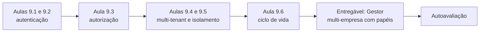
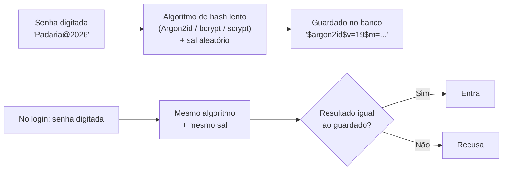
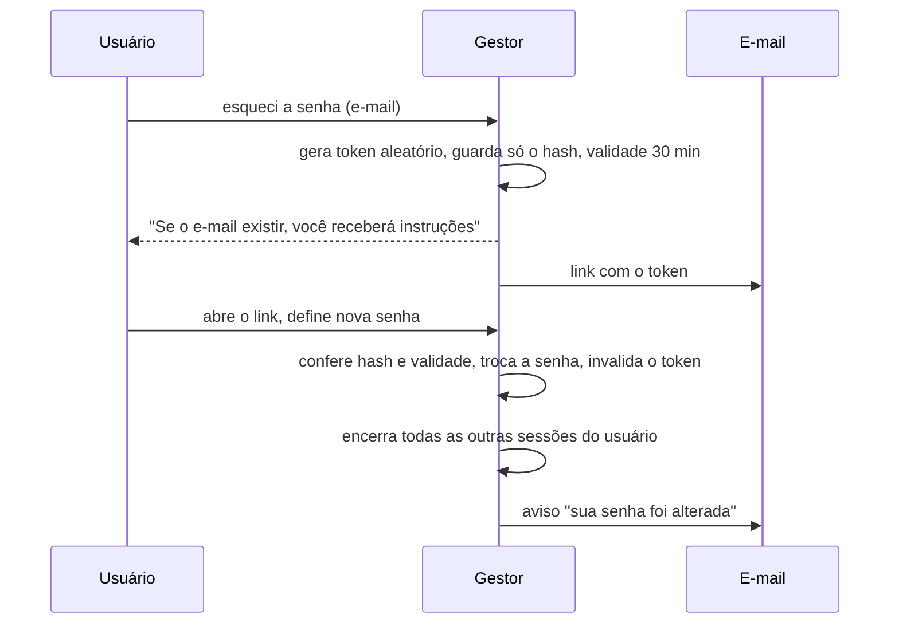
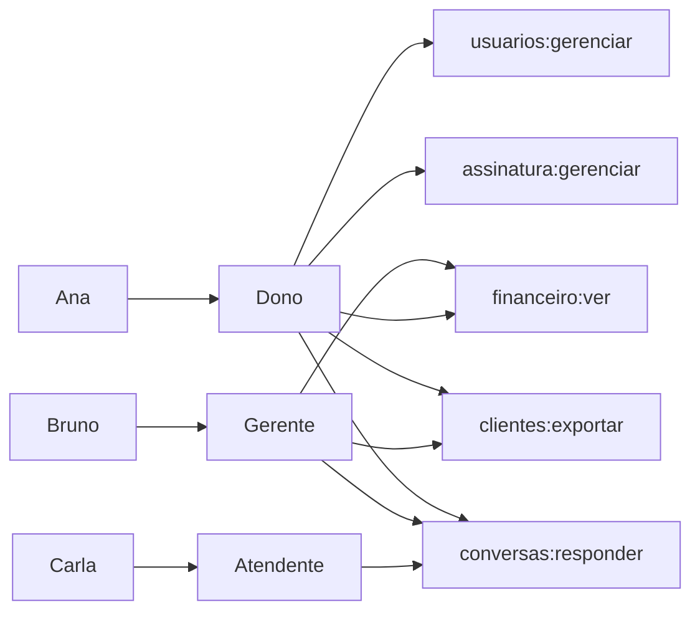
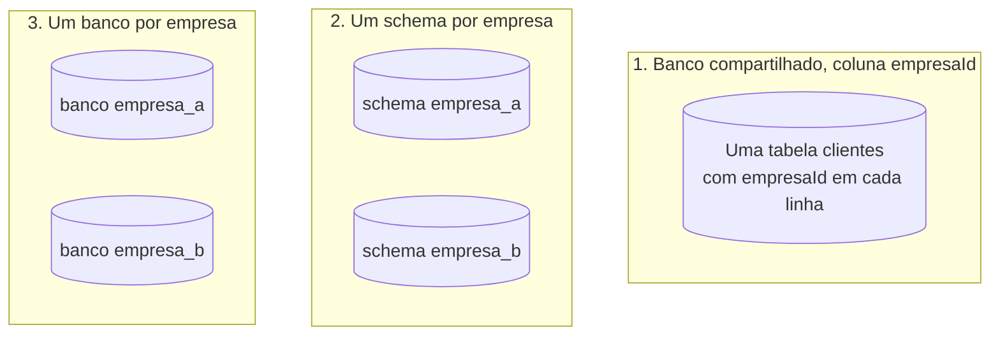
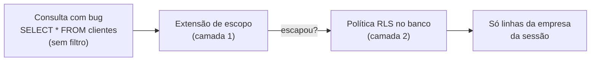
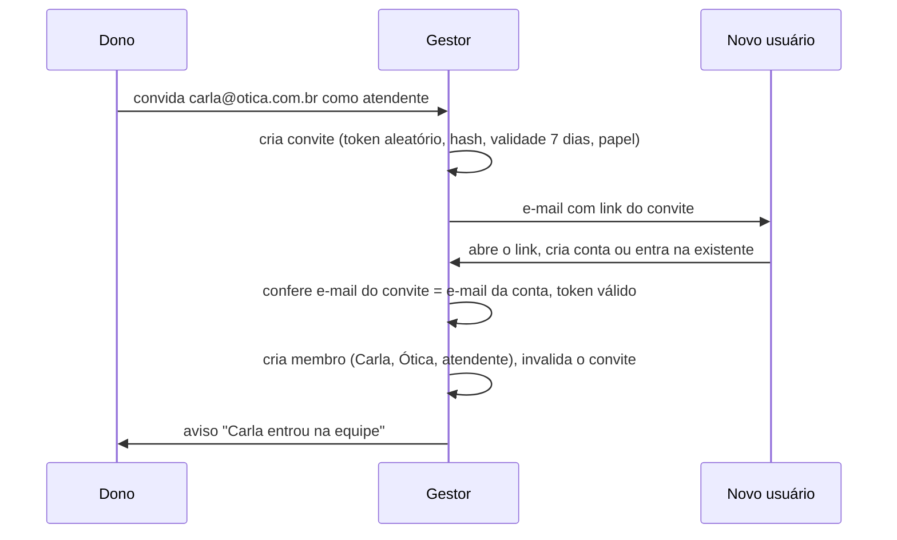

# Módulo 9: Login, permissões e multi-tenant

**Semanas 17 e 18 · cerca de 24 horas**

## Objetivos de aprendizagem

Este é o módulo que mais diretamente responde ao seu medo de vazar dados. Quase todo vazamento grave em sistemas de pequenas e médias empresas cai em uma de três categorias: **alguém entrou como outra pessoa** (falha de autenticação), **alguém viu o que não podia** (falha de autorização) ou **uma empresa viu os dados de outra** (falha de isolamento). Neste módulo você aprende a fechar as três portas, e a **provar** com testes que estão fechadas.

Ao final deste módulo você será capaz de:
1. Explicar como senhas, hashes, sessões e cookies funcionam, e configurá-los com segurança.
2. Implementar 2FA, recuperação de senha segura e proteção contra tentativas em massa.
3. Desenhar papéis e permissões (RBAC) e aplicá-los no servidor.
4. Escolher a estratégia de multi-tenant e isolar os dados de cada empresa em todas as consultas.
5. Adicionar isolamento no próprio banco (RLS) como camada extra e testar o isolamento de forma sistemática.
6. Gerenciar o ciclo de vida dos usuários: convite, troca de papel, desligamento e acesso de suporte.

### Como estudar este módulo

*Figura: as três portas (quem é, o que pode, de qual empresa) e o ciclo de vida dos usuários.*

| Semana | O que fazer | Horas |
|---|---|---|
| 17 | Aulas 9.1 a 9.3, exercícios 1 a 3 | 12 |
| 18 | Aulas 9.4 a 9.6, exercícios 4 e 5, tarefa, entregável, autoavaliação | 12 |

---

## Aula 9.1: Autenticação: senhas, sessões e cookies

**Autenticação** responde "quem é você?". **Autorização** responde "o que você pode fazer?". Iniciantes confundem as duas e acham que "tem login" significa "está seguro". Esta aula trata da primeira, com o cuidado que ela merece: um erro aqui entrega o sistema inteiro.

### Senhas: nunca guarde a senha

O sistema **nunca** guarda a senha do usuário. Guarda o resultado de um **hash**: uma função que transforma a senha em um código, de forma que:
- A mesma senha sempre gera o mesmo resultado (para conferir no login).
- É impossível, na prática, voltar do resultado para a senha.
- Cada usuário tem um **sal** (salt) aleatório misturado à senha, para que duas pessoas com a mesma senha tenham hashes diferentes.


*Figura: o sistema compara hashes, nunca senhas. Se o banco vazar, o atacante tem só os hashes, que são caros de quebrar.*

Use **algoritmos feitos para senhas**, que são propositalmente lentos (para dificultar tentativas em massa): **Argon2id**, **scrypt** ou **bcrypt**. Nunca MD5, SHA-1 ou SHA-256 puros: são rápidos demais. A biblioteca de login (Better Auth) já faz isso; seu trabalho é **conferir** e nunca deixar o Claude "simplificar".

### Regras de senha modernas

As recomendações atuais (por exemplo, do NIST, órgão de padrões dos EUA, referência mundial) mudaram em relação ao que muita gente pratica:

| Antigo (evite) | Atual (faça) |
|---|---|
| Exigir maiúscula, número e símbolo | Exigir **comprimento** (mínimo de 8; recomendável 12 ou mais) |
| Trocar a senha a cada 90 dias | Trocar só quando houver suspeita de vazamento |
| Proibir colar a senha | Permitir colar (facilita gerenciadores de senha) |
| Dica de senha, pergunta secreta | Nunca |
| | Recusar senhas conhecidas por vazamentos e óbvias ("12345678", "nome da empresa") |

### Sessão: como o sistema lembra que você entrou

Depois do login, o servidor cria uma **sessão** e entrega ao navegador um identificador dela, guardado em um **cookie**. A cada requisição, o navegador manda o cookie, e o servidor sabe quem é.

Duas formas comuns:

| | Sessão no banco | Token assinado (JWT) |
|---|---|---|
| Onde fica a informação | No banco; o cookie só tem um id aleatório | Dentro do próprio token, assinado |
| Revogar (desligar um usuário agora) | Fácil: apaga a sessão | Difícil: o token vale até expirar |
| Padrão desta formação | **Sim** (o Better Auth usa sessões no banco) | Só em casos específicos |

> 🎯 **Por que isso importa para você:** quando o cliente demitir um funcionário às 10h, ele precisa perder o acesso às 10h, não "quando o token expirar amanhã". Sessão no banco permite isso.

### O cookie de sessão bem configurado

| Atributo | Faz | Configuração |
|---|---|---|
| `HttpOnly` | O JavaScript da página não consegue ler o cookie (protege contra XSS roubar a sessão) | Sempre |
| `Secure` | Só é enviado por HTTPS | Sempre em produção |
| `SameSite=Lax` | Não é enviado em requisições vindas de outros sites (protege contra CSRF) | Padrão |
| Expiração | Sessão expira por inatividade e por tempo máximo | Ex.: 12 horas de inatividade, 30 dias no máximo, conforme o risco |

**CSRF** (falsificação de requisição entre sites) é quando um site malicioso faz o navegador do usuário logado enviar uma ação para o seu sistema ("transfira", "exclua"). `SameSite`, a verificação da origem da requisição e as proteções do framework cobrem a maior parte dos casos.

### Mensagens de erro do login

| Ruim | Bom |
|---|---|
| "Usuário não encontrado" / "Senha incorreta" | "E-mail ou senha incorretos" |

Mensagens diferentes permitem a um atacante descobrir quais e-mails têm conta (**enumeração de usuários**). O mesmo vale para "esqueci minha senha": responda sempre "Se o e-mail estiver cadastrado, você receberá as instruções".

### Exemplo completo: configurando o login do Gestor

```text
Configure o Better Auth no Gestor conforme a documentação oficial atual.

Requisitos:
- Login por e-mail e senha; sessões guardadas no banco (PostgreSQL via Prisma).
- Senha: mínimo de 10 caracteres, recusar as 10 mil senhas mais comuns; permitir colar.
- Hash: o padrão seguro da biblioteca (confirme qual é e me diga).
- Cookie: HttpOnly, Secure em produção, SameSite=Lax.
- Sessão: expira após 12 horas sem uso e no máximo em 30 dias.
- Mensagens genéricas no login e na recuperação.
- BETTER_AUTH_SECRET longo e aleatório, só em variável de ambiente.

Testes: login certo cria sessão; senha errada → mensagem genérica; senha curta
recusada no cadastro; sessão expirada → 401; logout apaga a sessão no banco.
```

> 📌 **Em resumo**
> - Nunca guarde senhas: guarde hashes de algoritmos lentos (Argon2id, scrypt, bcrypt), feitos pela biblioteca.
> - Senhas: comprimento acima de regras de símbolo; recusar senhas comuns; sem troca periódica forçada.
> - Sessões no banco permitem desligar um usuário na hora; cookie `HttpOnly`, `Secure`, `SameSite`.
> - Mensagens genéricas evitam revelar quais e-mails têm conta.

### Para ir além
- [Guia de autenticação da OWASP (em inglês)](https://cheatsheetseries.owasp.org/cheatsheets/Authentication_Cheat_Sheet.html)
- [Guia de armazenamento de senhas da OWASP (em inglês)](https://cheatsheetseries.owasp.org/cheatsheets/Password_Storage_Cheat_Sheet.html)
- [Guia de gerenciamento de sessões da OWASP (em inglês)](https://cheatsheetseries.owasp.org/cheatsheets/Session_Management_Cheat_Sheet.html)

---

## Aula 9.2: 2FA, recuperação de senha e ataques em massa

Senhas vazam: o usuário usa a mesma senha em vários sites, um deles é invadido, e a lista vai parar na internet. Robôs testam essas listas em milhares de sistemas, inclusive no seu. Esta aula adiciona as camadas que fazem uma senha vazada não ser suficiente para invadir.

### Segundo fator (2FA)

O **2FA** (autenticação em dois fatores) exige, além da senha, algo que só o usuário tem:

| Método | Segurança | Observação |
|---|---|---|
| **App autenticador** (códigos de 6 dígitos que mudam a cada 30 s, padrão TOTP) | Alta | Padrão recomendado; funciona sem internet no celular |
| **Chave de acesso (passkey) ou chave física** | Muito alta | Resistente a páginas falsas (phishing); cada vez mais suportada |
| **Código por e-mail** | Média | Melhor que nada; depende da segurança do e-mail |
| **Código por SMS** | Baixa a média | Vulnerável a clonagem de chip; evite para contas críticas |

Política recomendada para o Gestor:
- **Obrigatório** para o papel dono (que controla a assinatura, os usuários e exporta dados).
- **Recomendado** (com lembrete) para os demais.
- **Códigos de recuperação**: ao ativar o 2FA, o usuário recebe 10 códigos de uso único para o caso de perder o celular.

### Recuperação de senha sem abrir uma porta

"Esqueci minha senha" é uma das portas mais atacadas. O fluxo seguro:


*Figura: recuperação de senha segura. O token é de uso único e curto, as outras sessões são encerradas e o usuário é avisado da troca.*

| Regra | Por quê |
|---|---|
| Token longo e aleatório, guardado como hash | Se o banco vazar, os tokens não servem |
| Validade curta (15 a 60 minutos) e uso único | Limita a janela de ataque |
| Resposta igual existindo ou não o e-mail | Evita enumeração |
| Encerrar as outras sessões após a troca | Se alguém tinha invadido, perde o acesso |
| Avisar por e-mail que a senha mudou | O dono legítimo percebe se não foi ele |
| Não fazer login automático após o link, se houver 2FA | Senão, quem tem o e-mail pula o 2FA |

### Ataques em massa e limite de tentativas

Dois ataques comuns ao login:
- **Força bruta:** muitas senhas para um mesmo usuário.
- **Preenchimento de credenciais** (credential stuffing): listas de e-mail e senha vazadas de outros sites, testadas em massa.

Defesas, em camadas:
1. **Limite de tentativas** (rate limit) por conta e por endereço IP: por exemplo, 5 tentativas erradas por conta em 15 minutos, com espera crescente.
2. **Atraso ou desafio** (CAPTCHA) após várias falhas.
3. **Senhas comuns recusadas** (Aula 9.1).
4. **2FA**, que torna a senha vazada insuficiente.
5. **Alerta ao usuário** de login a partir de um dispositivo novo.
6. **Monitoramento**: um pico de falhas de login é sinal de ataque (Módulo 15).

> ⚠️ Cuidado com o bloqueio total da conta após N tentativas: um atacante pode bloquear de propósito as contas da empresa inteira. Prefira espera crescente e desafio, em vez de bloqueio permanente.

### Login social e convites

Entrar com Google ou Microsoft é cômodo e transfere parte da segurança para esses provedores (que têm 2FA robusto). Se oferecer, cuide de **não juntar contas automaticamente** só porque o e-mail é igual, sem confirmar a posse, e de manter a regra de que o acesso a uma empresa depende de **convite** (Aula 9.6), não só de ter uma conta.

### Exemplo completo: a invasão que não aconteceu

Às 3h de um domingo, o monitoramento do Gestor mostra 4.000 tentativas de login falhas em 20 minutos, de 300 IPs diferentes, contra 900 e-mails. É um ataque de preenchimento de credenciais.

O que segurou:
- O limite por IP e por conta desacelerou o ataque.
- Dois usuários tinham senhas que estavam na lista vazada. Um deles era um dono, com 2FA obrigatório: o atacante acertou a senha e parou no segundo fator. O outro era uma atendente sem 2FA, e o login com dispositivo novo gerou um alerta por e-mail.

O que você fez na segunda-feira (seguindo o plano de incidente, Módulo 14): forçou a troca de senha da atendente, revisou a auditoria dela (nenhuma ação suspeita), avisou a empresa cliente, e propôs tornar o 2FA obrigatório também para gerentes. Esse episódio vira uma linha poderosa no seu Dossiê de Confiança: **"nosso sistema detectou e conteve um ataque automatizado sem acesso indevido a dados"**.

> 📌 **Em resumo**
> - 2FA com app autenticador ou passkey; obrigatório para quem controla a conta.
> - Recuperação de senha com token aleatório, curto, de uso único, guardado como hash; encerre sessões e avise o usuário.
> - Limite de tentativas por conta e por IP, com espera crescente, contra força bruta e listas vazadas.
> - Monitore picos de falha de login.

### Para ir além
- [NIST SP 800-63B: diretrizes de autenticação (em inglês)](https://pages.nist.gov/800-63-4/sp800-63b.html)

---

## Aula 9.3: Autorização: papéis e permissões

Agora o sistema sabe **quem** é o usuário. Falta decidir **o que** ele pode fazer. A falha de autorização é a número 1 da lista OWASP Top 10 de riscos em aplicações web, e a mais comum em sistemas gerados por IA: o botão some da tela, mas a rota continua aberta.

### RBAC: controle de acesso baseado em papéis

O modelo mais usado em sistemas de gestão é o **RBAC**: cada usuário tem um **papel** (dono, gerente, atendente) e cada papel tem um conjunto de **permissões** (ações que pode fazer).


*Figura: usuários recebem papéis, e papéis recebem permissões. A verificação no código é sempre pela permissão, nunca pelo nome do papel.*

### Verifique a permissão, não o papel

```typescript
// ❌ espalhado pelo código, difícil de mudar
if (sessao.papel === "dono" || sessao.papel === "gerente") { ... }

// ✔ uma tabela central de permissões
exigirPermissao(sessao, "financeiro:ver");
```

```typescript
// src/server/auth/permissoes.ts
export const PERMISSOES = {
  dono:      ["clientes:*", "financeiro:*", "usuarios:gerenciar", "assinatura:gerenciar", "conversas:*", "auditoria:ver"],
  gerente:   ["clientes:*", "financeiro:ver", "financeiro:lancar", "conversas:*"],
  atendente: ["clientes:ver", "clientes:criar", "conversas:responder"],
} as const;
```

Quando o cliente disser "agora o gerente também pode gerenciar usuários", você muda **uma linha**, e os testes mostram exatamente o que passou a ser permitido.

### A matriz de permissões

Ela nasce do mapa de telas por papel da especificação (Aula 4.4) e vira a fonte da verdade:

| Permissão | Dono | Gerente | Atendente |
|---|---|---|---|
| `clientes:ver` | ✔ | ✔ | ✔ |
| `clientes:criar` | ✔ | ✔ | ✔ |
| `clientes:excluir` | ✔ | ✔ | ✘ |
| `clientes:exportar` | ✔ | ✔ | ✘ |
| `financeiro:ver` | ✔ | ✔ | ✘ |
| `financeiro:lancar` | ✔ | ✔ | ✘ |
| `financeiro:estornar` | ✔ | ✘ | ✘ |
| `usuarios:gerenciar` | ✔ | ✘ | ✘ |
| `assinatura:gerenciar` | ✔ | ✘ | ✘ |
| `auditoria:ver` | ✔ | ✘ | ✘ |

> 🎯 **Teste gerado da matriz:** peça ao Claude um teste que lê a matriz e, para **cada papel e cada rota**, confirma que a resposta é 200/201 quando permitido e 403 quando não. Assim, a matriz não é só documentação: ela é verificada a cada mudança.

### Além dos papéis: regras de posse e de contexto

Papéis não resolvem tudo. Às vezes a regra depende **do registro**:
- "O atendente vê só as conversas **atribuídas a ele**."
- "O vendedor vê só os clientes **dos quais é responsável**."
- "O gerente vê só os dados **da loja dele**."

Essas regras ficam no serviço, como filtros adicionais à consulta (além do `empresaId`):

```typescript
const filtro = { empresaId: sessao.empresaId, excluidoEm: null };
if (!temPermissao(sessao, "conversas:ver_todas")) {
  filtro.atendenteId = sessao.usuarioId;
}
```

### Princípio do menor privilégio

Cada papel recebe **o mínimo** necessário para o trabalho. Na dúvida, não permita, e libere quando o cliente pedir. É muito mais fácil liberar uma permissão que esqueceu do que explicar por que a atendente exportou a base inteira de clientes antes de ir para o concorrente.

Ofereça ao cliente, quando fizer sentido, **papéis personalizados** (o dono monta um papel marcando permissões). Isso exige guardar papéis e permissões no banco em vez de no código, e é uma funcionalidade comum de versão 2 de SaaS.

### Exemplo completo: a falha que o teste pegou

O cliente pediu: "o gerente agora pode ver o relatório de comissões". O Claude adicionou `comissoes:ver` ao gerente e criou a rota `/api/comissoes`. Na rota, porém, ele verificou `financeiro:ver` (que o gerente já tinha) em vez de `comissoes:ver`.

O teste gerado da matriz mostrou:
```text
✗ atendente > GET /api/comissoes → esperado 403, recebido 403 ✔
✗ gerente   > GET /api/comissoes → esperado 200, recebido 200 ✔
✗ permissão comissoes:ver não é exigida por nenhuma rota
```

O terceiro teste (que confere que toda permissão declarada é usada por alguma rota) revelou a inconsistência. Hoje não havia vazamento, mas no dia em que alguém tirasse `comissoes:ver` de um papel, a rota continuaria aberta. Corrigido antes de existir o problema.

> 📌 **Em resumo**
> - RBAC: usuários têm papéis, papéis têm permissões; o código verifica permissões, numa tabela central.
> - A matriz de permissões vem da especificação e gera testes automáticos para cada papel e rota.
> - Regras de posse e contexto (só os meus, só da minha loja) são filtros adicionais no serviço.
> - Menor privilégio: na dúvida, não permita.

### Para ir além
- [OWASP Top 10 (em inglês)](https://owasp.org/Top10/): leia o item A01, Broken Access Control.

---

## Aula 9.4: Multi-tenant: uma empresa nunca vê a outra

Em um SaaS, dezenas ou centenas de empresas usam o mesmo sistema e, muitas vezes, o mesmo banco. Se uma única consulta esquecer o filtro, a Ótica A vê os clientes da Ótica B. Esse é o incidente que pode acabar com um SaaS em um dia: além do dano a todos os clientes, é um incidente de segurança com dados pessoais que pode precisar ser comunicado à ANPD.

### Três estratégias de multi-tenant


*Figura: as três estratégias de multi-tenant, da mais compartilhada à mais separada.*

| Estratégia | Isolamento | Custo e operação | Quando usar |
|---|---|---|---|
| **1. Coluna `empresaId`** | Depende do código (e de RLS) | Baixo: um banco, uma migration | **Padrão** para SaaS de PMEs |
| **2. Schema por empresa** | Maior | Médio: migrations em cada schema | Muitos dados por cliente, exigência de separação |
| **3. Banco por empresa** | Máximo | Alto: N bancos, N backups | Clientes grandes que exigem contratualmente, dados muito sensíveis |

A estratégia 1 é a mais usada e a desta formação. Ela exige disciplina: o isolamento é garantido **pelas suas camadas de defesa**. A Aula 9.5 adiciona a camada do banco.

### Empresa, usuário e membro

Um mesmo usuário pode pertencer a mais de uma empresa (o contador que atende 5 clientes, o dono de duas lojas). O modelo:

```text
usuarios        (id, nome, email, ...)          ← a pessoa
empresas        (id, nome, plano, ...)          ← o tenant
membros         (usuarioId, empresaId, papel)   ← a pessoa NESTA empresa, com este papel
```

A sessão guarda **a empresa ativa**. Trocar de empresa é uma ação explícita, que confere se o usuário é membro dela.

### De onde vem o `empresaId`: só da sessão

A regra mais importante do módulo:

> 🎯 **O `empresaId` usado nas consultas vem sempre da sessão no servidor, depois de conferir que o usuário é membro daquela empresa. Nunca da URL, do corpo da requisição, de um cabeçalho ou de um campo escondido do formulário.**

```typescript
// ❌ o atacante só precisa trocar o valor
const clientes = await db.cliente.findMany({ where: { empresaId: req.query.empresaId } });

// ✔
const sessao = await exigirSessao(req);   // contém empresaId ativo, já validado como membro
const clientes = await db.cliente.findMany({ where: { empresaId: sessao.empresaId } });
```

### Como não esquecer o filtro: o repositório com escopo

Esquecer o `empresaId` em **uma** consulta entre centenas é humano (e é de IA). A defesa é estrutural: em vez de cada serviço acessar `db` diretamente, todos usam um **acesso ao banco já com escopo da empresa**:

```typescript
// src/server/db-escopo.ts
export function dbDaEmpresa(sessao: Sessao) {
  return db.$extends({
    query: {
      $allModels: {
        async $allOperations({ model, args, query }) {
          if (MODELOS_DE_NEGOCIO.has(model)) {
            args.where = { ...args.where, empresaId: sessao.empresaId };
            // para create, também força o empresaId nos dados
          }
          return query(args);
        },
      },
    },
  });
}
```

Com isso, mesmo que o Claude esqueça o filtro, ele é aplicado. Junto, uma regra de lint ou teste que **proíbe** importar `db` diretamente nos serviços de negócio (só `dbDaEmpresa`).

> ⚠️ Essa extensão é uma camada de conveniência e segurança, não a única. Ela precisa ser testada (inclusive para `create`, `update`, `delete`, `count` e consultas com `include` de relações) e convive com a RLS da próxima aula.

### Outros vazamentos entre empresas que você precisa fechar

| Onde | Risco | Proteção |
|---|---|---|
| Arquivos (anexos, PDFs) | URL do arquivo de outra empresa | Caminho com `empresaId`; download só por rota que verifica a sessão; links temporários |
| Tarefas em segundo plano | Tarefa processa dados sem sessão | Toda tarefa carrega o `empresaId` e usa `dbDaEmpresa` |
| Cache | Resultado da empresa A servido para a B | Chave de cache sempre inclui o `empresaId` |
| Busca e autocompletar | Sugestões de clientes de outras empresas | Mesmo filtro, mesmos testes |
| Contadores e relatórios globais | Totais somando todas as empresas | Só no painel administrativo seu, separado |
| Logs e ferramentas de erro | Dados de várias empresas misturados | Logs com `empresaId`, sem dados pessoais |
| Webhooks | Evento atribuído à empresa errada | Encontrar a empresa pela referência guardada (id da cobrança), nunca por dado enviado no evento sem conferência |

### Exemplo completo: o teste de isolamento que roda em tudo

```text
Crie tests/isolamento.test.ts que:
1. Cria as empresas A e B com dados em todos os modelos de negócio.
2. Para cada rota de API e Server Action que recebe um id, chama com um usuário
   da empresa A passando o id de um registro da empresa B, em GET, PATCH e DELETE.
3. Confirma: resposta 404, e o registro da empresa B não foi alterado.
4. Para cada listagem, confirma que nenhum item da empresa B aparece para A.
5. Para criação, envia empresaId da B no corpo e confirma que o registro foi
   criado na A (ou recusado), nunca na B.
6. Falha se existir uma rota nova que não esteja coberta (lista de rotas gerada
   automaticamente).
```

Esse teste é o seu **seguro contra o pior incidente de um SaaS**, e é uma evidência concreta para o Dossiê de Confiança.

> 📌 **Em resumo**
> - Coluna `empresaId` no banco compartilhado é o padrão; schema ou banco por empresa para exigências maiores.
> - Usuários pertencem a empresas por meio de membros com papel; a sessão guarda a empresa ativa.
> - O `empresaId` vem só da sessão, nunca do que o navegador envia.
> - Acesso ao banco com escopo automático, mais testes de isolamento em todas as rotas, arquivos, tarefas e cache.

### Para ir além
- [Guia de segurança multi-tenant da OWASP (em inglês)](https://cheatsheetseries.owasp.org/cheatsheets/Multi_Tenant_Security_Cheat_Sheet.html)

---

## Aula 9.5: Isolamento no banco (RLS) e testes sistemáticos

O filtro por `empresaId` no código é a primeira linha de defesa. Mas código tem bugs, e o Claude pode escrever, um dia, uma consulta em SQL puro que escapa da extensão. A **Row Level Security** (RLS) do PostgreSQL coloca uma última barreira **dentro do banco**: mesmo que o código erre, o banco se recusa a entregar as linhas de outra empresa.

### Como a RLS funciona

Você define **políticas** em cada tabela: "uma linha só é visível se `empresaId` for igual à empresa definida na conexão atual".

```sql
ALTER TABLE "Cliente" ENABLE ROW LEVEL SECURITY;
ALTER TABLE "Cliente" FORCE ROW LEVEL SECURITY;

CREATE POLICY isolamento_empresa ON "Cliente"
  USING ("empresaId" = current_setting('app.empresa_id', true))
  WITH CHECK ("empresaId" = current_setting('app.empresa_id', true));
```

E, a cada requisição, a aplicação informa ao banco qual é a empresa da sessão, **dentro da mesma transação** em que faz as consultas:

```sql
SELECT set_config('app.empresa_id', 'emp-3', true);  -- true = vale só nesta transação
SELECT * FROM "Cliente";                              -- só devolve os da emp-3
```


*Figura: duas camadas de isolamento. Mesmo que uma consulta escape do filtro do código, a política do banco limita o resultado à empresa da sessão.*

### Cuidados importantes

| Cuidado | Por quê |
|---|---|
| A aplicação conecta com um **usuário do banco sem privilégio de ignorar RLS** | Donos de tabela e superusuários ignoram RLS por padrão; `FORCE ROW LEVEL SECURITY` e um usuário próprio da aplicação evitam isso |
| `set_config` dentro da **transação** (`true` no terceiro parâmetro) | Com conexões reaproveitadas (pool), uma configuração que "sobra" de outra requisição seria um desastre |
| Migrations e tarefas administrativas usam outro usuário | Para conseguirem operar em todas as empresas, de forma controlada e registrada |
| Testar a RLS | Uma política escrita errado dá uma falsa sensação de segurança |
| Desempenho | A coluna `empresaId` com índice mantém a RLS rápida |

> 💡 **RLS é obrigatória?** Para um SaaS com dados pessoais de muitas empresas, é uma camada extra que vale o esforço, e um argumento forte para o cliente ("o isolamento é garantido pelo próprio banco, além do código"). Para um sistema sob medida de uma única empresa, o ganho é menor. Registre a decisão em um ADR (no Gestor, ADR 0005).

### Testes de isolamento: a bateria completa

Junte as camadas em uma bateria de testes que roda em todo pull request:

| Teste | O que prova |
|---|---|
| Rotas com id de outra empresa → 404 (Aula 9.4) | O código isola |
| Listagens não trazem itens de outra empresa | O código isola |
| `empresaId` enviado no corpo é ignorado | Contra atribuição em massa |
| Consulta SQL direta, sem filtro, com `app.empresa_id` da A → só linhas da A | **A RLS isola mesmo sem o filtro do código** |
| Consulta sem `app.empresa_id` definido → nenhuma linha | A RLS falha "fechada" |
| Arquivo da empresa B pedido por usuário da A → 404 | Arquivos isolados |
| Tarefa em segundo plano da empresa A não altera dados da B | Tarefas isoladas |
| Todas as tabelas de negócio têm RLS ativa (consulta ao catálogo do banco) | Ninguém esqueceu uma tabela nova |

O último teste é especialmente valioso: ele consulta o próprio PostgreSQL para listar as tabelas sem RLS. Quando alguém criar uma tabela nova e esquecer a política, o teste quebra.

### Exemplo completo: o pedido ao Claude

```text
Implemente o ADR 0005 (isolamento com RLS como segunda camada).

1. Migration que habilita e força RLS em todas as tabelas com empresaId, com
   política USING e WITH CHECK baseada em current_setting('app.empresa_id', true).
2. Usuário do banco "gestor_app" sem BYPASSRLS e sem ser dono das tabelas;
   a aplicação conecta com ele. Migrations usam "gestor_migracao".
3. dbDaEmpresa passa a abrir uma transação e executar set_config com true
   antes das consultas.
4. Testes da tabela da Aula 9.5, inclusive o que lista tabelas sem RLS.
5. Documente no docs/arquitetura.md como funciona e como criar tabelas novas.

Antes: confirme na documentação atual do Prisma a forma recomendada de usar
set_config por transação com pool de conexões, e me mostre o plano.
```

> 📌 **Em resumo**
> - A RLS faz o próprio PostgreSQL recusar linhas de outra empresa, mesmo que o código erre.
> - A empresa da sessão é informada ao banco por transação; a aplicação usa um usuário sem privilégio de ignorar RLS.
> - Teste a RLS diretamente, inclusive com consulta sem filtro e sem empresa definida.
> - Um teste que lista tabelas sem RLS impede que uma tabela nova fique desprotegida.

### Para ir além
- [Row Level Security (documentação do PostgreSQL, em inglês)](https://www.postgresql.org/docs/current/ddl-rowsecurity.html)
- [RLS no Supabase (em inglês)](https://supabase.com/docs/guides/database/postgres/row-level-security)

---

## Aula 9.6: Ciclo de vida dos usuários

Funcionários entram, mudam de função e saem. Clientes pedem para você "dar uma olhada" na conta deles. Cada um desses momentos é uma oportunidade de erro: o ex-funcionário que continua com acesso, o convite enviado para o e-mail errado, o suporte que vê mais do que devia. Esta aula fecha as brechas do dia a dia.

### Convite: a única porta de entrada em uma empresa


*Figura: o fluxo de convite. O acesso a uma empresa só nasce de um convite válido, de uso único, para o e-mail certo.*

Regras:
- Só quem tem `usuarios:gerenciar` convida.
- Ninguém convida para um papel **maior** que o próprio.
- O convite expira e é de uso único; pode ser cancelado.
- O e-mail da conta tem que bater com o do convite.
- Tudo é auditado.

### Mudança de papel

- Registrada na auditoria (quem mudou, de qual papel para qual).
- Efeito **imediato**: as próximas requisições já usam o novo papel (outro motivo para sessões no banco e permissões verificadas a cada requisição).
- O sistema impede que a empresa fique **sem nenhum dono** (o último dono não pode se rebaixar nem ser removido).

### Desligamento: o momento mais crítico

Quando um funcionário sai, especialmente em conflito, o risco é real. O fluxo de desligamento:

| Passo | O que o sistema faz |
|---|---|
| 1 | Remove o membro da empresa (ou o marca como inativo) |
| 2 | **Encerra todas as sessões** dele naquela empresa, imediatamente |
| 3 | Revoga tokens de API e integrações criados por ele |
| 4 | Pede para transferir os registros dos quais era responsável (clientes, conversas) |
| 5 | Registra na auditoria |
| 6 | Mantém o histórico (o que ele fez continua atribuído a ele) |

Na conversa com o cliente, isso vira um argumento simples: **"quando alguém sai da empresa, você remove o acesso em um clique, e ele perde o acesso na mesma hora, em todos os dispositivos"**.

### Acesso de suporte: o seu poder, controlado

Você, como fornecedor, vai precisar investigar problemas na conta de um cliente. O jeito errado é ter uma "senha mestra" ou consultar o banco de produção à vontade. O jeito certo:

| Princípio | Na prática |
|---|---|
| **Consentimento** | O cliente autoriza o acesso de suporte (um botão "permitir acesso do suporte por 24 horas"), ou isso está previsto em contrato para casos específicos |
| **Prazo** | O acesso expira sozinho |
| **Escopo** | De preferência somente leitura |
| **Registro** | Toda ação feita no modo suporte fica na auditoria, marcada como "suporte" |
| **Visibilidade** | O cliente consegue ver quando o suporte acessou |
| **Seu próprio acesso protegido** | Sua conta de administrador com 2FA forte (chave física, de preferência) |

Esse recurso (chamado de "impersonação" ou "acessar como") é poderoso e perigoso. Construa só quando precisar, e com essas regras.

### Seu painel administrativo

Um SaaS precisa de uma área **sua**, separada das empresas: ver assinaturas, empresas ativas, métricas, problemas. Regras:
- Separada da aplicação dos clientes (outra rota protegida, de preferência outro subdomínio).
- Acesso só para você (e quem você autorizar), com 2FA forte.
- Mostra o mínimo de dados pessoais necessário (você precisa saber que a empresa X tem 2.000 clientes, não quem são eles).
- Tudo auditado.

### Exemplo completo: a demissão de sexta-feira

Sexta-feira, 17h55, a dona da Ótica Visão Clara demite um vendedor. Ela abre o Gestor no celular, vai em **Equipe**, toca em "Remover acesso" no nome dele e confirma.

Em menos de um segundo:
- O vendedor, que estava com o sistema aberto no celular, recebe "Sua sessão foi encerrada" na próxima ação.
- Os 43 clientes dos quais ele era responsável aparecem para a dona com o aviso "Transferir clientes".
- A auditoria registra: "Ana (dona) removeu João (vendedor) às 17h55".

Na segunda-feira, a dona consulta a auditoria e confirma: nenhuma exportação ou alteração suspeita nas últimas semanas. Ela dorme tranquila no fim de semana, e é isso que ela vai contar para outros donos de ótica quando perguntarem sobre o seu sistema.

> 📌 **Em resumo**
> - Acesso a uma empresa só por convite: uso único, com validade, para o e-mail certo, sem papel maior que o de quem convida.
> - Mudanças de papel e desligamentos têm efeito imediato e são auditados; desligar encerra todas as sessões.
> - Acesso de suporte com consentimento, prazo, escopo mínimo e registro.
> - Seu painel administrativo é separado, protegido por 2FA forte e mostra o mínimo de dados pessoais.

---

## Exercícios

### Exercício 1: Audite o login (45 min)
No Gestor, confira e registre: algoritmo de hash usado; atributos do cookie de sessão (F12 → Aplicação → Cookies); mensagem de erro com e-mail inexistente e com senha errada (devem ser iguais); o que acontece com a sessão no banco após o logout.

### Exercício 2: Recuperação de senha (45 min)
Implemente ou revise o fluxo de recuperação com os requisitos da Aula 9.2 e escreva testes: token expirado recusado; token usado duas vezes recusado; outras sessões encerradas após a troca; resposta igual para e-mail existente e inexistente.

### Exercício 3: A matriz que se testa (60 min)
Escreva a matriz de permissões do Gestor e peça ao Claude o teste gerado da matriz (Aula 9.3). Depois, mude de propósito uma rota para verificar a permissão errada e veja o teste falhar.

### Exercício 4: Ataque de isolamento manual (60 min)
**Objetivo:** pensar como atacante.
Com dois usuários de empresas diferentes no Gestor local, tente ver ou alterar dados da outra empresa por pelo menos 6 caminhos: trocar o id na URL, mandar `empresaId` no corpo, baixar um anexo pelo link, usar a busca, usar a exportação, chamar uma Server Action diretamente.

<details>
<summary><strong>Resolução comentada</strong></summary>

Para cada caminho, o resultado esperado é:
1. **Id na URL** (GET/PATCH/DELETE): 404, sem alteração.
2. **`empresaId` no corpo** de uma criação: ignorado (registro criado na própria empresa) ou recusado pelo schema estrito.
3. **Link de anexo** copiado da outra empresa: 404, porque o download passa por rota que confere a sessão; ou o link temporário expirou.
4. **Busca/autocompletar** com nome de cliente da outra empresa: nenhum resultado.
5. **Exportação**: só dados da própria empresa (confira abrindo o CSV).
6. **Server Action chamada diretamente** (copie a requisição na aba Rede e reenvie alterando o id): 404.

Se qualquer caminho funcionar, você encontrou uma falha crítica: corrija, escreva o teste que a reproduz e registre no diário. Para ir além, desative temporariamente o filtro do código em uma consulta (só no ambiente local) e confirme que a RLS ainda bloqueia.
</details>

### Exercício 5: Simulação de desligamento (30 min)
Com dois navegadores (um como dono, outro como atendente logado), remova o atendente. Confirme que a próxima ação no navegador dele é recusada, que a auditoria registrou e que os registros sob responsabilidade dele foram sinalizados para transferência.

---

## Tarefa de campo

**Desenhe as permissões do caso real** (Módulo 4) com o cliente. Leve a matriz de permissões em linguagem de negócio ("quem pode ver o faturamento?", "quem pode dar desconto?", "quem pode exportar a lista de clientes?") e preencha junto com ele. Pergunte também: "quando alguém sai da empresa, quem remove o acesso e com que rapidez?". Registre as respostas na especificação.

---

## Entregável: Gestor multi-empresa com papéis

**Checklist de qualidade:**
- [ ] Login com Better Auth, sessões no banco, cookie `HttpOnly`/`Secure`/`SameSite`.
- [ ] Senhas: mínimo de comprimento, senhas comuns recusadas, mensagens genéricas.
- [ ] 2FA obrigatório para dono, com códigos de recuperação.
- [ ] Recuperação de senha segura (token curto, uso único, encerra sessões, avisa).
- [ ] Limite de tentativas no login e na recuperação.
- [ ] Matriz de permissões central, com teste gerado para todas as rotas e papéis.
- [ ] `empresaId` sempre da sessão; acesso ao banco com escopo automático.
- [ ] RLS ativa e forçada em todas as tabelas de negócio, com teste que detecta tabela sem RLS.
- [ ] Bateria de testes de isolamento (rotas, listas, criação, arquivos, tarefas).
- [ ] Convite, troca de papel e desligamento com efeito imediato e auditoria.
- [ ] Empresa nunca fica sem dono.

---

## Autoavaliação

Meta: 8 de 10.

1. Qual a diferença entre autenticação e autorização? Dê um exemplo de falha de cada.
2. Por que usar Argon2id ou bcrypt, e não SHA-256, para senhas?
3. Por que sessões no banco são preferíveis a tokens JWT de longa duração em um sistema de gestão?
4. Para que servem os atributos `HttpOnly` e `SameSite` do cookie?
5. Cite 4 regras de uma recuperação de senha segura.
6. Por que o código deve verificar `exigirPermissao(sessao, "financeiro:ver")` em vez de `papel === "dono"`?
7. De onde deve vir o `empresaId` usado nas consultas? Cite dois lugares de onde **nunca** deve vir.
8. Se o código já filtra por `empresaId`, por que adicionar RLS?
9. Cite 3 lugares, além das rotas, onde pode haver vazamento entre empresas.
10. Um funcionário foi demitido. O que o sistema precisa fazer para que ele perca o acesso na hora?

<details>
<summary><strong>Gabarito</strong></summary>

1. Autenticação confirma quem é o usuário; autorização decide o que ele pode fazer. Falha de autenticação: login aceita senha errada ou sessão roubada. Falha de autorização: atendente consegue acessar o financeiro chamando a rota diretamente.
2. Porque Argon2id, scrypt e bcrypt são propositalmente lentos e usam sal, tornando caro testar bilhões de senhas se o banco vazar. SHA-256 é rápido, o que facilita a quebra.
3. Porque permitem revogar o acesso imediatamente (apagando a sessão), essencial quando alguém é desligado ou uma conta é invadida. Um JWT longo continua válido até expirar.
4. `HttpOnly` impede que o JavaScript da página leia o cookie (protege contra roubo de sessão por XSS). `SameSite` impede o envio do cookie em requisições vindas de outros sites (protege contra CSRF).
5. Token longo e aleatório guardado como hash; validade curta e uso único; resposta igual para e-mail existente ou não; encerrar outras sessões após a troca; avisar o usuário por e-mail; não pular o 2FA.
6. Porque centraliza as regras em uma tabela: mudar o que um papel pode fazer é mudar uma linha, e testes conferem a matriz. Verificar nomes de papel espalha regras pelo código e gera inconsistências.
7. Da sessão, no servidor, depois de conferir que o usuário é membro da empresa. Nunca da URL, do corpo da requisição, de cabeçalhos ou de campos escondidos do formulário.
8. Como defesa em profundidade: se uma consulta escapar do filtro (bug, SQL puro, código novo), o próprio banco se recusa a entregar linhas de outra empresa.
9. Arquivos e anexos; tarefas em segundo plano; cache; busca e autocompletar; exportações; webhooks; logs e ferramentas de erro.
10. Remover (ou inativar) o membro, encerrar todas as sessões dele imediatamente, revogar tokens e integrações, sinalizar a transferência dos registros sob responsabilidade dele e registrar tudo na auditoria. Como as permissões são verificadas a cada requisição com sessão no banco, o efeito é imediato.
</details>

---

## Checklist de segurança do módulo

- [ ] Hash de senha com algoritmo próprio para senhas (pela biblioteca).
- [ ] Cookie de sessão `HttpOnly`, `Secure`, `SameSite`; expiração por inatividade.
- [ ] Mensagens genéricas no login e na recuperação.
- [ ] 2FA obrigatório para quem controla a conta.
- [ ] Limite de tentativas no login e na recuperação.
- [ ] Matriz de permissões central e testada.
- [ ] `empresaId` só da sessão; escopo automático; RLS como segunda camada.
- [ ] Testes de isolamento em todas as superfícies.
- [ ] Desligamento com efeito imediato; acesso de suporte com consentimento e registro.
- [ ] Sua conta administrativa com 2FA forte.

---

## Para aprofundar (opcional)

| Material | Formato | Por que vale |
|---|---|---|
| [OWASP Top 10: Broken Access Control](https://owasp.org/Top10/) | Texto, em inglês | O risco número 1 de aplicações web |
| [Guia multi-tenant da OWASP](https://cheatsheetseries.owasp.org/cheatsheets/Multi_Tenant_Security_Cheat_Sheet.html) | Texto, em inglês | Checklist específico de SaaS |
| [Documentação do Better Auth](https://www.better-auth.com/docs/introduction) | Texto, em inglês | 2FA, organizações e sessões |
| [NIST SP 800-63B](https://pages.nist.gov/800-63-4/sp800-63b.html) | Norma, em inglês | A referência de regras de senha e autenticação |
