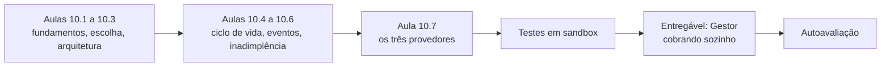
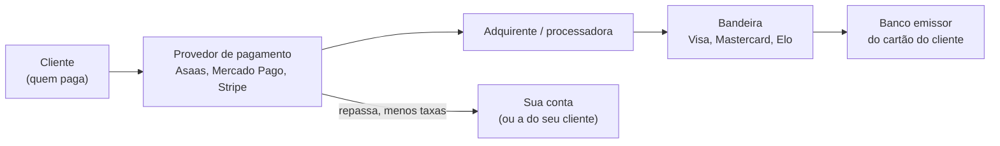
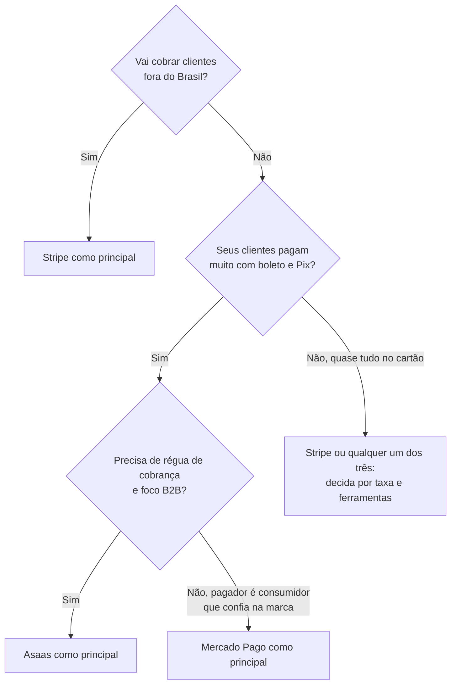
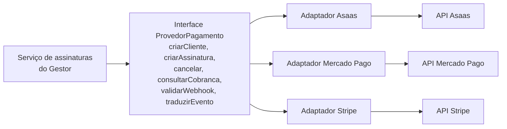
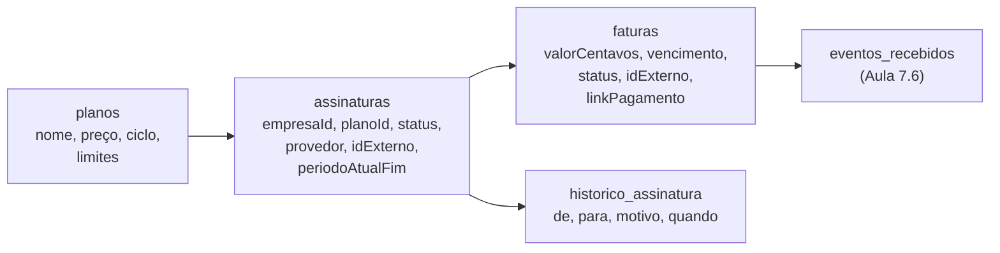
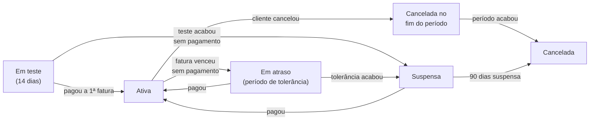
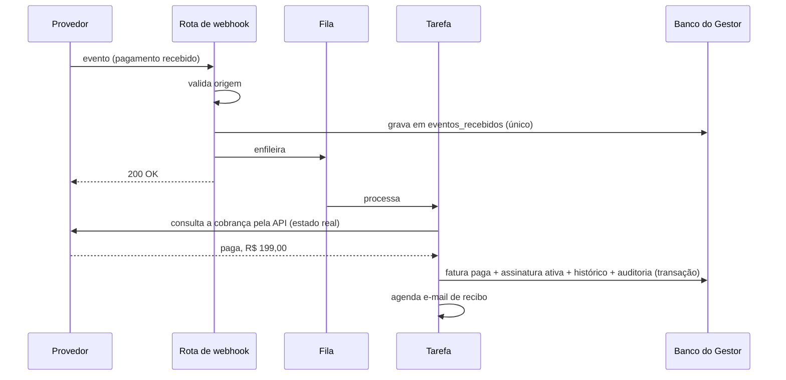
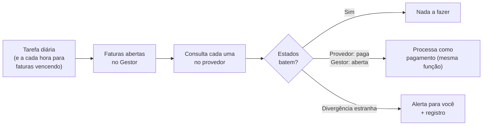
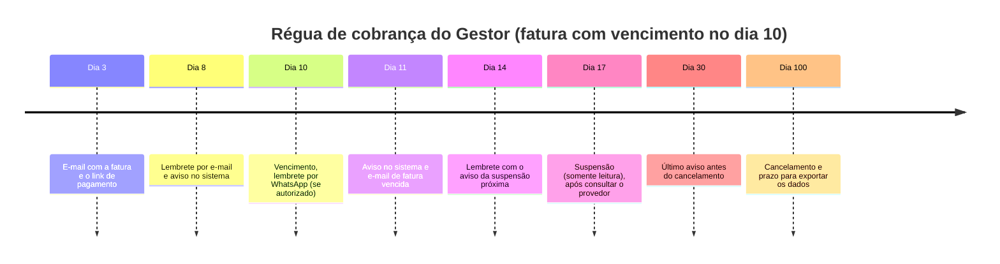

# Módulo 10: Pagamentos e assinaturas automáticas

**Semanas 19 e 20 · cerca de 26 horas**

## Objetivos de aprendizagem

Você quer vender sistemas em escala, com acesso controlado por login e **pagamento automático**. Isso significa que o seu sistema vai lidar com dinheiro de verdade, sem ninguém conferindo cada transação. Um bug aqui não é só um incômodo: é cliente cobrado duas vezes, acesso liberado sem pagamento, ou um cliente pagante bloqueado. Neste módulo você aprende como pagamentos funcionam no Brasil, compara Asaas, Mercado Pago e Stripe, e constrói no Gestor a cobrança recorrente que libera e bloqueia o acesso sozinha.

Ao final deste módulo você será capaz de:
1. Explicar como funcionam cartão, Pix e boleto, quem são os intermediários e o que é PCI.
2. Escolher um provedor de pagamento com critérios objetivos.
3. Desenhar a integração atrás de uma interface própria, para poder trocar de provedor.
4. Modelar planos, assinaturas e faturas, com o ciclo de vida completo da assinatura.
5. Processar eventos de pagamento com segurança e conciliar divergências.
6. Automatizar a cobrança de inadimplentes e o bloqueio e liberação de acesso.
7. Implementar a cobrança com Asaas, Mercado Pago e Stripe, testando em ambiente de testes.

### Como estudar este módulo

*Figura: do funcionamento dos pagamentos ao Gestor cobrando e liberando acesso sozinho.*

| Semana | O que fazer | Horas |
|---|---|---|
| 19 | Aulas 10.1 a 10.4, exercícios 1 a 3 | 12 |
| 20 | Aulas 10.5 a 10.7, exercícios 4 e 5, tarefa, entregável, autoavaliação | 14 |

> ⚖️ **Aviso:** taxas, prazos de recebimento, métodos disponíveis e regras dos provedores mudam com frequência. Esta formação ensina o funcionamento e os critérios; **antes de qualquer decisão ou proposta, consulte as páginas oficiais** de cada provedor. Questões fiscais (emissão de nota sobre a assinatura, impostos) devem ser validadas com um contador.

---

## Aula 10.1: Como pagamentos funcionam no Brasil

Antes de integrar qualquer coisa, entenda o caminho do dinheiro. Isso explica as taxas, os prazos, os riscos de fraude e por que certas coisas (como guardar o número do cartão) você **nunca** faz.

### Os personagens


*Figura: o caminho de um pagamento com cartão. O provedor de pagamento esconde essa cadeia de você e entrega uma API simples.*

Para você, o personagem que importa é o **provedor de pagamento** (também chamado de gateway, subadquirente ou plataforma de pagamentos): ele recebe o pagamento, cuida da cadeia toda e repassa o dinheiro, cobrando uma taxa. Você integra com a API dele.

### Os três meios principais

| | Cartão de crédito | Pix | Boleto |
|---|---|---|---|
| Como paga | Digita os dados do cartão | QR Code ou "copia e cola" no app do banco | Código de barras, no banco ou app |
| Confirmação | Na hora (aprovado/recusado) | Em segundos | Em até 1 a 3 dias úteis após o pagamento |
| Recorrência automática | **Sim**: o cartão é cobrado todo mês sem ação do cliente | O cliente paga uma cobrança por vez (há modalidades de Pix automático/recorrente; verifique o suporte do provedor) | O cliente paga um boleto por mês |
| Risco de fraude | Maior (cartão roubado, contestação) | Baixo | Baixo |
| Contestação (chargeback) | **Sim**: o cliente pode contestar com o banco | Muito restrita | Não |
| Quando o dinheiro chega | Conforme o plano do provedor (pode ser na hora, com antecipação, ou em dias) | Normalmente rápido | Após a compensação |

> 🎯 **Implicação para SaaS:** cartão é o melhor meio para assinatura (cobra sozinho todo mês, menos inadimplência por esquecimento). Pix e boleto são importantes no Brasil e muitos clientes preferem, mas exigem que o cliente pague a cada mês, então seu sistema precisa **lembrar e cobrar** (Aula 10.6).

### Chargeback: o risco do cartão

Um **chargeback** (contestação) acontece quando o titular do cartão diz ao banco que não reconhece a compra. O valor é retirado de você, mesmo que o serviço tenha sido prestado, a menos que você comprove. Para SaaS:
- Mantenha registros: data do aceite dos termos, logins do cliente, uso do sistema.
- Nome claro na fatura do cartão (configurável no provedor), para o cliente reconhecer.
- Cancelamento fácil: muitos chargebacks são de clientes que não acharam como cancelar.

### PCI DSS: por que você nunca toca no número do cartão

O **PCI DSS** é o padrão de segurança da indústria de cartões. Quem armazena, processa ou transmite dados de cartão precisa cumprir uma lista longa e cara de exigências, com auditorias.

A boa notícia: **você não precisa, e não deve**. Os provedores oferecem formas em que o número do cartão vai **direto do navegador do cliente para o provedor**, sem passar pelo seu servidor:
- **Página de pagamento do provedor** (checkout hospedado): o cliente é levado à página do provedor e volta.
- **Campos seguros embutidos** (o formulário de cartão aparece na sua página, mas é do provedor).
- **Tokenização**: o provedor devolve um identificador (token) que representa o cartão, e só ele serve para cobrar.

> ⚠️ **Regra inegociável:** o número completo do cartão e o código de segurança (CVV) **nunca** passam pelo seu servidor, nunca vão para o banco, nunca vão para logs. Se o Claude propuser um formulário de cartão que envia os dados para a sua API, recuse. Você guarda só o que o provedor devolve: id do cliente no provedor, id da assinatura, últimos 4 dígitos e bandeira (para exibir).

### Quem recebe o dinheiro: você ou o seu cliente?

Duas situações diferentes, que mudam a integração:

| Situação | Exemplo | Conta no provedor |
|---|---|---|
| **Você vende o seu SaaS** | Empresas pagam a assinatura do Gestor | **Sua** conta no provedor |
| **Seu sistema cobra os clientes do seu cliente** | A ótica emite cobranças para os pacientes dela pelo sistema que você fez | Conta **do seu cliente** (ele integra com a chave dele), ou uma solução de "subcontas" / marketplace do provedor |

No segundo caso, a chave de API é do seu cliente: ela fica guardada **criptografada** (Módulo 14) e cada empresa usa a sua. Nunca use a sua conta para receber dinheiro que é do seu cliente sem uma estrutura própria (de marketplace, com contrato), porque isso traz responsabilidades fiscais e legais.

> 📌 **Em resumo**
> - O provedor de pagamento esconde a cadeia (adquirente, bandeira, banco) e entrega uma API.
> - Cartão cobra sozinho e tem risco de contestação; Pix e boleto exigem que o cliente pague a cada ciclo.
> - O número do cartão nunca passa pelo seu servidor: use checkout hospedado, campos seguros ou tokenização.
> - Defina se o dinheiro é seu (sua conta) ou do seu cliente (a conta dele).

### Para ir além
- [Pix no Stripe (em inglês)](https://docs.stripe.com/payments/pix)

---

## Aula 10.2: Escolhendo o provedor: Asaas, Mercado Pago e Stripe

A escolha do provedor é uma decisão de arquitetura (vira ADR) e de negócio (afeta sua margem). Não existe "o melhor": existe o mais adequado para o seu caso. Esta aula compara os três que você pediu, com critérios que você vai reaplicar a qualquer provedor.

### Os critérios

| Critério | Pergunta |
|---|---|
| **Meios de pagamento** | Tem cartão, Pix e boleto? Quais funcionam com **recorrência**? |
| **Assinaturas** | Tem recurso nativo de assinatura (cobra sozinho a cada ciclo)? Lida com troca de plano e cobrança proporcional? |
| **Webhooks** | São confiáveis? Como verificam a origem? Reenviam em caso de falha? |
| **Documentação e ambiente de testes** | É clara? Tem sandbox completo e cartões de teste? |
| **Taxas e prazo de recebimento** | Quanto custa por transação e quando o dinheiro cai? (consultar a página oficial) |
| **Público** | Seus clientes conhecem e confiam na marca? |
| **Internacional** | Vai cobrar clientes fora do Brasil? |
| **Recursos extras** | Emissão de nota fiscal, régua de cobrança, portal do cliente, split de pagamento |
| **Suporte** | Em português? Rápido quando dá problema? |

### Os três, lado a lado

| | Asaas | Mercado Pago | Stripe |
|---|---|---|---|
| Origem e foco | Brasileiro, foco em cobrança para empresas | Do Mercado Livre, muito presente no varejo e no e-commerce brasileiro | Americano, presente em dezenas de países, inclusive no Brasil |
| Ponto forte | Cobrança recorrente com Pix, boleto e cartão; régua de cobrança; painel e suporte em português | Marca conhecida pelo consumidor; checkout familiar; muitos meios | Documentação e ferramentas de desenvolvedor de referência; assinaturas muito completas (troca de plano, proporcional, portal do cliente) |
| Assinaturas | Sim, com Pix, boleto e cartão (confira as regras atuais) | Sim (assinaturas/planos; confira os meios aceitos na recorrência) | Sim, muito completas (Billing); confira quais meios brasileiros funcionam em assinatura |
| Verificação de webhook | Token configurado no painel, enviado em cabeçalho | Assinatura no cabeçalho, verificada com segredo | Assinatura no cabeçalho, verificada com o segredo do endpoint |
| Ambiente de testes | Sandbox | Credenciais de teste | Modo de teste completo, com ferramenta de linha de comando para simular eventos |
| Bom para | SaaS e serviços B2B no Brasil que precisam de Pix e boleto | Negócios em que o pagador final é consumidor e confia na marca | SaaS que quer as melhores ferramentas de assinatura, ou que cobra também fora do Brasil |

> ⚠️ Esta tabela descreve características gerais na data da formação. **Confirme na documentação oficial**, especialmente os meios de pagamento aceitos em assinaturas recorrentes, que mudam com frequência.

### A matriz de decisão


*Figura: uma matriz de decisão para o provedor principal. Ela é um ponto de partida; taxas atuais e preferência do público podem mudar a escolha.*

### Por que não escolher "para sempre"

Taxas sobem, provedores mudam regras, um concorrente aparece mais barato, um cliente grande exige outro meio. Por isso a arquitetura da Aula 10.3 coloca o provedor **atrás de uma interface**: trocar ou adicionar um provedor vira um trabalho de dias, não uma reescrita.

### Exemplo completo: a decisão do Gestor

- **Público:** pequenas e médias empresas brasileiras. Na descoberta, metade disse preferir boleto ou Pix ("o financeiro paga tudo junto no dia 10").
- **Internacional:** não, por enquanto.
- **Necessidades:** assinatura mensal e anual, teste grátis de 14 dias, troca de plano, régua de cobrança para Pix e boleto.

Decisão (ADR 0004): **Asaas como principal** para o mercado brasileiro, com a interface de provedor pronta. **Stripe como segundo provedor planejado** para quando houver clientes no exterior ou para quem prefere cartão com portal de autoatendimento. Neste módulo você implementa os três no ambiente de testes, para dominar as diferenças.

> 📌 **Em resumo**
> - Escolha por meios aceitos na recorrência, assinaturas, webhooks, ambiente de testes, taxas, público e suporte.
> - Asaas: forte em cobrança B2B brasileira com Pix e boleto; Mercado Pago: marca conhecida pelo consumidor; Stripe: ferramentas de assinatura de referência e alcance internacional.
> - Confirme sempre na documentação oficial, especialmente o que funciona em recorrência.
> - Nenhuma escolha é para sempre; a arquitetura deve permitir trocar.

### Para ir além
- [Documentação do Asaas (em português)](https://docs.asaas.com/)
- [Documentação do Mercado Pago (em português)](https://www.mercadopago.com.br/developers/pt)
- [Assinaturas no Stripe (em inglês)](https://docs.stripe.com/billing/subscriptions/overview)

---

## Aula 10.3: A arquitetura: o provedor atrás de uma interface

Se o código do Gestor chamar o Asaas diretamente em 30 lugares, trocar de provedor (ou adicionar o Stripe) significa mexer em 30 lugares, com risco de quebrar a cobrança. A solução é um padrão clássico de engenharia: **uma interface própria**, com um **adaptador** para cada provedor.

### O padrão adaptador


*Figura: o padrão adaptador. O Gestor só conhece a interface; cada adaptador traduz para um provedor. Trocar de provedor é trocar o adaptador.*

```typescript
// src/server/pagamentos/provedor.ts
export interface ProvedorPagamento {
  nome: "asaas" | "mercadopago" | "stripe";
  criarCliente(dados: ClientePagador): Promise<{ idExterno: string }>;
  criarAssinatura(dados: NovaAssinatura): Promise<AssinaturaExterna>;
  alterarPlano(idAssinatura: string, novoPlano: PlanoExterno): Promise<AssinaturaExterna>;
  cancelarAssinatura(idAssinatura: string): Promise<void>;
  consultarCobranca(idCobranca: string): Promise<CobrancaExterna>;
  linkDePagamento(idCobranca: string): Promise<string>;
  validarWebhook(req: Request): Promise<boolean>;
  traduzirEvento(corpo: unknown): EventoPagamento | null;   // para o formato do Gestor
}

// Eventos no formato do Gestor, iguais para qualquer provedor
export type EventoPagamento =
  | { tipo: "cobranca_paga"; idCobranca: string; valorCentavos: number; pagoEm: Date }
  | { tipo: "cobranca_vencida"; idCobranca: string }
  | { tipo: "cobranca_estornada"; idCobranca: string }
  | { tipo: "assinatura_cancelada"; idAssinatura: string };
```

O segredo está em `traduzirEvento`: cada provedor chama seus eventos de um jeito diferente, e o adaptador traduz para **os eventos do Gestor**. O resto do sistema nunca sabe qual provedor está por trás.

### O modelo de dados da cobrança


*Figura: o modelo de dados das assinaturas. O Gestor guarda a sua própria visão do estado, com os ids externos para conciliar com o provedor.*

| Tabela | Guarda | Detalhe importante |
|---|---|---|
| `planos` | Nome, preço em centavos, ciclo (mensal, anual), limites (usuários, clientes) | Preço muda? Crie um **plano novo** ou uma versão; assinaturas antigas mantêm o preço contratado |
| `assinaturas` | Empresa, plano, status, provedor, id externo, fim do período atual | Uma assinatura ativa por empresa |
| `faturas` | Cada cobrança: valor, vencimento, status, link de pagamento | O cliente vê o histórico de faturas no Gestor |
| `historico_assinatura` | Cada mudança de status, com motivo | Para suporte e disputas |

### Fonte da verdade: o seu banco ou o provedor?

- O **provedor** é a fonte da verdade sobre **dinheiro**: se uma cobrança foi paga ou não.
- O **seu banco** é a fonte da verdade sobre **acesso**: se a empresa pode usar o sistema.
- O **webhook e a conciliação** mantêm os dois sincronizados.

O acesso nunca depende de uma consulta ao provedor a cada clique (seria lento, e se o provedor cair, o seu sistema cairia junto). O Gestor consulta o **seu** estado da assinatura, atualizado pelos eventos.

### Segredos dos provedores

- Chaves de API **diferentes** para teste e produção, em variáveis de ambiente diferentes.
- Chave de produção **só** no ambiente de produção (nunca no seu computador).
- Permissões mínimas, quando o provedor permite chaves com escopo restrito.
- Rotação planejada: se um desenvolvedor sair ou houver suspeita, troque a chave.

### Exemplo completo: o pedido da camada de pagamentos

```text
Implemente a camada de pagamentos do Gestor conforme o ADR 0004.

1. Interface ProvedorPagamento e tipo EventoPagamento conforme
   @docs/arquitetura.md (seção Pagamentos).
2. Modelos Prisma: Plano, Assinatura, Fatura, HistoricoAssinatura, com
   valores em centavos e empresaId.
3. Um adaptador falso (ProvedorFake) para testes, que simula cobranças pagas,
   vencidas e estornadas.
4. Serviço assinaturas.service.ts que só usa a interface, nunca um provedor
   concreto.
5. Configuração: PAGAMENTOS_PROVEDOR=asaas|mercadopago|stripe escolhe o adaptador.

Ainda não implemente os adaptadores reais (Aula 10.7). Testes do serviço com o
ProvedorFake. Plano primeiro.
```

O **adaptador falso** é um ganho enorme: você testa toda a lógica de assinatura (ciclo de vida, bloqueio, liberação) sem depender de rede nem de sandbox.

> 📌 **Em resumo**
> - O Gestor fala com uma interface própria; cada provedor tem um adaptador que traduz chamadas e eventos.
> - Modele planos (preço em centavos, versões), assinaturas, faturas e histórico.
> - O provedor é a verdade sobre dinheiro; o seu banco é a verdade sobre acesso; eventos sincronizam.
> - Um adaptador falso permite testar toda a lógica sem rede.

---

## Aula 10.4: O ciclo de vida da assinatura

Uma assinatura não é "paga ou não paga". Ela passa por estados: teste grátis, ativa, com pagamento atrasado, suspensa, cancelada. Cada transição tem regras, e o acesso ao sistema depende do estado. Desenhar isso explicitamente evita os dois erros mais caros: **bloquear quem pagou** e **liberar quem não pagou**.

### A máquina de estados


*Figura: os estados de uma assinatura e as transições permitidas. O acesso ao sistema depende do estado.*

### O que cada estado permite

| Estado | Acesso ao sistema | O que o usuário vê |
|---|---|---|
| **Em teste** | Completo | "Seu teste termina em 5 dias. Escolher plano" |
| **Ativa** | Completo | Nada (tudo normal) |
| **Em atraso** (tolerância, ex.: 7 dias) | Completo | Faixa: "Sua fatura venceu em 10/11. Pagar agora" |
| **Suspensa** | **Somente leitura** e exportação dos próprios dados, ou só a tela de pagamento | "Acesso suspenso por falta de pagamento. Pagar para reativar" |
| **Cancelada no fim do período** | Completo até a data | "Sua assinatura termina em 30/11" |
| **Cancelada** | Só exportação dos dados por um prazo, depois nada | "Sua conta foi encerrada. Exportar dados até 30/01" |

> 🎯 **Por que "somente leitura" e não "bloqueio total" na suspensão:** os dados são do cliente. Bloquear completamente o acesso aos dados dele, por atraso de um boleto, gera conflito, desconfiança e risco jurídico. Suspender as **funções** (cadastrar, enviar mensagens) e manter a **consulta e a exportação** é firme e justo. Defina isso no contrato e nos termos de uso (Módulo 17).

### Regras de transição no código

Uma transição só acontece se for **permitida a partir do estado atual**. Isso protege contra eventos fora de ordem (Aula 7.6):

```typescript
const TRANSICOES: Record<StatusAssinatura, StatusAssinatura[]> = {
  em_teste:       ["ativa", "suspensa", "cancelada"],
  ativa:          ["em_atraso", "cancelada_fim_periodo", "cancelada"],
  em_atraso:      ["ativa", "suspensa", "cancelada"],
  suspensa:       ["ativa", "cancelada"],
  cancelada_fim_periodo: ["ativa", "cancelada"],   // "ativa" = desistiu de cancelar
  cancelada:      [],                              // reativar = nova assinatura
};

function mudarStatus(assinatura, novo, motivo) {
  if (!TRANSICOES[assinatura.status].includes(novo))
    throw new Conflito(`Transição inválida: ${assinatura.status} → ${novo}`);
  // grava o novo status + historico_assinatura + auditoria, em transação
}
```

### Troca de plano

| Situação | Regra comum |
|---|---|
| **Upgrade** (plano maior) | Vale na hora; cobra a diferença proporcional aos dias restantes, ou a partir do próximo ciclo (escolha e documente) |
| **Downgrade** (plano menor) | Vale no próximo ciclo; se a empresa usa mais do que o plano menor permite (ex.: 8 usuários e o plano novo permite 5), avise antes e peça para ajustar |

Cobrança proporcional (pro rata) é fácil de errar. Faça em função pura, em centavos, com testes de casos limite (troca no primeiro dia, no último dia, em mês de 28 e de 31 dias), ou use o recurso nativo do provedor quando ele existir e documente o comportamento.

### Limites do plano

Os planos têm limites (usuários, clientes, mensagens). Verifique-os **no servidor**, no serviço, ao criar o recurso:
- "Seu plano permite 5 usuários. Faça upgrade para convidar mais."
- Nunca apague dados por estourar o limite após um downgrade; só impeça novos.

### Exemplo completo: o teste do ciclo de vida

Com o adaptador falso, peça os testes:

```text
Testes de ciclo de vida da assinatura (com ProvedorFake e relógio controlado):
1. Empresa nova começa "em_teste" com acesso completo por 14 dias.
2. Dia 15 sem pagamento → "suspensa", acesso somente leitura.
3. Pagamento confirmado na suspensão → "ativa", acesso completo.
4. Fatura vence sem pagamento → "em_atraso", acesso completo com aviso.
5. 7 dias em atraso → "suspensa".
6. Evento de "pago" repetido → nenhuma mudança extra (idempotência).
7. Evento "vencida" chegando depois de "paga" da mesma fatura → ignorado.
8. Cancelamento pelo cliente → acesso até o fim do período, depois "cancelada".
9. Upgrade no meio do ciclo → valor proporcional correto em centavos.
10. Downgrade com mais usuários que o permitido → aviso, sem apagar nada.
```

O **relógio controlado** (os testes podem "avançar o tempo") é essencial: você não vai esperar 14 dias para testar o fim do teste grátis.

> 📌 **Em resumo**
> - A assinatura é uma máquina de estados: em teste, ativa, em atraso, suspensa, cancelada.
> - Cada estado define o acesso; suspensão bloqueia funções, mas mantém consulta e exportação dos dados.
> - Transições só a partir de estados permitidos, o que protege contra eventos fora de ordem.
> - Troca de plano e limites com regras claras, em centavos, testadas com relógio controlado.

---

## Aula 10.5: Eventos de pagamento e conciliação

Você aprendeu webhooks no Módulo 7. Agora eles carregam dinheiro e acesso. Esta aula junta tudo no fluxo completo de confirmação de pagamento, e adiciona a peça que separa um sistema amador de um profissional: a **conciliação**, que garante que o seu banco e o provedor concordam, mesmo quando algo se perdeu no caminho.

### O fluxo completo de um pagamento confirmado


*Figura: o fluxo de confirmação de pagamento. A rota só valida e enfileira; a tarefa reconsulta o provedor e atualiza tudo numa transação.*

### Por que reconsultar o provedor

Você viu na Aula 7.6. Aqui, ela é obrigatória:
- Protege contra webhooks falsos que passaram pela verificação (segredo vazado, bug).
- Protege contra interpretação errada do evento (o formato mudou, um campo veio vazio).
- Garante que você usa o **estado atual**, não o estado do momento em que o evento foi gerado (que pode ter mudado, como num estorno logo depois).

### Conferências no processamento

Antes de liberar acesso, a tarefa confere:
- [ ] A cobrança existe no seu banco (pelo id externo) e pertence à empresa certa.
- [ ] O status no provedor é realmente "pago/confirmado".
- [ ] O **valor pago** é o valor esperado (ou maior). Um valor menor indica algo errado.
- [ ] A fatura ainda não estava paga (idempotência).
- [ ] A transição de status da assinatura é permitida.

### Conciliação: a rede de segurança

Webhooks se perdem: o seu sistema estava fora do ar, o provedor desistiu de reenviar, um bug descartou o evento. Sem conciliação, um cliente que pagou fica bloqueado, e você só descobre quando ele reclama.

A **conciliação** é uma tarefa agendada que compara as duas fontes:


*Figura: a conciliação compara o Gestor com o provedor e corrige divergências usando a mesma função do webhook. O que não se explica vira alerta.*

Pontos importantes:
- A conciliação usa **a mesma função de processamento** do webhook. Não há duas lógicas para manter.
- Ela também verifica o contrário: faturas pagas no Gestor que o provedor diz estarem estornadas.
- Um **relatório de conciliação** (quantas verificadas, quantas corrigidas, quantas divergentes) vai para o seu painel administrativo e para os logs.

### Estornos e contestações

| Evento | O que o Gestor faz |
|---|---|
| **Estorno** (você ou o cliente pediu a devolução) | Marca a fatura como estornada; se for a fatura vigente, a assinatura vai para "em atraso" ou é cancelada, conforme a regra |
| **Contestação aberta** (chargeback) | Alerta para você; reúne as evidências (aceite dos termos, logins, uso); não bloqueia automaticamente sem análise |
| **Contestação perdida** | Fatura estornada; regra de assinatura conforme contrato |

### Exemplo completo: o cliente que pagou e foi bloqueado

Uma segunda-feira, o provedor teve instabilidade das 8h às 9h e alguns webhooks não foram entregues. A Contabilidade Exata pagou o boleto, que foi compensado nesse horário. Às 9h05, a tarefa de suspensão rodou e, como a fatura estava "vencida há 8 dias" no Gestor, suspendeu a conta.

Com conciliação a cada hora para faturas em atraso:
- Às 10h, a conciliação consultou a fatura, viu "paga" no provedor e processou o pagamento. A conta voltou a "ativa" automaticamente.
- O relatório mostrou "3 pagamentos recuperados pela conciliação".

Melhor ainda, depois desse episódio você ajustou a regra: **a tarefa de suspensão consulta o provedor antes de suspender**. Uma consulta a mais evita bloquear quem pagou. Registre no diário e no runbook (Módulo 15).

> 📌 **Em resumo**
> - A rota de webhook valida, registra e enfileira; a tarefa reconsulta o provedor e atualiza tudo em transação.
> - Antes de liberar acesso, confira existência, empresa, status real, valor e idempotência.
> - A conciliação periódica compara o Gestor com o provedor e corrige divergências com a mesma função.
> - Antes de suspender alguém, consulte o provedor.

### Para ir além
- [Eventos de assinatura no Stripe (em inglês)](https://docs.stripe.com/billing/subscriptions/webhooks)

---

## Aula 10.6: Inadimplência, régua de cobrança e bloqueio automático

Em SaaS no Brasil, especialmente com boleto e Pix, uma parte dos clientes vai esquecer de pagar. Não por má-fé: o boleto foi para o e-mail errado, o financeiro estava de férias. Uma **régua de cobrança** bem feita recupera a maioria desses pagamentos sem você mandar nenhuma mensagem manual, e o bloqueio automático cuida do resto com justiça.

### A régua de cobrança

É a sequência de lembretes e ações antes e depois do vencimento:


*Figura: uma régua de cobrança típica. Os lembretes começam antes do vencimento e a suspensão só acontece depois de vários avisos.*

Alguns provedores (o Asaas, por exemplo) oferecem notificações automáticas próprias. Você pode usar as deles, as suas, ou combinar. Cuidado para o cliente não receber mensagens duplicadas.

### Regras para uma régua justa e eficaz

- **Mensagem clara e respeitosa:** valor, vencimento, link para pagar, como falar com alguém. Nada de ameaça.
- **Destinatário certo:** permita que a empresa cadastre o **e-mail do financeiro** separado do e-mail do dono.
- **Link sempre válido:** o link de pagamento leva à fatura atualizada (com juros, se houver).
- **Autorização para WhatsApp:** mensagens de cobrança por WhatsApp exigem que o cliente tenha optado por receber, e seguem as políticas da Meta para mensagens (Módulo 11).
- **Juros e multa:** se cobrar, siga o contrato e a legislação aplicável (valide com o contador ou advogado).
- **Idempotência:** cada lembrete é enviado uma vez por fatura e etapa (Aula 7.5).

### Bloqueio e liberação automáticos

| Momento | Ação automática | Salvaguarda |
|---|---|---|
| Fim da tolerância | Suspender (somente leitura) | Consultar o provedor antes; não suspender se houver pagamento em compensação |
| Pagamento confirmado | Reativar na hora | Mesmo que seja de madrugada ou fim de semana |
| Suspensão prolongada | Cancelar | Aviso antes; prazo para exportar os dados |
| Contestação aberta | Nenhuma (análise manual) | Alerta para você |

> 🎯 **A liberação é tão importante quanto o bloqueio.** Um cliente que pagou às 23h de sexta-feira precisa ter acesso às 23h01, não na segunda-feira quando você acordar. É por isso que webhook, fila, conciliação e transições de estado precisam funcionar sozinhos.

### Exceções controladas por você

A vida real tem exceções: o cliente grande que combinou pagar dia 20, a empresa parceira com 3 meses grátis. Para isso:
- Um campo **"tolerância especial até"** na assinatura, que só você (painel administrativo) altera, com motivo, e que fica na auditoria.
- **Cupons** ou descontos registrados no provedor e no Gestor.
- Nunca "liberar no banco na mão" sem registro.

### Recuperação de quem cancelou ou foi suspenso

- **Pesquisa de cancelamento:** ao cancelar, pergunte o motivo (opções + texto). É informação de ouro para o seu produto.
- **Reativação fácil:** pagar a fatura pendente reativa sem falar com ninguém.
- **Dados preservados** pelo prazo definido nos termos: o cliente volta e encontra tudo.

### Exemplo completo: os números de um mês

O Gestor tem 80 empresas assinantes. No mês:
- 72 pagaram até o vencimento (60% no cartão, cobrado sozinho).
- 6 pagaram entre o dia 11 e o dia 16, depois dos lembretes.
- 2 foram suspensas no dia 17: uma pagou no dia 19 (reativada automaticamente às 15h02), outra pediu cancelamento e respondeu "fechou a empresa".

Sem a régua, você teria passado horas mandando mensagens para 8 empresas. Com a régua, você não fez nada, e soube de tudo pelo relatório do painel administrativo. **É assim que se vende sistema em escala.**

> 📌 **Em resumo**
> - A régua de cobrança envia lembretes antes e depois do vencimento, de forma clara, respeitosa e idempotente.
> - Suspensão só depois da tolerância, de vários avisos e de consultar o provedor; liberação imediata ao pagar.
> - Exceções só pelo painel administrativo, com motivo e auditoria.
> - Pergunte o motivo do cancelamento e facilite a reativação.

---

## Aula 10.7: Implementando com Asaas, Mercado Pago e Stripe

Agora você implementa os três adaptadores. O foco não é decorar a API de cada um (ela muda; a documentação oficial é a fonte), mas saber **o que procurar** em cada provedor e como mapear para a interface do Gestor. Faça tudo em **ambiente de testes**.

### O roteiro, igual para os três

1. Criar a conta de testes (sandbox) e gerar as chaves de **teste**.
2. Ler a documentação de: clientes, assinaturas (ou planos), cobranças, links de pagamento, webhooks (eventos e verificação), ambiente de testes (cartões e simulação de pagamento).
3. Pedir ao Claude o adaptador, **mandando consultar a documentação atual** e mapear cada método da interface.
4. Configurar o webhook no painel de testes, apontando para o seu ambiente (localmente, use um túnel seguro ou a ferramenta de linha de comando do provedor, quando houver).
5. Rodar os mesmos testes de contrato para os três adaptadores.

### O que procurar em cada um

| Conceito do Gestor | Asaas | Mercado Pago | Stripe |
|---|---|---|---|
| Cliente pagador | Cliente (customer) | Pagador (payer) / cliente | Customer |
| Assinatura | Assinatura (subscription), que gera cobranças | Assinatura / plano de assinatura (preapproval) | Subscription, ligada a um Price de um Product |
| Cobrança / fatura | Cobrança (payment) | Pagamento (payment) / fatura da assinatura | Invoice + PaymentIntent |
| Página de pagamento | Link da fatura | Checkout / link de pagamento | Checkout Session; portal do cliente para autoatendimento |
| Verificação do webhook | Token de autenticação configurado no painel, enviado em cabeçalho | Assinatura em cabeçalho, verificada com a chave secreta do webhook | Assinatura em cabeçalho, verificada com o segredo do endpoint |
| Testes | Sandbox com simulação de pagamento | Credenciais e usuários de teste | Modo de teste, cartões de teste, ferramenta de linha de comando que dispara eventos |

> ⚠️ Os nomes de campos, cabeçalhos e eventos devem vir **da documentação atual**, não da memória do Claude nem desta tabela. Inclua no pedido: *"consulte a documentação oficial e cite as páginas que usou"*.

### Testes de contrato: o mesmo teste para os três

Um **teste de contrato** verifica que cada adaptador cumpre a interface do mesmo jeito. Exemplo de lista:

```text
Para cada adaptador (asaas, mercadopago, stripe), no ambiente de testes:
1. criarCliente devolve um id externo.
2. criarAssinatura mensal de R$ 199,00 gera a primeira cobrança com valor 19900.
3. linkDePagamento devolve uma URL https.
4. validarWebhook recusa requisição sem assinatura/token válido.
5. traduzirEvento converte o evento de "pago" do provedor em
   { tipo: "cobranca_paga", valorCentavos: 19900, ... }.
6. traduzirEvento devolve null para eventos que o Gestor não usa.
7. consultarCobranca reflete o pagamento simulado.
8. cancelarAssinatura impede novas cobranças.
```

Os testes que dependem da rede rodam separados (por exemplo, `npm run test:pagamentos`), porque são lentos e precisam das chaves de teste. Os testes da lógica do Gestor continuam usando o adaptador falso.

### Particularidades que costumam pegar

| Provedor | Atenção para |
|---|---|
| **Asaas** | Diferença entre os eventos de cobrança "recebida" e "confirmada" conforme o meio de pagamento (confira qual liberar para cada meio); ambiente de testes e produção com endereços e chaves diferentes |
| **Mercado Pago** | Notificações às vezes trazem só o id do recurso, exigindo consulta à API (o que, na prática, já é a sua reconsulta); validar a assinatura conforme o manifesto descrito na documentação |
| **Stripe** | Verificar a assinatura com o **corpo bruto** da requisição (antes de qualquer conversão para JSON), senão a verificação falha; muitos eventos diferentes ao longo da vida de uma fatura: escolha os que importam |

### Indo para produção (checklist)

- [ ] Conta do provedor em nome da empresa certa (a sua, para o SaaS), com dados bancários conferidos.
- [ ] 2FA na conta do provedor; acesso só para quem precisa.
- [ ] Chaves de produção só no ambiente de produção.
- [ ] Webhook de produção configurado, com segredo próprio, apontando para o domínio com HTTPS.
- [ ] Teste real de ponta a ponta com um valor pequeno (e estorno).
- [ ] Conciliação e régua de cobrança ativas e monitoradas.
- [ ] Nome na fatura do cartão configurado.
- [ ] Termos de uso e política de cancelamento publicados (Módulo 17).
- [ ] Emissão de nota fiscal sobre as assinaturas definida com o contador.

### Exemplo completo: o pedido do adaptador Asaas

```text
Implemente src/server/pagamentos/adaptadores/asaas.ts cumprindo a interface
ProvedorPagamento.

Antes de escrever: consulte a documentação oficial atual do Asaas para clientes,
assinaturas, cobranças e webhooks, e liste as páginas que usou e os eventos
que vamos tratar (e qual deles libera o acesso para cartão, Pix e boleto).

Requisitos:
- Endereço da API e chave vindos de ASAAS_API_URL e ASAAS_API_KEY.
- validarWebhook compara o token do cabeçalho com ASAAS_WEBHOOK_TOKEN em tempo constante.
- traduzirEvento mapeia para EventoPagamento; eventos não usados → null.
- Valores sempre convertidos para centavos inteiros.
- Erros da API viram erros do Gestor (ProvedorIndisponivel, ProvedorRecusou) sem
  expor a resposta bruta em logs.
- Tempo limite de 10 segundos nas chamadas, com nova tentativa só em operações
  idempotentes (consultas).

Testes de contrato da Aula 10.7, rodando com as chaves de sandbox.
```

Repita para Mercado Pago e Stripe. Ao final, troque `PAGAMENTOS_PROVEDOR` e veja o Gestor funcionando igual com os três: é a prova de que a arquitetura está certa.

> 📌 **Em resumo**
> - Roteiro igual para os três: sandbox, documentação, adaptador, webhook, testes de contrato.
> - Nomes de campos e eventos vêm da documentação atual; peça ao Claude para citar as páginas.
> - Testes de contrato garantem que os três adaptadores se comportam igual.
> - Ir para produção tem checklist próprio, incluindo teste real com valor pequeno e definição fiscal.

### Para ir além
- [Assinaturas no Asaas (em português)](https://docs.asaas.com/docs/assinaturas)
- [Assinaturas no Mercado Pago (em português)](https://www.mercadopago.com.br/developers/pt/docs/subscriptions/overview)
- [Ambiente de testes do Stripe (em inglês)](https://docs.stripe.com/testing)

---

## Exercícios

### Exercício 1: O caminho do dinheiro (30 min)
Explique, em um parágrafo para um dono de empresa, por que o seu sistema nunca guarda o número do cartão e o que acontece quando um cliente contesta uma cobrança.

### Exercício 2: Escolha o provedor (45 min)
Aplique os critérios da Aula 10.2 a dois casos: (a) um SaaS de gestão para escolas de inglês no Brasil; (b) um sistema de agendamento em que o seu cliente (um estúdio de pilates) cobra as mensalidades dos alunos. Para cada caso, escreva um ADR resumido.

<details>
<summary><strong>Resolução comentada (b)</strong></summary>

Ponto-chave: no caso (b), **o dinheiro é do estúdio**, não seu. O sistema precisa usar a conta do estúdio no provedor (a chave de API do estúdio, guardada criptografada), e cada estúdio que usar o sistema terá a sua. Alunos de pilates são consumidores finais, muitas vezes preferem Pix ou cartão recorrente. Um provedor com assinaturas e Pix/cartão, com marca conhecida pelo consumidor, ou com régua de cobrança simples, faz sentido. O ADR deve registrar: que a conta é do estúdio; como a chave é guardada e quem pode trocá-la; que o estúdio é responsável pela relação fiscal com os alunos; que o sistema não recebe nem repassa dinheiro. Se o modelo de negócio fosse você receber e repassar (marketplace), seria preciso um produto específico do provedor (subcontas/split) e avaliação jurídica e fiscal.
</details>

### Exercício 3: A máquina de estados (45 min)
Desenhe a máquina de estados da assinatura do Gestor com as suas regras (tolerância, suspensão, cancelamento) e escreva a tabela "estado → o que o usuário pode fazer → o que ele vê". Discuta com alguém: a suspensão é justa?

### Exercício 4: Webhook fora de ordem (60 min)
Com o adaptador falso, escreva testes para: (a) "estornada" chegando antes de "paga"; (b) "paga" chegando duas vezes; (c) "paga" de uma fatura antiga de uma assinatura já cancelada. Defina o resultado correto de cada um antes de rodar.

### Exercício 5: Os três no sandbox (3 h)
Implemente os três adaptadores no ambiente de testes, faça os testes de contrato passarem e faça uma assinatura de ponta a ponta com cada um (do cadastro ao acesso liberado após o pagamento simulado). Registre no diário as diferenças que mais surpreenderam.

---

## Tarefa de campo

**Desenhe a política de cobrança** de um sistema seu (o Gestor, para vender, ou o caso real): planos e preços (provisórios, você vai calcular no Módulo 17), meios aceitos, régua de cobrança com textos das mensagens, tolerância, o que acontece na suspensão e no cancelamento, prazo para exportar dados. Mostre a 2 potenciais clientes e pergunte: "isso parece justo? algo te incomodaria?". Ajuste.

---

## Entregável: Gestor cobrando sozinho

**Checklist de qualidade:**
- [ ] Interface `ProvedorPagamento` com adaptadores Asaas, Mercado Pago e Stripe (sandbox) e um adaptador falso.
- [ ] Testes de contrato passando para os três.
- [ ] Planos, assinaturas, faturas e histórico modelados em centavos, com `empresaId`.
- [ ] Máquina de estados com transições validadas e testes com relógio controlado.
- [ ] Webhook: origem verificada, idempotente, reconsulta o provedor, atualiza em transação.
- [ ] Conciliação agendada que corrige divergências com a mesma função.
- [ ] Régua de cobrança com lembretes idempotentes.
- [ ] Suspensão consulta o provedor antes; liberação imediata ao pagar.
- [ ] Suspensão mantém consulta e exportação dos dados.
- [ ] Número de cartão nunca passa pelo servidor (checkout ou campos do provedor).
- [ ] Chaves de teste e produção separadas.

---

## Autoavaliação

Meta: 8 de 10.

1. Por que o cartão é o melhor meio para assinatura, e o que muda com Pix e boleto?
2. O que é PCI DSS e como você evita ter que cumpri-lo por inteiro?
3. Seu sistema vai emitir cobranças para os pacientes de uma clínica. De quem é a conta no provedor, e por quê?
4. Para que serve colocar o provedor atrás de uma interface?
5. Quem é a fonte da verdade sobre dinheiro, e quem é sobre acesso?
6. Por que a suspensão deve manter a consulta e a exportação dos dados?
7. Um evento "fatura vencida" chega depois do evento "fatura paga" da mesma fatura. O que acontece no Gestor?
8. O que é conciliação e qual problema ela resolve?
9. Antes de suspender uma empresa, o que a tarefa deve fazer, e por quê?
10. Ao verificar o webhook do Stripe, por que usar o corpo bruto da requisição?

<details>
<summary><strong>Gabarito</strong></summary>

1. Porque o cartão é cobrado automaticamente a cada ciclo, sem ação do cliente, reduzindo a inadimplência por esquecimento. Com Pix e boleto, o cliente precisa pagar a cada ciclo, então o sistema precisa de régua de cobrança e lembretes.
2. É o padrão de segurança da indústria de cartões, exigido de quem armazena, processa ou transmite dados de cartão. Você evita a maior parte das exigências usando checkout hospedado, campos seguros ou tokenização do provedor, de modo que o número do cartão nunca passa pelo seu servidor.
3. Da clínica, porque o dinheiro é dela; ela integra com a própria chave (guardada criptografada no sistema). Receber na sua conta e repassar traria responsabilidades fiscais e legais e exigiria uma estrutura de marketplace.
4. Para trocar ou adicionar provedores sem reescrever o sistema, e para testar toda a lógica com um adaptador falso.
5. O provedor é a verdade sobre dinheiro (se foi pago); o seu banco é a verdade sobre acesso (se a empresa pode usar), sincronizado por webhooks e conciliação.
6. Porque os dados pertencem ao cliente; bloquear completamente por atraso gera conflito, desconfiança e risco jurídico. Suspender as funções e manter consulta e exportação é firme e justo.
7. A transição de "ativa" (ou paga) para "vencida" daquela fatura não é permitida, e a reconsulta ao provedor mostra que ela está paga; o evento é ignorado (registrado, sem efeito).
8. É uma tarefa periódica que compara o estado das faturas no Gestor com o do provedor e corrige divergências. Resolve webhooks perdidos (sistema fora do ar, falhas de entrega) e detecta inconsistências.
9. Consultar o provedor para confirmar que a fatura continua sem pagamento, porque um webhook pode ter se perdido ou o pagamento pode estar em compensação. Evita bloquear quem pagou.
10. Porque a assinatura é calculada sobre os bytes exatos enviados; converter para JSON e de volta pode alterar espaços e ordem, e a verificação falha.
</details>

---

## Checklist de segurança do módulo

- [ ] Número de cartão e CVV nunca passam pelo servidor, banco ou logs.
- [ ] Chaves de produção só em produção; teste e produção separados.
- [ ] Webhooks de pagamento com verificação, idempotência e reconsulta.
- [ ] Valor pago conferido com o valor esperado.
- [ ] Transições de assinatura validadas; histórico e auditoria em transação.
- [ ] Chaves de clientes (quando a conta é deles) guardadas criptografadas.
- [ ] 2FA na conta do provedor.
- [ ] Exceções de cobrança só pelo painel administrativo, com registro.

---

## Para aprofundar (opcional)

| Material | Formato | Por que vale |
|---|---|---|
| [Documentação do Asaas](https://docs.asaas.com/) | Texto, em português | Referência completa de cobranças e assinaturas |
| [Documentação do Mercado Pago](https://www.mercadopago.com.br/developers/pt) | Texto, em português | Pagamentos, assinaturas e notificações |
| [Billing do Stripe](https://docs.stripe.com/billing/subscriptions/overview) | Texto, em inglês | O modelo de assinaturas mais completo do mercado, ótimo para aprender os conceitos |
| [Requisições idempotentes no Stripe](https://docs.stripe.com/api/idempotent_requests) | Texto, em inglês | Como evitar cobranças duplicadas |
