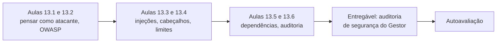
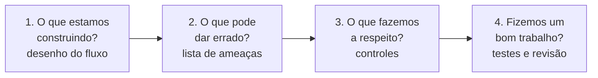
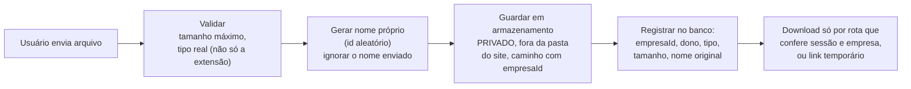
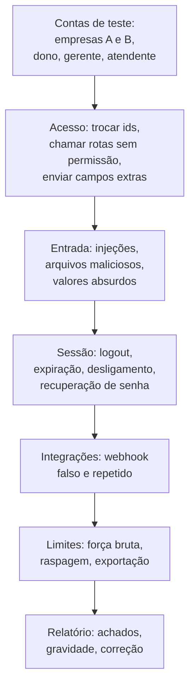

# Módulo 13: Proteger a aplicação

**Semanas 25 e 26 · cerca de 24 horas**

## Objetivos de aprendizagem

Você já aplicou dezenas de proteções ao longo da formação: isolamento, permissões, validação, webhooks verificados. Este módulo junta tudo em uma visão de **atacante**: como alguém tentaria invadir o Gestor, quais são os riscos mais comuns do mundo segundo a OWASP, e como você **audita** um sistema antes de entregá-lo. No fim, você terá um checklist de segurança que vai usar em todo projeto, e uma auditoria completa do Gestor para mostrar ao cliente.

Ao final deste módulo você será capaz de:
1. Fazer uma modelagem de ameaças simples de qualquer sistema.
2. Explicar e verificar cada item do OWASP Top 10 no Gestor.
3. Proteger o sistema contra injeções, uploads maliciosos e requisições forjadas para dentro da sua rede.
4. Configurar cabeçalhos de segurança, CORS, política de conteúdo e limites de requisições.
5. Manter as dependências seguras e reduzir o risco da cadeia de suprimentos.
6. Conduzir uma auditoria de segurança com o Claude, ferramentas automáticas e testes.

### Como estudar este módulo

*Figura: do modo de pensar do atacante até a auditoria completa do Gestor.*

| Semana | O que fazer | Horas |
|---|---|---|
| 25 | Aulas 13.1 a 13.3, exercícios 1 a 3 | 12 |
| 26 | Aulas 13.4 a 13.6, exercícios 4 e 5, auditoria, autoavaliação | 12 |

> ⚖️ **Ética e lei:** teste ataques **só** nos seus sistemas ou em sistemas com autorização por escrito do dono. Testar sistemas de terceiros sem autorização é crime no Brasil (Lei 12.737/2012, entre outras).

---

## Aula 13.1: Como um invasor pensa: modelagem de ameaças

Proteger sem saber do que se proteger é como trancar a porta da frente e deixar a janela aberta. A **modelagem de ameaças** é um exercício simples, feito no papel, que responde: **o que pode dar errado, e o que fazemos a respeito?** Programadores seniores fazem isso antes de construir funcionalidades sensíveis.

### Quem ataca sistemas de pequenas e médias empresas

| Atacante | Motivação | Como age |
|---|---|---|
| **Robôs automáticos** | Qualquer sistema vulnerável serve | Varrem a internet testando falhas conhecidas, senhas vazadas, painéis expostos. **A maioria dos ataques** |
| **Funcionário ou ex-funcionário** | Vingança, vantagem, levar clientes para o concorrente | Usa o acesso que tem (ou tinha) para exportar dados, apagar registros |
| **Cliente curioso de um SaaS** | Ver dados de concorrentes | Troca ids na URL, chama a API diretamente |
| **Golpista** | Dinheiro | Falsifica e-mails do domínio, cria boletos falsos, tenta webhooks falsos de pagamento |
| **Criminoso com alvo** | Resgate, venda de dados | Phishing, invasão de contas de administrador, ransomware |

Repare: os três primeiros não precisam de nenhuma habilidade especial. Por isso as proteções básicas (que você já aprendeu) cobrem a maior parte do risco.

### O método em 4 perguntas

Para cada funcionalidade sensível (ou para o sistema todo):


*Figura: as quatro perguntas da modelagem de ameaças. A resposta da quarta pergunta é sempre um teste ou uma revisão, nunca "acho que sim".*

### O que pode dar errado: as seis categorias (STRIDE)

Para não esquecer nenhum tipo de ameaça, use as categorias STRIDE, aplicadas a cada parte do fluxo:

| Categoria | Pergunta | Exemplo no Gestor | Controle |
|---|---|---|---|
| **Falsificação de identidade** | Alguém pode se passar por outra pessoa ou sistema? | Webhook falso de "pagamento aprovado" | Verificação de assinatura + reconsulta (Aula 7.6) |
| **Adulteração** | Alguém pode alterar dados que não deveria? | Atendente muda o valor de uma cobrança pela API | Permissão no servidor + auditoria |
| **Repúdio** | Alguém pode negar que fez algo? | "Eu não dei esse desconto" | Auditoria só de inserção |
| **Vazamento de informação** | Dados podem chegar a quem não deve? | Empresa A vê clientes da B | Isolamento + RLS + testes |
| **Negação de serviço** | Alguém pode derrubar ou travar o sistema? | Robô chamando a busca 1.000 vezes por segundo | Limite de requisições, paginação |
| **Elevação de privilégio** | Alguém pode ganhar poderes que não tem? | Atendente se promove a dono enviando `papel` no corpo | Schema estrito, permissões, convite sem papel maior |

### Exemplo completo: modelando a exportação de clientes

**1. O que estamos construindo:** dono e gerente exportam a lista de clientes da empresa em CSV.

**2. O que pode dar errado (STRIDE):**
- Falsificação: alguém com sessão roubada exporta tudo.
- Adulteração: (não se aplica, é leitura).
- Repúdio: o gerente que saiu da empresa nega ter exportado.
- Vazamento: exportação inclui clientes de outra empresa; atendente consegue exportar; o CSV contém dados sensíveis desnecessários; nomes com fórmulas executam no Excel.
- Negação de serviço: exportar 500 mil linhas trava o servidor.
- Elevação: atendente chama a rota diretamente.

**3. O que fazemos:** permissão `clientes:exportar` no servidor; `empresaId` da sessão + RLS; colunas mínimas; proteção contra injeção em planilhas; limite de tamanho e geração em segundo plano para volumes grandes; auditoria com quem, quando e quantos; alerta se um usuário exportar mais de N vezes por dia; 2FA para donos.

**4. Fizemos um bom trabalho:** testes de permissão (atendente → 403), isolamento, injeção em planilhas, auditoria gravada.

> 💡 **Peça ao Claude para participar:** *"Faça a modelagem de ameaças STRIDE da funcionalidade X descrita em @docs/especificacao.md. Para cada ameaça, sugira o controle e o teste que provaria que o controle funciona. Aponte o que ainda não está coberto no código atual."*

> 📌 **Em resumo**
> - A maioria dos ataques a PMEs é automática ou vem de quem já tem algum acesso.
> - Modelagem de ameaças: o que construímos, o que pode dar errado, o que fazemos, como provamos.
> - STRIDE garante que você pense em falsificação, adulteração, repúdio, vazamento, negação de serviço e elevação de privilégio.
> - A resposta para "fizemos um bom trabalho?" é sempre um teste ou revisão.

---

## Aula 13.2: O OWASP Top 10 na prática

A **OWASP** é uma fundação sem fins lucrativos que publica a lista dos dez riscos mais críticos em aplicações web, baseada em dados reais de milhares de sistemas. É a referência que auditores, clientes grandes e seguradoras conhecem. Conhecê-la e mostrar como o seu sistema trata cada item é um argumento de confiança poderoso.

### A lista (edição 2025) aplicada ao Gestor

| # | Risco | O que é, em uma frase | Como o Gestor trata | Onde você aprendeu |
|---|---|---|---|---|
| A01 | **Controle de acesso quebrado** | Usuário acessa o que não devia | Permissão no servidor, `empresaId` da sessão, RLS, testes de matriz e isolamento | M9 |
| A02 | **Configuração insegura** | Padrões inseguros, recursos desnecessários ligados, mensagens de erro detalhadas | Variáveis validadas, erros genéricos, cabeçalhos, servidor protegido, banco sem acesso público | M7, M12, Aula 13.4 |
| A03 | **Falhas na cadeia de suprimentos de software** | Bibliotecas ou ferramentas comprometidas ou vulneráveis | Poucas dependências, travadas e auditadas; ações de CI com versão fixada | Aula 13.5 |
| A04 | **Falhas de criptografia** | Dados sensíveis sem proteção em trânsito ou em repouso | HTTPS em tudo, hash de senhas, segredos de clientes criptografados | M9, M12, M14 |
| A05 | **Injeção** | Texto do usuário interpretado como comando | Prisma parametrizado, sem SQL montado, React escapando texto, injeção em planilhas e em prompts tratadas | M5, M8, M11, Aula 13.3 |
| A06 | **Design inseguro** | A falha está no desenho, não no código | Modelagem de ameaças, especificação com segurança, defesa em profundidade | M4, M6, Aula 13.1 |
| A07 | **Falhas de autenticação** | Senhas fracas, sessões mal cuidadas, sem 2FA, força bruta | Biblioteca madura, regras de senha, 2FA, limite de tentativas, sessões revogáveis | M9 |
| A08 | **Falhas de integridade de software ou dados** | Dados ou atualizações aceitos sem verificação | Webhooks assinados, reconsulta ao provedor, pipeline com aprovação | M7, M10, M12 |
| A09 | **Falhas de registro e alerta** | Ataques acontecem e ninguém percebe | Logs estruturados, auditoria, alertas de falhas de login e erros | M7, M15 |
| A10 | **Tratamento inadequado de condições excepcionais** | Erros e situações inesperadas deixam o sistema em estado inseguro | Tratador central, falhar fechado (na dúvida, nega), transações, nada de `catch` vazio | M7 |

### "Falhar fechado"

Um princípio que atravessa vários itens: **quando algo dá errado, o sistema nega**.
- A verificação de permissão deu erro? Nega o acesso (não libera "por via das dúvidas").
- A RLS não recebeu a empresa da sessão? Nenhuma linha volta (Aula 9.5).
- A verificação do webhook lançou exceção? Responde 401 e não processa.
- O provedor de pagamento não respondeu na hora de liberar acesso? Mantém o estado atual e tenta de novo depois.

### A lista como roteiro de revisão

Use os 10 itens como roteiro sempre que revisar uma funcionalidade nova:

```text
Revise as mudanças desta branch (git diff main...HEAD) contra o OWASP Top 10
edição 2025. Para cada um dos 10 itens, diga: se a mudança é afetada, o que
está protegido, o que falta e qual teste comprovaria. Seja específico, com
arquivo e linha. Não altere nada.
```

### Exemplo completo: a página "Segurança" do Gestor

Transforme esta tabela em uma página pública do seu site (sem detalhes que ajudem um atacante): "Como protegemos seus dados". Para cada risco, uma frase em linguagem de cliente:

> - **Cada empresa só vê os próprios dados.** O isolamento é verificado pelo sistema e pelo próprio banco de dados, e testado automaticamente a cada atualização.
> - **Senhas nunca são guardadas.** Usamos algoritmos próprios para senhas, verificação em duas etapas para administradores e bloqueio de tentativas em massa.
> - **Tudo é criptografado no caminho** (HTTPS) e os dados sensíveis também são protegidos no armazenamento.
> - **Toda ação importante fica registrada**: quem fez, o quê e quando.

Esse texto é parte do Dossiê de Confiança (Módulo 17). E repare: cada frase é verdadeira **porque você construiu e testou**. Nunca escreva uma promessa de segurança que não tem um controle e um teste por trás.

> 📌 **Em resumo**
> - O OWASP Top 10 é a referência mundial de riscos em aplicações web; o controle de acesso quebrado é o primeiro.
> - Cada item tem controles que você já aprendeu na formação; a tabela mostra onde.
> - Falhar fechado: na dúvida, o sistema nega.
> - Use a lista como roteiro de revisão e como base do discurso de segurança, sempre com controles e testes reais por trás.

### Para ir além
- [OWASP Top 10 edição 2025 (em inglês)](https://owasp.org/Top10/2025/)
- [OWASP ASVS: padrão de verificação de segurança de aplicações (em inglês)](https://owasp.org/www-project-application-security-verification-standard/)

---

## Aula 13.3: Injeções, uploads e requisições forjadas

Injeção é o nome de uma família de ataques com a mesma raiz: **um texto que deveria ser dado é interpretado como comando**. Você já viu a injeção de SQL, o XSS, a injeção em planilhas e a injeção de instruções em IA. Esta aula completa a família e trata de dois pontos que o Claude costuma deixar abertos: uploads de arquivos e chamadas a URLs informadas pelo usuário.

### A família das injeções

| Injeção | Onde o texto vira comando | Defesa |
|---|---|---|
| **SQL** | No banco | Consultas parametrizadas (Prisma); proibido `$queryRawUnsafe` com texto do usuário (Aula 5.2) |
| **XSS** | No navegador de outra pessoa | React escapa texto; sem `dangerouslySetInnerHTML` com conteúdo de usuário; CSP (Aula 8.6, 13.4) |
| **Comandos do sistema** | No terminal do servidor | Nunca montar comandos com texto do usuário (`exec("convert " + nomeArquivo)`); usar bibliotecas em vez de comandos; se inevitável, lista de argumentos fixos |
| **Em planilhas** | No Excel de quem abre a exportação | Prefixar valores que começam com `=`, `+`, `-`, `@` (Aula 8.3) |
| **Em instruções de IA** | No comportamento do modelo | Dados mínimos, instruções separadas, saída validada, humano no meio (Aula 11.6) |
| **Em modelos de e-mail e mensagens** | No sistema de modelos | Variáveis escapadas pela biblioteca de modelos; nunca montar o modelo com texto do usuário |
| **Em caminhos de arquivo** | No sistema de arquivos | Nunca usar o nome enviado pelo usuário como caminho (`../../etc/passwd`); gerar nomes próprios |

> 🎯 **Regra geral:** dado do usuário nunca é concatenado em algo que será **interpretado** (SQL, HTML, comando, caminho, fórmula, instrução). Ele é passado **separado**, por um mecanismo feito para isso.

### Uploads de arquivos

Anexos (contratos, fotos, documentos) são uma porta de entrada clássica. O roteiro seguro:


*Figura: o caminho seguro de um upload. O arquivo é validado, renomeado, guardado de forma privada e só é entregue por uma rota que confere quem pede.*

| Cuidado | Por quê |
|---|---|
| **Tamanho máximo** | Arquivos enormes enchem o disco e travam o sistema |
| **Tipo real** (pelo conteúdo, não pela extensão) | `foto.jpg` pode ser um programa |
| **Lista de tipos permitidos** (PDF, JPG, PNG...) | Nunca aceite HTML, SVG ou executáveis sem tratamento especial (SVG e HTML podem conter scripts) |
| **Nome próprio** | O nome enviado pode conter caminhos maliciosos ou caracteres que quebram o sistema |
| **Armazenamento privado** | Arquivos públicos por URL previsível vazam por adivinhação |
| **Entrega com cabeçalhos corretos** | `Content-Disposition: attachment` para forçar download de tipos arriscados; tipo de conteúdo correto |
| **Links temporários** | Um link copiado para fora expira em minutos |
| **Antivírus** (para sistemas que recebem arquivos de terceiros em volume) | Arquivos enviados por clientes finais podem ser maliciosos para quem os abre |

### SSRF: quando o seu servidor é usado como ponte

**SSRF** (falsificação de requisição do lado do servidor) acontece quando o sistema aceita uma **URL informada pelo usuário** e faz a chamada a partir do servidor. Exemplos de funcionalidades vulneráveis: "importar imagem por URL", "testar seu webhook", "pré-visualizar link".

O atacante informa uma URL interna, que só o servidor alcança:
- `http://localhost:3000/admin`
- `http://169.254.169.254/...` (o serviço de metadados de muitas nuvens, que pode entregar credenciais do servidor)
- O endereço interno do banco ou de outros serviços.

Defesas:
1. **Evite** a funcionalidade, se possível (peça o upload do arquivo em vez da URL).
2. Se precisar: só `https://`, só portas padrão, **resolva o endereço e recuse IPs internos** (privados, `localhost`, link-local, metadados), sem seguir redirecionamentos (ou validando cada um), com tempo limite e tamanho máximo de resposta.
3. Faça essas chamadas a partir de um componente isolado, sem acesso à rede interna, quando o volume justificar.

### Exemplo completo: o anexo que era uma página

Na revisão da funcionalidade de anexos do Gestor, você testa enviar um arquivo `contrato.svg` com um script dentro. O Claude tinha implementado: aceita qualquer imagem, guarda em armazenamento público, devolve a URL.

Resultado: abrir a URL executava o script **no domínio do Gestor**. Um atacante poderia enviar esse "contrato" e mandar o link para o dono da empresa.

Correção pedida:
```text
Anexos: aceite apenas PDF, JPG e PNG, verificando o tipo pelo conteúdo do
arquivo (não pela extensão), até 10 MB. Gere o nome do arquivo (uuid) e guarde
em armazenamento privado no caminho empresas/{empresaId}/anexos/{uuid}.
Download por GET /api/anexos/{id}, que confere sessão, permissão e empresaId,
e responde com Content-Disposition: attachment e o Content-Type correto, ou
redireciona para um link temporário de 5 minutos.
Testes: SVG e HTML recusados; arquivo com extensão .pdf mas conteúdo de
executável recusado; anexo de outra empresa → 404; arquivo de 11 MB recusado.
```

> 📌 **Em resumo**
> - Injeções: dado do usuário nunca é concatenado em algo que será interpretado; passe-o separado.
> - Uploads: tamanho máximo, tipo real, lista permitida, nome próprio, armazenamento privado, entrega controlada.
> - SVG e HTML enviados por usuários podem executar scripts.
> - SSRF: evite chamar URLs informadas por usuários; se precisar, recuse endereços internos.

### Para ir além
- [OWASP Cheat Sheet Series (em inglês)](https://cheatsheetseries.owasp.org/): procure "File Upload" e "Server Side Request Forgery".

---

## Aula 13.4: Cabeçalhos de segurança, CORS e limites de requisições

Algumas das proteções mais eficazes custam poucas linhas de configuração: cabeçalhos que dizem ao navegador como se comportar, regras sobre quais sites podem chamar a sua API e limites que impedem um robô de derrubar o sistema. É a parte "barata e eficaz" da segurança.

### Cabeçalhos de segurança

| Cabeçalho | Faz | Valor recomendado (ponto de partida) |
|---|---|---|
| `Strict-Transport-Security` (HSTS) | Obriga o navegador a usar HTTPS sempre, para aquele domínio | `max-age=31536000; includeSubDomains` |
| `Content-Security-Policy` (CSP) | Diz de onde scripts, estilos, imagens e conexões podem vir; bloqueia scripts injetados | Comece restritivo e libere o necessário (abaixo) |
| `X-Content-Type-Options` | Impede o navegador de "adivinhar" o tipo de arquivo | `nosniff` |
| `Referrer-Policy` | Controla que endereço é informado a outros sites ao clicar em links | `strict-origin-when-cross-origin` |
| `X-Frame-Options` ou `frame-ancestors` na CSP | Impede que o sistema seja aberto dentro de outro site (ataque de "clique sequestrado") | `DENY` / `frame-ancestors 'none'` |
| `Permissions-Policy` | Desliga recursos do navegador que você não usa (câmera, microfone, localização) | `camera=(), microphone=(), geolocation=()` |

### CSP: a defesa extra contra XSS

A CSP diz ao navegador, por exemplo: "scripts só podem vir do meu próprio domínio". Se um atacante conseguir injetar um script, o navegador se recusa a executá-lo.

```text
Content-Security-Policy:
  default-src 'self';
  script-src 'self' 'nonce-{valor-aleatório-por-requisição}';
  style-src 'self' 'unsafe-inline';
  img-src 'self' data: https://armazenamento.exemplo.com;
  connect-src 'self' https://o-servico-de-erros.exemplo.com;
  frame-ancestors 'none';
  base-uri 'self';
  form-action 'self';
```

Dicas:
- Comece no modo **somente relatório** (`Content-Security-Policy-Report-Only`), observe o que seria bloqueado, ajuste, e só então ative de verdade.
- O Next.js tem orientação oficial para CSP com *nonce* (um valor aleatório por requisição que autoriza só os scripts do próprio sistema). Peça ao Claude para seguir a documentação atual.
- Cada serviço externo no navegador (chat, analytics, mapas) exige uma liberação. Mais um motivo para usar poucos.

### CORS: quem pode chamar a sua API pelo navegador

O **CORS** é uma regra do navegador: por padrão, um site não pode ler as respostas da API de **outro** domínio. O seu backend pode liberar domínios específicos.

| Situação | Configuração |
|---|---|
| Frontend e API no mesmo domínio (o Gestor, com Next.js) | **Não libere nada**. Sem CORS, ninguém de fora lê as respostas pelo navegador |
| App de outro domínio seu precisa chamar a API | Libere **só esse domínio**, explicitamente |
| API pública para integrações de clientes | Autenticação por chave de API, não por cookie; CORS só se for necessário uso direto no navegador |

> ⚠️ **O erro clássico:** `Access-Control-Allow-Origin: *` junto com cookies, ou "refletir" qualquer origem que pedir. Se o Claude sugerir isso para "resolver um erro de CORS", recuse e investigue: na maioria das vezes, o problema real é outro.

### Limites de requisições (rate limiting)

Sem limite, um robô (ou um bug no frontend em laço) pode fazer milhares de requisições por segundo: derruba o sistema, aumenta a fatura e facilita ataques de força bruta.

| Rota | Limite de exemplo | Por quê |
|---|---|---|
| Login e recuperação de senha | 5 por conta / 20 por IP a cada 15 min | Força bruta (Aula 9.2) |
| Cadastro de conta | 5 por IP por hora | Contas falsas em massa |
| Busca e listagens | 60 por minuto por usuário | Raspagem de dados, sobrecarga |
| Exportação | 10 por hora por usuário | Vazamento em massa |
| Webhooks | Por provedor, alto, mas limitado | Inundação de eventos |
| Funções de IA | Conforme o plano | Custo (Aula 11.6) |

Onde aplicar:
- Na **borda** (provedor de DNS/CDN com proteção, como Cloudflare, ou a plataforma de hospedagem): protege contra volumes grandes antes de chegar ao servidor.
- Na **aplicação**, por usuário e por empresa, com um contador compartilhado entre as instâncias (no banco ou em um serviço de cache).
- Resposta: `429` com o cabeçalho `Retry-After`, sem detalhes.

### Proteção contra ataques de volume (DDoS)

Um ataque de **negação de serviço distribuída** inunda o sistema a partir de milhares de máquinas. Contra volumes grandes, a aplicação sozinha não aguenta: a proteção vem de **provedores de borda** (CDN e proteção anti-DDoS), que absorvem o tráfego. Muitos têm plano gratuito ou barato. Para sistemas de clientes com exigência de disponibilidade, coloque o domínio atrás de um desses serviços.

### Exemplo completo: verificando de fora

Depois de configurar, verifique como um auditor faria:
1. `curl -I https://app.gestor.com.br` e confira cada cabeçalho da tabela.
2. Use um verificador público de cabeçalhos e de configuração HTTPS (o Mozilla Observatory e o SSL Labs são referências) e guarde o relatório.
3. Teste o limite de login com um script que faz 30 tentativas: a partir da sexta, a resposta deve ser 429.
4. De um domínio qualquer (em uma página de teste local), tente ler a resposta da API do Gestor com `fetch`: o navegador deve bloquear.

O relatório desses verificadores vai para a auditoria e para o Dossiê de Confiança.

> 📌 **Em resumo**
> - Cabeçalhos de segurança (HSTS, CSP, nosniff, Referrer-Policy, frame-ancestors, Permissions-Policy) custam pouco e protegem muito.
> - CSP bloqueia scripts injetados; comece em modo relatório.
> - CORS: no mesmo domínio, não libere nada; nunca `*` com cookies.
> - Limites de requisições por rota, na borda e na aplicação; proteção anti-DDoS na borda para quem precisa de disponibilidade.

### Para ir além
- [Guia de cabeçalhos HTTP de segurança da OWASP (em inglês)](https://cheatsheetseries.owasp.org/cheatsheets/HTTP_Headers_Cheat_Sheet.html)
- [CORS (MDN, em português)](https://developer.mozilla.org/pt-BR/docs/Web/HTTP/CORS)
- [Mozilla Observatory](https://observatory.mozilla.org/) e [SSL Labs](https://www.ssllabs.com/ssltest/): verificadores públicos.

---

## Aula 13.5: Dependências e a cadeia de suprimentos

O Gestor tem algumas dezenas de bibliotecas diretas, que trazem centenas de outras indiretas. Cada uma é código de terceiros rodando no seu servidor, com acesso aos seus dados. A falha da cadeia de suprimentos subiu para o terceiro lugar no OWASP Top 10 de 2025 por um motivo: atacantes descobriram que é mais fácil comprometer uma biblioteca usada por milhares de sistemas do que invadir cada um.

### Os riscos

| Risco | Exemplo |
|---|---|
| **Vulnerabilidade conhecida** | Uma biblioteca de upload tem uma falha publicada; quem não atualiza fica exposto |
| **Pacote malicioso** | Um pacote com nome parecido com um popular (`reqeusts` em vez de `requests`) contém código que rouba variáveis de ambiente |
| **Pacote sequestrado** | A conta do mantenedor de uma biblioteca legítima é invadida e uma versão maliciosa é publicada |
| **Pacote inventado pela IA** | O Claude sugere instalar uma biblioteca que **não existe**; um atacante registra esse nome com código malicioso (isso já acontece) |
| **Ferramentas do pipeline** | Uma ação de CI de terceiros comprometida tem acesso aos seus segredos |

### As defesas

**1. Menos dependências.** Toda biblioteca nova precisa de justificativa (regra do CLAUDE.md). Formatar moeda, validar CPF, calcular datas: muitas vezes são 10 linhas de código próprio com teste, em vez de um pacote.

**2. Confira antes de instalar.** Quando o Claude sugerir um pacote:
- Ele existe? É o nome certo (sem erro de digitação)?
- É mantido (atualizações recentes), popular, com repositório público?
- Quantas dependências ele traz?

```text
Antes de instalar qualquer pacote novo, me mostre: nome exato, link do
repositório oficial, data da última versão, número de downloads semanais,
quantas dependências ele traz e por que não dá para resolver sem ele.
```

**3. Versões travadas.** O arquivo `package-lock.json` registra a versão exata de cada pacote. Ele vai para o Git, e a CI usa `npm ci` (que instala exatamente o que está no lock). Assim, uma versão nova maliciosa não entra sozinha.

**4. Auditoria automática.**
- `npm audit` na CI (Aula 12.6), falhando em vulnerabilidades altas.
- **Dependabot** com alertas e pull requests de atualização (Aula 2.3).
- Imagem Docker base atualizada periodicamente.

**5. Atualização com método.**

| Tipo de atualização | Como tratar |
|---|---|
| **De segurança** (alerta de vulnerabilidade) | Prioridade: avaliar no mesmo dia, aplicar em dias |
| **Correção** (versão `x.y.Z`) | Mensalmente, em lote, com CI e homologação |
| **Pequena** (versão `x.Y.z`) | Mensalmente, lendo as notas de versão |
| **Grande** (versão `X.y.z`) | Planejada, com tempo, branch própria e testes completos |

O formato `X.Y.Z` é o **versionamento semântico**: X muda quando há quebras de compatibilidade, Y para funcionalidades novas compatíveis, Z para correções.

**6. Pipeline protegido.** Ações de terceiros com versão fixada, permissões mínimas, segredos só nos jobs que precisam (Aula 12.6).

### Exemplo completo: o alerta de terça-feira

O Dependabot abre um alerta: vulnerabilidade de gravidade alta na biblioteca que o Gestor usa para processar imagens enviadas. A falha permite travar o servidor com uma imagem preparada.

1. **Avaliar:** o Gestor usa a função afetada? Sim, no upload de fotos de anexos.
2. **Mitigar imediatamente** (se a correção demorar): desligar temporariamente o processamento de imagens por interruptor (Aula 12.7), aceitando apenas PDF.
3. **Atualizar:** o pull request do Dependabot atualiza para a versão corrigida. CI verde, homologação ok, deploy no mesmo dia.
4. **Registrar** no diário e no histórico de manutenção do cliente: "atualização de segurança aplicada em 6 horas após a publicação do alerta". Isso é **exatamente** o que você vende no plano de manutenção (Módulo 16).

> 📌 **Em resumo**
> - Cada dependência é código de terceiros com acesso aos seus dados; menos é mais seguro.
> - Confira se o pacote existe, é o certo e é mantido, especialmente quando sugerido pela IA.
> - Versões travadas (`package-lock.json` + `npm ci`), auditoria na CI e Dependabot.
> - Atualizações de segurança em dias; as demais com método, mensalmente.

### Para ir além
- [Dependabot (GitHub, em português)](https://docs.github.com/pt/code-security/dependabot)
- [Versionamento semântico (em português)](https://semver.org/lang/pt-BR/)

---

## Aula 13.6: A auditoria de segurança antes de entregar

Antes de entregar um sistema a um cliente (ou de abrir o seu SaaS para vendas), você faz uma **auditoria**: uma verificação estruturada de que os controles existem e funcionam. Ela tem três camadas: o **checklist**, as **ferramentas automáticas** e o **teste manual de ataque**. O resultado é um relatório que você guarda e que sustenta o que você promete ao cliente.

### Camada 1: o checklist de segurança

O modelo completo está em [checklist de segurança](templates/checklist-seguranca.md). Ele percorre, item a item: autenticação, autorização, isolamento, validação, segredos, dados pessoais, uploads, integrações, cabeçalhos, dependências, servidor, backups, logs e monitoramento. Cada item é marcado com **evidência**: o teste que prova, o arquivo de configuração, o relatório do verificador.

> 🎯 **Sem evidência, o item não está marcado.** "Acho que o isolamento está ok" não vale. "O teste `isolamento.test.ts` cobre 47 rotas e passou no commit `a3f9c2e`" vale.

### Camada 2: ferramentas automáticas

| Ferramenta | O que encontra | Como usar |
|---|---|---|
| **Revisão de segurança com o Claude** (`/security-review` no Claude Code, ou uma sessão nova com instruções de revisor) | Falhas lógicas, permissões faltando, padrões perigosos | Em toda mudança sensível e na auditoria completa |
| **Testes automatizados de segurança** (isolamento, matriz de permissões, webhooks, uploads) | Regressões | Na CI, sempre |
| **Análise estática** (lint com regras de segurança, verificador de tipos) | Padrões de código perigosos | Na CI |
| **Auditoria de dependências** (`npm audit`, Dependabot) | Bibliotecas vulneráveis | Na CI e semanalmente |
| **Varredura de segredos** (secret scanning do GitHub) | Chaves no repositório e no histórico | Sempre ativa |
| **Verificadores externos** (Mozilla Observatory, SSL Labs) | Cabeçalhos e HTTPS | Na auditoria e após mudanças de infraestrutura |
| **Varredura dinâmica** (ferramentas como o OWASP ZAP, em homologação) | Falhas comuns vistas de fora | Na auditoria, **só em homologação** |

### Camada 3: o teste manual de ataque

Separe algumas horas e **ataque o seu próprio sistema** em homologação, com dois usuários de empresas diferentes e um de cada papel. Roteiro:


*Figura: o roteiro do teste manual de ataque, do acesso indevido aos limites, terminando em um relatório com gravidade e correção.*

Peça ajuda ao Claude para montar o roteiro específico do sistema e para escrever os scripts de teste (com `curl` ou Playwright), mas **você** conduz e interpreta.

### Classificando os achados

| Gravidade | Critério | Prazo |
|---|---|---|
| **Crítica** | Vazamento entre empresas, acesso sem login, execução de código, pagamento falso aceito | Corrigir **antes** de entregar ou publicar; se já estiver em produção, imediatamente |
| **Alta** | Elevação de privilégio dentro da empresa, dados sensíveis expostos a papel indevido, ausência de limite no login | Antes de entregar |
| **Média** | Cabeçalho faltando, mensagem de erro detalhada, limite fraco | Em até 30 dias |
| **Baixa** | Melhorias de defesa em profundidade | Planejar |

### Quando chamar um profissional

O seu processo de auditoria cobre muito bem sistemas de pequenas e médias empresas. Recomende ao cliente um **teste de invasão profissional** (pentest), feito por uma empresa especializada, quando:
- O sistema trata dados sensíveis em volume (saúde, financeiro detalhado, documentos de muitas pessoas).
- O cliente é grande ou regulado, ou um cliente dele exige.
- O SaaS cresceu para centenas de empresas.

Isso não é admitir fraqueza: é o que empresas sérias fazem. E o relatório do pentest, com as correções, vira um argumento de venda poderoso.

### Exemplo completo: a auditoria do Gestor

O entregável deste módulo é `docs/seguranca/auditoria-AAAA-MM.md`:

1. **Escopo:** versão auditada, ambiente, data, quem fez.
2. **Modelagem de ameaças** das funcionalidades críticas (exportação, pagamentos, atendimento, anexos).
3. **Checklist** completo com evidências.
4. **Resultados das ferramentas:** CI (links), `npm audit`, Observatory, SSL Labs.
5. **Teste manual:** roteiro executado e achados.
6. **Achados** com gravidade, status e commit da correção.
7. **Riscos aceitos** (com justificativa) e **recomendações** (por exemplo, pentest quando passar de 100 empresas).

Esse documento é a base técnica do seu Dossiê de Confiança, e você vai repeti-lo a cada 6 meses ou a cada mudança grande.

> 📌 **Em resumo**
> - Auditoria em três camadas: checklist com evidências, ferramentas automáticas e teste manual de ataque.
> - Sem evidência, o item não está marcado.
> - Achados críticos e altos são corrigidos antes de entregar.
> - Recomende pentest profissional para sistemas com dados sensíveis em volume, clientes grandes ou SaaS em escala.

### Para ir além
- [Segurança no Claude Code (em inglês)](https://code.claude.com/docs/en/security)
- [OWASP ASVS (em inglês)](https://owasp.org/www-project-application-security-verification-standard/): o padrão usado por auditores, ótimo para aprofundar o checklist.

---

## Exercícios

### Exercício 1: Modelagem de ameaças (60 min)
Faça a modelagem STRIDE da funcionalidade "registrar pagamento manual" (um gerente marca uma cobrança como paga em dinheiro). Liste as ameaças, os controles e os testes.

<details>
<summary><strong>Resolução comentada</strong></summary>

- **Falsificação:** sessão roubada de um gerente → 2FA para gerentes (ou para esta ação), sessão com expiração, alerta de login em novo dispositivo.
- **Adulteração:** valor pago maior que o saldo ou baixa em cobrança de outra empresa → validação (valor ≤ saldo, positivo, centavos), `empresaId` da sessão + RLS. Teste: valor acima do saldo → 409; cobrança de outra empresa → 404.
- **Repúdio:** "não fui eu que dei baixa" → auditoria só de inserção com usuário, valor, data, IP. Teste: baixa gera registro de auditoria.
- **Vazamento:** (pouco aplicável) o retorno não deve trazer dados além do necessário.
- **Negação de serviço:** baixas em massa por script → limite de requisições por usuário.
- **Elevação de privilégio:** atendente chama a rota → permissão `financeiro:lancar` no servidor. Teste: atendente → 403.
- **Ameaça de negócio (fraude interna):** gerente marca como paga uma cobrança que o cliente não pagou, e embolsa o dinheiro → relatório de baixas manuais por usuário visível ao dono, e opcionalmente exigir aprovação do dono acima de um valor. Esse tipo de ameaça não é "técnica", mas é exatamente o que o dono teme, e o sistema pode ajudar.
</details>

### Exercício 2: OWASP no seu código (60 min)
Rode a revisão do Claude contra o OWASP Top 10 (prompt da Aula 13.2) no Gestor inteiro. Classifique cada achado por gravidade e corrija os críticos e altos.

### Exercício 3: Anexo malicioso (45 min)
Tente enviar ao Gestor: um SVG com script, um HTML, um arquivo de 50 MB, um `.pdf` que na verdade é um executável e um arquivo com nome `../../teste.pdf`. Registre o resultado de cada um e corrija o que passou.

### Exercício 4: Cabeçalhos e limites (60 min)
Configure os cabeçalhos da Aula 13.4 (com a CSP em modo relatório primeiro), rode o Mozilla Observatory e o SSL Labs, e escreva um script que confirma o limite de tentativas no login.

### Exercício 5: Dependências em revista (40 min)
Liste todas as dependências diretas do Gestor com: para que servem, última versão, se poderiam ser substituídas por código próprio. Remova pelo menos uma desnecessária e rode `npm audit`.

---

## Tarefa de campo

**Audite um sistema que não é seu, com autorização.** Pode ser um sistema que você construiu antes desta formação, ou um sistema simples de um conhecido que autorize **por escrito** o teste em um ambiente de testes. Aplique o checklist (sem os ataques destrutivos), escreva o relatório com gravidades e apresente ao dono em linguagem de negócio. Registre como ele reagiu: esse é um ensaio da sua conversa de venda.

---

## Entregável: Auditoria de segurança do Gestor + checklist para todo projeto

1. `docs/seguranca/auditoria-AAAA-MM.md` com as 7 seções da Aula 13.6.
2. O seu [checklist de segurança](templates/checklist-seguranca.md) adaptado, pronto para reutilizar.
3. Página "Como protegemos seus dados" (rascunho, em linguagem de cliente).

**Checklist de qualidade:**
- [ ] Modelagem de ameaças das 4 funcionalidades críticas.
- [ ] Todos os itens do OWASP Top 10 2025 avaliados no Gestor.
- [ ] Checklist preenchido com evidências (testes, configurações, relatórios).
- [ ] Teste manual executado com duas empresas e três papéis.
- [ ] Nenhum achado crítico ou alto em aberto.
- [ ] Cabeçalhos de segurança configurados e verificados externamente.
- [ ] Limites de requisições nas rotas sensíveis, testados.
- [ ] Uploads com validação de tipo real, armazenamento privado e entrega controlada.
- [ ] Dependências revisadas; `npm audit` sem vulnerabilidades altas.
- [ ] Cada frase da página de segurança tem um controle e um teste por trás.

---

## Autoavaliação

Meta: 8 de 10.

1. Quem são os atacantes mais comuns de sistemas de PMEs, e por que isso é uma boa notícia?
2. Quais são as quatro perguntas da modelagem de ameaças?
3. Qual é o primeiro item do OWASP Top 10, e cite três controles do Gestor contra ele.
4. O que significa "falhar fechado"? Dê um exemplo.
5. Qual a regra geral contra todos os tipos de injeção?
6. Por que aceitar SVG em uploads pode ser perigoso?
7. O que é SSRF e cite uma defesa.
8. Para que serve a CSP, e por que começar em modo relatório?
9. O Claude sugeriu instalar um pacote que você não conhece. O que você confere antes?
10. Um achado da auditoria mostra que um usuário da empresa A consegue baixar anexos da empresa B. Qual a gravidade e o que fazer?

<details>
<summary><strong>Gabarito</strong></summary>

1. Robôs automáticos, pessoas com algum acesso (funcionários, ex-funcionários, clientes curiosos) e golpistas. É uma boa notícia porque esses ataques exploram falhas básicas e conhecidas, que as proteções aprendidas na formação cobrem.
2. O que estamos construindo? O que pode dar errado? O que fazemos a respeito? Fizemos um bom trabalho?
3. Controle de acesso quebrado. Controles: permissões verificadas no servidor com matriz central e testes; empresaId sempre da sessão com escopo automático; RLS no banco; testes de isolamento em todas as rotas.
4. Quando algo dá errado na verificação, o sistema nega em vez de liberar. Exemplo: se a verificação de assinatura do webhook lança erro, a rota responde 401 e não processa o evento.
5. Dado do usuário nunca é concatenado em algo que será interpretado (SQL, HTML, comando, caminho, fórmula, instrução); ele é passado separado, por um mecanismo próprio.
6. Porque SVG pode conter scripts; se for servido do domínio do sistema, o script executa no navegador de quem abrir, como um XSS.
7. É quando o servidor faz requisições para URLs informadas pelo usuário, que podem apontar para endereços internos (localhost, metadados da nuvem, serviços internos). Defesas: evitar a funcionalidade; aceitar só https e portas padrão; resolver o endereço e recusar IPs internos; não seguir redirecionamentos sem validar; tempo limite e tamanho máximo.
8. A CSP diz ao navegador de onde scripts e outros recursos podem vir, bloqueando scripts injetados. Começar em modo relatório permite ver o que seria bloqueado e ajustar sem quebrar o sistema para os usuários.
9. Se o pacote existe com esse nome exato (sem erro de digitação), se é mantido e popular, o repositório oficial, a data da última versão, quantas dependências traz e se é realmente necessário.
10. Crítica (vazamento entre empresas). Corrigir antes de entregar; se já estiver em produção, imediatamente: fechar a falha, escrever o teste que a reproduz, verificar nos logs e na auditoria se houve acesso indevido e, se houve, seguir o plano de incidente (Módulo 14), inclusive avaliar a comunicação aos afetados e à ANPD.
</details>

---

## Checklist de segurança do módulo

- [ ] Modelagem de ameaças feita para as funcionalidades críticas.
- [ ] OWASP Top 10 2025 revisado no sistema.
- [ ] Nenhuma concatenação de dado do usuário em SQL, HTML, comandos, caminhos ou fórmulas.
- [ ] Uploads seguros; sem SSRF.
- [ ] Cabeçalhos de segurança, CSP, CORS fechado e limites de requisições.
- [ ] Dependências mínimas, travadas, auditadas e atualizadas com método.
- [ ] Auditoria documentada, com evidências e achados críticos/altos corrigidos.

---

## Para aprofundar (opcional)

| Material | Formato | Por que vale |
|---|---|---|
| [OWASP Top 10 2025](https://owasp.org/Top10/2025/) | Texto, em inglês | A lista oficial com exemplos e referências |
| [OWASP Cheat Sheet Series](https://cheatsheetseries.owasp.org/) | Texto, em inglês | Guias práticos por assunto |
| [OWASP ASVS](https://owasp.org/www-project-application-security-verification-standard/) | Padrão, em inglês | Checklist profissional de verificação |
| [Mozilla Observatory](https://observatory.mozilla.org/) | Ferramenta | Verificação externa de cabeçalhos |
