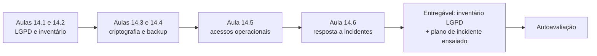
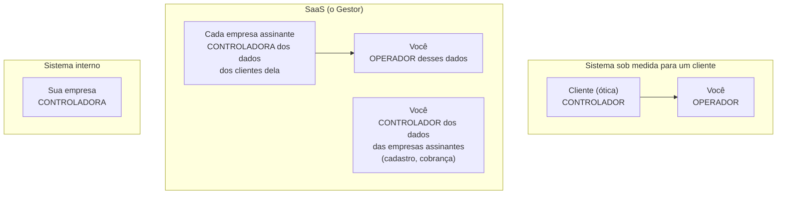
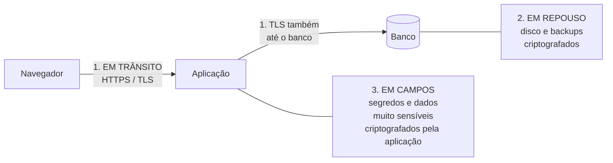
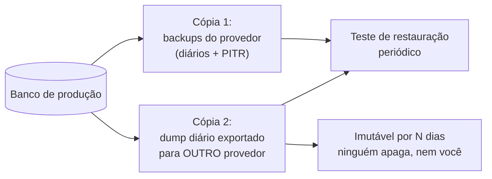
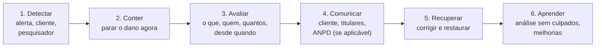

# Módulo 14: Proteger os dados, o servidor e cumprir a LGPD

**Semanas 27 e 28 · cerca de 24 horas**

## Objetivos de aprendizagem

O Módulo 13 protegeu a **aplicação**. Este protege o que está em volta dela: os **dados** (onde ficam, quem acessa, como são criptografados, como voltam depois de um desastre), os **acessos operacionais** (as suas contas, o seu computador, o banco de produção) e a **lei** (a LGPD). E termina com a peça que todo profissional sério tem e quase nenhum iniciante: um **plano para quando der errado**. Ele responde ao seu medo mais direto: "e se vazar?".

Ao final deste módulo você será capaz de:
1. Explicar a LGPD do ponto de vista de quem constrói sistemas: papéis, bases legais, direitos e obrigações.
2. Fazer o inventário de dados pessoais de um sistema e aplicar a minimização.
3. Aplicar criptografia em trânsito, em repouso e em campos sensíveis, com gestão de chaves.
4. Montar uma estratégia de backup que resiste a erro humano, falha do provedor e sequestro de dados.
5. Proteger os acessos operacionais: contas, banco de produção, computador e colaboradores.
6. Responder a um incidente de segurança, inclusive com a comunicação exigida pela ANPD.

### Como estudar este módulo

*Figura: da lei aos controles técnicos e ao plano para quando algo der errado.*

| Semana | O que fazer | Horas |
|---|---|---|
| 27 | Aulas 14.1 a 14.3, exercícios 1 a 3 | 12 |
| 28 | Aulas 14.4 a 14.6, exercícios 4 e 5, simulação de incidente, entregável, autoavaliação | 12 |

> ⚖️ **Aviso legal:** este módulo explica a LGPD para que você construa sistemas adequados e saiba conversar sobre o tema. Ele **não substitui** orientação jurídica. Para contratos, bases legais em casos específicos, dados sensíveis e incidentes reais, o cliente deve contar com um advogado ou encarregado de dados.

---

## Aula 14.1: A LGPD para quem constrói sistemas

A **Lei Geral de Proteção de Dados** (Lei 13.709/2018) regula como dados pessoais são tratados no Brasil. Para você, ela é ao mesmo tempo uma **obrigação** (seus sistemas tratam dados de milhares de pessoas) e um **argumento de venda** (clientes têm medo de multas e de vazamentos, e você sabe como reduzir esse risco).

### Os conceitos que você precisa dominar

| Conceito | Significa | Exemplo |
|---|---|---|
| **Dado pessoal** | Informação que identifica ou pode identificar uma pessoa | Nome, CPF, e-mail, telefone, endereço IP, foto |
| **Dado pessoal sensível** | Categoria com proteção reforçada: saúde, origem racial ou étnica, religião, opinião política, vida sexual, genética, biometria, filiação sindical | Receita oftalmológica, prontuário, digital |
| **Titular** | A pessoa a quem os dados se referem | O cliente da ótica |
| **Tratamento** | Qualquer operação com dados: coletar, guardar, consultar, enviar, apagar | Tudo o que o sistema faz |
| **Controlador** | Quem decide **por que** e **como** os dados são tratados | A ótica, sobre os dados dos clientes dela |
| **Operador** | Quem trata os dados **em nome** do controlador | **Você** (e o seu sistema), quando opera o sistema da ótica |
| **Encarregado** (DPO) | Pessoa indicada pelo controlador para ser o canal com titulares e com a ANPD | Pode ser alguém da empresa ou um serviço contratado |
| **ANPD** | A Autoridade Nacional de Proteção de Dados, que fiscaliza e aplica sanções | |

### Quem é quem nos seus três modelos de negócio


*Figura: os papéis da LGPD nos seus modelos de negócio. No SaaS, você é operador dos dados que os clientes guardam no sistema e controlador dos dados das próprias empresas assinantes.*

Por que isso importa:
- Como **operador**, você trata os dados **conforme as instruções** do controlador, com segurança adequada, e responde junto com ele se descumprir a lei ou as instruções.
- Os seus **fornecedores** (hospedagem, e-mail, WhatsApp, IA) são, em geral, suboperadores: você precisa conhecê-los e listá-los.
- O **contrato** com o cliente deve tratar de proteção de dados (Módulo 17).

### Os princípios da lei, traduzidos para sistemas

| Princípio (art. 6º) | No seu sistema |
|---|---|
| **Finalidade** e **adequação** | Cada dado coletado tem um motivo registrado na especificação |
| **Necessidade** (minimização) | Colete só o necessário; não peça CPF se não for emitir nota |
| **Livre acesso** e **qualidade** | O titular pode saber e corrigir o que há sobre ele |
| **Transparência** | Política de privacidade clara; avisos de uso de IA e WhatsApp |
| **Segurança** e **prevenção** | Tudo o que você aprendeu nos Módulos 9 a 15 |
| **Não discriminação** | Regras automáticas não podem discriminar de forma ilícita |
| **Responsabilização** | **Provar** que cumpre: inventário, auditoria, registros, testes |

### Bases legais: o "porquê jurídico" de cada tratamento

Todo tratamento precisa de uma **base legal**. As mais comuns em sistemas de gestão:

| Base legal | Quando se aplica | Exemplo |
|---|---|---|
| **Execução de contrato** | O dado é necessário para prestar o serviço que a pessoa contratou | Endereço para entregar o pedido |
| **Obrigação legal** | A lei manda guardar | Dados fiscais na nota |
| **Legítimo interesse** | Interesse legítimo da empresa, equilibrado com os direitos do titular | Histórico de compras para atendimento |
| **Consentimento** | A pessoa autorizou de forma livre, informada e específica | Receber ofertas pelo WhatsApp |
| **Proteção do crédito** | Cobrança e análise de crédito, nos termos da lei | Régua de cobrança |

Para dados **sensíveis**, as bases são mais restritas (art. 11). Escolher a base legal é tarefa do controlador, com orientação jurídica. Seu papel: **registrar** a base informada no inventário (Aula 14.2) e construir o sistema de forma compatível (por exemplo, registrar o consentimento quando ele for a base).

### Os direitos do titular, e o que o sistema precisa permitir

O titular pode pedir (art. 18), entre outros: confirmação e **acesso** aos dados, **correção**, **anonimização ou eliminação** de dados desnecessários, **portabilidade**, informação sobre compartilhamento e **revogação do consentimento**.

O sistema precisa permitir que o **controlador** (seu cliente) atenda esses pedidos:
- [ ] Encontrar todos os dados de uma pessoa (busca por CPF, e-mail ou telefone, em todas as tabelas).
- [ ] Exportar esses dados em formato legível.
- [ ] Corrigir.
- [ ] Anonimizar ou eliminar, preservando o que a lei obriga a manter.
- [ ] Registrar o pedido e o atendimento (prova).

### Exemplo completo: a ótica e a LGPD

- **Controladora:** a Ótica Visão Clara. **Operador:** você. **Suboperadores:** hospedagem, banco, e-mail, WhatsApp (Meta).
- **Dado sensível:** receita oftalmológica (saúde). Acesso restrito e registrado; finalidade: fabricação das lentes; base legal: a definir com o advogado da ótica (registrada no inventário).
- **Consentimento:** avisos por WhatsApp, registrado na venda (Aula 11.2).
- **Direitos:** tela "Dados do titular" para a dona buscar por CPF, exportar, corrigir e anonimizar, com registro.
- **Contrato:** cláusula de proteção de dados definindo você como operador, as medidas de segurança e a obrigação de avisar a ótica em caso de incidente (Módulo 17).

> 📌 **Em resumo**
> - Dado pessoal identifica uma pessoa; dado sensível (saúde, biometria e outros) tem proteção reforçada.
> - O cliente costuma ser o controlador; você, o operador; seus fornecedores, suboperadores.
> - Princípios viram práticas: finalidade registrada, minimização, transparência, segurança e responsabilização (provar).
> - O sistema precisa permitir ao controlador atender os direitos do titular: acesso, correção, eliminação, portabilidade.

### Para ir além
- [Lei Geral de Proteção de Dados, Lei 13.709/2018](https://www.planalto.gov.br/ccivil_03/_ato2015-2018/2018/lei/l13709.htm)
- [ANPD](https://www.gov.br/anpd/pt-br): guias orientativos para agentes de tratamento.

---

## Aula 14.2: Inventário de dados e minimização

Você não protege o que não sabe que tem. O **inventário de dados** é a lista de todos os dados pessoais que o sistema trata: o quê, de quem, para quê, onde fica, com quem é compartilhado e por quanto tempo. É a base da conformidade com a LGPD, do plano de incidente e do Dossiê de Confiança.

### O inventário

| Campo | Exemplo |
|---|---|
| Dado | Telefone do cliente |
| Categoria | Pessoal (não sensível) |
| Titular | Clientes das empresas assinantes |
| Finalidade | Contato e atendimento por WhatsApp |
| Base legal (informada pelo controlador) | Execução de contrato / consentimento para avisos |
| Onde fica | Tabela `clientes`, banco PostgreSQL (região ___); backups |
| Quem acessa | Dono, gerente, atendente da empresa; suporte com consentimento |
| Compartilhado com | Meta (WhatsApp), ao enviar mensagens |
| Retenção | Enquanto o cliente for ativo + ___ (definido pelo controlador) |
| Proteções | Isolamento por empresa, RLS, logs sem o dado, exportação auditada |

Faça uma linha para cada dado pessoal relevante. Para o Gestor, as principais categorias: usuários (nome, e-mail, senha em hash, IP de login), clientes das empresas (nome, contatos, documentos), conversas (conteúdo das mensagens, mídias), financeiro (valores, dados de cobrança), assinantes (dados da empresa e do responsável).

> 💡 **Peça ao Claude um rascunho a partir do código:** *"Leia @prisma/schema.prisma e as integrações em src/server/integracoes. Liste todos os campos que contêm ou podem conter dados pessoais, classifique (pessoal/sensível), diga onde são usados e para quais fornecedores são enviados. Marque como 'a confirmar' a finalidade e a base legal."* Você revisa e completa com o cliente.

### Minimização: o dado mais seguro é o que você não tem

Um dado que não existe não vaza. Antes de cada campo, pergunte: **precisamos mesmo disso? em que formato mínimo?**

| Em vez de | Considere |
|---|---|
| Pedir CPF de todo cliente | Só quando for emitir nota ou houver obrigação |
| Data de nascimento completa | Só o mês, se for para "parabéns no aniversário" |
| Guardar o número do cartão | Nunca; token do provedor (Aula 10.1) |
| Guardar a foto do documento | Verificar e descartar, se a lei não obriga a guardar |
| Logs com o corpo inteiro das requisições | Logs com ids e metadados (Aula 7.4) |
| Manter conversas de WhatsApp para sempre | Retenção definida (ex.: 2 anos) com eliminação automática |
| Copiar a base de produção para testar | Seed com dados fictícios (Aula 5.5) |

### Retenção e eliminação automáticas

Dados guardados "para sempre" são risco acumulado. Implemente:
- **Política de retenção** por categoria (definida com o controlador e com a orientação jurídica dele).
- **Tarefa agendada** que elimina ou anonimiza o que passou do prazo, com registro.
- **Anonimização** quando for preciso manter estatísticas: trocar nome, e-mail, telefone e documento por valores sem significado, de forma irreversível.

> ⚠️ **Backups também contêm dados.** Se um titular pediu eliminação, o dado continua nos backups até eles expirarem. Isso é aceitável desde que a retenção dos backups seja limitada e documentada, e que, ao restaurar um backup, os pedidos de eliminação sejam reaplicados. Registre isso no procedimento.

### Pseudonimização e acesso a dados sensíveis

Para dados sensíveis, além do controle de acesso:
- **Registre cada visualização** (quem viu a receita do cliente X, quando).
- **Mostre só quando necessário** (a receita aparece ao clicar em "ver receita", não em todas as listas).
- **Separe** em tabela própria, com permissões próprias, para facilitar o controle e a criptografia de campo (Aula 14.3).

### Exemplo completo: o inventário do Gestor

O entregável deste módulo inclui `docs/lgpd/inventario.md` com:
1. A tabela de dados pessoais (uma linha por dado ou grupo de dados).
2. A lista de **fornecedores** que tratam dados (hospedagem, banco, e-mail, WhatsApp, IA, erros, pagamentos), com país, finalidade e link para os termos de proteção de dados de cada um.
3. A **política de retenção** por categoria e a tarefa que a aplica.
4. O **procedimento de atendimento aos titulares** (como o controlador busca, exporta, corrige e elimina, e como isso é registrado).
5. As **decisões de minimização** tomadas (o que você deixou de coletar e por quê).

> 📌 **Em resumo**
> - O inventário lista cada dado pessoal: finalidade, base legal, local, acesso, compartilhamento, retenção e proteções.
> - Minimize: o dado que não existe não vaza.
> - Retenção definida, com eliminação ou anonimização automáticas, inclusive considerando os backups.
> - Dados sensíveis com acesso registrado, exibição sob demanda e separação.

---

## Aula 14.3: Criptografia: em trânsito, em repouso e em campos

Criptografia transforma dados em algo ilegível para quem não tem a chave. Ela não substitui o controle de acesso, mas reduz drasticamente o dano quando outras camadas falham: um backup roubado, um disco descartado, um acesso indevido ao banco. É uma das perguntas que clientes mais fazem: "os dados são criptografados?". Esta aula ensina a responder com precisão.

### As três camadas


*Figura: as três camadas de criptografia. Em trânsito protege o caminho, em repouso protege o disco, em campos protege o dado mesmo de quem acessa o banco.*

| Camada | Protege contra | Como | Quem cuida |
|---|---|---|---|
| **Em trânsito** | Interceptação na rede | HTTPS para o usuário; TLS entre aplicação e banco e com fornecedores | Você configura (HTTPS automático na PaaS ou Caddy; `sslmode=require` na conexão do banco) |
| **Em repouso** | Roubo de disco, backup ou mídia descartada | Criptografia do disco e dos backups | Normalmente o provedor (confirme que está ativa); na VPS, configure |
| **Em campos** (criptografia na aplicação) | Quem consegue ler o banco (acesso indevido, backup vazado, consulta errada) | A aplicação criptografa o valor antes de gravar e descriptografa ao usar | **Você**, no código |

> 🎯 **Resposta precisa ao cliente:** "Os dados trafegam criptografados (HTTPS), ficam criptografados no armazenamento do provedor, e as informações mais sensíveis, como as credenciais das suas integrações, são criptografadas também pelo próprio sistema, com chaves guardadas separadamente." Diga só o que é verdade no seu sistema.

### Criptografia em campos: quando usar

Ela tem custo: o banco não consegue buscar nem ordenar pelo valor criptografado, e você precisa cuidar das chaves. Use para:
- **Segredos de clientes**: tokens do WhatsApp, chaves de API de pagamento do cliente, senha do certificado digital (Aula 11.1).
- **Dados muito sensíveis** com pouca necessidade de busca: números de documentos guardados por obrigação, dados de saúde detalhados, dados bancários.

Não use para tudo: nome e e-mail do cliente precisam de busca, e estão protegidos pelas outras camadas.

### Como fazer certo

- Use **algoritmos modernos e bibliotecas prontas** (por exemplo, AES-256-GCM pela biblioteca de criptografia nativa do Node, ou uma biblioteca de alto nível reconhecida). **Nunca invente** um esquema próprio.
- Cada valor criptografado leva um **vetor de inicialização aleatório** próprio (a biblioteca cuida, se usada corretamente).
- Guarde junto com o valor a **versão da chave** usada, para permitir a troca de chaves.

```typescript
// formato gravado no banco: versão:iv:dados:tag (tudo em base64)
const cifrado = criptografar(tokenWhatsapp, chaves.atual);   // "v2:Xk9...:aB3...:Qz1..."
const token = descriptografar(cifrado, chaves);              // escolhe a chave pela versão
```

Peça ao Claude: *"implemente src/server/cripto.ts com AES-256-GCM usando o módulo crypto nativo, IV aleatório por valor, versão da chave no formato gravado, suporte a várias chaves para rotação, e testes (cifrar/decifrar, valor adulterado recusado, chave errada recusada)"*.

### Gestão de chaves

A criptografia é tão boa quanto o cuidado com a chave.

| Regra | Por quê |
|---|---|
| A chave **não fica no banco** junto com os dados | Quem rouba o banco não pode levar a chave junto |
| A chave fica em variável de ambiente (ou em um serviço de gerenciamento de chaves do provedor) | Separação de quem acessa dados e quem acessa chaves |
| Chaves diferentes por ambiente | Vazamento de homologação não afeta produção |
| **Rotação** possível: chave nova para gravações novas; antigas continuam decifrando; uma tarefa recriptografa aos poucos | Se a chave vazar ou um colaborador sair, você troca |
| **Cópia segura da chave** fora do provedor (no gerenciador de senhas, por exemplo) | Se perder a chave, os dados criptografados estão **perdidos para sempre**, inclusive nos backups |

> ⚠️ **O risco do outro lado:** perder a chave mestra é tão grave quanto vazá-la. Teste a restauração (Aula 14.4) incluindo a descriptografia dos campos, com a chave guardada no lugar de recuperação.

### Exemplo completo: os segredos dos clientes do Gestor

- Tabela `credenciais_integracao` (empresaId, tipo, valorCifrado, versaoChave, criadoPorId, atualizadoEm).
- Ao salvar o token do WhatsApp: validação, criptografia com a chave atual, gravação, auditoria ("token do WhatsApp atualizado por Ana"). A tela passa a mostrar "•••• configurado em 08/11".
- Ao usar: a tarefa de envio descriptografa **na memória**, usa e descarta; o valor nunca vai para log.
- A API nunca devolve o valor, nem para o dono.
- `CHAVE_MESTRA_CRIPTOGRAFIA` em variável de ambiente de produção, com cópia no cofre do gerenciador de senhas, e procedimento de rotação em `docs/seguranca/chaves.md`.

> 📌 **Em resumo**
> - Três camadas: em trânsito (HTTPS e TLS até o banco), em repouso (disco e backups) e em campos (pela aplicação).
> - Criptografe em campos os segredos de clientes e os dados muito sensíveis com pouca busca.
> - Use bibliotecas e algoritmos modernos; nunca invente esquemas.
> - Chave separada dos dados, por ambiente, rotacionável e com cópia segura: perder a chave é perder os dados.

### Para ir além
- [Guia de armazenamento criptográfico da OWASP, na série de guias (em inglês)](https://cheatsheetseries.owasp.org/)

---

## Aula 14.4: Backups que realmente salvam

Todo mundo diz que tem backup. Quase ninguém **testou restaurar**. O backup que nunca foi restaurado é uma esperança, não uma garantia. Esta aula monta uma estratégia que resiste aos três desastres reais: **erro humano** (alguém apagou), **falha do provedor** (a conta ou a região sumiu) e **sequestro de dados** (ransomware ou invasor que apaga os backups também).

### Os dois números que definem a estratégia

| Sigla | Pergunta | Exemplo |
|---|---|---|
| **RPO** (ponto de recuperação) | Quantos dados posso perder, no máximo? | "No máximo 24 horas" ou "no máximo 5 minutos" |
| **RTO** (tempo de recuperação) | Em quanto tempo o sistema precisa voltar? | "Em até 4 horas" |

Eles vêm da especificação (Aula 4.2: "se perder os dados de um dia, qual o prejuízo?") e vão para o SLA (Módulo 16). Quanto menores, mais caro.

### Os tipos de backup de banco

| Tipo | Como funciona | RPO típico |
|---|---|---|
| **Cópia diária** (dump, `pg_dump`) | Uma fotografia completa por dia | Até 24 horas |
| **Recuperação por ponto no tempo** (PITR) | O banco guarda continuamente o registro de alterações; você restaura para qualquer minuto | Minutos |
| **Réplica** | Uma cópia viva do banco, sincronizada | Segundos, mas **não protege contra erro humano** (o "apagar" é replicado também) |

> 🎯 Réplica é para **disponibilidade**, backup é para **recuperação**. Um não substitui o outro.

Bancos gerenciados costumam oferecer backups diários e PITR por um período (confirme no plano contratado e quantos dias são guardados).

### A regra 3-2-1 (e o "1" a mais)


*Figura: a regra 3-2-1 aplicada ao Gestor. Os dados de produção, a cópia do provedor e uma cópia em outro provedor, imutável, todas testadas periodicamente.*

- **3** cópias dos dados (a produção e mais duas).
- **2** tipos de armazenamento diferentes.
- **1** cópia **fora** do provedor principal (outra empresa, outra conta).
- **+1**: pelo menos uma cópia **imutável** (com bloqueio de exclusão por um período; vários serviços de armazenamento de objetos oferecem isso). Se um invasor (ou um ransomware) conseguir sua senha da hospedagem, ele apaga a produção e os backups do provedor; a cópia imutável em outro lugar sobrevive.

### Cuidados com a cópia externa

- **Criptografada** antes de sair (com chave guardada separadamente; Aula 14.3).
- Credenciais da conta de backup **diferentes** e com permissão só de **escrita** a partir do servidor (o servidor pode enviar, mas não apagar).
- **Retenção** definida (ex.: diários por 30 dias, mensais por 12 meses), compatível com a LGPD (Aula 14.2).
- **Monitorada**: se o backup de hoje não aconteceu, você recebe um alerta (Módulo 15).

### O que mais precisa de backup

Não é só o banco:
- **Arquivos** (anexos, mídias): armazenamento com versionamento ou cópia para outro provedor.
- **Configuração**: variáveis de ambiente (no gerenciador de senhas), `docs/servidor.md`, Caddyfile, Compose (no repositório).
- **Chaves de criptografia**: no gerenciador de senhas (sem elas, o backup dos campos criptografados é inútil).
- **Código**: o GitHub, e uma cópia do repositório em outro lugar para projetos de clientes importantes.

### O teste de restauração

Pelo menos **a cada trimestre** (e sempre antes de uma migração grande):

1. Crie um banco **novo e vazio**, em um ambiente isolado.
2. Restaure a partir da **cópia externa** (o caminho mais difícil, que é o que você vai precisar no pior dia).
3. Suba a aplicação apontando para ele.
4. Confira: quantidade de registros por tabela, um cliente conhecido, os campos criptografados sendo lidos com a chave guardada.
5. **Cronometre** do início ao fim: esse é o seu RTO real.
6. Registre no relatório de restauração (data, origem, tempo, problemas).
7. Apague o ambiente de teste.

> ⚠️ Nunca restaure um backup **por cima** da produção sem analisar: você apagaria todos os dados gravados depois dele. Restaure em um banco separado e recupere o que precisa (por exemplo, os registros apagados por engano).

### Exemplo completo: o gerente que apagou 300 clientes

Quinta, 16h20. O gerente da Imobiliária Lar Novo usou a importação de planilha com a opção "substituir" e apagou 300 clientes por engano.

1. A exclusão era lógica (Aula 5.4)? Neste caso, a importação fazia exclusão física (um defeito que você vai corrigir).
2. Você restaura o **PITR para 16h15** em um banco **separado** (não por cima da produção).
3. Exporta desse banco os 300 clientes da empresa da imobiliária, e as oportunidades e atividades ligadas.
4. Reinsere na produção com um script revisado, dentro de uma transação, conferindo que nada da empresa foi gravado depois por cima.
5. Tempo total: 50 minutos. Dados perdidos: zero.
6. Depois: a importação passa a usar exclusão lógica e a pedir confirmação com o número de registros afetados; você registra o incidente (Aula 14.6) e atualiza o runbook.

> 📌 **Em resumo**
> - Defina RPO (quanto pode perder) e RTO (em quanto tempo volta) com o cliente.
> - Réplica não é backup; use backups diários e recuperação por ponto no tempo.
> - Regra 3-2-1 com uma cópia externa, criptografada e imutável; inclua arquivos, configuração e chaves.
> - Teste a restauração a cada trimestre, a partir da cópia externa, cronometrando; nunca restaure por cima da produção.

### Para ir além
- [Backup e restauração no PostgreSQL (em inglês)](https://www.postgresql.org/docs/current/backup.html)
- [pg_dump (em inglês)](https://www.postgresql.org/docs/current/app-pgdump.html)

---

## Aula 14.5: Protegendo os acessos operacionais

Os sistemas mais bem escritos são invadidos pela porta dos fundos: a senha da hospedagem do desenvolvedor, o notebook roubado com a chave SSH, o ex-colaborador que ainda tem acesso ao GitHub. Os **acessos operacionais** (os seus e os da sua equipe) são o ponto mais forte de ataque contra quem desenvolve para vários clientes: uma conta sua invadida pode expor **todos** eles.

### O inventário de acessos

Mantenha uma lista (no gerenciador de senhas ou em um documento protegido) de todos os acessos de cada sistema:

| Acesso | Quem tem | 2FA | Nível | Revisado em |
|---|---|---|---|---|
| GitHub (organização) | Você, colaborador X | ✔ chave física | Admin / escrita | ___ |
| Hospedagem (produção) | Você | ✔ | Admin | ___ |
| Banco de produção | Aplicação; você (somente leitura, sob demanda) | n/a | ___ | ___ |
| DNS e registrador | Cliente (titular), você (técnico) | ✔ | ___ | ___ |
| Provedor de pagamento | Cliente, você | ✔ | ___ | ___ |
| WhatsApp / Meta | Cliente, você | ✔ | ___ | ___ |
| E-mail transacional | Você | ✔ | ___ | ___ |
| Painel administrativo do SaaS | Você | ✔ chave física | Admin | ___ |

### As regras

| Regra | Na prática |
|---|---|
| **2FA em tudo** | Prioridade para e-mail principal (é ele que recupera as outras senhas), GitHub, hospedagem, DNS, pagamentos |
| **Gerenciador de senhas** | Senhas únicas e longas; cofres separados por cliente; compartilhamento pelo gerenciador, nunca por mensagem |
| **Contas nominais** | Cada pessoa com o próprio usuário; nada de "login compartilhado da equipe" (sem isso, não há como saber quem fez o quê nem como remover uma pessoa) |
| **Menor privilégio** | Colaborador que só programa não precisa de acesso à produção nem ao banco |
| **Acesso ao banco de produção** | Por exceção, somente leitura, por tempo limitado, registrado. Alterações só por migration ou script revisado |
| **Revisão periódica** | A cada trimestre, revise a lista e remova o que não é mais necessário |
| **Saída de colaborador** | No mesmo dia: remover de todos os acessos, trocar senhas e chaves que ele conhecia, revogar chaves SSH e tokens |
| **Acesso do cliente** | O cliente é titular das contas dele (domínio, pagamento, WhatsApp); você é convidado. Se você sair, ele continua dono de tudo |

### O seu computador é infraestrutura

Seu notebook tem chaves SSH, sessões abertas no GitHub, o Claude Code com acesso aos repositórios de clientes. Trate-o como um servidor:
- [ ] Disco criptografado (BitLocker no Windows, FileVault no Mac, LUKS no Linux).
- [ ] Sistema e navegador sempre atualizados.
- [ ] Bloqueio de tela automático com senha.
- [ ] Chaves SSH com frase-senha.
- [ ] Nada de dados reais de clientes em arquivos locais (seed fictício).
- [ ] Nada de segredos de produção no `.env` local.
- [ ] Cuidado com extensões de navegador e programas desconhecidos.
- [ ] Backup dos seus próprios arquivos de trabalho.

### Phishing: o ataque contra você

O ataque mais provável contra a sua conta não é técnico: é um e-mail ou mensagem falsa ("sua conta do GitHub será suspensa, clique aqui"; "nova fatura da hospedagem"). Defesas:
- **Chaves de acesso (passkeys) ou chaves físicas** como 2FA nas contas críticas: elas não funcionam em sites falsos.
- Nunca entre em uma conta por um link recebido; abra o site você mesmo.
- Desconfie de urgência e de pedidos de código de verificação por telefone ou mensagem.

### Exemplo completo: o colaborador que saiu

Você contratou um desenvolvedor por 3 meses para ajudar no Gestor. No último dia:
1. Remove-o da organização do GitHub (e confere que não há chaves de deploy criadas por ele).
2. Remove-o da plataforma de hospedagem e do serviço de erros.
3. Troca os segredos que ele **viu**: se ele teve acesso às variáveis de produção, gere novos (sessão, webhooks, chaves de API) e atualize. Isso é rotação (Aula 14.3).
4. Revoga a chave SSH dele nos servidores.
5. Remove-o dos cofres do gerenciador de senhas.
6. Registra no inventário de acessos, com data.

Se ele nunca teve acesso à produção (menor privilégio), os passos 3 e 4 nem existem. Esse é o melhor argumento para o menor privilégio.

> 📌 **Em resumo**
> - Inventário de acessos por sistema, com 2FA, nível e data de revisão.
> - Contas nominais, menor privilégio, banco de produção só por exceção e somente leitura.
> - Saída de colaborador: remover acessos e trocar os segredos que ele viu, no mesmo dia.
> - Seu computador é infraestrutura; passkeys ou chaves físicas protegem contra phishing.

---

## Aula 14.6: Quando der errado: resposta a incidentes

Mesmo fazendo tudo certo, um dia algo vai acontecer: um bug que expõe dados, uma conta invadida, um servidor fora do ar. O que define o tamanho do estrago é a **reação nas primeiras horas**. Profissionais têm um plano escrito antes do incidente, porque no meio dele ninguém pensa direito. Esta aula é a resposta direta ao seu medo: **"e se vazar?"**.

### O que é um incidente de segurança

Qualquer evento que comprometa a **confidencialidade** (alguém viu o que não devia), a **integridade** (dados alterados indevidamente) ou a **disponibilidade** (dados ou sistema inacessíveis). Exemplos: vazamento entre empresas por um bug, conta de administrador invadida, chave de API publicada, ransomware, exclusão indevida em massa, perda de um backup com dados.

### As fases da resposta


*Figura: as seis fases da resposta a incidentes. Conter vem antes de entender tudo: primeiro se para o sangramento, depois se investiga.*

| Fase | O que fazer | Exemplos |
|---|---|---|
| **1. Detectar** | Confirmar que é real; registrar a hora; abrir o registro do incidente | Alerta de erro, reclamação de cliente, aviso de um pesquisador de segurança |
| **2. Conter** | Parar o dano, mesmo que custe funcionalidade | Desligar a funcionalidade por interruptor, voltar a versão, revogar a chave vazada, encerrar sessões, bloquear a conta invadida |
| **3. Avaliar** | Entender o escopo com logs e auditoria | Quais dados? De quais empresas e titulares? Quantos? Desde quando? Houve acesso de fato ou só exposição? |
| **4. Comunicar** | Avisar quem precisa saber, no prazo | O controlador (seu cliente), que decide sobre titulares e ANPD |
| **5. Recuperar** | Corrigir a causa, restaurar dados, confirmar | Correção com teste, restauração (Aula 14.4), rotação de segredos |
| **6. Aprender** | Análise sem culpados: o que permitiu, o que muda | Novo teste, nova regra no CLAUDE.md, melhoria no monitoramento |

### A comunicação e a LGPD

Quando o incidente envolve **dados pessoais** e pode acarretar **risco ou dano relevante** aos titulares, a LGPD (art. 48) e o Regulamento de Comunicação de Incidente de Segurança da ANPD (Resolução CD/ANPD nº 15, de abril de 2024) exigem que o **controlador** comunique à **ANPD** e aos **titulares**. O prazo previsto no regulamento é de **3 dias úteis** a partir do conhecimento de que o incidente afetou dados pessoais (confira sempre o texto vigente no site da ANPD).

O seu papel, como **operador**:
- **Avisar o controlador (seu cliente) imediatamente**, com as informações que tiver (o contrato deve prever isso, com prazo curto, como 24 horas).
- **Ajudar** o cliente com as informações técnicas que a comunicação exige: o que aconteceu, quais dados, quantos titulares, quais medidas foram tomadas.
- **Não** comunicar os titulares em nome do cliente sem combinar com ele (a decisão é do controlador).
- **Guardar** o registro do incidente, mesmo quando não houver obrigação de comunicar.

> ⚖️ Avaliar se o risco é relevante e redigir a comunicação são decisões que o controlador deve tomar com seu encarregado e orientação jurídica. Você fornece os fatos técnicos, com precisão e rapidez.

### Comunicar com honestidade

A forma como você comunica um incidente define se o cliente continua confiando em você. Princípios:
- **Rápido**, mesmo sem ter todas as respostas: "identificamos um problema às 14h, já contivemos, estamos avaliando e mandamos atualização às 18h".
- **Fatos**, sem minimizar nem dramatizar.
- **O que foi feito** e **o que o cliente precisa fazer** (se algo).
- **Atualizações** nos horários prometidos.
- **Relatório final** com causa e melhorias.

### O plano escrito

O modelo completo está em [templates/plano-de-incidente.md](templates/plano-de-incidente.md). Ele contém: quem é acionado e como (telefones de você, do cliente, do encarregado dele), a classificação de gravidade, os primeiros passos por tipo de incidente (vazamento, conta invadida, chave vazada, ransomware, indisponibilidade), modelos de comunicação e o formulário de registro.

**Ensaie o plano** pelo menos uma vez por ano (uma simulação de 1 hora: "às 10h um cliente diz que viu dados de outra empresa; e agora?"). O ensaio revela o que falta: o telefone de quem você não tem, o log que não existe, o acesso que você não lembra a senha.

### Exemplo completo: o vazamento das 14h

Terça, 14h02. Um usuário da Ótica A reporta que, na busca de clientes, apareceu o nome de um cliente que ele não conhece. Você suspeita de vazamento entre empresas.

| Hora | Ação |
|---|---|
| 14h05 | Reproduz em homologação: a busca nova (deploy de ontem) ignora o `empresaId` quando o termo tem acento. A RLS deveria ter bloqueado, mas a busca usava uma consulta em SQL puro fora da transação com `set_config`. **Confirmado.** |
| 14h08 | **Contém:** desliga a busca nova por interruptor (volta a busca antiga, segura). Abre o registro do incidente. |
| 14h10–15h30 | **Avalia** pelos logs (que têm `empresaId`, usuário e rota) e pela auditoria: a busca afetada ficou no ar 22 horas; 14 buscas retornaram resultados de outras empresas; os dados expostos foram **nomes e cidades** (a lista não mostrava telefone nem documentos); 4 empresas tiveram nomes de clientes exibidos a outras; 31 titulares. |
| 15h40 | **Comunica** os donos das empresas envolvidas (controladoras), com os fatos, a lista de titulares afetados de cada uma, e se coloca à disposição para a avaliação de risco e eventual comunicação à ANPD. |
| 16h–18h | **Recupera:** corrige a consulta, adiciona um teste de isolamento para busca com acentos e um teste que proíbe SQL puro fora do acesso com escopo; deploy. |
| Semana seguinte | **Aprende:** análise sem culpados; nova regra no CLAUDE.md ("consultas em SQL puro só pelo dbDaEmpresa"); revisão de todas as consultas em SQL puro do sistema. |

Os clientes não ficaram felizes, mas viram: detecção, contenção em 6 minutos, avaliação precisa (graças aos logs e à auditoria), comunicação no mesmo dia e correção com prova. **É isso que mantém um cliente depois de um incidente.**

> 📌 **Em resumo**
> - Fases: detectar, conter, avaliar, comunicar, recuperar, aprender. Contenção primeiro.
> - Incidente com dados pessoais e risco relevante: o controlador comunica a ANPD e os titulares (prazo do regulamento: 3 dias úteis; confira o texto vigente).
> - Como operador, avise o cliente imediatamente e forneça os fatos técnicos.
> - Plano escrito, com contatos e modelos, ensaiado pelo menos uma vez por ano.

### Para ir além
- [Incidente de segurança (ANPD)](https://www.gov.br/anpd/pt-br/assuntos/incidente-de-seguranca)
- [Comunicado de incidente de segurança (ANPD)](https://www.gov.br/anpd/pt-br/canais_atendimento/agente-de-tratamento/comunicado-de-incidente-de-seguranca-cis)

---

## Exercícios

### Exercício 1: Quem é quem (30 min)
Para cada situação, diga quem é controlador e quem é operador: (a) você desenvolve e hospeda o sistema de agendamento de uma clínica; (b) você vende o Gestor para uma imobiliária; (c) você usa o Gestor para os clientes da sua própria empresa; (d) o Gestor envia e-mails por um provedor de e-mail transacional.

### Exercício 2: Inventário a partir do código (60 min)
Use o prompt da Aula 14.2 no Gestor e complete o inventário. Identifique pelo menos 2 dados que você poderia deixar de coletar ou guardar por menos tempo.

### Exercício 3: Criptografia de campo (60 min)
Implemente `cripto.ts` (Aula 14.3) e migre o token do WhatsApp para a tabela de credenciais criptografadas. Faça uma rotação de chave em homologação: gere a chave v2, recriptografe os valores e confirme que tudo continua funcionando.

### Exercício 4: Restauração do zero (2 h)
**Objetivo:** medir o seu RTO real.
Restaure o banco de homologação a partir da cópia externa em um banco novo, suba a aplicação apontando para ele, confira registros e campos criptografados, e cronometre.

<details>
<summary><strong>Resolução comentada</strong></summary>

Problemas mais comuns na primeira restauração (e o que eles ensinam):
- **"Não achei a credencial do armazenamento externo"**: ela precisa estar no gerenciador de senhas, num cofre de emergência, não só no servidor que pode ter sumido.
- **"O dump não restaura porque falta uma extensão ou um usuário do banco"**: documente os pré-requisitos (extensões, usuários `gestor_app` e `gestor_migracao`, políticas de RLS) e inclua-os no procedimento.
- **"Os campos criptografados não abrem"**: a chave mestra usada não é a mesma ou a versão antiga não estava guardada. Guarde todas as versões de chave ainda em uso.
- **"Demorou 3 horas, e o SLA diz 2"**: ou o procedimento melhora (script de restauração, banco já provisionado), ou o SLA precisa refletir a realidade.
Registre o tempo e os problemas no relatório. O objetivo da primeira vez não é ser rápido, é descobrir o que falta.
</details>

### Exercício 5: Simulação de incidente (60 min)
Com alguém fazendo o papel de cliente (ou sozinho, cronometrando), simule: "um ex-funcionário de uma empresa cliente diz que ainda consegue entrar no sistema". Siga o plano de incidente fase a fase, registre cada ação com horário e escreva a comunicação ao cliente.

---

## Tarefa de campo

**Faça o inventário de dados e de acessos do caso real** (Módulo 4) com o cliente. Pergunte quem é o encarregado de dados da empresa (se houver), quais dados ele guarda hoje e onde (planilhas, WhatsApp pessoal dos vendedores, e-mail), quem tem acesso e o que acontece quando alguém sai. É comum descobrir riscos graves no processo atual (dados de clientes em celulares pessoais, planilhas compartilhadas por link público): esse diagnóstico, por si só, é valioso para o cliente e mostra o que o seu sistema resolve.

---

## Entregável: Inventário LGPD, estratégia de backup e plano de incidente ensaiado

1. `docs/lgpd/inventario.md` (Aula 14.2), com fornecedores, retenção e procedimento de titulares.
2. Tela ou procedimento de atendimento a titulares (busca, exportação, correção, anonimização) no Gestor.
3. `src/server/cripto.ts` com testes e os segredos de clientes migrados.
4. `docs/seguranca/backup.md` com RPO, RTO, regra 3-2-1, retenção e o **relatório de restauração** do exercício 4.
5. Inventário de acessos atualizado.
6. Plano de incidente preenchido (modelo) e o registro da simulação.

**Checklist de qualidade:**
- [ ] Papéis da LGPD definidos para cada modelo de negócio.
- [ ] Inventário com finalidade, base legal (a confirmar), local, acesso, compartilhamento, retenção.
- [ ] Pelo menos 2 decisões de minimização aplicadas.
- [ ] Tarefa de retenção (eliminação ou anonimização) implementada e testada.
- [ ] TLS até o banco; criptografia em repouso confirmada com o provedor.
- [ ] Segredos de clientes criptografados, com rotação ensaiada e chave guardada fora do provedor.
- [ ] Cópia externa, criptografada e imutável; restauração testada e cronometrada.
- [ ] 2FA em todas as contas do inventário de acessos; contas nominais.
- [ ] Plano de incidente com contatos reais, ensaiado.

---

## Autoavaliação

Meta: 8 de 10.

1. Qual a diferença entre dado pessoal e dado pessoal sensível? Dê dois exemplos de sensível.
2. No Gestor, quem é controlador dos dados dos clientes de uma imobiliária assinante, e qual é o seu papel?
3. O que o sistema precisa permitir para que o controlador atenda os direitos dos titulares?
4. Cite 3 exemplos de minimização de dados.
5. Explique as três camadas de criptografia e quem cuida de cada uma.
6. Por que perder a chave mestra é tão grave quanto vazá-la?
7. Qual a diferença entre réplica e backup?
8. O que é a regra 3-2-1, e por que ter uma cópia imutável?
9. Um colaborador com acesso às variáveis de produção saiu. O que fazer além de remover os acessos dele?
10. Você descobriu que um bug expôs dados de uma empresa para outra. Quais são os seus primeiros passos, e quem comunica a ANPD?

<details>
<summary><strong>Gabarito</strong></summary>

1. Dado pessoal é qualquer informação que identifica ou pode identificar uma pessoa. Sensível é a categoria com proteção reforçada: saúde, biometria, genética, origem racial ou étnica, religião, opinião política, vida sexual, filiação sindical.
2. A imobiliária é a controladora dos dados dos clientes dela; você é o operador, que trata esses dados em nome dela, conforme suas instruções e com segurança adequada.
3. Encontrar todos os dados de uma pessoa, exportá-los, corrigi-los, anonimizá-los ou eliminá-los (preservando o que a lei obriga), e registrar os pedidos e atendimentos.
4. Não pedir CPF quando não houver necessidade; guardar só o mês do aniversário; nunca guardar número de cartão; logs só com ids; retenção definida para conversas; seed fictício em vez de cópia da produção.
5. Em trânsito (HTTPS e TLS até o banco), configurada por você e pela plataforma; em repouso (disco e backups), normalmente do provedor, que você confirma; em campos (pela aplicação), feita por você no código, para segredos e dados muito sensíveis.
6. Porque os dados criptografados (inclusive nos backups) ficam permanentemente ilegíveis sem a chave; é uma perda de dados irreversível.
7. A réplica é uma cópia viva e sincronizada, boa para disponibilidade, mas replica também os erros (uma exclusão indevida chega à réplica). O backup é uma cópia de um momento, que permite voltar ao estado anterior.
8. Três cópias dos dados, em dois tipos de armazenamento, uma fora do provedor principal. A cópia imutável impede que um invasor (ou ransomware) com acesso às suas contas apague também os backups.
9. Trocar (rotacionar) todos os segredos que ele viu, revogar chaves SSH e tokens, remover dos cofres do gerenciador de senhas e registrar no inventário de acessos.
10. Conter imediatamente (desligar a funcionalidade, voltar a versão), avaliar o escopo pelos logs e pela auditoria e avisar o controlador (o cliente afetado) o quanto antes, com os fatos. A comunicação à ANPD e aos titulares, quando houver risco ou dano relevante, é feita pelo controlador, no prazo do regulamento; você apoia com as informações técnicas.
</details>

---

## Checklist de segurança do módulo

- [ ] Inventário de dados pessoais e de fornecedores atualizado.
- [ ] Minimização aplicada e retenção automática implementada.
- [ ] Procedimento de atendimento a titulares.
- [ ] TLS até o banco; criptografia em repouso confirmada; segredos de clientes criptografados.
- [ ] Chaves separadas dos dados, por ambiente, rotacionáveis e com cópia segura.
- [ ] Backup 3-2-1 com cópia externa imutável; restauração testada no trimestre.
- [ ] Inventário de acessos com 2FA, contas nominais e menor privilégio.
- [ ] Seu computador com disco criptografado e sem dados reais.
- [ ] Plano de incidente escrito, com contatos, e ensaiado.

---

## Para aprofundar (opcional)

| Material | Formato | Por que vale |
|---|---|---|
| [Lei 13.709/2018 (LGPD)](https://www.planalto.gov.br/ccivil_03/_ato2015-2018/2018/lei/l13709.htm) | Lei, em português | Leia os artigos 5º, 6º, 7º, 11, 18, 37 a 39, 46 a 49 |
| [ANPD](https://www.gov.br/anpd/pt-br) | Portal, em português | Guias orientativos e regulamentos |
| [Incidente de segurança (ANPD)](https://www.gov.br/anpd/pt-br/assuntos/incidente-de-seguranca) | Página oficial, em português | Quando e como comunicar |
| [Backup no PostgreSQL](https://www.postgresql.org/docs/current/backup.html) | Texto, em inglês | Dumps, arquivamento contínuo e PITR |
