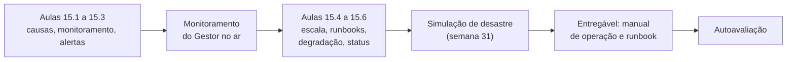
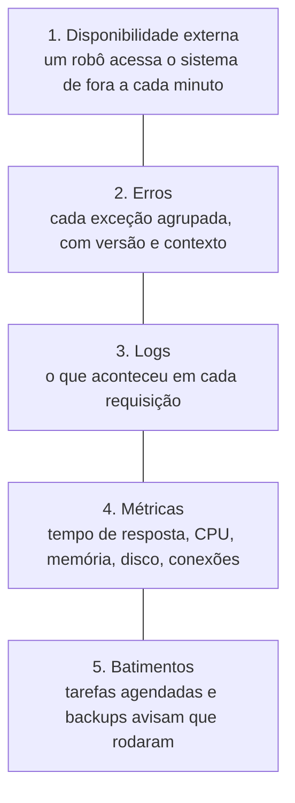
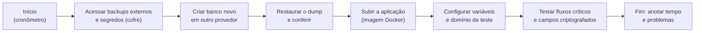

# Módulo 15: Confiabilidade: o sistema não pode cair

**Semanas 29 a 32 · cerca de 34 horas**

## Objetivos de aprendizagem

"E se o sistema cair?" é a pergunta que todo cliente faz, com razão: sistema fora do ar é venda perdida, atendimento parado, funcionário de braços cruzados. Nenhum sistema tem 100% de disponibilidade, mas há uma diferença enorme entre o sistema que cai e ninguém percebe por horas e o sistema que avisa você antes do cliente, se recupera sozinho na maioria das vezes, e volta em minutos nas outras. Este módulo constrói essa diferença, e termina com uma simulação de desastre de verdade.

Ao final deste módulo você será capaz de:
1. Explicar as causas reais de indisponibilidade e definir metas de disponibilidade mensuráveis.
2. Montar o monitoramento completo: disponibilidade, erros, desempenho, tarefas e backups.
3. Configurar alertas que avisam o que importa, sem soterrar você em ruído.
4. Identificar gargalos e preparar o sistema para crescer.
5. Escrever runbooks e conduzir uma simulação de desastre.
6. Fazer o sistema degradar com elegância quando um fornecedor cai, e comunicar indisponibilidades.

### Como estudar este módulo

*Figura: o módulo vai do monitoramento à simulação de desastre, com uma semana dedicada a ensaiar o pior dia.*

| Semana | O que fazer | Horas |
|---|---|---|
| 29 | Aulas 15.1 a 15.3, exercícios 1 e 2 | 9 |
| 30 | Aulas 15.4 a 15.6, exercícios 3 e 4 | 9 |
| 31 | Simulação de desastre (exercício 5) | 8 |
| 32 | Revisão da Fase 4, runbook completo, entregável, autoavaliação | 8 |

---

## Aula 15.1: Por que sistemas caem, e como medir a disponibilidade

Para evitar quedas, primeiro entenda de onde elas vêm. A maioria das indisponibilidades de sistemas de pequenas e médias empresas **não** vem de ataques nem de falhas espetaculares da nuvem. Vem de coisas mundanas, e previsíveis.

### As causas mais comuns

| Causa | Exemplo | Defesa (onde você aprendeu) |
|---|---|---|
| **Mudança mal feita** (a maior de todas) | Deploy com bug, migration que trava, configuração errada | CI, homologação, deploy sem queda, rollback (M12) |
| **Algo que venceu** | Domínio, certificado, cartão da hospedagem, certificado digital, plano gratuito que acabou | Renovação automática + alertas de vencimento (M12, M11) |
| **Recurso esgotado** | Disco cheio, memória, limite de conexões do banco, cota do provedor | Monitoramento de capacidade (Aula 15.4) |
| **Dependência fora** | Provedor de pagamento, WhatsApp, e-mail instáveis | Tempo limite, fila, degradação elegante (M11, Aula 15.6) |
| **Carga inesperada** | Campanha do cliente, robô raspando dados | Limites de requisições, paginação, escala (M13, Aula 15.4) |
| **Erro humano em produção** | Comando manual errado no banco | Acesso por exceção, scripts revisados, backups (M14) |
| **Falha de infraestrutura** | Servidor ou região do provedor com problema | Reinício automático, backups externos, plano de recuperação |

> 🎯 Repare: **quase todas** as causas têm uma defesa que você já construiu ou vai construir neste módulo. Confiabilidade não é sorte, é a soma de práticas.

### Medindo: SLI, SLO e SLA

| Sigla | O que é | Exemplo no Gestor |
|---|---|---|
| **SLI** (indicador) | O que você mede | % de requisições respondidas com sucesso (não 5xx) e em menos de 2 s |
| **SLO** (objetivo) | A meta interna | 99,5% por mês |
| **SLA** (acordo) | O que você promete ao cliente em contrato, com consequências | 99% por mês em horário comercial; se não cumprir, desconto na mensalidade |

O **SLO é mais exigente que o SLA**: você mira 99,5% internamente para garantir os 99% que prometeu, com folga. O SLA vai para o contrato e para o plano de manutenção (Módulo 16).

### O orçamento de erro

Se a meta é 99,5% no mês, você tem um **orçamento** de 0,5% de falha: cerca de 3,6 horas. Esse número muda a conversa:
- Se o mês está tranquilo e o orçamento quase intacto, você pode publicar mudanças com mais liberdade.
- Se um incidente já consumiu a maior parte, você congela mudanças arriscadas e prioriza estabilidade até o mês virar.

Isso transforma "devemos publicar sexta?" de uma discussão de opinião em uma decisão com dados.

### Medindo do jeito certo

- Meça **do ponto de vista do usuário**: um verificador externo acessando o sistema (Aula 15.2), não "o servidor está ligado".
- Meça **o que importa**: a tela de login abrir não basta; o fluxo crítico (logar, listar, registrar) precisa funcionar.
- **Registre** a disponibilidade mensal. Ela vai para o relatório do cliente (Módulo 16) e para o Dossiê de Confiança ("disponibilidade dos últimos 12 meses: 99,82%").

### Exemplo completo: o ano do Gestor

Em 12 meses, o Gestor teve 6 indisponibilidades:

| Causa | Duração | Defesa que faltou / que funcionou |
|---|---|---|
| Deploy com erro na tela de funil | 6 min | Rollback rápido (funcionou) |
| Instabilidade do provedor de hospedagem | 48 min | Fora do seu controle; comunicação pela página de status |
| Disco do banco 100% cheio | 1 h 20 min | **Faltou** alerta de capacidade; criado depois |
| Provedor de pagamento fora | 0 min para o usuário | Fila e nova tentativa (funcionou) |
| Migration travou a tabela de mensagens | 12 min | **Faltou** testar a migration com volume real; regra criada |
| Certificado digital de um cliente venceu | Só emissão de notas, 1 dia | **Faltou** alerta de vencimento; criado depois |

Disponibilidade do ano: cerca de 99,97% (excluindo a emissão de notas, que foi parcial). Cada falha virou uma defesa nova. **É assim que sistemas ficam robustos**: não por nunca cair, mas por aprender sempre.

> 📌 **Em resumo**
> - A maioria das quedas vem de mudanças, vencimentos, recursos esgotados e dependências; quase todas têm defesa conhecida.
> - SLI é o que se mede, SLO é a meta interna, SLA é a promessa contratual (menos exigente que o SLO).
> - O orçamento de erro transforma decisões de publicação em decisões com dados.
> - Meça do ponto de vista do usuário e registre a disponibilidade mensal.

### Para ir além
- [Objetivos de nível de serviço, livro de SRE do Google (em inglês)](https://sre.google/sre-book/service-level-objectives/)

---

## Aula 15.2: Monitoramento: saber antes do cliente

O pior jeito de descobrir que o sistema caiu é pelo telefone do cliente. O monitoramento é o conjunto de "sensores" que mostram, a cada minuto, se o sistema está de pé, se está com erros e se está lento, e que avisam você.

### As cinco camadas do monitoramento


*Figura: as cinco camadas de monitoramento. Cada uma responde a uma pergunta diferente, e juntas cobrem as causas mais comuns de queda.*

| Camada | Pergunta | Ferramentas típicas |
|---|---|---|
| **1. Disponibilidade externa** | O sistema responde para quem está de fora? | Serviços de monitoramento de disponibilidade (UptimeRobot, Better Stack, Uptime Kuma auto-hospedado, entre outros) |
| **2. Erros** | Que erros estão acontecendo, quantos, desde qual versão? | Sentry ou similar |
| **3. Logs** | O que aconteceu na requisição X? | Logs da plataforma ou um serviço de logs |
| **4. Métricas** | O sistema está ficando lento? Algum recurso está acabando? | Painéis da plataforma e do banco |
| **5. Batimentos** (heartbeats) | A tarefa das 8h rodou? O backup de hoje aconteceu? | Monitores de "batimento": a tarefa avisa quando termina; se não avisar, alerta |

### 1. Disponibilidade externa

Configure verificações de fora, a cada 1 a 5 minutos, de preferência de mais de uma região:
- `GET https://app.gestor.com.br/api/saude` → espera `200` e `"status":"ok"` (Aula 12.2).
- A página de login → espera `200` e um texto específico da página.
- **Vencimento do certificado HTTPS** e **do domínio** (muitos serviços monitoram).

Alerta se falhar em **2 verificações seguidas** (evita alarme falso por um soluço de rede).

### 2. Erros

A ferramenta de erros (Aula 7.4), configurada com:
- **Versão** (commit) de cada erro, para saber qual deploy introduziu.
- **Ambiente** (homologação, produção).
- `empresaId` e `usuarioId` como contexto (ids, não dados pessoais), para avaliar quem foi afetado.
- **Filtro de dados pessoais** ativado e testado.
- Alerta para **erro novo** e para **pico** de um erro conhecido.

### 3 e 4. Logs e métricas

- Logs estruturados (Aula 7.4) com retenção definida e busca por `requisicaoId`, `empresaId`, rota.
- Métricas a acompanhar:

| Métrica | Sinal de problema |
|---|---|
| Taxa de erros 5xx | Acima de 1% por 5 minutos |
| Tempo de resposta (percentil 95: o tempo que 95% das requisições não ultrapassam) | Acima de 2 s por 10 minutos |
| CPU e memória da aplicação | Acima de 85% por 15 minutos |
| Disco (banco e servidor) | Acima de 80% |
| Conexões do banco | Acima de 80% do limite |
| Tamanho da fila de tarefas | Crescendo sem parar por 15 minutos |
| Tarefas na fila de falhas | Qualquer nova |
| Falhas de login | Pico (sinal de ataque, Aula 9.2) |

### 5. Batimentos

Tarefas importantes **avisam que rodaram**. Se o aviso não chegar no horário, você recebe um alerta:
- Régua de cobrança das 8h.
- Conciliação de pagamentos.
- **Backup diário e cópia externa** (o mais importante: backup que parou de rodar em silêncio é uma descoberta terrível no dia em que você precisa dele).
- Tarefa de retenção de dados.

```typescript
// no fim da tarefa de backup, se tudo deu certo:
await fetch(process.env.BATIMENTO_BACKUP_URL);   // o serviço de monitoramento registra
```

### Exemplo completo: o painel de operação do Gestor

Monte (na ferramenta escolhida ou no seu painel administrativo) uma visão única:
- Disponibilidade das últimas 24 h, 7 dias e 30 dias (com o SLO).
- Erros por hora e erros novos desde o último deploy.
- Tempo de resposta p95.
- Disco, memória, conexões do banco.
- Fila de tarefas e fila de falhas.
- Último batimento de cada tarefa e do backup.
- Status dos fornecedores (pagamento, WhatsApp, e-mail), a partir da sua função de chamadas externas (Aula 11.1).

Abra esse painel todo dia de manhã, por 2 minutos. É o "olhar o painel do carro" de quem opera sistemas.

> 📌 **Em resumo**
> - Cinco camadas: disponibilidade externa, erros, logs, métricas e batimentos.
> - Verificação externa da rota de saúde, do login, do certificado e do domínio.
> - Erros com versão, ambiente e contexto (ids), sem dados pessoais.
> - Batimentos garantem que tarefas e backups rodaram; o silêncio vira alerta.

### Para ir além
- [Sentry para Next.js (em inglês)](https://sentry.io/for/nextjs/)
- [UptimeRobot](https://uptimerobot.com/) e [Better Stack Uptime](https://betterstack.com/uptime): exemplos de monitoramento de disponibilidade.

---

## Aula 15.3: Alertas que funcionam

Monitoramento sem alerta é um painel que ninguém olha às 3h. Alerta demais é pior: depois da décima notificação inútil, você para de prestar atenção, e perde a que importa. Um bom sistema de alertas acorda você **só** quando é preciso, e diz o que fazer.

### Princípios

1. **Todo alerta exige ação.** Se a resposta a um alerta é "ah, isso é normal", ele está errado: ajuste ou apague.
2. **Alerte sobre sintomas, não sobre causas.** "Os usuários estão recebendo erros" é um sintoma (sempre importa). "CPU em 90%" é uma causa possível (às vezes não importa nada).
3. **Gravidade define o canal.**
4. **Todo alerta aponta para o runbook** (Aula 15.5): o que verificar e o que fazer.

### Níveis e canais

| Nível | Exemplos | Canal | Quando reagir |
|---|---|---|---|
| **Crítico** (acorda) | Sistema fora do ar; erros 5xx acima de 5%; backup não rodou; pico de falhas de login | Ligação ou notificação insistente no celular (aplicativos de plantão), além de mensagem | Imediatamente, a qualquer hora |
| **Alto** | Fila de falhas crescendo; fornecedor de pagamento com erros; disco acima de 85% | Notificação no celular | Em horário comercial estendido, em até 1 hora |
| **Informativo** | Erro novo em baixa frequência; certificado digital de cliente vence em 30 dias | E-mail ou canal de mensagens | No próximo dia útil |

> ⚠️ **Não use só o e-mail para alertas críticos.** Ele chega misturado com tudo e você não vê de madrugada. E **não dependa do próprio sistema** para alertar sobre ele mesmo: se o servidor caiu, ele não manda e-mail. O monitoramento externo existe para isso.

### Quem atende: o plantão

Se você trabalha sozinho, você é o plantão. Defina **por escrito** (no SLA e no seu calendário):
- Em quais horários você atende alertas críticos (24 horas? horário comercial estendido?).
- O que acontece nas suas férias (um substituto técnico com acesso e runbook, ou o SLA reduzido nesse período, combinado com os clientes).
- Quanto custa um SLA com atendimento 24 horas (é caro, porque tira o seu sono, e deve ser cobrado; Módulo 16).

### Evitando o cansaço de alertas

| Problema | Solução |
|---|---|
| Alerta dispara e para sozinho em 1 minuto | Exigir 2 ou 3 verificações seguidas, ou duração mínima |
| O mesmo problema gera 50 alertas | Agrupamento: um alerta por incidente |
| Alerta que nunca leva a ação | Rebaixar para informativo ou apagar |
| Alerta sem contexto | Incluir: o que é, gravidade, link para o painel, link para o runbook |
| Manutenção planejada gera alertas | Janela de manutenção silenciando os alertas daquele período |

### O texto do alerta

```text
🔴 CRÍTICO · Gestor produção · Taxa de erro 5xx em 7,3% (limite 5%) há 5 min
Desde: 14:32 · Versão atual: a3f9c2e (deploy às 14:28)
Painel: [link]   Runbook: "Erros 5xx em alta" [link]
Primeiro passo: houve deploy recente → considerar voltar para 91be0d4.
```

Um bom alerta já sugere o primeiro passo. Às 3h da manhã, ninguém pensa bem.

### Exemplo completo: a configuração de alertas do Gestor

| Alerta | Condição | Nível | Runbook |
|---|---|---|---|
| Sistema fora | Saúde falhou em 2 verificações seguidas, de 2 regiões | Crítico | "Sistema fora do ar" |
| Erros em alta | 5xx > 5% por 5 min | Crítico | "Erros 5xx em alta" |
| Backup não rodou | Sem batimento do backup até 5h | Crítico | "Backup falhou" |
| Ataque ao login | > 200 falhas de login em 10 min | Crítico | "Pico de falhas de login" |
| Lentidão | p95 > 2 s por 10 min | Alto | "Sistema lento" |
| Fila parada | Fila crescendo por 15 min ou tarefa na fila de falhas | Alto | "Fila de tarefas" |
| Fornecedor instável | Pausa automática acionada (Aula 11.1) | Alto | "Fornecedor fora" |
| Disco | > 80% | Alto | "Disco cheio" |
| Vencimentos | Domínio, certificado HTTPS, certificado digital de cliente em 30 dias | Informativo | "Renovações" |
| Erro novo | Primeiro aparecimento | Informativo | (investigar) |

> 📌 **Em resumo**
> - Todo alerta exige ação, é sobre sintoma e aponta para um runbook.
> - Críticos por canal insistente no celular, a partir de monitoramento externo; nunca só e-mail.
> - Defina o plantão por escrito, inclusive férias; atendimento 24 horas tem custo e preço.
> - Combata o cansaço: duração mínima, agrupamento, apagar alertas inúteis, janelas de manutenção.

---

## Aula 15.4: Capacidade e escala: preparar para crescer

O Gestor com 10 empresas roda em qualquer lugar. Com 300 empresas, cada uma com milhares de clientes e centenas de mensagens por dia, coisas que eram imperceptíveis viram gargalos. Escalar não é "comprar um servidor maior" às cegas: é **medir**, achar o gargalo e resolver aquele ponto.

### Onde os gargalos costumam aparecer (nessa ordem)


*Figura: a ordem típica em que os gargalos aparecem. Quase sempre o primeiro está nas consultas ao banco, e é também o mais barato de resolver.*

### As soluções, da mais barata à mais cara

| # | Solução | Quando | Custo |
|---|---|---|---|
| 1 | **Corrigir consultas**: índices, N+1, paginação, `select` só do necessário (Aula 5.6) | Sempre, primeiro | Horas de trabalho |
| 2 | **Mover trabalho para segundo plano** (Aula 7.5) | Requisições que fazem coisas demoradas | Horas |
| 3 | **Cache** de resultados que mudam pouco (painéis, configurações), com chave incluindo `empresaId` (Aula 9.4) | Consultas repetidas e caras | Horas + cuidado com dados desatualizados |
| 4 | **Gerenciador de conexões** (pool, como o PgBouncer, ou o pool do provedor) | Muitas instâncias ou funções serverless abrindo conexões | Configuração |
| 5 | **Escala vertical**: máquina ou plano maior | Recursos realmente no limite após 1 a 4 | Mensal |
| 6 | **Escala horizontal**: mais instâncias da aplicação | Alto volume, ou disponibilidade (se uma cai, outra atende) | Mensal + o sistema precisa estar preparado |
| 7 | **Réplicas de leitura** do banco para relatórios | Relatórios pesados competindo com o uso normal | Mensal |
| 8 | **Separar um módulo** em serviço próprio (Aula 6.1) | Uma parte com volume ou necessidades muito diferentes, medidas | Alto |

### Preparado para várias instâncias

Para escalar horizontalmente (e para o deploy sem queda), a aplicação precisa ser **sem estado local**:
- [ ] Sessões no banco, não na memória do servidor (Aula 9.1).
- [ ] Arquivos em armazenamento externo, não no disco do servidor.
- [ ] Limites de requisições com contador compartilhado (Aula 13.4).
- [ ] Agendador rodando **uma vez** por horário, não em cada instância (Aula 7.5).
- [ ] Cache compartilhado (ou aceitável por instância).

Se tudo isso está certo, adicionar uma instância é mudar um número no painel.

### Teste de carga

Antes de um momento de pico conhecido (um cliente grande entrando, uma campanha), faça um **teste de carga em homologação**: um programa simula muitos usuários usando o sistema ao mesmo tempo, e você observa onde quebra.
- Use dados em volume parecido com o real (o seed gera).
- Simule o fluxo real (login, listar, buscar, registrar), não só a página inicial.
- Aumente aos poucos e anote em que ponto o tempo de resposta passa do limite.
- **Nunca** faça teste de carga em produção sem planejar, nem em sistemas de terceiros.

### Planejamento de capacidade

Uma vez por trimestre, olhe as tendências: crescimento do banco (GB por mês), das mensagens, do tempo de resposta, do custo. Projete 6 meses. Se o disco do banco vai encher em 4 meses, o momento de agir é agora, com calma, e não quando o alerta disparar.

### Exemplo completo: o Gestor com 300 empresas

Sintoma: p95 subiu de 400 ms para 2,8 s nas segundas de manhã.

1. **Medir:** os logs mostram que a rota mais lenta é o painel do dono (Aula 8.4), e o banco mostra 95% das conexões em uso nesse horário.
2. **Causa:** às segundas, todos os donos abrem o painel; cada abertura faz 8 consultas de soma sobre milhões de lançamentos.
3. **Solução em etapas:**
   - Índices compostos para as somas do painel (1 hora).
   - Indicadores do painel recalculados a cada 10 minutos em segundo plano e guardados, com "Atualizado às 9h10" (meio dia).
   - Pool de conexões configurado (1 hora).
4. **Resultado:** p95 de 350 ms às segundas, sem aumentar o plano.
5. **Registro:** diário, ADR (se o cache dos indicadores for uma decisão relevante), e o alerta de conexões em 80% criado.

> 📌 **Em resumo**
> - Gargalos aparecem primeiro nas consultas ao banco; corrija antes de pagar por mais máquina.
> - Escale na ordem: consultas, segundo plano, cache, pool de conexões, vertical, horizontal, réplicas, separar módulos.
> - Para várias instâncias, a aplicação não guarda estado local.
> - Teste carga em homologação antes de picos e planeje capacidade a cada trimestre.

### Para ir além
- [PgBouncer](https://www.pgbouncer.org/): gerenciador de conexões do PostgreSQL.

---

## Aula 15.5: Runbooks e a simulação de desastre

No meio de uma crise, ninguém pensa bem. Por isso, profissionais escrevem **antes** o que fazer em cada situação: os **runbooks**. E testam esses runbooks em uma **simulação de desastre**, porque um procedimento nunca testado quase sempre tem um passo faltando.

### O que é um runbook

É um procedimento passo a passo para um sintoma específico, escrito para ser seguido às 3h da manhã por alguém cansado (você).

```markdown
## Runbook: Sistema fora do ar

**Sintoma:** alerta "Sistema fora" ou cliente informa que não abre.

1. Confirme de fora: `curl -I https://app.gestor.com.br/api/saude`
   - Sem resposta / erro de DNS → vá para o passo 2.
   - Erro de certificado → vá para "Certificado HTTPS".
   - 502/503 → vá para o passo 3.
   - 200 → o problema é parcial: vá para "Erros 5xx em alta".
2. DNS: `nslookup app.gestor.com.br`. Domínio expirado? (painel do registrador)
3. Plataforma: o status do provedor de hospedagem tem incidente? (link)
   - Sim → atualize a página de status, acompanhe, avise os clientes (modelo).
   - Não → veja os logs do serviço web dos últimos 15 min (link).
4. Houve deploy nos últimos 60 min? → volte para a versão anterior (docs/deploy.md).
5. O banco responde? (painel do banco) Disco cheio? Conexões esgotadas?
6. Nada resolveu em 30 min → acione o suporte da hospedagem (contato) e siga o
   plano de recuperação de desastre (restaurar em outro ambiente).
7. Ao resolver: confirme a saúde, avise os clientes, registre o incidente.
```

O modelo completo, com os runbooks mais comuns, está em [templates/runbook.md](templates/runbook.md).

### Os runbooks que todo sistema seu precisa

| Runbook | Gatilho |
|---|---|
| Sistema fora do ar | Alerta de disponibilidade |
| Erros 5xx em alta | Alerta de taxa de erro |
| Sistema lento | Alerta de p95 |
| Banco: disco cheio ou conexões esgotadas | Alerta de recursos |
| Fila de tarefas parada ou com falhas | Alerta de fila |
| Fornecedor fora (pagamento, WhatsApp, e-mail) | Alerta de pausa automática |
| Backup falhou | Alerta de batimento |
| Certificado HTTPS ou domínio vencendo | Alerta de vencimento |
| Restaurar o banco (recuperação de desastre) | Perda de dados ou do provedor |
| Voltar uma versão | Deploy com problema |
| Pico de falhas de login | Alerta de segurança |
| Incidente de segurança | [Plano de incidente](templates/plano-de-incidente.md) |

> 💡 **Escreva runbooks com o Claude e teste você.** *"Com base em @docs/deploy.md, @docs/servidor.md e @docs/seguranca/backup.md, escreva o runbook 'Sistema lento' no formato do modelo, com comandos e links reais do Gestor. Marque como [CONFIRMAR] tudo que você não tem certeza."* Depois, execute cada passo em homologação e corrija.

### A simulação de desastre

Uma vez por semestre (e esta semana, no Gestor), simule o pior cenário realista **em homologação**, com o relógio correndo:

**Cenário principal desta formação:** "o provedor de hospedagem principal ficou indisponível (ou a conta foi perdida) e não há previsão de volta. Coloque o Gestor no ar em outro provedor a partir dos backups externos."


*Figura: o roteiro da simulação de desastre. O objetivo é medir o tempo real de recuperação e descobrir o que falta antes que seja de verdade.*

Regras da simulação:
- Use **só** o que estaria disponível no desastre real: o cofre do gerenciador de senhas, os backups externos, o repositório, a documentação. Não vale olhar o provedor "que caiu".
- **Cronometre** cada etapa.
- **Anote tudo** o que faltou ou atrapalhou.
- Ao final, compare o tempo com o RTO prometido (Aula 14.4) e ajuste: ou o procedimento, ou a promessa.

### A análise sem culpados

Depois de cada incidente real ou simulação, faça uma **análise sem culpados** (post-mortem): o foco é **o que no sistema e no processo permitiu** o problema, não quem errou. Estrutura:
1. Linha do tempo.
2. Impacto (quem, quanto tempo, quais dados).
3. Causas (geralmente mais de uma: "o deploy tinha um bug" **e** "o teste não cobria" **e** "o alerta demorou").
4. O que funcionou bem.
5. Ações, com responsável e prazo.

Guarde em `docs/incidentes/`. Essa pasta é uma das evidências mais fortes de maturidade que você pode mostrar a um cliente exigente.

### Exemplo completo: a primeira simulação do Gestor

Resultado real de uma primeira simulação típica:

| Etapa | Tempo | Problema encontrado |
|---|---|---|
| Acessar backups e segredos | 25 min | A credencial do armazenamento externo não estava no cofre |
| Criar banco novo | 10 min | |
| Restaurar | 35 min | Faltava criar os usuários `gestor_app` e `gestor_migracao` antes |
| Subir a aplicação | 20 min | A imagem estava num registro privado cujo token também não estava no cofre |
| Variáveis e domínio | 30 min | Lista de variáveis desatualizada no `.env.example` |
| Testes | 15 min | Campos criptografados ok |
| **Total** | **2 h 15 min** | RTO prometido: 4 h ✔ (mas com 4 problemas) |

Ações: credenciais no cofre, script de restauração com os usuários do banco, `.env.example` revisado na CI (um teste que compara com as variáveis validadas). A segunda simulação levou 1 h 10 min.

> 📌 **Em resumo**
> - Runbooks são procedimentos para um sintoma, escritos para alguém cansado seguir às 3h.
> - Todo alerta tem um runbook; o Claude ajuda a escrever, você testa.
> - Simule o desastre por semestre, só com o que estaria disponível, cronometrando.
> - Depois de incidentes e simulações, análise sem culpados com ações e prazos.

### Para ir além
- [Livro de SRE do Google (em inglês)](https://sre.google/sre-book/table-of-contents/): capítulos sobre resposta a emergências e post-mortems.

---

## Aula 15.6: Degradar com elegância e comunicar indisponibilidades

Nem toda falha precisa derrubar o sistema inteiro. Se o WhatsApp está fora, o CRM continua funcionando. Se o provedor de pagamento caiu, os clientes continuam usando o sistema. Projetar a **degradação elegante** e saber **comunicar** quando algo está fora são as últimas peças da confiabilidade, e as que mais aparecem para o cliente.

### Degradação elegante

A ideia: quando uma parte falha, o sistema **continua fazendo o resto** e deixa claro o que está limitado.

| Falha | Sem degradação | Com degradação |
|---|---|---|
| WhatsApp fora | Tela de atendimento dá erro; mensagens se perdem | Mensagens enviadas vão para a fila e saem quando voltar; aviso "WhatsApp instável: mensagens serão enviadas assim que normalizar" |
| Provedor de pagamento fora | Empresas sem conseguir usar o sistema | Acesso mantido pelo estado atual; cobranças novas tentadas depois; a suspensão automática fica pausada |
| E-mail fora | Recuperação de senha "não funciona" | Fila com nova tentativa; aviso "o e-mail pode demorar alguns minutos" |
| IA fora | Atendimento travado | Classificação automática desligada; conversas vão para a fila padrão |
| Banco de relatórios lento | Painel não abre | Mostra os últimos indicadores calculados, com o horário |

Técnicas, que você já aprendeu: tempo limite e pausa automática (Aula 11.1), filas com nova tentativa (Aula 7.5), interruptores de funcionalidade (Aula 12.7), estado próprio de acesso independente do provedor (Aula 10.3), estados de tela (Aula 8.5).

> 🎯 **Pergunta de desenho para cada integração:** "se este fornecedor ficar fora por 4 horas, o que o usuário consegue fazer, o que ele vê, e o que acontece quando voltar?". A resposta vai para a especificação e para o runbook.

### Modo manutenção

Para manutenções planejadas que exigem parar o sistema (raras, se você usa deploy sem queda):
- Avise os clientes com antecedência (dias), com horário de início e fim.
- Escolha o horário de menor uso (que você conhece pelas métricas).
- Mostre uma página de manutenção clara, com a previsão de volta.
- Silencie os alertas da janela.

### A página de status

Uma **página de status** é um endereço público (por exemplo, `status.gestor.com.br`) que mostra o estado do sistema e o histórico de incidentes. Ela:
- **Reduz chamados**: o cliente olha a página antes de ligar.
- **Mostra profissionalismo**: transparência gera confiança.
- **Organiza a comunicação** durante um incidente.

Regras:
- Hospedada **fora** da sua infraestrutura (um serviço de página de status, muitos com plano gratuito), senão cai junto.
- Atualizada durante incidentes: identificado, investigando, corrigido, monitorando, resolvido.
- Histórico visível, com as disponibilidades mensais.

### Comunicando durante uma indisponibilidade

| Momento | Mensagem (página de status e/ou aviso aos clientes) |
|---|---|
| Em até 15 min do início | "Identificamos instabilidade no acesso ao Gestor. Estamos investigando. Próxima atualização em 30 minutos." |
| Durante | "A causa foi identificada (instabilidade do provedor de hospedagem). Os dados estão preservados. Previsão: ___." |
| Resolvido | "O acesso foi normalizado às 11h42. Nenhum dado foi perdido. Pedimos desculpas pelo transtorno." |
| Depois (incidentes relevantes) | Resumo do que aconteceu e do que muda, para os clientes afetados |

Mesmo quando a culpa é do fornecedor, **o cliente é seu**: a comunicação também é.

### Fornecedores também caem: acompanhe

- Assine as **páginas de status** dos seus fornecedores críticos (hospedagem, banco, pagamento, WhatsApp, e-mail, Claude).
- Registre os incidentes deles que afetaram você. Isso informa as decisões de arquitetura ("o provedor X teve 5 incidentes neste trimestre": hora de um ADR novo?).

### Exemplo completo: a tarde sem WhatsApp

Quarta, 15h. A API do WhatsApp fica instável por 2 horas.

- A função de chamadas externas detecta falhas seguidas e **pausa** os envios por 2 minutos, depois tenta de novo (Aula 11.1). O alerta "fornecedor instável" chega para você.
- As mensagens enviadas pelas atendentes ficam na fila, com o status "aguardando envio" (relógio) na tela.
- O Gestor mostra uma faixa: "O WhatsApp está instável. Suas mensagens serão enviadas automaticamente assim que normalizar."
- Você atualiza a página de status: "Instabilidade no envio de mensagens de WhatsApp (fornecedor). O restante do sistema funciona normalmente."
- 17h: o WhatsApp normaliza, a fila envia 1.240 mensagens em 6 minutos, na ordem, sem duplicar (idempotência). Você encerra o incidente na página de status.

Nenhuma ligação de cliente. Esse é o objetivo.

> 📌 **Em resumo**
> - Degradação elegante: quando uma parte falha, o resto continua e o usuário sabe o que está limitado.
> - Para cada integração, defina o que acontece se ela ficar fora por horas.
> - Página de status fora da sua infraestrutura, atualizada durante incidentes.
> - Comunique rápido, com fatos e próxima atualização; acompanhe o status dos fornecedores.

### Para ir além
- [Status da Anthropic (exemplo de página de status)](https://status.claude.com)
- [Statuspage (em inglês)](https://www.statuspage.io/): um dos serviços de página de status.

---

## Exercícios

### Exercício 1: Defina os números (40 min)
Para o Gestor e para o caso real, defina: SLI, SLO, SLA, orçamento de erro mensal em minutos, RPO e RTO. Justifique cada número com o que o cliente disse na descoberta e com o que a arquitetura sustenta.

### Exercício 2: Monitoramento completo (2 h)
Configure no Gestor de produção (ou homologação): verificação externa da saúde e do login, monitoramento de certificado e domínio, ferramenta de erros com versão e filtro de dados pessoais, batimentos do backup e da régua de cobrança. Derrube a aplicação de homologação de propósito e meça quanto tempo o alerta leva para chegar ao seu celular.

### Exercício 3: Alertas que importam (45 min)
Monte a tabela de alertas da Aula 15.3 para o Gestor, com condição, nível, canal e runbook. Para cada alerta, escreva o texto que você receberia, incluindo o primeiro passo sugerido.

### Exercício 4: Degradação planejada (45 min)
Para cada integração do Gestor (pagamento, WhatsApp, e-mail, IA, nota fiscal se houver), escreva: o que o usuário consegue fazer se ela ficar fora por 4 horas, o que ele vê, e o que acontece quando ela volta. Implemente a faixa de aviso para o WhatsApp.

### Exercício 5: Simulação de desastre (semana 31, cerca de 6 h)
**Objetivo:** medir o seu tempo real de recuperação.
Execute o cenário da Aula 15.5: coloque o Gestor (versão de homologação) no ar em **outro provedor**, a partir dos backups externos e do cofre, sem consultar o provedor original. Cronometre cada etapa, anote os problemas, faça a análise sem culpados e corrija o que faltou.

<details>
<summary><strong>Resolução comentada (o que costuma faltar)</strong></summary>

- **Credenciais fora do cofre** (armazenamento externo, registro de imagens, provedor de DNS). Tudo o que é necessário para reconstruir precisa estar no gerenciador de senhas, num cofre de emergência que você consegue acessar mesmo sem o seu computador principal.
- **Pré-requisitos do banco** (extensões, usuários, políticas de RLS) que o dump não recria sozinho. Solução: script de restauração versionado no repositório.
- **Lista de variáveis desatualizada.** Solução: teste na CI que compara o `.env.example` com o schema de validação das variáveis.
- **DNS com TTL alto**, atrasando a troca para o novo provedor. Solução: TTL moderado nos registros críticos e procedimento de troca documentado.
- **Dependência escondida** (um webhook do provedor de pagamento apontando para o endereço antigo). Solução: lista de "configurações externas que apontam para nós" no `docs/deploy.md`.
O objetivo não é ter zero problemas na primeira vez; é que cada problema vire uma correção antes do desastre real.
</details>

---

## Tarefa de campo

**Faça o diagnóstico de confiabilidade de um sistema real** (o caso real, um sistema que você já entregou, ou um sistema que a sua operação usa). Responda: como saberíamos que caiu? Em quanto tempo? Quem seria avisado? Existe backup externo? Quando foi a última restauração? O domínio e os certificados vencem quando? Apresente ao dono do sistema as 3 maiores lacunas e quanto custaria fechá-las. Esse diagnóstico é, por si só, um serviço que você pode vender.

---

## Entregável: Manual de operação e runbook do Gestor

1. `docs/operacao.md`: SLI/SLO/SLA, painel de operação, tabela de alertas, plantão (horários, férias, substituto).
2. `docs/runbooks/` com os 12 runbooks da Aula 15.5, testados em homologação.
3. Relatório da simulação de desastre e a análise sem culpados, em `docs/incidentes/`.
4. Página de status configurada fora da sua infraestrutura.
5. Faixas de degradação para as integrações.

**Checklist de qualidade:**
- [ ] SLO mais exigente que o SLA; orçamento de erro calculado.
- [ ] Cinco camadas de monitoramento ativas.
- [ ] Alertas críticos chegam ao celular, a partir de monitoramento externo; tempo medido.
- [ ] Todo alerta aponta para um runbook.
- [ ] Batimentos de backup e tarefas críticas.
- [ ] Aplicação sem estado local (pronta para várias instâncias).
- [ ] Simulação de desastre feita, cronometrada, com problemas corrigidos.
- [ ] Degradação definida e visível para cada integração.
- [ ] Página de status pública e independente.
- [ ] Plantão definido por escrito.

---

## Autoavaliação

Meta: 8 de 10.

1. Qual é a causa mais comum de indisponibilidade, e as três defesas principais contra ela?
2. Qual a diferença entre SLI, SLO e SLA? Por que o SLO deve ser mais exigente que o SLA?
3. O que é o orçamento de erro e como ele ajuda a decidir sobre publicações?
4. Quais são as cinco camadas de monitoramento?
5. Por que o backup precisa de um "batimento"?
6. Por que alertas críticos não podem depender só de e-mail nem do próprio sistema?
7. O sistema ficou lento com o crescimento. Qual é a primeira coisa a investigar, antes de aumentar o plano?
8. O que significa a aplicação ser "sem estado local", e por que isso importa?
9. Por que a simulação de desastre só pode usar o que estaria disponível no desastre real?
10. O provedor de pagamento caiu por 3 horas. O que o Gestor deve fazer com o acesso das empresas e com a suspensão automática?

<details>
<summary><strong>Gabarito</strong></summary>

1. Mudanças mal feitas (deploys, migrations, configuração). Defesas: CI com testes e homologação, deploy sem queda com verificação de saúde, e rollback rápido com migrations compatíveis.
2. SLI é o indicador medido (ex.: % de requisições com sucesso); SLO é a meta interna; SLA é a promessa contratual ao cliente. O SLO é mais exigente para dar folga: mirando mais alto, você cumpre o que prometeu mesmo em meses ruins.
3. É a quantidade de falha permitida pela meta no período (ex.: 0,5% do mês). Se sobra orçamento, dá para publicar com mais liberdade; se foi consumido, congelam-se mudanças arriscadas.
4. Disponibilidade externa, erros, logs, métricas e batimentos.
5. Porque um backup que para de rodar não gera erro visível; o silêncio só é percebido no dia em que se precisa dele. O batimento transforma a ausência do aviso em alerta.
6. E-mail se mistura com tudo e não acorda ninguém de madrugada; e se o sistema caiu, ele não consegue enviar o próprio alerta. Por isso o monitoramento é externo e o canal crítico é insistente no celular.
7. As consultas ao banco: índices faltando, N+1, ausência de paginação, consultas pesadas em telas muito usadas. É a causa mais comum e a correção mais barata.
8. Significa não guardar sessões, arquivos, contadores ou agendamentos na memória ou no disco de uma instância específica. Importa para poder ter várias instâncias (escala e disponibilidade) e para o deploy sem queda.
9. Porque o objetivo é descobrir o que falta de verdade; se você usar o provedor "que caiu" para pegar uma senha ou um arquivo, esconde exatamente a lacuna que vai te travar no desastre real.
10. Manter o acesso conforme o estado atual das assinaturas (o banco do Gestor é a verdade sobre acesso), pausar a suspensão automática (ou fazê-la consultar o provedor antes, o que falharia e manteria o estado), enfileirar cobranças novas para depois e deixar a conciliação corrigir tudo quando o provedor voltar.
</details>

---

## Checklist de segurança do módulo

- [ ] Monitoramento externo da disponibilidade, do certificado e do domínio.
- [ ] Ferramenta de erros com filtro de dados pessoais testado.
- [ ] Alerta de pico de falhas de login.
- [ ] Batimento do backup e da cópia externa.
- [ ] Runbooks não contêm segredos (só onde encontrá-los no cofre).
- [ ] Credenciais de recuperação de desastre no cofre de emergência.
- [ ] Página de status sem informações que ajudem um atacante.
- [ ] Simulação de desastre feita no semestre.

---

## Para aprofundar (opcional)

| Material | Formato | Por que vale |
|---|---|---|
| [Livro de SRE do Google](https://sre.google/sre-book/table-of-contents/) | Livro gratuito, em inglês | A referência em confiabilidade, monitoramento e resposta a incidentes |
| [Sentry](https://docs.sentry.io/) | Texto, em inglês | Rastreamento de erros |
| [PgBouncer](https://www.pgbouncer.org/) | Texto, em inglês | Gerenciamento de conexões |
