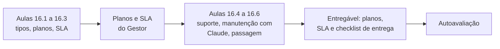
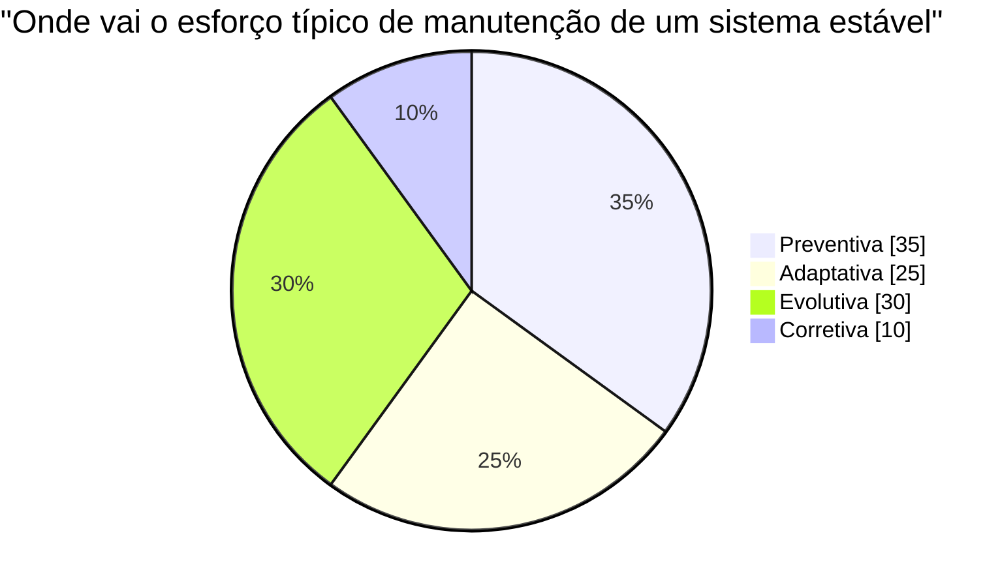
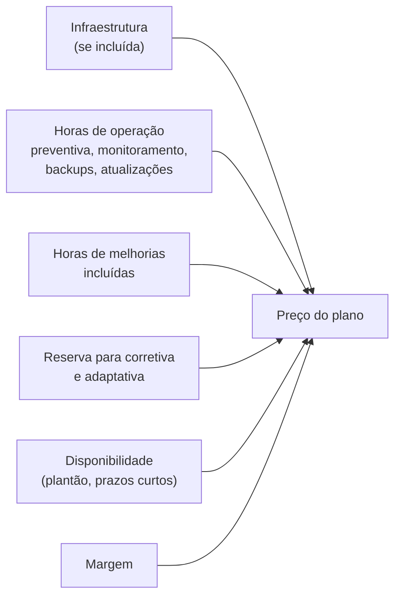
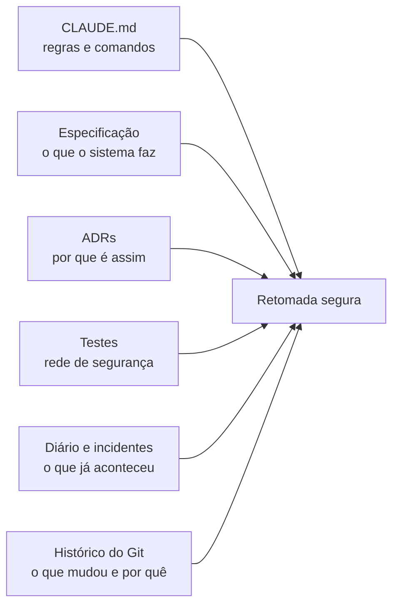
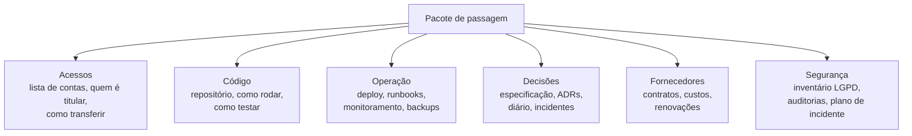

# Módulo 16: Manutenção e suporte como produto

**Semanas 33 e 34 · cerca de 22 horas**

## Objetivos de aprendizagem

"E se precisar de manutenção?" é uma pergunta que você hoje não sabe responder, e é uma das mais importantes do seu negócio. A entrega do sistema não é o fim do trabalho: é o começo de uma relação que pode durar anos. Bem estruturada, a manutenção é **receita recorrente** para você e **tranquilidade** para o cliente. Mal estruturada, vira trabalho de graça, cliente insatisfeito e um sistema que apodrece. Este módulo transforma a manutenção em um produto claro: o que inclui, quanto custa, em quanto tempo você responde, e como você a executa com o Claude.

Ao final deste módulo você será capaz de:
1. Explicar ao cliente os tipos de manutenção e por que um sistema sem manutenção se deteriora.
2. Montar planos de manutenção com escopo, horas e preço claros.
3. Escrever um SLA com níveis de gravidade, prazos, disponibilidade, exclusões e compensações.
4. Organizar o suporte: canais, triagem, registro e base de conhecimento.
5. Fazer manutenção com segurança em um sistema que você não toca há meses, com a ajuda do Claude.
6. Preparar o sistema para ser passado a outra pessoa, e responder "e se você sumir?".

### Como estudar este módulo

*Figura: o módulo transforma a manutenção em um produto, do escopo ao contrato e à execução.*

| Semana | O que fazer | Horas |
|---|---|---|
| 33 | Aulas 16.1 a 16.3, exercícios 1 a 3 | 11 |
| 34 | Aulas 16.4 a 16.6, exercícios 4 e 5, entregável, autoavaliação | 11 |

---

## Aula 16.1: O que é manutenção de verdade

Muita gente acha que manutenção é "corrigir bug quando der problema". Isso é só um dos quatro tipos, e o menor. Um sistema parado no tempo se deteriora mesmo sem ninguém mexer nele: as bibliotecas envelhecem e ganham falhas de segurança, os fornecedores mudam suas APIs, a lei muda, o negócio do cliente muda.

### Os quatro tipos de manutenção

| Tipo | O que é | Exemplo | Quem inicia |
|---|---|---|---|
| **Corretiva** | Corrigir defeitos | "O relatório soma errado quando há desconto" | O cliente (ou o seu monitoramento) |
| **Preventiva** | Evitar problemas futuros | Atualizar bibliotecas, aplicar correções de segurança, revisar backups, renovar certificados, testar restauração | **Você** |
| **Adaptativa** | Ajustar a mudanças externas | O provedor de pagamento mudou a API; nova regra fiscal; o WhatsApp mudou a política de modelos | O mundo externo |
| **Evolutiva** | Melhorias e funcionalidades novas | "Quero um relatório de comissões" | O cliente |


*Figura: uma distribuição típica de esforço em um sistema bem construído e estável (números ilustrativos). A corretiva é a menor parte quando há testes; a preventiva é a que o cliente não vê e a que mais o protege.*

> 🎯 **O argumento para o cliente:** "sem manutenção preventiva e adaptativa, o sistema funciona hoje e fica vulnerável amanhã. Uma biblioteca com falha de segurança publicada, sem atualização, é uma porta aberta. Uma API de pagamento que muda sem a gente adaptar para de cobrar. A manutenção é o que mantém o sistema seguro e funcionando sem que você precise se preocupar."

### O custo de não manter

| Sem manutenção por... | O que costuma acontecer |
|---|---|
| 3 meses | Alertas de segurança acumulando; pequenas incompatibilidades |
| 1 ano | Várias bibliotecas com falhas conhecidas; uma integração quebra por mudança do fornecedor |
| 2 a 3 anos | Atualizar vira um projeto grande e caro (versões muito antigas não atualizam direto); risco real de incidente |

É a mesma lógica da manutenção de um carro: a revisão periódica é barata; o motor fundido, não.

### O que é bug e o que é melhoria

Esta é a fonte número 1 de atrito com clientes. Defina **por escrito** (no contrato e no plano):

| É **correção** (incluída, sem custo extra) | É **evolução** (orçada ou consome horas do plano) |
|---|---|
| O sistema não faz o que a especificação aprovada diz | O cliente quer algo que não estava na especificação |
| Um cálculo dá resultado errado em relação à regra definida | A regra de negócio mudou |
| Uma tela quebra no navegador suportado | Suporte a um navegador ou dispositivo novo |
| Falha de segurança | Uma integração nova |

É aqui que a **especificação aprovada** (Módulo 4) mostra seu valor: ela é a referência objetiva do que foi combinado.

### Garantia × manutenção

- **Garantia:** um período após a entrega (por exemplo, 90 dias) em que você corrige, sem custo, defeitos em relação à especificação. Faz parte do projeto.
- **Manutenção:** um serviço recorrente, contratado à parte, que inclui preventiva, adaptativa, suporte e um volume de corretiva e evolutiva.

Deixe claro na proposta que a garantia **não** inclui atualizações preventivas nem adaptações a mudanças externas. Essas são da manutenção.

### Exemplo completo: o ERP sem manutenção

A Autopeças Silva contratou o ERP, recusou o plano de manutenção ("está funcionando, não precisa"), e voltou 18 meses depois:
- O provedor de emissão de notas mudou a versão da API; as notas pararam de sair há 2 semanas.
- 14 bibliotecas com alertas de segurança, 3 de gravidade alta.
- O certificado digital venceu (ninguém avisou).
- A versão do Node usada saiu do período de suporte.

O orçamento para "colocar em dia" saiu maior que 2 anos de plano de manutenção, e o cliente ficou 2 semanas sem emitir notas. Essa história (sem nomes) vira parte da sua conversa de venda do plano.

> 📌 **Em resumo**
> - Quatro tipos: corretiva, preventiva, adaptativa e evolutiva; a preventiva é a que mais protege.
> - Sistemas sem manutenção se deterioram, mesmo sem ninguém mexer.
> - Defina por escrito o que é correção e o que é evolução, com a especificação como referência.
> - Garantia cobre defeitos por um período; manutenção é um serviço recorrente.

---

## Aula 16.2: Os planos de manutenção

Em vez de cobrar "por chamado" (imprevisível para os dois lados), ofereça **planos**: um valor mensal fixo que cobre um escopo definido. O cliente ganha previsibilidade; você ganha receita recorrente e pode planejar o seu tempo.

### A estrutura de três planos

| | **Essencial** | **Profissional** | **Premium** |
|---|---|---|---|
| Para quem | Sistemas pequenos, uso em horário comercial | Sistemas importantes para a operação | Sistemas críticos, SaaS, operação estendida |
| Hospedagem e infraestrutura gerenciadas | ✔ | ✔ | ✔ |
| Monitoramento e alertas | ✔ | ✔ | ✔ (com plantão) |
| Backups e teste de restauração | Diário · teste semestral | Diário + ponto no tempo · teste trimestral | Ponto no tempo · teste trimestral + simulação de desastre anual |
| Atualizações de segurança | ✔ (críticas em até 5 dias úteis) | ✔ (críticas em até 2 dias úteis) | ✔ (críticas em até 24 horas) |
| Atualizações preventivas (bibliotecas) | Trimestral | Mensal | Mensal |
| Manutenção adaptativa (mudanças de fornecedores) | ✔ | ✔ | ✔ |
| Correção de defeitos | ✔ | ✔ | ✔ |
| Horas para melhorias (evolutiva) | — | 4 h/mês | 10 h/mês |
| Suporte | E-mail, horário comercial | E-mail e WhatsApp, horário comercial | E-mail, WhatsApp e telefone para crítico, horário estendido |
| SLA (Aula 16.3) | Básico | Padrão | Ampliado |
| Relatório mensal | Resumido | Completo | Completo + reunião mensal |
| Auditoria de segurança | Anual | Semestral | Semestral + recomendação de pentest |

> 💡 **Três planos funcionam bem** porque a maioria dos clientes escolhe o do meio. Mas os nomes, os limites e o conteúdo são seus: ajuste ao seu público e à sua capacidade. O modelo editável está em [templates/planos-de-manutencao.md](templates/planos-de-manutencao.md).

### Como precificar cada plano

O preço do plano cobre (você vai aprofundar na calculadora do Módulo 17):


*Figura: os componentes do preço de um plano de manutenção. Prazos de resposta mais curtos e plantão custam mais, porque comprometem a sua disponibilidade.*

- **Horas de operação:** quanto tempo, por mês, a preventiva desse sistema leva (atualizações, revisão do painel, teste de restauração diluído). Meça nos seus sistemas.
- **Reserva para imprevistos:** uma porcentagem para corretiva e adaptativa.
- **Disponibilidade:** prazos curtos e plantão têm preço alto, com razão.
- **Margem.**

### Regras que evitam conflito

- **Horas de melhorias não acumuladas** (ou acumuladas por no máximo 1 a 2 meses). Senão, um dia o cliente pede 60 horas de uma vez.
- **Horas extras** com valor definido no contrato.
- **Melhorias grandes** (acima de X horas) viram projeto à parte, com especificação e orçamento.
- **Reajuste anual** previsto em contrato (por um índice).
- **Mudança de plano** com aviso de 30 dias.
- O que **não** está incluído, escrito: treinamento presencial, digitação de dados, suporte a computadores do cliente, mudanças de escopo grandes.

### O relatório mensal: a prova do valor

A manutenção preventiva é invisível quando funciona: o cliente nunca vê o ataque que não aconteceu. O **relatório mensal** torna o trabalho visível:

```text
Relatório de manutenção · Ótica Visão Clara · Novembro de 2026

Disponibilidade: 99,96% (meta 99,5%)
Incidentes: nenhum que tenha afetado o uso
Segurança: 3 atualizações aplicadas (1 de gravidade alta, aplicada em 18h)
Backups: 30 de 30 concluídos · restauração testada em 12/11 (38 min)
Monitoramento: 2 alertas (lentidão às 9h do dia 4, resolvida em 12 min)
Melhorias: filtro por laboratório na lista de pedidos (3,5 h de 4 h)
Uso: 1.284 vendas registradas · 1.190 avisos de WhatsApp enviados
Próximo mês: renovação do certificado digital (vence em 15/12)
```

> 🎯 Esse relatório é o que faz o cliente **renovar** o plano, e o que ele mostra para outros donos de empresa. Gere-o automaticamente (boa parte dos números vem do seu monitoramento).

### Exemplo completo: os planos para a ótica

A dona da ótica escolheu o plano Profissional:
- Infraestrutura incluída (PaaS + banco + monitoramento + backups).
- Atualizações mensais e de segurança crítica em até 2 dias úteis.
- 4 horas de melhorias por mês (ela usou para o filtro por laboratório e um relatório de comissões).
- Suporte por WhatsApp em horário comercial; SLA padrão.
- Relatório mensal enviado no dia 5.

Em 12 meses: nenhum incidente grave, 31 atualizações de segurança aplicadas, 9 pequenas melhorias. Ela renovou e indicou outra ótica. **Para você, é receita recorrente e previsível**, e cada cliente novo do mesmo setor reaproveita a base.

> 📌 **Em resumo**
> - Planos com valor fixo mensal e escopo claro, em vez de cobrança por chamado.
> - Três níveis (essencial, profissional, premium) diferenciados por prazos, atualizações, horas de melhoria e suporte.
> - O preço cobre infraestrutura, operação, melhorias, reserva, disponibilidade e margem.
> - Regras claras (horas que não acumulam, horas extras, o que não está incluído) e um relatório mensal que torna o valor visível.

---

## Aula 16.3: O SLA explicado

O **SLA** (acordo de nível de serviço) é a parte do contrato que diz **o que você garante e em quanto tempo**. Um bom SLA protege o cliente (ele sabe o que esperar) e protege você (ele limita o que pode ser exigido). Um SLA vago ("atendimento rápido") gera conflito; um SLA impossível ("disponibilidade 100%") gera multa.

### Os componentes de um SLA

| Componente | O que define |
|---|---|
| **Níveis de gravidade** | Como classificar um problema |
| **Tempo de resposta** | Em quanto tempo você **começa** a tratar |
| **Tempo de solução ou contorno** | Em quanto tempo o problema é **resolvido** ou contornado |
| **Disponibilidade** | Percentual do tempo em que o sistema está no ar, e como se mede |
| **Horário de atendimento** | Quando os prazos correm |
| **Canais** | Por onde o cliente abre chamados |
| **Exclusões** | O que não conta (manutenções avisadas, falhas do cliente, força maior) |
| **Compensações** | O que acontece se você não cumprir (desconto na mensalidade) |
| **Medição e relatório** | Como os números são apurados e informados |

### Níveis de gravidade

| Gravidade | Definição | Exemplo |
|---|---|---|
| **1 · Crítica** | Sistema indisponível ou funcionalidade essencial parada para todos, ou incidente de segurança | Ninguém consegue logar; vendas não podem ser registradas; suspeita de vazamento |
| **2 · Alta** | Funcionalidade importante com falha, sem contorno razoável | Cobranças não estão sendo emitidas; WhatsApp não envia |
| **3 · Média** | Falha com contorno disponível, ou afetando poucos usuários | Relatório com erro em um filtro; exportação lenta |
| **4 · Baixa** | Dúvida, ajuste visual, problema cosmético | Texto com erro de digitação |

> 💡 **Quem classifica?** O cliente informa, você confirma pela definição. Escreva as definições com exemplos do sistema dele, para não haver discussão.

### Prazos (exemplo para o plano Profissional)

| Gravidade | Resposta | Solução ou contorno |
|---|---|---|
| 1 · Crítica | 1 hora (no horário de atendimento) | 4 horas |
| 2 · Alta | 4 horas úteis | 1 dia útil |
| 3 · Média | 1 dia útil | 5 dias úteis |
| 4 · Baixa | 2 dias úteis | Próxima janela de manutenção |

Repare em "solução **ou contorno**": às vezes a correção definitiva leva dias, mas um contorno (voltar a versão, desligar a funcionalidade, um procedimento manual) restaura a operação rápido. Isso é realista e honesto.

### Disponibilidade: como prometer

- Prometa **menos** que o seu SLO (Aula 15.1): se você mira 99,5%, prometa 99% ou 99,3%.
- **Nunca** mais que os seus fornecedores garantem (Aula 6.6).
- Defina a **medição**: monitoramento externo a cada X minutos, no mês, com relatório.
- Defina o **horário** que conta: 24 x 7 ou horário comercial (para muitos sistemas de PMEs, horário comercial estendido é o que importa, e é mais barato de garantir).

### Exclusões (sempre escreva)

- Manutenções programadas avisadas com antecedência.
- Problemas causados pelo cliente (configuração alterada, uso indevido, dados importados errados, internet ou computadores do cliente).
- Falhas de serviços de terceiros contratados diretamente pelo cliente.
- Indisponibilidade geral de provedores de nuvem fora do seu controle (avalie com cuidado: o cliente pode não aceitar; uma alternativa é limitar a compensação nesses casos).
- Caso fortuito e força maior.

### Compensações

A forma mais comum: **créditos** na mensalidade seguinte, proporcionais ao descumprimento, com teto.

| Disponibilidade no mês | Crédito |
|---|---|
| Abaixo de 99% | 10% da mensalidade |
| Abaixo de 98% | 25% |
| Abaixo de 95% | 50% (teto) |

O teto é importante: o seu risco máximo fica limitado e conhecido. Valide a redação com um advogado (Módulo 17).

### Exemplo completo: explicando o SLA ao cliente

O dono da Distribuidora Ramos pergunta: "e se o sistema cair num sábado?". Com o SLA do plano Profissional (horário comercial estendido, de segunda a sábado, 8h às 20h):

> "Se cair no sábado às 10h, o monitoramento me avisa na hora, antes de você perceber. Problema crítico eu respondo em até 1 hora e resolvo ou contorno em até 4 horas, e na prática a maioria se resolve em minutos, porque eu consigo voltar a versão anterior rapidamente. Se cair no domingo, que está fora do horário contratado, eu também sou avisado e, para casos críticos, eu verifico assim que possível, mas o prazo garantido começa na segunda às 8h. Se você precisa de garantia aos domingos, o plano Premium cobre."

Resposta honesta, com números, e com uma opção para quem precisa de mais. É exatamente o que o cliente quer ouvir.

> 📌 **Em resumo**
> - O SLA define gravidade, prazos de resposta e de solução ou contorno, disponibilidade, horários, canais, exclusões, compensações e medição.
> - Defina a gravidade com exemplos do sistema do cliente.
> - Prometa menos que o seu SLO e nunca mais que os seus fornecedores.
> - Compensações em créditos, com teto; redação validada por advogado.

---

## Aula 16.4: Organizando o suporte

Suporte desorganizado é chamado no WhatsApp pessoal às 22h, pedido esquecido, cliente perguntando "e aquilo que eu pedi?". Suporte organizado tem canal, registro, prazo e resposta. Com poucos clientes, você consegue fazer isso com ferramentas simples, e o Claude ajuda muito na triagem.

### Os canais

| Canal | Para quê | Regra |
|---|---|---|
| **Formulário ou e-mail de suporte** | Chamados normais (gravidade 3 e 4) | Todo chamado gera um registro com número |
| **WhatsApp do suporte** (número da empresa, não o pessoal) | Chamados rápidos e gravidade 2 | Horário de atendimento visível; mensagens fora do horário recebem resposta automática com o canal de emergência |
| **Telefone de emergência** | Só gravidade 1, em planos que incluem | Uso restrito, combinado |
| **Dentro do sistema** | Botão "Ajuda" com o formulário e a base de conhecimento | Já envia a versão, a empresa e a tela (sem dados sensíveis) |

> ⚠️ **Separe o pessoal do profissional.** O WhatsApp pessoal para suporte de clientes acaba com o seu descanso e mistura dados de clientes com a sua vida. Use um número de suporte, com horário.

### O registro de chamados

Cada chamado tem: número, cliente, quem abriu, data e hora, gravidade, descrição, status, responsável, prazo do SLA, solução e tempo gasto. Pode começar com uma ferramenta simples (uma planilha bem estruturada, um quadro de tarefas, as issues privadas do GitHub) e evoluir para uma ferramenta de suporte quando o volume pedir.

O registro serve para:
- Cumprir e **provar** o SLA (relatório mensal).
- Medir quanto tempo cada cliente consome (para ajustar o preço do plano).
- Encontrar padrões ("10 chamados sobre a mesma tela": é um problema de usabilidade).

### Triagem com o Claude

O Claude ajuda a transformar a mensagem confusa do cliente em um chamado útil, **sem enviar dados sensíveis**:

```text
Abaixo está a mensagem de um cliente do sistema [tipo]. Sem inventar
informações, organize em: (1) resumo do problema em uma frase, (2) gravidade
provável segundo esta tabela [cole a tabela do SLA], com justificativa,
(3) passos para reproduzir que dá para inferir, (4) perguntas que preciso fazer
ao cliente para reproduzir, (5) hipóteses de causa. Mensagem: [cole, removendo
nomes, telefones e documentos].
```

### Base de conhecimento

Muitos chamados são dúvidas repetidas ("como cadastro um usuário?", "por que o boleto não aparece?"). Uma **base de conhecimento** com artigos curtos (com capturas de tela de dados fictícios) reduz chamados e dá autonomia ao cliente.
- Escreva um artigo toda vez que responder a mesma dúvida pela segunda vez.
- Peça ao Claude o rascunho a partir da resposta que você deu; revise.
- Coloque o link no botão "Ajuda" do sistema.

### Suporte e segurança

O suporte é uma porta de ataque (engenharia social):
- **Confirme a identidade** antes de ações sensíveis ("troque o e-mail do dono", "me dê acesso", "reative o usuário"). Confira por um canal já cadastrado (ligar para o telefone do contrato, e-mail do dono registrado).
- **Nunca peça senha** ao cliente, e diga isso a ele ("nunca vamos pedir a sua senha").
- Acesso de suporte à conta do cliente só pelo mecanismo com consentimento e registro (Aula 9.6).
- Não peça nem aceite dados sensíveis por WhatsApp quando não for necessário.

### Exemplo completo: um chamado do começo ao fim

1. **Segunda, 9h12**, WhatsApp do suporte: "o sistema não tá deixando eu registrar pagamento!!!" (gerente da Contabilidade Exata).
2. **9h15**, triagem: você pergunta qual cobrança e qual mensagem aparece. Resposta: "Valor maior que o saldo em aberto". Gravidade: 3 (há contorno; afeta um caso).
3. **9h20**, registro: chamado #142, gravidade 3, prazo de resposta cumprido.
4. **9h40**, investigação: a cobrança tinha um desconto aplicado depois de uma baixa parcial, e o saldo exibido na tela não considerava o desconto (o cálculo do servidor estava certo; a tela, não). Teste que reproduz, correção, deploy à tarde.
5. **16h10**, resposta ao cliente: "corrigido; a tela agora mostra o saldo já com o desconto. O pagamento pode ser registrado pelo valor de R$ 820,00".
6. Registro fechado com tempo gasto (1 h 10 min, dentro do plano); artigo novo na base: "Como funcionam descontos após pagamentos parciais".

> 📌 **Em resumo**
> - Canais definidos e profissionais, com horário; nada de WhatsApp pessoal.
> - Todo chamado registrado com gravidade, prazo e tempo gasto.
> - O Claude ajuda na triagem, sem receber dados sensíveis.
> - Base de conhecimento para dúvidas repetidas; confirme a identidade antes de ações sensíveis.

---

## Aula 16.5: Manutenção com o Claude em um sistema antigo

Oito meses depois da entrega, o cliente pede uma mudança. Você não lembra como o módulo de cobranças funciona, e o Claude começa a sessão sem saber nada. É aqui que todo o trabalho de documentação da formação paga a conta: com CLAUDE.md, especificação, ADRs, testes e diário, você retoma o sistema com segurança em minutos. Sem eles, você tem um sistema que tem medo de tocar.

### O que torna a manutenção segura


*Figura: as seis fontes que permitem retomar um sistema meses depois. Cada uma foi construída ao longo da formação.*

### O ritual de retomada (30 minutos)

Antes de qualquer mudança em um sistema que você não toca há tempo:

1. **Atualize o ambiente:** `git pull`, `npm ci`, banco local com seed, `npm test`. **Os testes passam antes de você mexer?** Se não passam, esse é o primeiro problema (ambiente ou algo que mudou).
2. **Peça ao Claude um resumo orientado à tarefa:**

```text
(modo de planejamento)
Vou fazer manutenção neste sistema depois de 8 meses sem mexer. Leia CLAUDE.md,
docs/especificacao.md, docs/arquitetura.md, docs/decisoes/ e o git log dos
últimos 6 meses. Depois:
1. Resuma a arquitetura em 10 linhas.
2. Explique como funciona o módulo de cobranças (arquivos, fluxo, regras RN do
   financeiro), citando os arquivos.
3. Liste os testes que cobrem esse módulo.
4. Aponte riscos de mexer nele (o que pode quebrar, que outras partes dependem dele).
Não altere nada.
```

3. **Leia o que o Claude apontou nos próprios arquivos.** Confirme 2 ou 3 afirmações.
4. **Confira o estado das dependências:** há alertas de segurança pendentes? É hora de uma atualização preventiva antes da mudança?

### A mudança, com o ciclo de sempre

O ciclo do Módulo 3 vale igual, com dois cuidados extras:
- **Atualize a especificação primeiro** (a regra de negócio mudou? o documento muda antes do código).
- **Testes de regressão:** se a parte que você vai mexer tem pouca cobertura, peça ao Claude para **escrever testes do comportamento atual antes da mudança** ("testes de caracterização"). Assim, você sabe que não quebrou o que já funcionava.

```text
Antes de alterar a regra de juros, escreva testes de caracterização que
capturem o comportamento ATUAL de calcularMulta para 10 cenários variados
(sem atraso, 1 dia, 30, 365, valores pequenos e grandes, com desconto).
Esses testes devem passar no código atual. Depois, vamos mudar só o que a nova
regra exige e ver exatamente quais testes mudam de resultado.
```

### Atualizações preventivas com o Claude

Atualizar bibliotecas é um trabalho perfeito para o Claude, com método:

1. Uma branch por grupo de atualizações (não tudo de uma vez).
2. Atualizações de correção e pequenas: em lote, com CI.
3. Atualizações grandes (mudança de versão principal): uma por vez.

```text
Atualize o Next.js da versão atual para a próxima versão principal.
Antes: leia o guia oficial de migração dessa versão e liste as mudanças que
afetam este projeto (cite os arquivos). Faça a atualização em passos, rodando
tipos, lint e testes após cada passo. Não altere comportamento de negócio.
Ao final, liste o que mudou e o que eu devo testar manualmente em homologação.
```

### Quando o sistema não é seu (herdado)

Às vezes o cliente chega com um sistema feito por outra pessoa, sem documentação. Antes de aceitar a manutenção:
1. **Diagnóstico pago** (algumas horas): peça ao Claude para mapear a arquitetura, as dependências, os riscos de segurança óbvios, a cobertura de testes e a qualidade geral, e confirme pessoalmente os pontos principais.
2. **Relatório ao cliente:** o estado do sistema, os riscos, o que precisa ser feito antes de qualquer melhoria (por exemplo, "não há backup", "a chave do pagamento está no código").
3. **Proposta em duas etapas:** primeiro, "colocar em ordem" (documentação, testes dos fluxos críticos, segurança básica, backups); depois, o plano de manutenção normal.

> ⚠️ Não aceite manutenção de um sistema que você não conhece pelo preço de um sistema que você construiu. O risco é muito maior, e o diagnóstico é o que transforma esse risco em preço justo.

### Exemplo completo: a mudança de regra de juros

A Contabilidade Exata pede: "a partir de janeiro, os juros passam de 1% para 2% ao mês, mas só para cobranças emitidas a partir de janeiro".

1. Retomada (30 min): testes passam; Claude resume o módulo; você confirma que `calcularMulta` é uma função pura com 14 testes.
2. Especificação: RN07 atualizada: "juros de 2% a.m. para lançamentos com `criadoEm` a partir de 01/01/2027; anteriores mantêm 1%".
3. Testes de caracterização (já existiam: 14 cenários).
4. Mudança: a taxa passa a depender da data de emissão; testes novos para cobranças de dezembro e de janeiro.
5. Revisão, CI, homologação, deploy na última semana de dezembro.
6. Registro: chamado, horas (2 h, do plano), diário, relatório mensal.

Duas horas, risco baixo, cliente satisfeito. **Isso é o que um sistema bem construído permite.**

> 📌 **Em resumo**
> - CLAUDE.md, especificação, ADRs, testes, diário e Git permitem retomar um sistema meses depois.
> - Ritual de retomada: atualizar e rodar os testes, pedir ao Claude um resumo orientado à tarefa, confirmar nos arquivos.
> - Especificação primeiro; testes de caracterização antes de mexer em código pouco testado.
> - Atualizações com o Claude em passos, lendo os guias oficiais; sistemas herdados começam com diagnóstico pago.

---

## Aula 16.6: "E se você sumir?": preparando a passagem do sistema

Uma das perguntas mais duras (e mais justas) que um cliente pode fazer: **"e se você sumir, adoecer, fechar a empresa?"**. Quem não tem resposta perde o negócio para quem tem. A resposta não é "eu não vou sumir": é **mostrar que o sistema não depende de você** para continuar existindo. Paradoxalmente, isso faz o cliente querer ficar com você.

### O que garante a continuidade

| Garantia | Na prática |
|---|---|
| **O cliente é dono das contas essenciais** | Domínio, conta do provedor de pagamento, conta do WhatsApp, de preferência a conta de hospedagem e do repositório (ou acesso garantido) estão no nome do cliente (Aulas 12.1 e 14.5) |
| **O código é acessível** | O repositório fica na conta (ou organização) do cliente, ou ele tem acesso de leitura e direito contratual a uma cópia |
| **Documentação suficiente** | Outro desenvolvedor consegue instalar, rodar, publicar e operar com o README, `docs/` e os runbooks |
| **Credenciais recuperáveis** | Um cofre de emergência do cliente (gerenciador de senhas da empresa) com o que for necessário, ou um procedimento de entrega de credenciais |
| **Tecnologia comum** | Stack popular (Aula 6.2): o cliente encontra outro profissional |
| **Contrato** | Prevê a propriedade (ou licença) do código, a entrega de acessos e documentação no fim do contrato, e um período de transição |

### O pacote de passagem (handover)

Prepare desde o início, e mantenha atualizado, um pacote que permitiria a outra pessoa assumir o sistema:


*Figura: o conteúdo do pacote de passagem. Quase tudo já foi produzido ao longo da formação; o pacote só organiza e mantém atualizado.*

### O teste da passagem

A forma de saber se o pacote funciona: **alguém que não conhece o sistema consegue colocá-lo no ar em homologação só com a documentação?** Você pode:
- Pedir a um colega desenvolvedor (em troca de uma revisão do sistema dele).
- Fazer você mesmo, em um computador limpo, sem consultar a memória.
- Pedir ao Claude, em uma sessão nova, só com o repositório: *"Você é um desenvolvedor que acabou de herdar este sistema. Usando só o README e docs/, descreva o passo a passo para rodar localmente, publicar em homologação e restaurar um backup. Aponte tudo o que estiver faltando ou ambíguo."*

### Propriedade do código: os modelos comuns

| Modelo | Quem é dono | Quando usar |
|---|---|---|
| **Cessão total** | O cliente | Sistema sob medida, totalmente específico, cliente paga o desenvolvimento inteiro |
| **Licença de uso + base sua** | Você é dono da base reutilizável; o cliente tem licença perpétua de uso e o código específico dele | Quando você reaproveita a base entre clientes (Aula 1.4); deve estar explícito no contrato |
| **SaaS** | Você | O cliente assina o serviço; não recebe o código. A continuidade é garantida por **exportação dos dados** a qualquer momento e por um aviso prévio de encerramento |

No SaaS, a resposta ao "e se você sumir?" é diferente: **"seus dados são seus, você exporta tudo em formatos abertos a qualquer momento, e o contrato prevê aviso de X meses e período de exportação se o serviço for encerrado"**. Construa a exportação completa (Aula 14.1) e mostre.

> ⚖️ A redação de propriedade intelectual, licença e encerramento deve ser feita ou revisada por um advogado (Módulo 17).

### O checklist de entrega

Na entrega de um sistema, use o [checklist de entrega ao cliente](templates/checklist-entrega.md): ele verifica que acessos, documentação, treinamento, garantia, plano de manutenção e pacote de passagem estão prontos, e que o cliente sabe onde está cada coisa.

### Exemplo completo: a resposta na reunião

O dono da Distribuidora Ramos pergunta: "e se você sumir?". Você abre o notebook:

> "Boa pergunta, e eu trato isso desde o primeiro dia. Primeiro: o domínio, a conta de pagamento e a conta do WhatsApp ficam no nome da sua empresa; eu sou só convidado. Segundo: o código fica no repositório da sua empresa, e você tem acesso. Terceiro: toda a documentação para outro programador assumir está aqui [mostra a pasta docs/ e o runbook]; inclusive, eu testo isso: um colega instala o sistema do zero só com a documentação. Quarto: a tecnologia é a mesma que grandes empresas usam, então qualquer bom programador do mercado consegue dar manutenção. E o contrato prevê que, se a gente encerrar, eu entrego tudo e acompanho a transição por 30 dias."

Ele não vai sentir que está preso a você. E é exatamente por isso que vai querer continuar.

> 📌 **Em resumo**
> - Continuidade: o cliente é dono das contas essenciais, tem acesso ao código, documentação suficiente e credenciais recuperáveis.
> - Mantenha um pacote de passagem atualizado e teste-o com alguém (ou o Claude) que não conhece o sistema.
> - Defina a propriedade do código no contrato; no SaaS, a garantia é a exportação dos dados e o aviso prévio.
> - Mostrar que o sistema não depende de você é o que mais faz o cliente confiar em você.

---

## Exercícios

### Exercício 1: Correção ou evolução (30 min)
Classifique e justifique: (a) "o total do relatório não bate com a soma da lista"; (b) "quero que o relatório tenha um gráfico"; (c) "o boleto parou de ser gerado porque o provedor mudou a API"; (d) "o sistema não abre no meu tablet antigo"; (e) "o cálculo de comissão está errado: mudamos a regra mês passado".

<details>
<summary><strong>Resolução comentada</strong></summary>

- (a) **Correção**: o sistema deveria mostrar números coerentes; incluído.
- (b) **Evolução**: não estava na especificação; consome horas do plano ou é orçado.
- (c) **Adaptativa**: mudança externa; incluída no plano de manutenção (na garantia, normalmente não, a menos que o contrato diga).
- (d) **Depende**: se o tablet/navegador está na lista de dispositivos suportados da especificação, é correção; se não está, é evolução (e pode nem ser viável).
- (e) **Evolução**: a regra mudou. O sistema está correto em relação à regra antiga. Atualize a especificação e trate como melhoria. Explique ao cliente com gentileza, mostrando a regra aprovada.
</details>

### Exercício 2: Seus planos (60 min)
Adapte o [modelo de planos](templates/planos-de-manutencao.md) para o seu público: nomes, conteúdo de cada plano, prazos e as regras de horas. Deixe os preços em branco por enquanto (Módulo 17).

### Exercício 3: Seu SLA (60 min)
Escreva o SLA do plano intermediário com o [modelo](templates/sla.md), usando exemplos de gravidade do Gestor. Confira: a disponibilidade prometida é menor que o seu SLO e que a dos seus fornecedores?

### Exercício 4: Retomada às cegas (60 min)
Escolha um módulo do Gestor que você não mexe há semanas. Faça o ritual de retomada da Aula 16.5 e implemente uma pequena mudança (por exemplo, um campo novo no relatório) com testes de caracterização antes. Anote quanto tempo levou para ter confiança para mexer.

### Exercício 5: O teste da passagem (60 min)
Use o prompt da Aula 16.6 em uma sessão nova do Claude, só com o repositório do Gestor. Corrija tudo o que ele apontar como faltando ou ambíguo na documentação.

---

## Tarefa de campo

**Ofereça um plano de manutenção de verdade.** Escolha um cliente real (ou o caso real, ou um sistema que você já entregou sem plano). Prepare: um diagnóstico rápido do estado do sistema (dependências, backups, monitoramento, acessos), o relatório de "o que pode dar errado sem manutenção" e a proposta de plano com SLA. Apresente. Registre a reação e as perguntas do cliente; elas vão alimentar o seu discurso no Módulo 17.

---

## Entregável: Planos de manutenção, SLA e checklist de entrega

1. Seus [planos de manutenção](templates/planos-de-manutencao.md) adaptados.
2. Seu [SLA](templates/sla.md) para cada plano.
3. Seu [checklist de entrega](templates/checklist-entrega.md) adaptado.
4. O modelo de relatório mensal, com geração automática dos números que vêm do monitoramento (ou o rascunho do que será automatizado).
5. O pacote de passagem do Gestor, testado.

**Checklist de qualidade:**
- [ ] Os quatro tipos de manutenção estão explicados em linguagem de cliente.
- [ ] Correção e evolução definidas por escrito, com a especificação como referência.
- [ ] Planos com escopo, prazos, horas de melhoria e o que não está incluído.
- [ ] SLA com gravidades exemplificadas, prazos de resposta e solução ou contorno, disponibilidade, exclusões, compensações com teto e medição.
- [ ] Disponibilidade prometida menor que o SLO e que a dos fornecedores.
- [ ] Canais de suporte profissionais, com horário, e registro de chamados.
- [ ] Ritual de retomada documentado no README do Gestor.
- [ ] Pacote de passagem testado por alguém (ou pelo Claude) sem conhecimento prévio.

---

## Autoavaliação

Meta: 8 de 10.

1. Quais são os quatro tipos de manutenção? Qual deles o cliente não vê e mais o protege?
2. Por que um sistema que ninguém mexe se deteriora?
3. O cliente diz "o sistema está com bug: o relatório não tem o filtro que eu quero". O que você responde?
4. Qual a diferença entre garantia e manutenção?
5. Por que as horas de melhoria do plano não devem acumular indefinidamente?
6. Qual a diferença entre tempo de resposta e tempo de solução? Por que "solução ou contorno"?
7. Por que a disponibilidade do SLA deve ser menor que o seu SLO?
8. Um cliente liga dizendo ser o dono e pede para trocar o e-mail da conta. O que você faz?
9. Quais são os passos do ritual de retomada de um sistema antigo?
10. Como responder "e se você sumir?" para um sistema sob medida, e para um SaaS?

<details>
<summary><strong>Gabarito</strong></summary>

1. Corretiva, preventiva, adaptativa e evolutiva. A preventiva (atualizações de segurança, revisão de backups, renovações) é invisível quando funciona e é a que mais protege.
2. Porque o mundo em volta muda: bibliotecas ganham falhas de segurança publicadas, fornecedores mudam APIs, versões saem do suporte, certificados vencem, a lei e o negócio mudam.
3. Que o filtro não fazia parte da especificação aprovada, então não é um defeito, e sim uma melhoria; ela pode usar as horas do plano ou ser orçada. Com gentileza, mostrando a especificação.
4. Garantia é um período após a entrega em que defeitos em relação à especificação são corrigidos sem custo. Manutenção é um serviço recorrente que inclui preventiva, adaptativa, suporte e um volume de corretiva e evolutiva.
5. Porque um acúmulo grande vira um pedido enorme de uma vez, que você não consegue atender sem comprometer outros clientes; a capacidade é mensal.
6. Tempo de resposta é quando você começa a tratar; tempo de solução é quando o problema está resolvido. "Ou contorno" porque às vezes a correção definitiva demora, mas a operação pode ser restaurada rápido (voltar versão, desligar a funcionalidade, procedimento manual).
7. Para ter folga: mirando mais alto internamente, você cumpre o que prometeu mesmo em meses ruins, sem pagar compensações.
8. Confirma a identidade por um canal já cadastrado (ligando para o telefone do contrato ou escrevendo para o e-mail registrado do dono), sem executar a troca só com base na ligação, e registra o pedido.
9. Atualizar o ambiente e rodar os testes (devem passar antes de mexer); pedir ao Claude, em modo de planejamento, um resumo orientado à tarefa a partir do CLAUDE.md, da especificação, dos ADRs e do histórico; confirmar nos arquivos; verificar alertas de dependências.
10. Sob medida: o cliente é titular das contas essenciais, tem acesso ao código, documentação suficiente e testada para outro desenvolvedor assumir, stack comum e contrato com entrega e transição. SaaS: os dados são do cliente, exportáveis a qualquer momento em formatos abertos, e o contrato prevê aviso prévio e período de exportação em caso de encerramento.
</details>

---

## Checklist de segurança do módulo

- [ ] Atualizações de segurança com prazo definido em cada plano.
- [ ] Suporte por canais profissionais, sem dados sensíveis desnecessários.
- [ ] Confirmação de identidade antes de ações sensíveis pedidas pelo suporte.
- [ ] "Nunca pedimos sua senha" comunicado aos clientes.
- [ ] Contas essenciais no nome do cliente.
- [ ] Cofre de emergência ou procedimento de entrega de credenciais.
- [ ] Pacote de passagem sem segredos em texto aberto (só onde encontrá-los).

---

## Para aprofundar (opcional)

| Material | Formato | Por que vale |
|---|---|---|
| [Livro de SRE do Google](https://sre.google/sre-book/table-of-contents/) | Livro gratuito, em inglês | Como grandes empresas definem SLOs e operam sistemas |
| [Versionamento semântico](https://semver.org/lang/pt-BR/) | Texto, em português | Para entender e planejar atualizações |
| [Sebrae](https://sebrae.com.br/empreendedores) | Portal, em português | Conteúdos sobre contratos de serviço e gestão para pequenos negócios |
