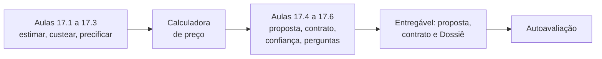
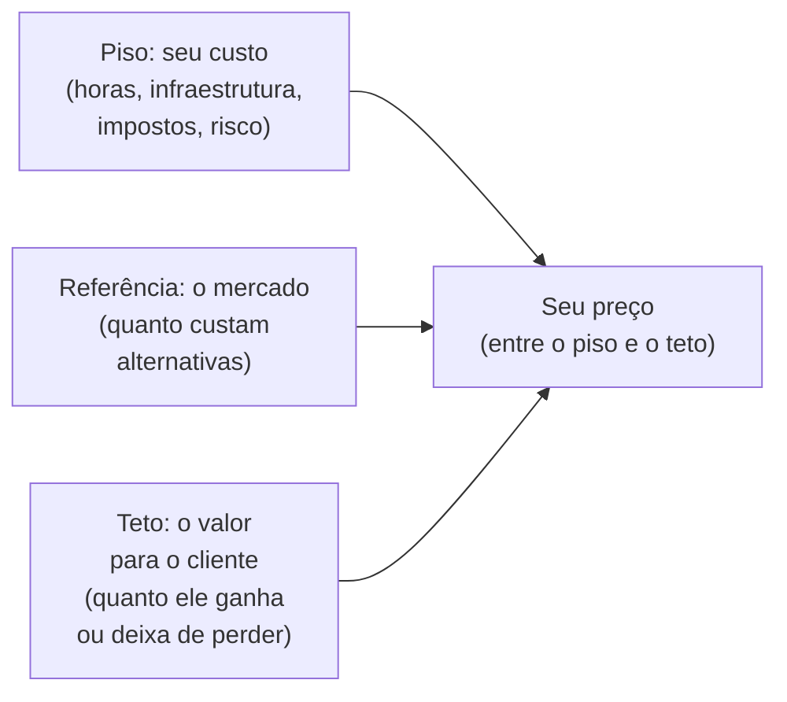
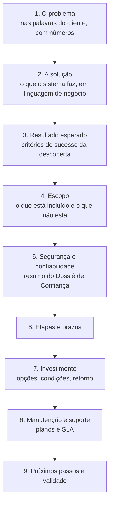
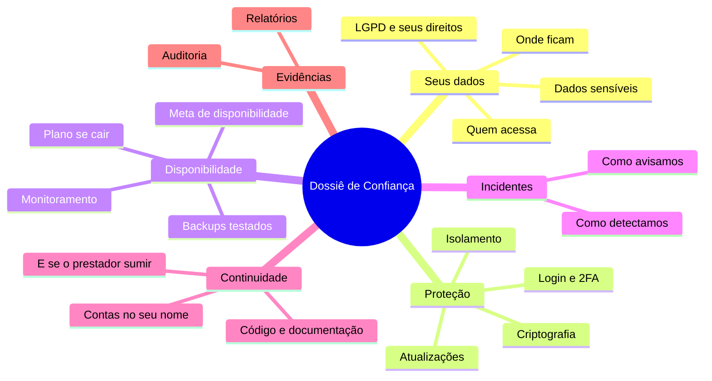
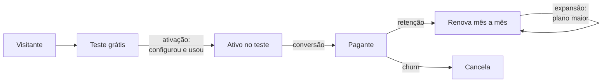

# Módulo 17: Precificar, vender e explicar a confiança

**Semanas 35 e 36 · cerca de 22 horas**

## Objetivos de aprendizagem

Você aprendeu a construir sistemas seguros e robustos. Agora falta a parte que paga as contas: **saber quanto custa, quanto cobrar e como convencer o cliente de que vale**. Com IA, o código sai mais rápido, e muita gente comete o erro de cobrar só pelas horas de digitação. Mas o cliente não paga por linhas de código: paga por um problema resolvido, com segurança, que não cai e que tem quem cuide. Este módulo ensina a estimar, precificar, montar a proposta e o contrato, e a **explicar por que o seu sistema é confiável**, com o Dossiê de Confiança e as respostas às perguntas difíceis.

Ao final deste módulo você será capaz de:
1. Estimar o esforço de um sistema com método, considerando o que a IA acelera e o que não acelera.
2. Calcular o seu custo real: valor-hora, infraestrutura por cliente, ferramentas, impostos e riscos.
3. Escolher o modelo de preço adequado (projeto, mensalidade, SaaS) e precificar pelo valor.
4. Montar uma proposta comercial e conhecer os pontos essenciais do contrato.
5. Produzir o Dossiê de Confiança de um sistema.
6. Responder às perguntas difíceis do cliente e entender as métricas de um SaaS em escala.

### Como estudar este módulo

*Figura: do cálculo do preço à proposta, ao contrato e ao discurso de confiança.*

| Semana | O que fazer | Horas |
|---|---|---|
| 35 | Aulas 17.1 a 17.3, calculadora, exercícios 1 a 3 | 11 |
| 36 | Aulas 17.4 a 17.6, exercícios 4 e 5, entregável, autoavaliação | 11 |

> ⚖️ **Aviso:** impostos, enquadramento da empresa (MEI, Simples Nacional, outros regimes) e redação de contratos dependem da sua situação e da legislação vigente. Valide com um **contador** (impostos e enquadramento) e um **advogado** (contratos). Esta aula ensina o que perguntar e o que não pode faltar.

---

## Aula 17.1: Estimar o esforço, mesmo com IA

"Quanto tempo leva?" é a pergunta que sustenta o preço e o prazo. Com IA, a tentação é responder "o Claude faz em uma semana". Só que **escrever código é só uma parte** do trabalho de entregar um sistema, e muitas vezes não é a maior. Estimar bem é proteger a sua margem e a sua reputação.

### O que a IA acelera e o que não acelera

| Atividade | Com o Claude | Observação |
|---|---|---|
| Escrever código de funcionalidades bem especificadas | **Muito mais rápido** | É onde a IA mais ajuda |
| Escrever testes | Muito mais rápido | Mas você precisa ler e conferir as regras |
| Documentação, ADRs, runbooks | Mais rápido | Revisão continua sua |
| Descoberta, entrevistas, alinhamento com o cliente | **Igual** | Depende de pessoas e agendas |
| Decisões de negócio, aprovações, validações | **Igual** | O cliente demora o tempo dele |
| Revisão de código e de segurança | Parcialmente | A responsabilidade e a leitura são suas |
| Configuração de contas e fornecedores (WhatsApp, pagamentos, domínio) | **Igual** | Verificações e aprovações de terceiros levam dias |
| Migração e limpeza de dados do cliente | Um pouco mais rápido | Dados reais são bagunçados |
| Treinamento, suporte na implantação | **Igual** | |
| Retrabalho por mudança de ideia | Mais rápido de refazer | Mas acontece, e precisa estar no preço |

> 🎯 Em um projeto típico de sistema para uma PME, a parte "escrever código" pode ser menos da metade do esforço total. A IA reduz muito essa parte; o resto continua. Estime **tudo**.

### O método: decompor, estimar em faixa, somar e multiplicar o risco

**1. Decomponha** a especificação em pacotes de trabalho pequenos (a lista de histórias do Módulo 4 é o ponto de partida), mais as atividades que não são funcionalidades:

| Pacote | Exemplos |
|---|---|
| Descoberta e especificação | Entrevistas, especificação, aprovação |
| Base do sistema | Projeto, login, permissões, multi-empresa, auditoria |
| Funcionalidades | Cada história ou grupo de histórias |
| Integrações | Pagamento, WhatsApp, e-mail, nota fiscal (cada uma com configuração de conta) |
| Infraestrutura | Domínio, hospedagem, CI/CD, monitoramento, backups |
| Segurança | Auditoria, correções |
| Dados | Importação e limpeza |
| Implantação | Treinamento, acompanhamento, ajustes da primeira semana |
| Gestão | Reuniões, relatórios, comunicação |

**2. Estime cada pacote em faixa** (otimista, provável, pessimista), em horas suas, já considerando que você trabalha com o Claude. Use o seu histórico: quanto tempo o login multi-empresa levou no Gestor? O seu diário é a melhor fonte.

**3. Calcule o valor esperado** de cada pacote, uma fórmula clássica de estimativa:

```text
esperado = (otimista + 4 × provável + pessimista) ÷ 6
```

**4. Some e aplique um multiplicador de risco** conforme a incerteza do projeto:

| Situação | Multiplicador |
|---|---|
| Sistema parecido com algo que você já fez (reaproveita a base) | 1,1 a 1,2 |
| Novo para você, especificação clara | 1,3 a 1,5 |
| Especificação vaga, cliente indeciso, integrações desconhecidas | 1,5 a 2,0 (ou faça uma etapa de descoberta paga antes) |

### Exemplo completo: estimando a Ótica Visão Clara

| Pacote | Otimista | Provável | Pessimista | Esperado |
|---|---|---|---|---|
| Descoberta e especificação | 6 | 10 | 16 | 10,3 |
| Base (reaproveitada do Gestor, adaptada) | 6 | 10 | 18 | 10,7 |
| Vendas com receita, pedidos, status | 10 | 16 | 28 | 17,0 |
| Saldo a receber e baixas | 6 | 10 | 16 | 10,3 |
| WhatsApp (modelos, conta, envio, status) | 8 | 14 | 30 | 15,7 |
| Infraestrutura e monitoramento | 4 | 6 | 10 | 6,3 |
| Segurança (auditoria e correções) | 4 | 6 | 10 | 6,3 |
| Importação de clientes (planilha) | 2 | 4 | 10 | 4,7 |
| Treinamento e implantação | 4 | 6 | 10 | 6,3 |
| Gestão e reuniões | 4 | 6 | 10 | 6,3 |
| **Soma** | | | | **93,9 h** |
| **× 1,2** (base reaproveitada) | | | | **≈ 113 h** |

Repare que o WhatsApp tem a faixa mais larga (8 a 30 horas): a verificação da conta e a aprovação dos modelos dependem da Meta e do cliente. É honesto refletir isso.

> 💡 **Use o Claude para decompor, não para adivinhar horas.** *"Decomponha esta especificação em pacotes de trabalho, incluindo atividades que não são código (descoberta, configuração de contas de terceiros, migração de dados, treinamento, gestão). Para cada pacote, liste os riscos que podem fazê-lo demorar mais."* As horas vêm do **seu** histórico.

> 📌 **Em resumo**
> - A IA acelera muito o código e pouco o resto: descoberta, decisões, contas de terceiros, dados, treinamento.
> - Decomponha em pacotes (inclusive os que não são código), estime em faixa, calcule o esperado e aplique um multiplicador de risco.
> - O seu diário de decisões e horas é a melhor fonte de estimativas.
> - Projetos muito incertos começam com uma descoberta paga.

### Para ir além
- [Planning Poker (Mountain Goat Software, em inglês)](https://www.mountaingoatsoftware.com/agile/story-points/planning-poker): uma técnica de estimativa em equipe.

---

## Aula 17.2: O seu custo real

Antes de saber quanto cobrar, saiba quanto **custa** você trabalhar. Quem não calcula o próprio custo cobra o que "parece justo" e, meses depois, descobre que estava pagando para trabalhar.

### O seu valor-hora mínimo

```text
custo mensal para existir profissionalmente
= sua retirada desejada (o "salário" que você quer)
+ custos fixos do negócio (ferramentas, assinaturas, contador, equipamento, internet)
+ reservas (férias, 13º, doença, períodos sem cliente)

horas vendáveis por mês
= horas de trabalho no mês × percentual que vira cobrança
  (o resto vai para vender, estudar, administrar, suporte não cobrado)

valor-hora mínimo = custo mensal ÷ horas vendáveis
```

**Horas vendáveis** é onde iniciantes erram mais. De 160 horas de trabalho no mês, é comum que só 50% a 70% sejam cobráveis. O resto é prospecção, propostas, reuniões não pagas, estudo, administração.

### Os custos que entram no preço de cada cliente

| Custo | Exemplo | Como entra |
|---|---|---|
| **Suas horas** | Desenvolvimento, gestão, suporte | Valor-hora × horas estimadas |
| **Infraestrutura** | Hospedagem, banco, monitoramento, backups externos | Repasse ou embutido na mensalidade (Aula 6.5) |
| **Custos variáveis por uso** | Mensagens de WhatsApp, e-mails, IA, emissão de notas | Repasse com margem, ou limite por plano |
| **Ferramentas suas** | Assinatura do Claude, GitHub, ferramentas de erro, gerenciador de senhas | Rateio entre os clientes (nos custos fixos) |
| **Impostos** | Sobre o faturamento (conforme o regime) | **Por cima** do preço, não por dentro do seu lucro |
| **Taxas de recebimento** | Taxa do provedor quando o cliente paga você | Considerar |
| **Risco** | Imprevistos, retrabalho | No multiplicador da estimativa e na reserva |

### Impostos: pergunte ao contador

O imposto incide sobre o **faturamento**, e o percentual depende do regime da sua empresa e da atividade. Pontos a levar ao contador:
- Qual o enquadramento adequado para desenvolvimento de software e serviços de manutenção e hospedagem.
- Qual a alíquota efetiva estimada sobre o faturamento.
- Se SaaS (licenciamento e cessão de uso de software) tem tratamento diferente de desenvolvimento sob encomenda.
- Como emitir as notas fiscais dos seus serviços.
- Os efeitos da reforma tributária em implantação.

> ⚠️ Alguns enquadramentos simplificados têm restrições de atividades e de faturamento; não presuma que se aplicam a você. **Confirme com o contador antes de fechar o primeiro contrato.**

### Exemplo completo: o custo do Gestor por empresa

Usando a estimativa de infraestrutura da Aula 6.5 e um volume de 50 empresas:

| Item (mensal) | Total | Por empresa |
|---|---|---|
| Infraestrutura fixa (aplicação, banco, monitoramento, backups) | ___ | ___ |
| Mensagens de WhatsApp (média) | ___ | ___ |
| E-mails e IA (média) | ___ | ___ |
| Suas horas de operação e suporte (ex.: 20 h × valor-hora) | ___ | ___ |
| Rateio de ferramentas | ___ | ___ |
| Taxa do provedor de pagamento sobre a assinatura | | ___% |
| **Custo por empresa** | | **___** |

O preço da assinatura precisa ficar **bem acima** desse custo, para cobrir impostos, o tempo de vendas, o crescimento e o lucro (Aula 17.3). A [calculadora de preço](templates/calculadora-de-preco.md) organiza tudo isso.

> 📌 **Em resumo**
> - Calcule o seu valor-hora mínimo a partir do custo de existir profissionalmente e das horas realmente vendáveis.
> - Inclua no preço: horas, infraestrutura, custos por uso, ferramentas, impostos, taxas e risco.
> - Impostos incidem sobre o faturamento e entram por cima do preço; confirme o enquadramento com o contador.
> - No SaaS, calcule o custo por empresa antes de definir o preço da assinatura.

---

## Aula 17.3: Modelos de preço e preço pelo valor

Agora que você sabe o seu custo, decida **como** cobrar. O modelo de preço muda o seu fluxo de caixa, o risco de cada lado e o tipo de relação com o cliente. E o **valor** do sistema para o cliente (não as suas horas) é o que define o teto do preço.

### Os modelos

| Modelo | Como funciona | Bom para você quando | Bom para o cliente quando | Risco principal |
|---|---|---|---|---|
| **Projeto fechado** | Preço fixo por um escopo definido | O escopo é claro e você estima bem | Quer previsibilidade | Escopo crescer sem controle (Aula 17.4) |
| **Por hora** | Cobra as horas trabalhadas | Escopo incerto, melhorias contínuas | Quer pagar só pelo que usar | Cliente acha caro e controla cada minuto; você é punido por ser rápido com IA |
| **Implantação + mensalidade** | Valor inicial menor + mensalidade (manutenção, hospedagem, evolução) | Você quer receita recorrente | Não tem caixa para o projeto inteiro | Precisa de contrato de permanência mínima |
| **SaaS (assinatura)** | Mensalidade por plano, por usuário ou por uso | Vende o mesmo sistema para muitos | Quer começar barato e sem compromisso longo | Precisa de muitos clientes para pagar o desenvolvimento |
| **Descoberta paga** | Valor fixo pela etapa de descoberta e especificação | Projeto incerto | Quer um plano antes de decidir | Cliente usar a especificação com outro (aceitável: foi pago) |

> 🎯 **Com IA, cobrar só por hora é ruim para você.** Se você entrega em 40 horas o que outro entrega em 200, cobrar por hora transfere todo o ganho de produtividade para o cliente. Prefira **projeto fechado com escopo bem definido** ou **implantação + mensalidade**, e precifique pelo valor.

### Preço pelo valor

O preço tem três referências:


*Figura: as três referências do preço. O custo é o piso, o valor para o cliente é o teto, e o mercado ajuda a posicionar.*

- **Piso:** abaixo dele você perde dinheiro.
- **Teto:** o valor que o sistema gera. Você descobriu na entrevista de descoberta (Aula 4.1): "quanto essa dor custa por mês?".
- **Mercado:** o que custam as alternativas (um SaaS pronto, outro desenvolvedor, continuar na planilha).

Exemplo: a Ótica Visão Clara perde, pelas contas da dona, 8 clientes por mês por óculos esquecidos no laboratório, com ticket médio de R$ 600: cerca de R$ 4.800 por mês. Um sistema que resolve isso vale, para ela, dezenas de milhares de reais ao longo de um ano. O seu custo (113 horas × valor-hora + infraestrutura) pode ser bem menor que isso. Seu preço pode ficar entre os dois, e a dona ainda faz um ótimo negócio.

> 💡 **Mostre a conta para o cliente.** Na proposta: "pelas suas estimativas, a perda atual é de cerca de R$ 4.800 por mês. O investimento se paga em ___ meses." Isso desloca a conversa de "está caro" para "quando começa".

### Precificando um SaaS

| Decisão | Opções | Dica |
|---|---|---|
| **Métrica de cobrança** | Por empresa (plano fixo), por usuário, por uso (mensagens, notas), híbrido | Escolha algo que cresce junto com o valor que o cliente recebe |
| **Planos** | 2 a 4 planos com limites claros | O do meio deve ser o "certo" para a maioria |
| **Período** | Mensal e anual (com desconto) | Anual melhora o seu caixa e reduz cancelamentos |
| **Teste grátis** | 7 a 30 dias | Com ajuda ativa na configuração (onboarding) |
| **Implantação** | Gratuita (autoatendimento) ou paga (com configuração e importação) | Clientes maiores valorizam implantação assistida |
| **Custos variáveis** | Incluídos até um limite, cobrados acima | Protege a margem (Aula 6.5, 11.6) |

### Exemplo completo: três formas de cobrar a ótica

| Proposta | Estrutura | Para a ótica | Para você |
|---|---|---|---|
| A · Projeto fechado | R$ ___ à vista ou em 3x + plano de manutenção Profissional opcional | Investimento maior no início | Bom caixa; recorrência depende do plano |
| B · Implantação + mensalidade | R$ ___ de implantação + R$ ___/mês (manutenção, hospedagem, 4 h de melhorias), permanência de 12 meses | Entrada menor, custo previsível | Recorrência garantida; valor total maior ao longo do tempo |
| C · Licença do seu SaaS para óticas | R$ ___/mês por loja, sem implantação | Mais barato e rápido | Só faz sentido se você já tem (ou vai ter) o produto para óticas |

Apresentar **duas opções** (por exemplo, A e B) costuma funcionar melhor que uma só: o cliente escolhe *como* contratar, não *se* contrata.

> 📌 **Em resumo**
> - Modelos: projeto fechado, por hora, implantação + mensalidade, SaaS, descoberta paga.
> - Com IA, cobrar só por hora transfere seu ganho de produtividade para o cliente.
> - O preço fica entre o seu custo (piso) e o valor para o cliente (teto), posicionado pelo mercado.
> - No SaaS, cobre por uma métrica que cresce com o valor, com planos claros e custos variáveis protegidos.

---

## Aula 17.4: A proposta comercial e o contrato

A proposta é o documento que fecha o negócio; o contrato é o que protege os dois lados quando surgir uma divergência (e vai surgir). Uma proposta clara evita metade dos conflitos; um contrato bem feito resolve a outra metade.

### A estrutura da proposta

O modelo completo está em [templates/proposta-comercial.md](templates/proposta-comercial.md). As seções, na ordem que convence:


*Figura: a estrutura da proposta comercial. Ela começa pelo problema do cliente e só chega ao preço depois de mostrar o valor e a segurança.*

Princípios:
- **O cliente precisa se reconhecer na primeira página.** Use as palavras e os números que ele disse na descoberta.
- **Escopo explícito**, com o que **não** está incluído. Isso protege você mais do que qualquer cláusula.
- **Segurança como seção própria**: é diferencial, e responde ao medo do cliente antes de ele perguntar.
- **Validade da proposta** (por exemplo, 15 dias), porque custos e agenda mudam.

### Mudanças de escopo: o controle que salva projetos

Todo projeto recebe pedidos de mudança ("e se também tivesse..."). Sem um processo, o escopo cresce e o preço não. O processo:
1. O pedido é registrado.
2. Você avalia o impacto (horas, prazo, riscos) e responde por escrito: "isso não está no escopo; custa ___ e adiciona ___ dias. Incluímos agora, deixamos para a versão 2, ou trocamos por algo do escopo?".
3. Só executa depois da aprovação por escrito.
4. A especificação é atualizada.

Esse processo está na proposta e no contrato. Apresente-o como **proteção do cliente** ("assim você sempre sabe quanto vai pagar"), não como burocracia.

### Os pontos essenciais do contrato

O modelo de base está em [templates/contrato.md](templates/contrato.md). **Ele é um roteiro de cláusulas para levar a um advogado**, não um contrato pronto. O que não pode faltar:

| Cláusula | O que define |
|---|---|
| **Objeto e escopo** | O que será entregue, referenciando a especificação aprovada |
| **Mudanças de escopo** | O processo acima |
| **Prazos e dependências do cliente** | Prazos contam a partir das entregas do cliente (aprovações, acessos, dados); atrasos dele estendem os seus |
| **Aceite** | Como e em quanto tempo o cliente valida cada entrega; silêncio após o prazo vale como aceite |
| **Pagamento** | Valores, parcelas, vencimentos, multa e juros por atraso, suspensão por inadimplência |
| **Garantia** | Prazo e o que cobre (defeitos em relação à especificação) |
| **Manutenção e SLA** | Plano contratado e SLA anexo (ou contrato próprio) |
| **Propriedade intelectual** | Cessão, licença ou SaaS (Aula 16.6); direito de reaproveitar sua base |
| **Proteção de dados (LGPD)** | Papéis (controlador e operador), instruções, medidas de segurança, suboperadores, aviso de incidentes com prazo, devolução ou eliminação dos dados no fim |
| **Confidencialidade** | Os dois lados protegem informações um do outro |
| **Limitação de responsabilidade** | Teto de responsabilidade (por exemplo, valores pagos nos últimos 12 meses), exclusão de danos indiretos, nos limites da lei |
| **Responsabilidades do cliente** | Uso adequado, guarda de senhas, remoção de usuários desligados, conteúdo que ele insere |
| **Vigência, rescisão e transição** | Prazo, aviso prévio, entrega de acessos, dados e documentação, período de apoio |
| **Foro** | Onde se resolvem disputas |

> ⚖️ Limitação de responsabilidade, propriedade intelectual e LGPD são as cláusulas em que um advogado mais agrega. O custo de uma revisão profissional do seu modelo de contrato é pequeno perto do risco de um contrato mal feito. Faça uma vez, bem, e reutilize.

### SaaS: termos de uso e política de privacidade

Para o seu SaaS, em vez de um contrato negociado com cada cliente, você publica:
- **Termos de uso**: regras do serviço, planos, pagamento, suspensão, cancelamento, exportação de dados, limitação de responsabilidade, SLA (se houver).
- **Política de privacidade**: quais dados você trata (dos assinantes e, como operador, dos clientes deles), para quê, com quem compartilha, por quanto tempo, como exercer direitos.
- **Acordo de tratamento de dados**: para clientes que pedem (comum em empresas maiores), formalizando você como operador.

O aceite é registrado no cadastro (data, hora, versão dos termos): isso é evidência, inclusive para contestações de pagamento (Aula 10.1).

### Exemplo completo: a proposta da ótica, em resumo

1. **Problema:** "40 óculos prontos parados no laboratório; clientes reclamando; cerca de R$ 4.800 por mês em vendas perdidas e dinheiro parado."
2. **Solução:** registro de vendas com receita, acompanhamento dos pedidos, aviso automático no WhatsApp quando o óculos fica pronto, saldo a receber.
3. **Resultado esperado:** nenhum óculos pronto parado mais de 2 dias sem aviso; saldo a receber visível em tempo real.
4. **Escopo:** v1 com 5 funcionalidades; fora do escopo: comissões, integração com laboratório, app para o cliente (previstos para a v2).
5. **Segurança:** dados de saúde (receitas) com acesso restrito e registrado; backup diário testado; domínio e contas no nome da ótica.
6. **Etapas:** descoberta concluída; desenvolvimento em 5 semanas; implantação na 6ª.
7. **Investimento:** opção A e opção B, com o retorno estimado.
8. **Manutenção:** planos Essencial e Profissional, SLA anexo.
9. **Próximos passos:** aprovação, contrato, início. Validade: 15 dias.

> 📌 **Em resumo**
> - A proposta começa pelo problema do cliente, mostra solução, resultado, escopo (com o que não está incluído), segurança, prazos, investimento e manutenção.
> - Mudanças de escopo seguem um processo escrito, apresentado como proteção do cliente.
> - O contrato precisa de escopo, aceite, pagamento, garantia, propriedade intelectual, LGPD, limitação de responsabilidade e transição; revise com um advogado.
> - No SaaS, termos de uso, política de privacidade e aceite registrado.

---

## Aula 17.5: O Dossiê de Confiança

Esta aula é a resposta direta à segunda parte do seu pedido: **saber explicar por que o sistema é de confiança**. O **Dossiê de Confiança** é um documento curto, em linguagem de dono de empresa, que explica onde os dados ficam, quem acessa, como são protegidos, o que acontece se o sistema cair e quem é dono de quê. Ele é entregue na proposta (resumido) e na entrega (completo).

### Por que um documento, e não uma conversa

- O cliente **mostra** para o sócio, o contador, o advogado, o filho que "entende de computador".
- Ele **responde** às perguntas antes de serem feitas.
- Ele é **verificável**: cada afirmação tem um controle e uma evidência por trás (Módulos 13 a 15).
- Ele **diferencia**: quase nenhum concorrente pequeno entrega algo parecido.

### A estrutura

O modelo completo está em [templates/dossie-de-confianca.md](templates/dossie-de-confianca.md).


*Figura: as seções do Dossiê de Confiança. Cada ramo responde a um medo concreto do cliente.*

### Como escrever: as três regras

**1. Linguagem do cliente.** Não escreva "RLS no PostgreSQL com políticas por tenant". Escreva: "cada empresa só enxerga os próprios dados; essa separação é garantida pelo sistema **e** pelo próprio banco de dados, e é testada automaticamente a cada atualização".

**2. Só o que é verdade, com evidência.** Cada afirmação aponta para um controle que existe e um teste ou relatório:

| Afirmação no Dossiê | Evidência (com você, para mostrar se pedirem) |
|---|---|
| "Backup diário, com cópia em outro provedor" | Configuração + relatório de backups do mês |
| "Restauração testada a cada trimestre" | Relatório da última restauração, com data e tempo |
| "Disponibilidade dos últimos 6 meses: 99,9%" | Relatório do monitoramento externo |
| "Senhas nunca são guardadas" | Configuração da biblioteca de login |
| "Funcionário desligado perde o acesso na hora" | Teste automatizado + demonstração |

**3. Honestidade sobre limites.** Inclua uma seção "O que nenhum sistema garante": não existe segurança 100%; o sistema depende de fornecedores (com os nomes); as senhas e os dispositivos dos usuários são responsabilidade da empresa. Paradoxalmente, isso **aumenta** a confiança: mostra que você não está vendendo milagre.

### Uma página de resumo, para a proposta

```text
COMO PROTEGEMOS O SEU SISTEMA E OS SEUS DADOS

🔒 Seus dados ficam em servidores de [provedor] na região de [região], com
   criptografia no caminho e no armazenamento.
👥 Cada pessoa vê só o que o cargo dela permite. Quem sai da empresa perde o
   acesso no mesmo instante. Administradores entram com verificação em duas etapas.
🧾 Toda ação importante fica registrada: quem fez, o quê e quando.
💾 Backup todo dia, com cópia em outro provedor. Testamos a restauração a cada
   3 meses. Perda máxima prevista: [RPO].
📈 Monitoramento 24 horas: sabemos de um problema antes de você. Meta de
   disponibilidade: [SLA]%. Volta ao ar em até [RTO] no pior cenário.
🛡️ Atualizações de segurança aplicadas em até [prazo].
⚖️ Tratamos os dados conforme a LGPD, como operador da sua empresa.
🔑 O domínio, as contas de pagamento e de WhatsApp ficam no nome da sua empresa.
   O código e a documentação permitem que outro profissional assuma, se um dia precisar.
```

### Exemplo completo: o Dossiê vencendo uma concorrência

A Distribuidora Ramos recebeu duas propostas para o ERP: a sua e a de uma agência maior, 15% mais barata. O dono pediu às duas: "como eu sei que é seguro?". A agência respondeu: "usamos as melhores tecnologias e servidores seguros". Você enviou o Dossiê de 4 páginas, com a página de resumo, o relatório da última restauração de outro cliente (anonimizado) e o histórico de disponibilidade.

O dono mostrou os dois para o contador, que perguntou à agência: "e o backup, já foi testado? em quanto tempo volta?". A agência não soube responder. Você fechou o contrato, pelo seu preço.

> 📌 **Em resumo**
> - O Dossiê de Confiança explica dados, proteção, disponibilidade, incidentes, continuidade e evidências, em linguagem de cliente.
> - Só afirme o que é verdade, com controle e evidência por trás.
> - Seja honesto sobre limites: isso aumenta a confiança.
> - Uma página de resumo vai na proposta; o documento completo vai na entrega.

---

## Aula 17.6: As perguntas difíceis do cliente, e o SaaS em escala

Na reunião de venda, o cliente vai testar você com perguntas difíceis. Quem gagueja perde; quem responde com calma, números e honestidade ganha. Esta aula reúne as perguntas que mais aparecem e termina com o que você precisa saber para vender sistemas em escala.

### As perguntas difíceis

O banco completo de respostas está em [templates/perguntas-dificeis-do-cliente.md](templates/perguntas-dificeis-do-cliente.md). As principais:

| Pergunta | O que está por trás | O caminho da resposta |
|---|---|---|
| "E se o sistema cair?" | Medo de parar a operação | Monitoramento, meta de disponibilidade, tempo de volta, histórico (M15) |
| "E se vazar meus dados?" | Medo de prejuízo e de multa | Camadas de proteção, testes, plano de incidente, LGPD (M9, M13, M14) |
| "E se você sumir?" | Medo de ficar refém | Contas no nome dele, código, documentação testada, contrato (M16) |
| "Os dados são meus?" | Medo de perder o controle | Sim; exportação a qualquer momento; contrato (M14, M16) |
| "Por que tão caro se a IA faz tudo?" | Desconfiança do preço | A IA acelera o código; o valor está em descoberta, segurança, testes, operação e responsabilidade (Aula 17.1) |
| "Meu sobrinho faz por menos" | Comparação de preço | Compare o que está incluído: segurança, backup testado, manutenção, SLA, documentação |
| "Precisa mesmo de manutenção?" | Quer economizar | Os 4 tipos, o custo de não manter, o caso do ERP sem manutenção (M16) |
| "Dá para fazer em 2 semanas?" | Pressa | O que dá para entregar em 2 semanas com qualidade (MVP menor), e o que não dá |
| "E se eu quiser mudar depois?" | Medo de ficar preso ao escopo | Processo de mudança, versões, horas de melhoria no plano |

### A forma de responder

1. **Valide a preocupação:** "faz todo sentido se preocupar com isso".
2. **Responda com fatos e números:** "o monitoramento verifica o sistema a cada minuto...".
3. **Mostre a evidência:** "aqui está o relatório do último teste de restauração".
4. **Seja honesto sobre o limite:** "nenhum sistema tem 100%; o que eu garanto é...".
5. **Devolva com uma pergunta:** "quanto tempo fora do ar seria aceitável para a sua operação?" (e isso vira requisito e SLA).

> 💡 **Treine em voz alta.** Peça ao Claude: *"faça o papel de um dono de distribuidora desconfiado, de 58 anos, que já foi enganado por um desenvolvedor. Faça uma pergunta difícil por vez sobre segurança, preço e manutenção, e avalie minha resposta: clareza, honestidade, se usei números e evidências."* Dez minutos por dia durante uma semana mudam a sua segurança na reunião.

### Vendendo sistemas em escala: o que muda no SaaS

Vender o Gestor para 200 empresas é diferente de vender um sistema sob medida. As métricas que você precisa acompanhar:

| Métrica | O que é | Por que importa |
|---|---|---|
| **MRR** (receita recorrente mensal) | Soma das assinaturas ativas no mês | O tamanho real do negócio |
| **Churn** (cancelamento) | % de clientes (ou de receita) que cancelam por mês | Um churn alto anula o crescimento |
| **CAC** (custo de aquisição) | Quanto custa conquistar um cliente (anúncios, tempo de venda, testes grátis) | Precisa ser bem menor que o LTV |
| **LTV** (valor ao longo da vida) | Quanto um cliente paga, em média, enquanto fica | LTV ÷ CAC indica se o negócio para de pé |
| **Ativação** | % dos que testam e realmente começam a usar (cadastram clientes, conectam o WhatsApp) | Quem não ativa não assina |
| **Custo por empresa** | Infraestrutura + suporte por empresa (Aula 17.2) | Define a margem |


*Figura: o funil de um SaaS. Cada seta é uma taxa que você mede e melhora: ativação, conversão, retenção e expansão.*

O que reduz o churn em sistemas de gestão:
- **Implantação ajudada** nos primeiros dias (importar clientes, conectar o WhatsApp, convidar a equipe).
- **Confiabilidade** (o sistema que cai perde clientes; o que tem página de status e comunica bem, retém).
- **Suporte rápido** e base de conhecimento.
- **Exportação fácil de dados** (paradoxalmente, saber que pode sair faz o cliente ficar).
- Ouvir o **motivo do cancelamento** (Aula 10.6) e agir.

### Exemplo completo: a reunião

O dono de uma rede de 3 óticas, indicado pela Ótica Visão Clara, pergunta, em sequência: "quanto custa?", "por que esse valor, se meu sobrinho faz por menos?", "e se cair num sábado?", "e se você sumir?".

Você responde com a calculadora (o retorno estimado), com a comparação do que está incluído, com o SLA do plano e com a lista de contas no nome dele e a documentação de passagem. No fim, ele pergunta: "quando a gente começa?". Essa é a pergunta que mostra que a confiança foi construída.

> 📌 **Em resumo**
> - As perguntas difíceis (cair, vazar, sumir, preço, manutenção, prazo) têm respostas baseadas em tudo o que você construiu.
> - Responda validando, com fatos, evidências, honestidade sobre limites e uma pergunta de volta.
> - Treine em voz alta, inclusive com o Claude no papel de cliente desconfiado.
> - Em SaaS, acompanhe MRR, churn, CAC, LTV e ativação; confiabilidade, implantação ajudada e exportação fácil reduzem o churn.

---

## Exercícios

### Exercício 1: Estime um sistema (60 min)
Decomponha o caso real (Módulo 4) em pacotes de trabalho, incluindo os que não são código, estime em faixa, calcule o esperado e aplique o multiplicador. Compare com o que você teria "chutado" antes desta aula.

### Exercício 2: Seu valor-hora (40 min)
Calcule o seu valor-hora mínimo com a fórmula da Aula 17.2, usando números reais da sua vida. Seja honesto com as horas vendáveis.

<details>
<summary><strong>Resolução comentada (exemplo de raciocínio)</strong></summary>

Suponha: retirada desejada de R$ 8.000; custos fixos do negócio de R$ 1.500 (ferramentas, contador, equipamento rateado, internet); reservas de 25% sobre a retirada (férias, 13º, meses fracos) = R$ 2.000. Custo mensal: R$ 11.500.

Horas de trabalho: 160 por mês. Horas vendáveis: 60% = 96 horas (o resto vai para vender, propostas, estudo, administração, suporte não cobrado).

Valor-hora mínimo = 11.500 ÷ 96 ≈ R$ 120. Isso **antes dos impostos** (que entram por cima, conforme o regime, com o contador) e **antes da margem de lucro e de risco**. Se você vinha cobrando R$ 60 por hora "porque parecia justo", estava trabalhando metade do tempo de graça. E lembre: com IA, você pode (e deve) cobrar por projeto e por valor, não só por hora.
</details>

### Exercício 3: Calculadora de preço (90 min)
Preencha a [calculadora](templates/calculadora-de-preco.md) para (a) o caso real em projeto fechado e em implantação + mensalidade e (b) o Gestor como SaaS com 50 empresas. Confira se o preço da assinatura cobre o custo por empresa com folga.

### Exercício 4: Dossiê do Gestor (90 min)
Escreva o [Dossiê de Confiança](templates/dossie-de-confianca.md) do Gestor e a página de resumo. Para cada afirmação, anote a evidência. Retire qualquer frase que não tenha evidência.

### Exercício 5: Treino de perguntas difíceis (60 min)
Use o prompt da Aula 17.6 para treinar com o Claude no papel de cliente desconfiado. Responda a 10 perguntas, por escrito ou em voz alta (gravando). Reescreva as 3 respostas mais fracas no [banco de respostas](templates/perguntas-dificeis-do-cliente.md).

---

## Tarefa de campo

**Faça uma proposta de verdade.** Para o caso real (ou um cliente novo), monte a proposta completa com a estrutura da Aula 17.4, duas opções de investimento, a página de resumo do Dossiê e os planos de manutenção. Apresente em reunião (presencial ou por vídeo). Anote todas as perguntas e objeções. Peça um retorno honesto, mesmo que a resposta seja "não". Registre no diário: o que funcionou, o que travou, e o que você mudaria.

---

## Entregável: Calculadora, proposta, contrato-base e Dossiê de Confiança

1. [Calculadora de preço](templates/calculadora-de-preco.md) preenchida para o caso real e para o Gestor.
2. [Proposta comercial](templates/proposta-comercial.md) do caso real.
3. Seu [roteiro de contrato](templates/contrato.md), com a lista de pontos para levar ao advogado.
4. [Dossiê de Confiança](templates/dossie-de-confianca.md) do Gestor, com a página de resumo.
5. Seu [banco de respostas às perguntas difíceis](templates/perguntas-dificeis-do-cliente.md).

**Checklist de qualidade:**
- [ ] Estimativa decomposta, com faixas e multiplicador justificado.
- [ ] Valor-hora mínimo calculado com horas vendáveis realistas.
- [ ] Preço entre o custo e o valor para o cliente, com o retorno estimado mostrado.
- [ ] Impostos e enquadramento confirmados (ou pergunta enviada) ao contador.
- [ ] Proposta com problema em palavras do cliente, escopo com exclusões, segurança, prazos, opções e validade.
- [ ] Processo de mudança de escopo escrito.
- [ ] Contrato-base com todas as cláusulas essenciais, marcado para revisão jurídica.
- [ ] Dossiê só com afirmações que têm evidência; seção de limites honestos.
- [ ] Respostas treinadas para as 9 perguntas difíceis.
- [ ] (SaaS) Métricas definidas: MRR, churn, CAC, LTV, ativação.

---

## Autoavaliação

Meta: 8 de 10.

1. O que a IA acelera muito e o que ela quase não acelera em um projeto de sistema?
2. Como calcular o valor esperado de um pacote de trabalho estimado em faixa?
3. Por que as horas vendáveis costumam ser bem menores que as horas trabalhadas?
4. Por que cobrar só por hora é desvantajoso para quem trabalha com IA?
5. Quais são as três referências de preço, e qual define o teto?
6. Como tratar um pedido de mudança de escopo no meio do projeto?
7. Cite 5 cláusulas que não podem faltar no contrato.
8. Quais são as três regras para escrever o Dossiê de Confiança?
9. O cliente pergunta: "por que tão caro se a IA faz tudo?". Como você responde?
10. O que são churn e ativação, e cite duas formas de reduzir o churn de um SaaS de gestão.

<details>
<summary><strong>Gabarito</strong></summary>

1. Acelera muito: escrever código bem especificado, testes, documentação. Quase não acelera: descoberta e alinhamento com o cliente, decisões e aprovações, configuração de contas de terceiros (WhatsApp, pagamento, domínio), migração de dados, treinamento e implantação.
2. Esperado = (otimista + 4 × provável + pessimista) ÷ 6.
3. Porque parte do tempo vai para atividades não cobradas: vender, fazer propostas, reuniões, estudar, administrar, suporte não faturado.
4. Porque o ganho de produtividade vai inteiro para o cliente: quanto mais rápido você entrega, menos recebe. Projeto fechado ou implantação + mensalidade, precificados pelo valor, preservam a sua margem.
5. O seu custo (piso), o mercado (referência) e o valor para o cliente (teto).
6. Registrar o pedido, avaliar o impacto (horas, prazo, riscos), responder por escrito com as opções (incluir com custo, deixar para a versão seguinte, trocar por algo do escopo), executar só após aprovação por escrito e atualizar a especificação.
7. Objeto e escopo (com a especificação); mudanças de escopo; aceite; pagamento e inadimplência; garantia; propriedade intelectual; proteção de dados (LGPD); confidencialidade; limitação de responsabilidade; vigência, rescisão e transição; foro.
8. Linguagem do cliente; só o que é verdade, com evidência; honestidade sobre os limites.
9. Que a IA acelera a escrita do código, o que permite um preço menor do que seria sem ela, mas o valor do trabalho está em entender o problema, desenhar a solução, garantir segurança e testes, operar o sistema com backup e monitoramento e ser responsável por ele. E mostrar o retorno estimado para o negócio dele.
10. Churn é o percentual de clientes (ou receita) que cancela no período; ativação é o percentual dos que testam e realmente começam a usar o sistema. Para reduzir o churn: implantação ajudada, confiabilidade e boa comunicação de incidentes, suporte rápido com base de conhecimento, exportação fácil de dados e agir sobre os motivos de cancelamento.
</details>

---

## Checklist de segurança do módulo

- [ ] O Dossiê não contém detalhes que ajudem um atacante (versões exatas, endereços internos, nomes de usuários administrativos).
- [ ] Toda promessa de segurança na proposta tem controle e evidência.
- [ ] O contrato define os papéis da LGPD e o aviso de incidentes com prazo.
- [ ] Os termos do SaaS preveem exportação de dados e encerramento com aviso.
- [ ] Evidências compartilhadas com clientes (relatórios, auditorias) não expõem dados de outros clientes.

---

## Para aprofundar (opcional)

| Material | Formato | Por que vale |
|---|---|---|
| [Sebrae](https://sebrae.com.br/empreendedores) | Portal, em português | Precificação, contratos e gestão para pequenos negócios |
| [Shape Up](https://basecamp.com/shapeup) | Livro gratuito, em inglês | Definir escopo com prazo e "apetite" de investimento |
| [Lei Geral de Proteção de Dados](https://www.planalto.gov.br/ccivil_03/_ato2015-2018/2018/lei/l13709.htm) | Lei, em português | Base das cláusulas de proteção de dados |
