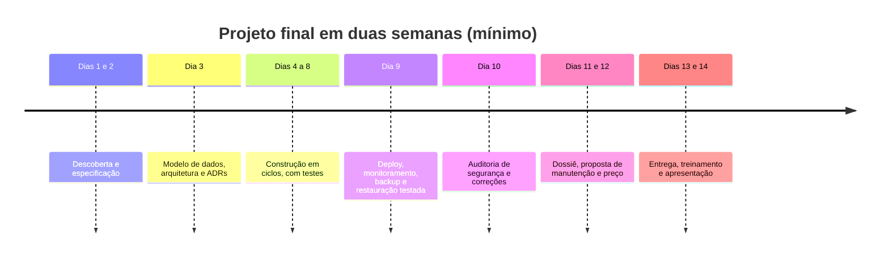

# Projeto final: do zero à produção

**Semanas 37 e 38 · cerca de 30 horas (podendo se estender com o cliente real)**

## Visão geral

O projeto final é a prova de que você consegue fazer, sozinho e com o Claude, o caminho inteiro: **pegar uma necessidade real, transformar em especificação, escolher a estrutura, construir, colocar no ar com segurança, provar que é confiável, precificar e apresentar**. Não é um exercício: é um sistema entregue a alguém de verdade, e o primeiro grande caso do seu portfólio.

Ao final, você terá demonstrado as seis competências da formação:
1. Transformar a necessidade em especificação com escopo, dados e arquitetura.
2. Conduzir o Claude com o método de sênior.
3. Construir um sistema completo e seguro.
4. Colocar no ar e operar com backup testado e monitoramento.
5. Proteger e cumprir a LGPD.
6. Explicar a confiança, oferecer manutenção e cobrar o preço certo.

*Figura: um cronograma mínimo de duas semanas. Com um cliente real, a descoberta e a construção podem levar mais tempo; o cronograma se estende, a qualidade não diminui.*

---

## Escolhendo o projeto

### Opções

| Opção | Exemplo | Vantagem | Cuidado |
|---|---|---|---|
| **A · Cliente real** (recomendada) | Um sistema de atendimento para uma clínica, um financeiro para um escritório, um CRM para uma imobiliária | Vira caso de portfólio real e, muitas vezes, contrato de manutenção | Combine escopo pequeno (MVP) e expectativas: é o seu primeiro projeto completo |
| **B · Sua própria operação** | Um sistema interno que resolve uma dor do seu negócio | Você é o cliente e conhece a dor | Seja tão rigoroso quanto seria com um cliente |
| **C · Um SaaS de nicho** | O Gestor especializado para um setor (óticas, salões, escolas de idiomas) | Primeiro passo para vender em escala | Valide com pelo menos 3 potenciais clientes antes de construir |

### Critérios para um bom projeto final

- [ ] Resolve uma dor concreta, com um critério de sucesso mensurável.
- [ ] Tem login, pelo menos 2 papéis com permissões diferentes e dados pessoais (para exercitar segurança e LGPD de verdade).
- [ ] Tem pelo menos uma integração externa (pagamento, WhatsApp ou e-mail).
- [ ] Cabe em um MVP de 30 a 60 horas de construção.
- [ ] Tem alguém que vai usar de verdade (ou validar, no caso C).

> 💡 **Reaproveite o Gestor.** A base que você construiu (login, papéis, multi-empresa, auditoria, pagamentos, WhatsApp, deploy, monitoramento) é exatamente o que torna o projeto final viável em poucas semanas. Isso é a estratégia de base reutilizável da Aula 1.4 na prática.

---

## As etapas

### Etapa 1 · Descoberta e especificação (Módulo 4)
- Entrevista de descoberta com o roteiro (gravada, com permissão).
- Especificação no [modelo](templates/especificacao.md), com histórias, critérios de aceite, regras numeradas, fluxos com erros, requisitos não funcionais e a seção de segurança e privacidade.
- Fluxos e wireframes validados com o usuário.
- Aprovação por escrito.

### Etapa 2 · Dados e arquitetura (Módulos 5 e 6)
- Modelo de dados com os padrões de sênior (centavos, datas, auditoria, exclusão lógica, `empresaId` se multi-empresa).
- Documento de arquitetura, ADRs (estilo, hospedagem e região, login, integrações), pontos de falha e superfície de ataque.
- Estimativa de custo mensal.

### Etapa 3 · Construção (Módulos 3, 7 a 11)
- CLAUDE.md completo, com as regras inegociáveis.
- Ciclo de sênior em cada funcionalidade: especificação → plano → passos pequenos → testes → revisão → commit, por pull requests.
- Testes de isolamento e de matriz de permissões desde o primeiro dia.
- Integrações com tempo limite, idempotência e webhooks verificados.

### Etapa 4 · Produção (Módulos 12 e 15)
- Homologação e produção separados; domínio do cliente; HTTPS.
- CI obrigatória e deploy com aprovação; rollback ensaiado.
- Monitoramento nas cinco camadas, alertas no celular, página de status (se fizer sentido).
- Backup 3-2-1 e **restauração testada e cronometrada**.

### Etapa 5 · Segurança e LGPD (Módulos 9, 13 e 14)
- Auditoria completa com o [checklist de segurança](templates/checklist-seguranca.md), com evidências.
- Teste manual de ataque com dois papéis (e duas empresas, se multi-empresa).
- Inventário de dados e fornecedores; procedimento de atendimento a titulares.
- [Plano de incidente](templates/plano-de-incidente.md) preenchido com os contatos do cliente.

### Etapa 6 · Negócio (Módulos 16 e 17)
- Preço calculado na [calculadora](templates/calculadora-de-preco.md) (mesmo que o projeto final seja feito com desconto ou de graça para o primeiro cliente, calcule o preço real e mostre o valor).
- [Proposta comercial](templates/proposta-comercial.md) do projeto e do plano de manutenção.
- [Dossiê de Confiança](templates/dossie-de-confianca.md).
- [SLA](templates/sla.md) do plano oferecido.

### Etapa 7 · Entrega e apresentação
- [Checklist de entrega](templates/checklist-entrega.md) completo, com o termo assinado.
- Treinamento dos usuários.
- Apresentação (abaixo).

---

## Critérios de aprovação

O projeto é aprovado quando **todos os critérios obrigatórios** são cumpridos e pelo menos **80% dos pontos** da rubrica.

### Obrigatórios (sem eles, não aprova)

- [ ] O sistema está em produção, em uso (ou validado, no caso C), com HTTPS.
- [ ] Nenhum achado crítico ou alto em aberto na auditoria de segurança.
- [ ] Testes de permissão (e de isolamento, se multi-empresa) cobrindo todas as rotas, passando na CI.
- [ ] Restauração do backup testada, com tempo registrado.
- [ ] Nenhum segredo no repositório; contas essenciais no nome do cliente.
- [ ] Dossiê de Confiança sem afirmações sem evidência.

### Rubrica (100 pontos)

| Critério | Pontos | Excelente (pontos totais) | Insuficiente (zero) |
|---|---|---|---|
| **Especificação** | 10 | Dor e sucesso mensuráveis, histórias com critérios, regras, fluxos com erro, segurança e privacidade, aprovada | Lista de funcionalidades sem critérios |
| **Arquitetura e decisões** | 10 | Estrutura simples e justificada, ADRs honestos, pontos de falha mapeados, custo estimado | Escolhas sem justificativa |
| **Método com o Claude** | 10 | Histórico com PRs pequenos, CLAUDE.md evoluído, testes antes ou junto do código | Commits gigantes, sem revisão |
| **Qualidade e testes** | 15 | Testes de regras, permissões, isolamento, entrada inválida e fluxo crítico; CI obrigatória | Poucos testes ou só caminho feliz |
| **Segurança** | 15 | Auditoria completa com evidências, teste manual, cabeçalhos, limites, uploads e webhooks seguros | Checklist marcado sem evidência |
| **Produção e confiabilidade** | 15 | Deploy automatizado com rollback ensaiado, monitoramento nas 5 camadas, alertas, backup 3-2-1 testado, runbooks | Deploy manual, sem monitoramento |
| **LGPD** | 10 | Inventário, minimização, procedimento de titulares, plano de incidente com contatos | Nenhum documento |
| **Negócio e confiança** | 15 | Preço entre custo e valor, proposta clara, SLA coerente, Dossiê verificável, respostas às perguntas difíceis | Preço "no chute", sem plano de manutenção |

> 🎯 Use o Claude como **avaliador** antes de apresentar: *"Avalie este projeto com a rubrica abaixo, como um avaliador exigente. Para cada critério, dê a nota, justifique com evidências dos arquivos do repositório e diga o que falta para a nota máxima."* Depois, peça a alguém de confiança para avaliar também.

---

## A apresentação (30 minutos)

Apresente para o cliente (e, se possível, para um colega ou mentor), como se fosse uma reunião de entrega:

1. **O problema** (3 min): a dor, nas palavras do cliente, e o critério de sucesso.
2. **A solução ao vivo** (8 min): os fluxos principais, com dados fictícios ou com autorização.
3. **Como garantimos a segurança** (5 min): as camadas, um teste de isolamento ou de permissão rodando, o checklist.
4. **Como garantimos que não cai** (5 min): o painel de monitoramento, o relatório da restauração, o rollback.
5. **Continuidade e manutenção** (4 min): contas no nome do cliente, documentação, plano e SLA.
6. **Perguntas difíceis** (5 min): peça que façam as piores perguntas; responda com o seu banco de respostas.

---

## Entregáveis

Tudo no repositório do projeto (privado), com a pasta `docs/`:
- [ ] `docs/especificacao.md` aprovada.
- [ ] `docs/arquitetura.md` e `docs/decisoes/`.
- [ ] `docs/modelo-de-dados.md`.
- [ ] `docs/deploy.md`, `docs/operacao.md`, `docs/runbooks/`.
- [ ] `docs/seguranca/auditoria-AAAA-MM.md` e `docs/seguranca/backup.md` com o relatório de restauração.
- [ ] `docs/lgpd/inventario.md` e o plano de incidente.
- [ ] CLAUDE.md e `docs/prompts.md`.
- [ ] Proposta, SLA, planos e Dossiê de Confiança (fora do repositório, se contiverem dados comerciais do cliente).
- [ ] Termo de entrega assinado.
- [ ] Caso de portfólio publicado (com autorização do cliente e sem dados reais).
- [ ] Análise final no diário: o que funcionou, o que você faria diferente, o que vai virar padrão nos próximos projetos.

---

## Depois do projeto final

Você terminou a formação quando consegue repetir esse ciclo com um cliente novo, com menos esforço a cada vez. Próximos passos sugeridos:
- **Transforme a base em produto:** cada projeto deixa a sua base reutilizável mais forte.
- **Mantenha a rotina de segurança:** checklist a cada 6 meses, restauração a cada trimestre, simulação de desastre a cada semestre, OWASP Top 10 a cada nova edição.
- **Atualize a stack com método:** revise versões e práticas a cada 6 meses (README, rotina de atualização).
- **Considere um pentest profissional** quando atender dados sensíveis em volume ou muitos clientes.
- **Construa a sua reputação:** o portfólio, as indicações e os relatórios mensais são o seu melhor marketing.
