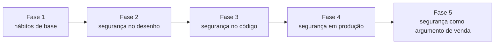

# Trilha contínua: Segurança desde o 1º dia

**Do início ao fim da formação · cerca de 1 hora por semana**

## Por que esta trilha existe

O seu maior medo é construir um sistema para uma empresa e ele **cair** ou **vazar dados**. Esse medo é saudável: são os dois piores acontecimentos na vida de quem constrói sistemas. A boa notícia é que quase todo incidente grave vem de um pequeno número de erros conhecidos, e todos têm prevenção.

O erro que a maioria comete é tratar segurança como uma etapa do fim ("depois a gente deixa seguro"). Nessa hora, o sistema já tem 200 arquivos, e consertar custa dez vezes mais. Esta trilha faz o contrário: **cada módulo da formação tem um checklist de segurança do próprio assunto**, e você cria o hábito desde a primeira semana.

Ao final da trilha você será capaz de:
1. Aplicar um conjunto de regras de segurança em todo projeto, desde o primeiro commit.
2. Fazer com que o Claude siga essas regras automaticamente, por meio do CLAUDE.md e de testes.
3. Montar uma auditoria de segurança de um sistema antes de entregá-lo.
4. Explicar ao cliente, com evidências, o que foi feito para proteger os dados e manter o sistema no ar.

*Figura: a trilha ao longo das fases. A segurança começa como hábito e termina como argumento de venda.*

---

## As 10 regras inegociáveis

Estas regras valem para **todo** sistema que você construir. Elas vão para o CLAUDE.md de cada projeto e para o seu [checklist de segurança](templates/checklist-seguranca.md).

| # | Regra | Protege contra | Onde você aprende |
|---|---|---|---|
| 1 | Toda verificação de permissão acontece no servidor | Usuário burlando a tela | M1, M9 |
| 2 | Toda consulta de dados de negócio filtra pela empresa da sessão | Vazamento entre clientes | M2, M9 |
| 3 | Toda entrada é validada no servidor | Dados corrompidos, injeção | M7, M13 |
| 4 | Segredos só em variáveis de ambiente, nunca no código | Chaves vazadas no GitHub | M1, M2, M14 |
| 5 | Senhas nunca são guardadas; só o resultado de um algoritmo próprio (hash) | Vazamento de senhas | M9 |
| 6 | HTTPS em tudo, com cabeçalhos de segurança | Interceptação, ataques no navegador | M12, M13 |
| 7 | Backup automático **e restauração testada** | Perda de dados | M14, M15 |
| 8 | Bibliotecas atualizadas e auditadas | Falhas conhecidas exploradas | M13 |
| 9 | Registro de quem fez o quê (auditoria) e logs sem dados sensíveis | Não saber o que aconteceu | M7, M14 |
| 10 | Menor privilégio: cada pessoa e cada serviço só acessa o que precisa | Dano grande a partir de um erro pequeno | M9, M12, M14 |

---

## Marcos por fase

### Fase 1 · Hábitos de base (semanas 1 a 6)
- [ ] 2FA ativo no GitHub, no e-mail principal e no gerenciador de senhas.
- [ ] Gerenciador de senhas em uso (Bitwarden, 1Password ou similar): nenhuma senha repetida.
- [ ] `.gitignore` com `.env` antes do primeiro commit em todo projeto.
- [ ] CLAUDE.md do Gestor com as 10 regras.
- [ ] Primeiro teste de isolamento e primeiro teste de permissão escritos.

### Fase 2 · Segurança no desenho (semanas 7 a 12)
- [ ] A especificação do Gestor tem uma seção "Segurança e privacidade": quem acessa o quê, quais dados pessoais são coletados e por quê.
- [ ] Toda tabela de negócio tem `empresaId`.
- [ ] Os dados pessoais e sensíveis estão marcados no modelo de dados.
- [ ] Um ADR registra a decisão de hospedagem considerando segurança e LGPD (onde os dados ficam).

### Fase 3 · Segurança no código (semanas 13 a 22)
- [ ] Toda rota passa pelo checklist de revisão (Aula 3.6).
- [ ] Testes de isolamento cobrem todos os recursos (clientes, oportunidades, cobranças, conversas).
- [ ] Webhooks de pagamento e WhatsApp verificam a assinatura ou token de origem.
- [ ] Nenhum dado pessoal em logs.
- [ ] Limite de tentativas no login.

### Fase 4 · Segurança em produção (semanas 23 a 32)
- [ ] Servidor com firewall, sem login por senha no SSH, atualizações automáticas.
- [ ] Cabeçalhos de segurança configurados e verificados com uma ferramenta externa.
- [ ] Backup automático diário, cópia fora do servidor principal e **uma restauração testada**.
- [ ] Monitoramento que avisa você antes do cliente.
- [ ] Plano de resposta a incidente escrito e ensaiado.
- [ ] Auditoria completa do Gestor com o checklist de segurança, sem pendências críticas.

### Fase 5 · Segurança como argumento de venda (semanas 33 a 36)
- [ ] Dossiê de Confiança do Gestor pronto.
- [ ] Respostas às perguntas difíceis do cliente treinadas em voz alta.
- [ ] SLA e plano de manutenção incluem atualizações de segurança.

---

## O ritual semanal (1 hora)

Toda semana, reserve uma hora para:

1. **Revisar o checklist do módulo atual** (está no fim de cada módulo) e marcar o que já faz.
2. **Ler os alertas** do Dependabot e do secret scanning nos seus repositórios.
3. **Perguntar ao Claude**, em sessão nova: *"revise as mudanças desta semana em busca de falhas de isolamento entre empresas, permissões faltando, validação de entrada e dados sensíveis em logs"*.
4. **Registrar** no diário de decisões o que encontrou e corrigiu.

> 🎯 **A mentalidade:** pergunte em toda funcionalidade "**o que um funcionário mal-intencionado, um concorrente curioso ou um robô na internet fariam com isto?**". Essa pergunta, feita sempre, vale mais que qualquer ferramenta.

---

## O que segurança **não** é

| Mito | Realidade |
|---|---|
| "Meu cliente é pequeno, ninguém vai atacar" | A maioria dos ataques é automática: robôs varrem a internet atrás de qualquer sistema vulnerável, sem escolher alvo |
| "A hospedagem cuida da segurança" | A hospedagem cuida do prédio; a porta do apartamento (seu código, suas permissões) é sua |
| "Coloquei login, está seguro" | Login só diz **quem** é; ainda falta dizer **o que** cada um pode ver (autorização) |
| "Segurança 100%" | Não existe. Existe reduzir a chance, reduzir o dano e saber reagir. É isso que você promete ao cliente |

> ⚖️ **Limite honesto:** esta trilha ensina as práticas que cobrem a grande maioria dos riscos de sistemas de pequenas e médias empresas. Sistemas que lidam com dados de saúde, cartões de crédito armazenados, grandes volumes de dados sensíveis ou exigências regulatórias específicas (bancos, governo) pedem uma avaliação de um profissional de segurança e, muitas vezes, de um advogado especializado em proteção de dados.

---

## Para ir além
- [OWASP Top 10](https://top10.owasp.org/): a lista dos riscos mais críticos em aplicações web (em inglês).
- [OWASP Cheat Sheet Series](https://cheatsheetseries.owasp.org/): guias práticos por assunto (em inglês).
- [ANPD, Autoridade Nacional de Proteção de Dados](https://www.gov.br/anpd/pt-br)
